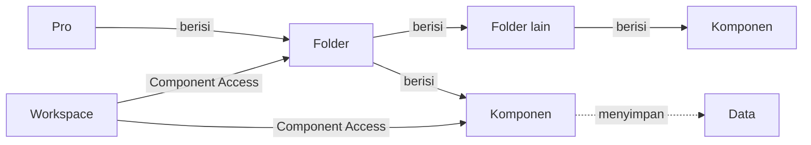

# Apa itu Folder?

>**note** Folder merupakan salah satu konsep dasar di Phoenix, bersama [[Docs/Dasar/Apa itu Pro|Pro]] dan [[Docs/Dasar/Apa itu Komponen|Komponen]]. Folder menata komponen di dalam Pro dan dikelola di [[Docs/Antarmuka#Area Manajemen Folder|Area Manajemen Folder]].

Folder adalah penata di dalam [[Docs/Dasar/Apa itu Pro|Pro]] yang mengelompokkan [[Docs/Dasar/Apa itu Komponen|Komponen]] dan folder lain dalam struktur bertingkat. Folder tidak menyimpan data. Fungsinya mengatur letak komponen dan, bersama [[Docs/Modul Developer/Workspace/Apa itu Workspace|Workspace]], menentukan siapa yang dapat melihat isinya.

Dengan Folder, Anda dapat memisahkan komponen menurut area kerja, tim, atau fungsi sehingga Pro tetap rapi dan mudah dijelajahi saat semakin besar.

## Mengapa Menggunakan Folder?

- **Pro tetap rapi.** Komponen dari modul yang berbeda dapat ditempatkan berdampingan menurut kebutuhan Anda, bukan menurut jenisnya.
- **Mudah ditemukan.** Folder dapat diperluas atau dilipat di [[Docs/Antarmuka#Area Manajemen Folder|Area Manajemen Folder]] sehingga Anda hanya membuka bagian yang dibutuhkan.
- **Akses lebih terarah.** [[Docs/Modul Developer/Workspace/Component Access|Component Access]] dapat diatur pada folder, misalnya menyembunyikan satu folder beserta isinya dari Workspace tertentu.
- **Mudah ditata ulang.** Folder dan komponen dapat dipindahkan atau diurutkan ulang dengan *drag and drop*.

## Konsep Utama

| Istilah | Penjelasan |
| --- | --- |
| [[Docs/Dasar/Apa itu Pro|Pro]] | Wadah tempat seluruh struktur folder berada. |
| [[Docs/Dasar/Apa itu Komponen|Komponen]] | Isi folder. Setiap komponen ditempatkan di dalam sebuah folder. |
| [[Docs/Antarmuka#Area Manajemen Folder|Area Manajemen Folder]] | Bagian antarmuka tempat Anda menelusuri, membuat, dan mengelola folder serta komponen. |
| [[#Folder Root]] | Titik awal struktur folder. Komponen tanpa folder tujuan berada di sini. |
| [[Docs/Dasar/Apa itu Komponen#Membuat Komponen|Directory]] | Bagian pada dialog pembuatan komponen yang menentukan folder tujuan. Dikosongkan berarti letak *root*. |
| [[Docs/Modul Developer/Workspace/Component Access|Component Access]] | Hak akses Workspace pada folder dan komponen: Visible, Add, Update, dan Delete. |
| [[Docs/Modul Developer/Workspace/Apa itu Workspace|Workspace]] | Menentukan folder dan komponen yang tampil serta dapat dikelola oleh anggota. |

## Cara Kerja

### Struktur Bertingkat

Sebuah folder dapat berisi komponen dan folder lain, dan folder di dalamnya dapat berisi lagi komponen dan folder, begitu seterusnya. Di antara semuanya, hanya komponen yang menyimpan data.



Komponen dari modul mana pun dapat berada dalam folder yang sama. Daftar modul dan komponen ada di [[Docs/Dasar/Apa itu Komponen#Modul dan Komponen di Phoenix|Modul dan Komponen di Phoenix]].

<!--

  * [TODO] Kalimat "Komponen dari modul mana pun dapat berada dalam folder yang sama" adalah kesimpulan saya dari diagram relasi Workspace (Folder berisi Komponen) dan contoh folder yang berisi beberapa jenis komponen. Mohon konfirmasi bahwa tidak ada pembatasan jenis komponen per folder.
    Jawaban: Ya betul
  * [DONE] Halaman yang ditautkan dari sini dan belum ada: `Docs/Antarmuka` (anchor Area Manajemen Folder) dan `Docs/Tipe Data/Query`. Daftar usulan halaman lain ada di halaman [[Docs/Dasar/Apa itu Pro]].

-->

### Folder Root

Folder *root* adalah titik awal struktur folder. Saat membuat komponen, Anda dapat mengosongkan [[Docs/Dasar/Apa itu Komponen#Membuat Komponen|Directory]] sehingga komponen berada di *root*. Komponen [[Docs/Modul Data/Variable/Apa itu Variable|Variable]] dibuat otomatis di folder *root* saat [[Docs/Dasar/Apa itu Pro|Pro]] dimulai.

Jika komponen [[Docs/Modul Developer/Workspace/Apa itu Workspace|Workspace]] ditempatkan di folder yang lebih dalam, folder itu menjadi *root* bagi Workspace tersebut.

### Folder dan Hak Akses

Workspace mengatur empat hak akses pada setiap folder lewat [[Docs/Modul Developer/Workspace/Component Access|Component Access]].

| Hak akses | Arti pada folder | Bila [[^value/boolean/disallow]] |
| --- | --- | --- |
| [[Docs/Modul Developer/Workspace/Component Access#Visible pada Folder dan Komponen|Visible]] | Folder tampil di Area Manajemen Folder. | Folder beserta isinya tidak tampil di Area Manajemen Folder dan tidak dapat dibuka. |
| [[^field|Add]] | Menambahkan folder atau komponen baru ke dalam folder ini, termasuk menempatkan folder atau komponen dari folder lain. | Folder ini tidak dapat menjadi tujuan penambahan atau pemindahan. |
| [[^field|Update]] | Mengubah atribut folder. | Atribut folder tidak dapat diubah. |
| [[^field|Delete]] | Menghapus folder, termasuk memindahkannya ke folder lain. | Folder tidak dapat dihapus atau dipindahkan. |

>**note** Visible tidak berjenjang
> Menyembunyikan folder membuat isinya tidak dapat dibuka di Area Manajemen Folder, tetapi komponen di dalamnya yang [[^field|Visible]]-nya [[^value/boolean/allow]] tetap muncul pada pilihan *field* atau [[Docs/Tipe Data/Query|Query]]. Untuk menutup komponen sepenuhnya, atur Visible komponen itu sendiri menjadi [[^value/boolean/disallow]].

## Folder di Area Manajemen Folder

![[Docs/Dasar/area-manajemen-folder.png|Area Manajemen Folder berisi tombol Workspace aktif dan struktur folder beserta komponen]]

<!--

  * [DONE] Sisipkan screenshot Area Manajemen Folder dengan nama file `area-manajemen-folder.png` di folder `Docs/Dasar/`. Anotasi yang disarankan: (1) tombol berisi nama Workspace aktif, (2) folder yang dapat diperluas atau dilipat, (3) komponen di dalam folder, (4) menu klik kanan pada folder.

-->

Penjelasan lengkap area ini ada di [[Docs/Antarmuka#Area Manajemen Folder|Antarmuka]]. Interaksi yang berkaitan dengan folder:

| Fungsi | Aksi |
| --- | --- |
| Memperluas atau melipat isi folder | Klik folder. |
| Membuka halaman kerja komponen | Klik komponen. |
| Menambahkan folder atau komponen | Klik kanan folder ➜ [[^field/add|Add]]. |
| Menghapus komponen | Klik kanan komponen ➜ [[^button/delete|Delete]]. |
| Berpindah Workspace | Klik tombol berisi nama Workspace aktif, lalu pilih Workspace pada popup. |

## Membuat Folder

1. Buka folder tempat folder baru akan ditempatkan di [[Docs/Antarmuka#Area Manajemen Folder]]
2. Klik kanan ➜ [[^field/add|New Folder]]
3. Isi [[^field|Name]]
4. Klik [[^button|Create]]

>**success** Folder berhasil dibuat
> Folder yang baru dibuat masih kosong. Tambahkan [[Docs/Dasar/Apa itu Komponen#Membuat Komponen|komponen]] atau folder lain di dalamnya.

<!--

  * [TODO] Langkah Membuat Folder saya susun dengan mengikuti pola pembuatan komponen. Mohon konfirmasi: (1) jalur menu persisnya (apakah Add ➜ Folder), (2) isian pada dialog (apakah hanya Name atau juga Description), (3) cara membuat folder langsung di *root*, dan (4) apakah ada aturan nama folder (misalnya tidak boleh sama dalam satu folder seperti komponen).
    Jawaban: Sudah saya perbaiki

-->

## Mengubah Nama Folder

1. Buka folder yang berisi folder tersebut di [[Docs/Antarmuka#Area Manajemen Folder]]
2. Klik kanan folder ➜ [[^field/rename|Rename]]
3. Ubah [[^field|Name]]
4. Klik [[^button|Update]]

Perubahan atribut folder memerlukan hak akses [[^field|Update]] pada folder tersebut di [[Docs/Modul Developer/Workspace/Component Access|Component Access]].

<!--

  * [TODO] Langkah Mengubah Folder adalah dugaan karena folder tidak memiliki halaman kerja dan tombol Edit. Mohon konfirmasi apakah perubahan dilakukan lewat menu klik kanan, dan atribut apa saja yang dapat diubah.
    Jawaban: Sudah saya perbaiki

-->

## Memindahkan Folder dan Komponen

Anda dapat memindahkan folder atau komponen ke folder lain, atau hanya mengubah urutannya di folder yang sama, dengan *drag and drop* di halaman kerja [[Docs/Modul Developer/Workspace/Apa itu Workspace|Workspace]].

1. Buka halaman kerja Workspace
2. Tekan dan tahan folder atau komponen yang ingin dipindahkan di kolom kiri
3. Seret ke folder tujuan atau ke posisi baru, lalu lepaskan

| Tujuan | Hak akses yang dibutuhkan |
| --- | --- |
| Memindahkan ke folder lain | [[^field|Delete]] pada folder atau komponen yang dipindahkan dan [[^field|Add]] pada folder tujuan. |
| Mengubah urutan di folder yang sama | Tidak memerlukan [[^field|Add]] maupun [[^field|Delete]]. |

>**note** Pemindahan mengubah struktur Pro
> Struktur folder Pro dan Workspace saling berkesinambungan. Memindahkan folder atau komponen mengubah struktur folder [[Docs/Dasar/Apa itu Pro|Pro]], bukan hanya tampilan halaman kerja Workspace.

>**warning** Izin memindahkan sama dengan izin menghapus
> Anggota yang boleh memindahkan komponen ke folder lain juga boleh menghapus komponen itu karena pemindahan memerlukan [[^field|Delete]]. Berikan hak akses ini dengan hati-hati. Selengkapnya lihat [[Docs/Modul Developer/Workspace/Component Access#Memindahkan Folder atau Komponen|Memindahkan Folder atau Komponen]].

<!--

  * [TODO] Knowledge hanya mengonfirmasi *drag and drop* di halaman kerja Workspace. Mohon konfirmasi apakah Area Manajemen Folder juga mendukung *drag and drop*, dan bagaimana cara memindahkan folder atau komponen ke folder *root*.
    Jawaban: Ya mendukung, pengguna harus menyalakan toggle Move pada bagian atas Area Manajemen Folder.
  * [TODO] Mohon konfirmasi apakah relasi komponen lain (misalnya Query atau Flow Block) tetap terhubung setelah komponen dipindahkan. Belum saya tulis sebagai fakta.
    Jawaban: Ya tetap terhubung

-->

## Menghapus Folder

1. Buka folder yang berisi folder tersebut di [[Docs/Antarmuka#Area Manajemen Folder]]
2. Klik kanan folder ➜ [[^button/delete|Delete]]
3. Konfirmasi dengan klik [[^button|Delete]]

>**warning** Periksa isi folder sebelum menghapus
> Menghapus folder dapat memengaruhi seluruh isinya, yaitu komponen dan folder di dalamnya. Komponen yang hilang membawa datanya dan dapat memutus relasi dari komponen lain. Pindahkan komponen yang masih dibutuhkan ke folder lain terlebih dahulu. Dampak penghapusan tiap komponen ada di [[Docs/Dasar/Apa itu Komponen#Menghapus Komponen|Menghapus Komponen]].

<!--

  * [TODO] Dampak penghapusan folder saya tulis secara hati-hati karena belum ada informasi di knowledge. Mohon konfirmasi: apakah isi folder ikut terhapus atau penghapusan ditolak bila folder tidak kosong, dan apakah ada konfirmasi tambahan.
    Jawaban: Ya sudah betul

-->

## Contoh Penggunaan

**Menata Pro yang terus bertumbuh**

Sebuah perusahaan memulai dengan beberapa komponen, lalu dalam beberapa bulan jumlahnya mencapai puluhan. Tanpa penataan, anggota tim sulit menemukan komponen yang mereka butuhkan. Dengan Folder, setiap area bisnis punya tempat sendiri.

**Struktur yang digunakan**

```
Pro
├── Variables (Variable)
├── Penjualan
│   ├── Daftar Pelanggan (Table)
│   ├── Pesanan (Table)
│   ├── Status Pesanan (Enum)
│   └── Pantau Pesanan (Table View)
├── Keuangan
│   ├── Tagihan (Table)
│   └── Laporan Bulanan (Canvas)
└── Otomasi
    └── Notifikasi Pesanan Baru (Flow)
```

**Alasan penataan**

| Folder | Isi | Manfaat |
| --- | --- | --- |
| [[^field/folder|Penjualan]] | Table, Enum, dan Table View untuk pencatatan dan pemantauan pesanan. | Tim penjualan menemukan semua komponen kerjanya di satu tempat. |
| [[^field/folder|Keuangan]] | Table dan Canvas untuk tagihan dan laporan. | Folder dapat disembunyikan dari Workspace tim lain lewat [[^field|Visible]]. |
| [[^field/folder|Otomasi]] | Flow yang menghubungkan data dan sistem lain. | Logika otomasi terpisah dari data dan tampilan sehingga mudah ditinjau. |

**Hasil yang dirasakan**

- Anggota baru cepat memahami isi Pro karena struktur mengikuti area bisnis.
- Folder yang tidak relevan dapat disembunyikan per Workspace tanpa memengaruhi data.
- Komponen dapat dipindahkan antarfolder saat struktur organisasi berubah, tanpa membuat ulang komponen.

**Ide skenario lain**

| Pola penataan | Contoh |
| --- | --- |
| Per tim | Satu folder untuk setiap tim, dipetakan ke Workspace tim lewat [[Docs/Modul Developer/Workspace/Component Access|Component Access]]. |
| Per aplikasi | Satu folder untuk setiap sistem yang dibangun, berisi Table, Form, dan Flow yang saling terhubung. |
| Per siklus | Folder arsip untuk komponen yang sudah tidak dipakai tetapi datanya masih perlu disimpan. |

Dengan penataan yang konsisten, folder menjadi peta Pro sekaligus batas akses yang mudah diatur.

<!--

  * [TODO] Nama folder dan komponen pada Contoh Penggunaan adalah nama generik buatan saya. Mohon sesuaikan bila ada contoh yang lebih mewakili.
    Jawaban: Kalau boleh saran dibandingkan penggunaan pada kasus khusus, lebih baik buat skema rekomendasi bagaimana membuat struktur yang tepat.
  * [TODO] Kalimat "tanpa membuat ulang komponen" mengasumsikan pemindahan tidak mengubah isi dan fungsi komponen. Mohon konfirmasi.
    Jawaban: ya betul

-->

## Praktik Terbaik

- Kelompokkan komponen menurut **area kerja atau fungsi bisnis** agar struktur mudah dipahami anggota baru.
- Beri nama yang jelas karena [[^field|Name]] komponen tidak boleh sama dengan komponen sejenis di folder yang sama.
- Jangan menjadikan [[^field|Visible]] pada folder sebagai satu-satunya pengaman. Atur juga Visible pada komponen yang harus tertutup, karena komponen dengan Visible [[^value/boolean/allow]] tetap muncul pada pilihan *field* dan [[Docs/Tipe Data/Query|Query]].
- Berikan hak akses [[^field|Delete]] dan [[^field|Add]] dengan hati-hati karena keduanya memungkinkan pemindahan komponen, dan pemindahan sama dengan izin menghapus.
- Rencanakan penataan sebelum memindahkan komponen [[Docs/Modul Developer/Workspace/Apa itu Workspace|Workspace]] ke folder yang lebih dalam karena folder itu menjadi *root* bagi Workspace tersebut.

>**success** Mulai dari yang sederhana
> Struktur dua tingkat, yaitu folder area bisnis lalu komponen di dalamnya, sudah cukup untuk sebagian besar [[Docs/Dasar/Apa itu Pro|Pro]]. Tambahkan tingkat berikutnya hanya ketika satu folder terasa terlalu ramai.

## Batasan dan Catatan

- Folder tidak menyimpan data. Hanya [[Docs/Dasar/Apa itu Komponen|Komponen]] yang memiliki [[Docs/Modul Developer/Workspace/Data Access|Data Access]].
- [[Docs/Modul Developer/Workspace/Component Access#Visible pada Folder dan Komponen|Visible]] tidak berjenjang. Folder yang disembunyikan tidak otomatis menyembunyikan komponen dari pilihan *field* dan Query.
- Memindahkan ke folder lain memerlukan [[^field|Delete]] pada yang dipindahkan dan [[^field|Add]] pada folder tujuan, sedangkan mengubah urutan di folder yang sama tidak memerlukan keduanya.
- Pemindahan mengubah struktur folder [[Docs/Dasar/Apa itu Pro|Pro]], bukan hanya tampilan halaman kerja.
- Komponen [[Docs/Modul Data/Variable/Apa itu Variable|Variable]] boleh dipindahkan ke folder lain, tetapi tidak dapat ditambah, diduplikasi, atau dihapus.

## TL:DR

- Folder adalah penata di dalam [[Docs/Dasar/Apa itu Pro|Pro]] yang berisi [[Docs/Dasar/Apa itu Komponen|Komponen]] dan folder lain secara bertingkat.
- Folder dikelola di [[Docs/Antarmuka#Area Manajemen Folder|Area Manajemen Folder]] dan tidak menyimpan data.
- Komponen tanpa folder tujuan berada di folder *root*.
- Folder dan komponen dapat dipindahkan dengan *drag and drop* di halaman kerja Workspace.
- [[Docs/Modul Developer/Workspace/Component Access|Component Access]] mengatur Visible, Add, Update, dan Delete pada folder, dan Visible tidak berjenjang.
- Izin memindahkan ke folder lain sama dengan izin menghapus.

## FAQ : Pertanyaan yang Sering Diajukan

> **faq**
> **Apakah folder menyimpan data?**
> Tidak. Folder hanya menata. Data disimpan oleh [[Docs/Dasar/Apa itu Komponen|komponen]] di dalamnya.
> **Apa yang terjadi bila Visible sebuah folder dinonaktifkan?**
> Folder beserta isinya tidak tampil di Area Manajemen Folder pada Workspace tersebut. Komponen di dalamnya yang [[^field|Visible]]-nya [[^value/boolean/allow]] tetap dapat dipilih pada *field* dan [[Docs/Tipe Data/Query|Query]].
> **Dapatkah komponen ditempatkan di luar folder?**
> Komponen tanpa folder tujuan, yaitu [[Docs/Dasar/Apa itu Komponen#Membuat Komponen|Directory]] yang dikosongkan, berada di folder *root*.
> **Mengapa saya tidak dapat memindahkan komponen ke folder lain?**
> Pemindahan memerlukan [[^field|Delete]] pada komponen yang dipindahkan dan [[^field|Add]] pada folder tujuan. Periksa [[Docs/Modul Developer/Workspace/Component Access|Component Access]] pada Workspace Anda.
> **Bolehkah dua komponen sejenis memiliki nama yang sama?**
> Tidak dalam folder yang sama. Aturan ini berlaku untuk komponen sejenis.
