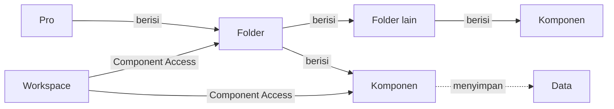

# Apa itu Folder?

>**note** Folder merupakan salah satu konsep dasar di Phoenix, bersama [[Docs/Dasar/Apa itu Pro|Pro]] dan [[Docs/Dasar/Apa itu Komponen|Komponen]]. Folder menata komponen di dalam Pro dan dikelola di [[Docs/Antarmuka#Area Manajemen Folder|Area Manajemen Folder]].

Folder adalah penata di dalam [[Docs/Dasar/Apa itu Pro|Pro]] yang mengelompokkan [[Docs/Dasar/Apa itu Komponen|Komponen]] dan folder lain dalam struktur bertingkat. Folder tidak menyimpan data. Fungsinya mengatur letak komponen dan, bersama [[Docs/Modul Developer/Workspace/Apa itu Workspace|Workspace]], menentukan siapa yang dapat melihat isinya.

Dengan Folder, Anda dapat memisahkan komponen menurut area kerja, tim, atau fungsi sehingga Pro tetap rapi dan mudah dijelajahi saat semakin besar.

## Mengapa Menggunakan Folder?

- **Pro tetap rapi.** Komponen dari modul yang berbeda dapat ditempatkan berdampingan menurut kebutuhan Anda, bukan menurut jenisnya.
- **Mudah ditemukan.** Folder dapat diperluas atau dilipat di [[Docs/Antarmuka#Area Manajemen Folder|Area Manajemen Folder]] sehingga Anda hanya membuka bagian yang dibutuhkan.
- **Akses lebih terarah.** [[Docs/Modul Developer/Workspace/Component Access|Component Access]] dapat diatur pada folder, misalnya menyembunyikan satu folder beserta isinya dari Workspace tertentu.
- **Mudah ditata ulang.** Folder dan komponen dapat dipindahkan atau diurutkan ulang dengan *drag and drop*, dan komponen yang dipindahkan tetap terhubung dengan komponen lain.

## Konsep Utama

| Istilah | Penjelasan |
| --- | --- |
| [[Docs/Dasar/Apa itu Pro|Pro]] | Wadah tempat seluruh struktur folder berada. |
| [[Docs/Dasar/Apa itu Komponen|Komponen]] | Isi folder. Setiap komponen ditempatkan di dalam sebuah folder. |
| [[Docs/Antarmuka#Area Manajemen Folder|Area Manajemen Folder]] | Bagian antarmuka tempat Anda menelusuri, membuat, dan mengelola folder serta komponen. |
| [[#Folder Root]] | Titik awal struktur folder. Komponen tanpa folder tujuan berada di sini. |
| [[Docs/Dasar/Apa itu Komponen#Membuat Komponen|Directory]] | Bagian pada dialog pembuatan komponen yang menentukan folder tujuan. Dikosongkan berarti letak *root*. |
| [[Docs/Modul Developer/Workspace/Component Access|Component Access]] | Hak akses Workspace pada folder dan komponen: Visible, Add, Update, dan Delete. |
| [[Docs/Modul Developer/Workspace/Apa itu Workspace|Workspace]] | Menentukan folder dan komponen yang tampil serta dapat dikelola oleh anggota. |

## Cara Kerja

### Struktur Bertingkat

Sebuah folder dapat berisi komponen dan folder lain, dan folder di dalamnya dapat berisi lagi komponen dan folder, begitu seterusnya. Di antara semuanya, hanya komponen yang menyimpan data. Komponen dari modul mana pun dapat berada dalam folder yang sama. Daftar modul dan komponen ada di [[Docs/Dasar/Apa itu Komponen#Modul dan Komponen di Phoenix|Modul dan Komponen di Phoenix]].

### Folder Root

Folder *root* adalah titik awal struktur folder. Saat membuat komponen, Anda dapat mengosongkan [[Docs/Dasar/Apa itu Komponen#Membuat Komponen|Directory]] sehingga komponen berada di *root*. Komponen [[Docs/Modul Data/Variable/Apa itu Variable|Variable]] dibuat otomatis di folder *root* saat [[Docs/Dasar/Apa itu Pro|Pro]] dimulai.

Jika komponen [[Docs/Modul Developer/Workspace/Apa itu Workspace|Workspace]] ditempatkan di folder yang lebih dalam, folder itu menjadi *root* bagi Workspace tersebut. Group anak yang ditempatkan lewat [[^field|Place to Directory]] juga berada di folder *root* dari Workspace yang aktif saat itu. Selengkapnya lihat [[Docs/Modul Developer/Group/Apa itu Group|Group]].

### Folder dan Hak Akses

Workspace mengatur empat hak akses pada setiap folder lewat [[Docs/Modul Developer/Workspace/Component Access|Component Access]].

| Hak akses | Arti pada folder | Bila [[^value/boolean/disallow]] |
| --- | --- | --- |
| [[Docs/Modul Developer/Workspace/Component Access#Visible pada Folder dan Komponen|Visible]] | Folder tampil di Area Manajemen Folder. | Folder beserta isinya tidak tampil di Area Manajemen Folder dan tidak dapat dibuka. |
| [[^field|Add]] | Menambahkan folder atau komponen baru ke dalam folder ini, termasuk menempatkan folder atau komponen dari folder lain. | Folder ini tidak dapat menjadi tujuan penambahan atau pemindahan. |
| [[^field|Update]] | Mengubah nama folder. | Nama folder tidak dapat diubah. |
| [[^field|Delete]] | Menghapus folder, termasuk memindahkannya ke folder lain. | Folder tidak dapat dihapus atau dipindahkan. |

>**note** Visible tidak berjenjang
> Menyembunyikan folder membuat isinya tidak dapat dibuka di Area Manajemen Folder, tetapi komponen di dalamnya yang [[^field|Visible]]-nya [[^value/boolean/allow]] tetap muncul pada pilihan *field* atau [[Docs/Tipe Data/Query|Query]]. Untuk menutup komponen sepenuhnya, atur Visible komponen itu sendiri menjadi [[^value/boolean/disallow]].

## Folder di Area Manajemen Folder

![[Docs/Dasar/area-manajemen-folder.png|Area Manajemen Folder berisi tombol Workspace aktif dan struktur folder beserta komponen]]

Penjelasan lengkap area ini ada di [[Docs/Antarmuka#Area Manajemen Folder|Antarmuka]]. Interaksi yang berkaitan dengan folder:

| Fungsi | Aksi |
| --- | --- |
| Memperluas atau melipat isi folder | Klik folder. |
| Membuka halaman kerja komponen | Klik komponen. |
| Menambahkan komponen | Klik kanan folder ➜ [[^field/add|Add]]. |
| Membuat folder | Klik kanan ➜ [[^field/add|New Folder]], selengkapnya lihat [[Docs/Dasar/Membuat Folder]].
| Mengubah nama folder | Klik kanan folder ➜ [[^field/rename|Rename]], selengkapnya lihat [[Docs/Dasar/Mengubah Nama Folder]] |
| Menghapus folder atau komponen | Klik kanan folder atau komponen ➜ [[^button/delete|Delete]], selengkapnya lihat [[Docs/Dasar/Menghapus Folder]]. |
| Memindahkan folder atau komponen | Nyalakan toggle [[^toggle/move]] di bagian atas Area Manajemen Folder, lalu *drag and drop*. Selengkapnya lihat [[Docs/Dasar/Memindahkan Komponen dan Folder]] |
| Berpindah Workspace | Klik tombol berisi nama Workspace aktif, lalu pilih Workspace pada popup. |

## Praktik Terbaik

- Beri nama yang jelas karena [[^field|Name]] komponen tidak boleh sama dengan komponen sejenis di folder yang sama.
- Jangan menjadikan [[^field|Visible]] pada folder sebagai satu-satunya pengaman. Atur juga Visible pada komponen yang harus tertutup, karena komponen dengan Visible [[^value/boolean/allow]] tetap muncul pada pilihan *field* dan [[Docs/Tipe Data/Query|Query]].
- Berikan hak akses [[^field|Delete]] dan [[^field|Add]] dengan hati-hati karena keduanya memungkinkan pemindahan komponen, dan pemindahan sama dengan izin menghapus.
- Rencanakan penataan sebelum memindahkan komponen [[Docs/Modul Developer/Workspace/Apa itu Workspace|Workspace]] ke folder yang lebih dalam karena folder itu menjadi *root* bagi Workspace tersebut.

## Batasan dan Catatan

- Folder tidak menyimpan data. Hanya [[Docs/Dasar/Apa itu Komponen|Komponen]] yang memiliki [[Docs/Modul Developer/Workspace/Data Access|Data Access]].
- [[Docs/Modul Developer/Workspace/Component Access#Visible pada Folder dan Komponen|Visible]] tidak berjenjang. Folder yang disembunyikan tidak otomatis menyembunyikan komponen dari pilihan *field* dan Query.
- Memindahkan ke folder lain memerlukan [[^field|Delete]] pada yang dipindahkan dan [[^field|Add]] pada folder tujuan, sedangkan mengubah urutan di folder yang sama tidak memerlukan keduanya.
- Pemindahan mengubah struktur folder [[Docs/Dasar/Apa itu Pro|Pro]], bukan hanya tampilan halaman kerja, tetapi tidak memutus relasi komponen dengan komponen lain.
- Komponen [[Docs/Modul Data/Variable/Apa itu Variable|Variable]] boleh dipindahkan ke folder lain, tetapi tidak dapat ditambah, diduplikasi, atau dihapus.
- Penghapusan folder beserta isinya tidak dapat dikembalikan.

## TL:DR

- Folder adalah penata di dalam [[Docs/Dasar/Apa itu Pro|Pro]] yang berisi [[Docs/Dasar/Apa itu Komponen|Komponen]] dan folder lain secara bertingkat, dan tidak menyimpan data.
- Folder dikelola di [[Docs/Antarmuka#Area Manajemen Folder|Area Manajemen Folder]]: dibuat dengan [[^field/add|New Folder]] dan diubah namanya dengan [[^field/rename|Rename]].
- Komponen tanpa folder tujuan berada di folder *root*.
- Folder dan komponen dipindahkan dengan *drag and drop* setelah toggle [[^toggle/move]] dinyalakan, atau di halaman kerja Workspace, dan relasinya tetap terhubung.
- [[Docs/Modul Developer/Workspace/Component Access|Component Access]] mengatur Visible, Add, Update, dan Delete pada folder, dan Visible tidak berjenjang.
- Izin memindahkan ke folder lain sama dengan izin menghapus, dan penghapusan folder beserta isinya tidak dapat dikembalikan.

## FAQ : Pertanyaan yang Sering Diajukan

> **faq**
> **Apakah folder menyimpan data?**
> Tidak. Folder hanya menata. Data disimpan oleh [[Docs/Dasar/Apa itu Komponen|komponen]] di dalamnya.
> **Apa yang terjadi bila Visible sebuah folder dinonaktifkan?**
> Folder beserta isinya tidak tampil di Area Manajemen Folder pada Workspace tersebut. Komponen di dalamnya yang [[^field|Visible]]-nya [[^value/boolean/allow]] tetap dapat dipilih pada *field* dan [[Docs/Tipe Data/Query|Query]].
> **Dapatkah komponen ditempatkan di luar folder?**
> Komponen tanpa folder tujuan, yaitu [[Docs/Dasar/Apa itu Komponen#Membuat Komponen|Directory]] yang dikosongkan, berada di folder *root*.
> **Mengapa saya tidak dapat memindahkan komponen ke folder lain?**
> Pastikan toggle [[^toggle/move]] di Area Manajemen Folder sudah menyala. Pemindahan juga memerlukan [[^field|Delete]] pada komponen yang dipindahkan dan [[^field|Add]] pada folder tujuan. Periksa [[Docs/Modul Developer/Workspace/Component Access|Component Access]] pada Workspace Anda.
> **Apakah memindahkan komponen memutus relasinya dengan komponen lain?**
> Tidak. Komponen tetap terhubung, misalnya lewat Query atau Flow Block. Selengkapnya lihat [[#Memindahkan Folder dan Komponen]].
> **Apakah folder yang sudah dihapus dapat dikembalikan?**
> Tidak. Folder beserta isinya tidak dapat dipulihkan. Pindahkan komponen yang masih dibutuhkan ke folder lain sebelum menghapus. Langkahnya ada di [[#Menghapus Folder]].
> **Bolehkah dua komponen sejenis memiliki nama yang sama?**
> Tidak dalam folder yang sama. Aturan ini berlaku untuk komponen sejenis.