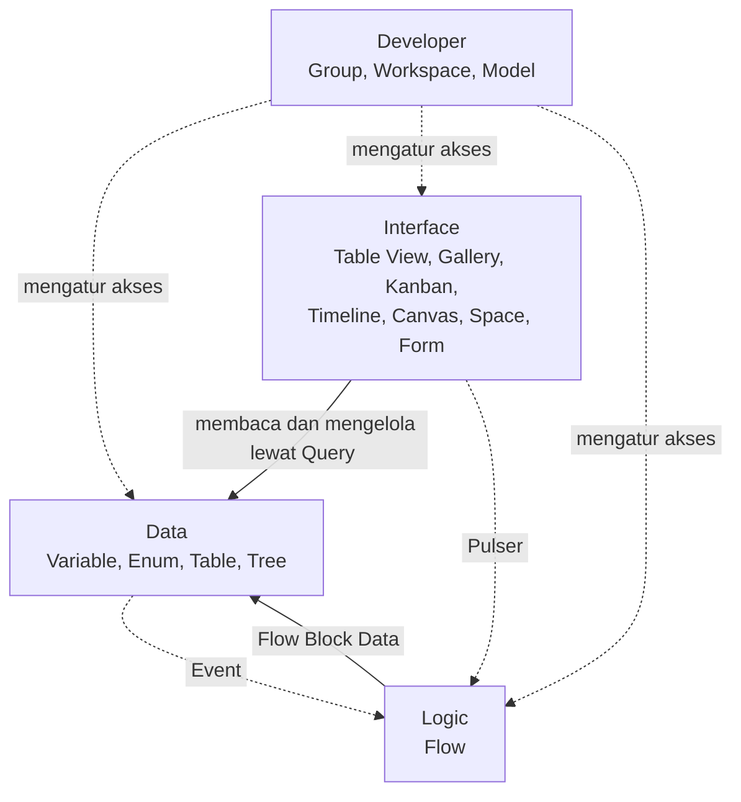

# Apa itu Komponen?

>**note** Komponen merupakan salah satu konsep dasar di Phoenix, bersama [[Docs/Dasar/Apa itu Pro|Pro]] dan [[Docs/Dasar/Apa itu Folder|Folder]]. Pro adalah wadahnya, Folder menatanya, dan Komponen menjadi isinya.

Komponen adalah unit fungsional penyusun sistem di Phoenix. Setiap komponen memiliki peran khusus, seperti menyimpan data, menampilkan data, menjalankan logika, atau mengatur akses. Komponen dikelompokkan dalam empat modul, dibuat dari [[Docs/Antarmuka#Area Manajemen Folder|Area Manajemen Folder]], dan ditempatkan di dalam [[Docs/Dasar/Apa itu Folder|Folder]] pada sebuah [[Docs/Dasar/Apa itu Pro|Pro]].

Anda membangun sistem dengan menggabungkan komponen. Data disimpan di satu komponen, ditampilkan oleh komponen lain, dan diotomasi oleh komponen lainnya, tanpa Anda memindahkan data dari satu alat ke alat lain.

## Konsep Utama

| Istilah | Penjelasan |
| --- | --- |
| [[Docs/Dasar/Apa itu Pro|Pro]] | Wadah utama tempat seluruh komponen berada. |
| [[Docs/Dasar/Apa itu Folder|Folder]] | Penata komponen dalam struktur bertingkat. |
| [[#Modul dan Komponen di Phoenix|Modul]] | Pengelompokan komponen berdasarkan peran: Data, Interface, Logic, dan Developer. |
| [[#Data dalam Komponen]] | Isi yang dikelola di dalam komponen, seperti [[Docs/Tipe Data/Row|Row]], [[Docs/Tipe Data/EnumData|EnumData]], dan [[Docs/Tipe Data/Node|Node]]. |
| [[#Komponen Unik]] | Komponen yang hanya ada satu per Pro dan dibuat otomatis. |
| [[Docs/Antarmuka#Halaman Kerja|Halaman Kerja]] | Antarmuka kerja sebuah komponen. |
| [[Docs/Antarmuka#Area Manajemen Folder|Area Manajemen Folder]] | Tempat Anda membuat dan membuka komponen. |
| [[Docs/Tipe Data/Query|Query]] | Cara komponen Interface mengambil dan menampilkan data dari komponen lain. |
| [[Docs/Event/Apa itu Event|Event]] | Cara data yang berubah memicu Flow. |
| [[Docs/Modul Developer/Workspace/Apa itu Workspace|Workspace]] | Komponen yang mengatur akses ke komponen lain. |

## Modul dan Komponen di Phoenix

Modul adalah pengelompokan komponen berdasarkan peran. Phoenix memiliki empat modul.

### Modul Data

Modul [[Docs/Modul Data/Pengenalan|Data]] berisi komponen untuk menyimpan data.

| Komponen | Fungsi | Data di dalamnya |
| --- | --- | --- |
| [[Docs/Modul Data/Variable/Apa itu Variable|Variable]] | Menyimpan nilai bernama yang menjadi sumber kebenaran dan dapat dirujuk dari komponen mana pun. | [[Docs/Tipe Data/Variable|Variable Data]] |
| [[Docs/Modul Data/Enum/Apa itu Enum|Enum]] | Menyimpan deret data atau *Master Data* seperti pilihan, menu, opsi, dan kategori. | [[Docs/Modul Data/Enum/Enum Data/Pengenalan|Enum Data]] |
| [[Docs/Modul Data/Table/Apa itu Table|Table]] | Menyimpan data kompleks, baik transaksional maupun generik. | [[Docs/Tipe Data/Column|Column]] dan [[Docs/Modul Data/Table/Table Row/Pengenalan|Table Row]] |
| [[Docs/Modul Data/Tree/Apa itu Tree|Tree]] | Menyimpan data hierarki atau berbentuk pohon, cocok untuk data bercabang. | [[Docs/Modul Data/Tree/Node/Pengenalan|Tree Node]] |

### Modul Interface

Modul [[Docs/Modul Interface/Pengenalan|Interface]] berisi komponen untuk menampilkan dan mengelola data.

| Komponen | Fungsi | Data di dalamnya |
| --- | --- | --- |
| [[Docs/Modul Interface/Table View/Apa itu Table View|Table View]] | Menampilkan data Table menggunakan Query dalam beberapa Data sekaligus. | [[Docs/Modul Interface/Table View/Table View Data/Pengenalan|Table View Data]] |
| [[Docs/Modul Interface/Gallery/Apa itu Gallery|Gallery]] | Menyajikan data sebagai kartu visual yang menonjolkan gambar atau konten. | Kartu dari [[Docs/Tipe Data/Row|Row]] |
| [[Docs/Modul Interface/Kanban/Apa itu Kanban|Kanban]] | Menampilkan data dalam kolom berdasarkan status atau kategori, dengan kartu yang dapat dipindahkan antarkolom. | Kartu dari [[Docs/Tipe Data/Row|Row]] |
| [[Docs/Modul Interface/Timeline/Apa itu Timeline|Timeline]] | Menampilkan data dalam urutan waktu untuk memantau jadwal, riwayat, dan progres. | [[Docs/Modul Interface/Timeline/Timeline Event/Pengenalan|Timeline Event]] dan [[Docs/Modul Interface/Timeline/Timeline Data/Pengenalan|Timeline Data]] |
| [[Docs/Modul Interface/Canvas/Apa itu Canvas|Canvas]] | Menyusun, menghubungkan, dan memetakan data atau presentasi secara visual. | [[Docs/Modul Interface/Canvas/Template/Pengenalan|Canvas Template]] dan [[Docs/Modul Interface/Canvas/Widget/Pengenalan|Canvas Widget]] |
| [[Docs/Modul Interface/Space/Apa itu Space|Space]] | Menaungi dan mengorganisasi data dalam bentuk tiga dimensi. | [[Docs/Modul Interface/Space/Weather/Pengenalan|Space Weather]], [[Docs/Modul Interface/Space/Environment/Pengenalan|Space Environment]], dan [[Docs/Modul Interface/Space/Object/Pengenalan|Space Object]] |
| [[Docs/Modul Interface/Form/Apa itu Form|Form]] | Membuat halaman isian yang dapat dipublikasikan agar pengisi mengirim data ke Table sebagai Row baru. | [[Docs/Modul Interface/Form/Elemen/Pengenalan|Elemen Form]] |

### Modul Logic

Modul [[Docs/Modul Logic/Pengenalan|Logic]] berisi komponen untuk mengotomasi proses.

| Komponen | Fungsi | Data di dalamnya |
| --- | --- | --- |
| [[Docs/Modul Logic/Flow/Apa itu Flow|Flow]] | Mengatur logika dan proses pengelolaan data dengan alur komposit, yaitu menghubungkan block demi block. | [[Docs/Modul Logic/Flow/Flow Block/Pengenalan|Flow Block]] |

### Modul Developer

Modul [[Docs/Modul Developer/Pengenalan|Developer]] berisi komponen untuk mengatur tim, akses, dan sumber daya pengembangan.

| Komponen | Fungsi | Data di dalamnya |
| --- | --- | --- |
| [[Docs/Modul Developer/Group/Apa itu Group|Group]] | Mengatur komposisi tim dan Workspace yang dapat diakses setiap anggota. | Group anak, pengguna, dan Workspace |
| [[Docs/Modul Developer/Workspace/Apa itu Workspace|Workspace]] | Mengatur komponen yang dapat dilihat, dikelola, dan diubah, serta fungsi di dalamnya. | [[Docs/Modul Developer/Workspace/Component Access|Component Access]], [[Docs/Modul Developer/Workspace/Data Access|Data Access]], dan [[Docs/Modul Developer/Workspace/Function Access|Function Access]] |
| [[Docs/Modul Developer/Model/Apa itu Model|Model]] | Menyimpan konfigurasi aset 3D beserta animasi dan logikanya yang dipakai Object pada Space. | Konfigurasi aset 3D, animasi, dan logika |

## Cara Kerja

### Komponen Berada di Folder

Setiap komponen ditempatkan di dalam folder. Folder menentukan letak komponen di struktur [[Docs/Dasar/Apa itu Pro|Pro]], sedangkan komponen menyimpan data dan menjalankan fungsinya. Saat membuat komponen, Anda menentukan folder tujuannya lewat [[^field|Directory]]. Selengkapnya lihat [[Docs/Dasar/Apa itu Folder|Folder]].

### Komponen Saling Terhubung

Komponen dari modul yang berbeda bekerja bersama. Data disimpan oleh modul Data, ditampilkan oleh modul Interface, diotomasi oleh modul Logic, dan diatur aksesnya oleh modul Developer.

| Hubungan | Cara | Selengkapnya |
| --- | --- | --- |
| Interface membaca Data | Komponen Interface mengisi [[Docs/Tipe Data/Query|Query]] untuk mengambil dan menampilkan data. | [[Docs/Modul Interface/Pengenalan|Modul Interface]] |
| Data memicu Logic | Perubahan data pada Table, Enum, Tree, dan Timeline Event dapat memicu Flow lewat tombol [[^button/event|Event]]. | [[Docs/Event/Menghubungkan Event|Menghubungkan Event]] |
| Logic mengubah Data | Flow mengubah data lewat Flow Block Data seperti Add, Delete, Getter, dan Setter. | [[Docs/Modul Logic/Flow/Flow Block/Data Table/Pengenalan|Flow Block Data Table]] |
| Interface memicu Logic | Widget Button pada Canvas dan Timeline Event memicu Flow lewat Pulser. | [[Docs/Modul Logic/Flow/Flow Block/Event/Pulser|Pulser Event Block]] |
| Komponen merujuk Variable | Nilai Variable dapat dirujuk dari komponen mana pun lewat Name. | [[Docs/Modul Data/Variable/Apa itu Variable|Variable]] |
| Developer mengatur akses | Workspace menentukan komponen, data, dan fungsi yang dapat dipakai anggota. | [[Docs/Modul Developer/Workspace/Apa itu Workspace|Workspace]] |

### Data dalam Komponen

Setiap komponen mengelola isinya sendiri. Isi tersebut disebut data dalam komponen, misalnya [[Docs/Tipe Data/Row|Row]] pada Table, [[Docs/Tipe Data/EnumData|EnumData]] pada Enum, [[Docs/Tipe Data/Node|Node]] pada Tree, [[Docs/Modul Logic/Flow/Flow Block/Pengenalan|Flow Block]] pada Flow, dan [[Docs/Modul Interface/Form/Elemen/Pengenalan|Elemen Form]] pada Form. Data dikelola di halaman kerja komponen dan diatur aksesnya lewat [[Docs/Modul Developer/Workspace/Data Access|Data Access]]. Jenis data yang dipakai komponen dijelaskan di [[Docs/Tipe Data/Pengenalan|Tipe Data]].

### Komponen Unik

Sebagian komponen hanya ada satu per [[Docs/Dasar/Apa itu Pro|Pro]] dan dibuat otomatis saat Pro dimulai. Contohnya [[Docs/Modul Data/Variable/Apa itu Variable|Variable]]: dibuat di folder *root*, tidak dapat ditambah lewat Area Manajemen Folder, tidak dapat diduplikasi, dan tidak dapat dihapus. Komponen unik boleh dipindahkan ke folder lain.

### Hak Akses Komponen

Akses ke komponen diatur oleh Workspace dalam tiga lapis.

| Akses | Yang diatur | Contoh |
| --- | --- | --- |
| [[Docs/Modul Developer/Workspace/Component Access|Component Access]] | Komponen tampil, diubah, dan dihapus, serta penambahan komponen ke dalam folder. | Komponen yang [[^field|Visible]]-nya [[^value/boolean/disallow]] tidak tampil di Area Manajemen Folder dan tidak dapat dipilih pada *field* Query. |
| [[Docs/Modul Developer/Workspace/Data Access|Data Access]] | Penambahan, perubahan, dan penghapusan data di dalam komponen. | Row Table hanya dapat diubah bila Data Access Table mengizinkan. |
| [[Docs/Modul Developer/Workspace/Function Access|Function Access]] | Fungsi khusus komponen. | Merge pada Table dan Enum, Event pada Table, Enum, Tree, dan Timeline Event, serta Publish pada Table, Tree, Canvas, dan Form. |

>**note** Akses berlapis pada komponen Interface
> Baris dan isi sel pada komponen Interface hanya dapat dikelola bila Data berstatus `editable` dan Data Access data sumber mengizinkan. Selengkapnya lihat [[Docs/Modul Developer/Workspace/Data Access#Akses Berlapis pada Komponen Interface|Akses Berlapis pada Komponen Interface]].

Komponen yang sebagian aksesnya dinonaktifkan menampilkan [[Docs/Modul Developer/Workspace/Component Access#Mengenali Ikon Kunci|ikon kunci]] di samping judulnya.

## Antarmuka Komponen

![[Docs/Dasar/anatomi-komponen.png|Halaman kerja komponen berisi bilah navigasi di bagian atas dan area kerja di bagian bawah]]

Setiap komponen memiliki [[Docs/Antarmuka#Halaman Kerja|halaman kerja]] dengan pola serupa: [[Docs/Antarmuka#Bilah Navigasi|bilah navigasi]] di bagian atas dan area kerja di bagian bawah.

### Bilah navigasi komponen terdiri dari:

| Tombol | Fungsi | Tersedia pada |
| --- | --- | --- |
| Ikon komponen dan [[^field|Header Name]] | Menampilkan jenis dan nama komponen yang sedang dibuka. | Semua komponen |
| [[^button/edit|Edit]] | Mengubah atribut komponen, seperti [[^field|Name]] dan [[^field|Description]]. | Semua komponen kecuali [[Docs/Modul Data/Variable/Apa itu Variable|Variable]] |
| [[^button/refresh|Refresh]] | Memuat ulang tampilan halaman kerja. | Semua komponen |
| [[^field|Search ... Data...]] | Mencari data di dalam komponen. Label mengikuti pola `Search <Nama Komponen> Data...` dan cakupan pencarian menyesuaikan komponen. | Sebagian besar komponen |
| [[^button/merge|Merge]] | Menggabungkan data. | [[Docs/Modul Data/Table/Merge|Table]] dan [[Docs/Modul Data/Enum/Merge|Enum]] |
| [[^button/publish|Publish]] | Mempublikasikan komponen lewat tautan. | [[Docs/Modul Data/Table/Publish|Table]], [[Docs/Modul Data/Tree/Publish|Tree]], [[Docs/Modul Interface/Canvas/Mempublikasi|Canvas]], dan [[Docs/Modul Interface/Form/Mempublikasi|Form]] |
| [[^button/event|Event]] | Menghubungkan perubahan data ke Flow Block Event. | [[Docs/Modul Data/Table/Mengotomasi|Table]], [[Docs/Modul Data/Enum/Mengotomasi|Enum]], [[Docs/Modul Data/Tree/Mengotomasi|Tree]], dan [[Docs/Modul Interface/Timeline/Timeline Event/Pengenalan|Timeline Event]] |
| [[^button/submission|Submission]] | Membuka bilik submission untuk memantau proses pada Flow, atau daftar pengisian pada Form. | [[Docs/Modul Logic/Flow/Apa itu Flow|Flow]] dan [[Docs/Modul Interface/Form/Submission|Form]] |

>**note** Perbedaan tombol antarkomponen
> Tombol pada bilah navigasi bergantung pada komponennya dan pada [[Docs/Modul Developer/Workspace/Function Access|Function Access]] Workspace Anda. Tombol yang aksesnya dinonaktifkan tidak tampil. Pada Canvas dan Form, bilah navigasi juga memiliki tombol [[^button/save|Save]] dan pengalih mode [[^mode/view|View]] atau [[^mode/edit|Edit]], dan Edit Mode berbeda dengan tombol [[^button/edit|Edit]] untuk mengubah atribut.

Sebagian besar komponen tidak memiliki perbedaan tampilan yang signifikan antara desktop dan mobile. Perbedaan yang ada dijelaskan di halaman komponennya.

## Membuat Komponen

Semua komponen dibuat dengan cara yang sama dari Area Manajemen Folder. Contoh berikut membuat Table. Ganti pilihan modul dan komponen sesuai kebutuhan Anda.

1. Buka folder tempat komponen akan ditempatkan di [[Docs/Antarmuka#Area Manajemen Folder]]
2. Klik kanan ➜ [[^field/add|Add]] ➜ [[^field|Data]] ➜ [[^field/table|Table]]
3. Isi [[^field|Name]] dan [[^field|Description]]
4. Klik [[^button|Create]]

>**success** Komponen berhasil dibuat
> Komponen yang baru dibuat berada di folder tujuan dan belum memiliki data. Buka komponennya dari Area Manajemen Folder, lalu tambahkan data sesuai jenis komponen.

Pada dialog pembuatan, [[^field|Directory]] menentukan folder tujuan. Isinya terisi otomatis sesuai folder yang Anda klik kanan, dapat diganti, dan bila dikosongkan komponen berada di folder *root*.

Beberapa komponen memiliki isian tambahan saat dibuat.

| Komponen | Isian tambahan |
| --- | --- |
| [[Docs/Modul Data/Table/Apa itu Table|Table]] | [[^field|Column]] (minimal satu), termasuk Alias, atau tombol [[^button/upload|Upload]] untuk membuat Table dari file. |
| [[Docs/Modul Data/Enum/Apa itu Enum|Enum]] | [[^field|Format]], [[^field|Header]], dan [[^field|Strict On Selected]]. |
| [[Docs/Modul Data/Tree/Apa itu Tree|Tree]] | [[^field|Merger Mode]], [[^field|External Read Only]], dan Default Configuration. |
| [[Docs/Modul Interface/Kanban/Apa itu Kanban|Kanban]] | [[^field|Table - Column]] (wajib, berformat [[Docs/Tipe Data/EnumData|EnumData]]). |
| [[Docs/Modul Interface/Gallery/Apa itu Gallery|Gallery]] | [[^field|Table]] (wajib dan tidak dapat diubah) serta Filter bila dibutuhkan. |
| [[Docs/Modul Developer/Group/Apa itu Group|Group]] | [[^field|Parent]] (wajib bila dibuat dari Area Manajemen Folder). |

>**note** Komponen unik tidak dapat ditambahkan
> Komponen [[Docs/Modul Data/Variable/Apa itu Variable|Variable]] dibuat otomatis saat Pro dimulai sehingga tidak tersedia pada menu [[^field/add|Add]].

>**note** Group memiliki jalur pembuatan lain
> Group anak juga dapat dibuat dari halaman kerja [[Docs/Modul Developer/Group/Apa itu Group|Group]] lewat tombol Add Group. Group anak tersebut tidak otomatis menjadi komponen di folder. Gunakan [[^field|Place to Directory]] untuk menempatkannya ke Area Manajemen Folder.

## Mengubah Komponen

1. Buka halaman kerja komponen
2. Klik [[^button/edit|Edit]]
3. Ubah [[^field|Name]] atau [[^field|Description]], serta atribut lain sesuai komponen
4. Klik [[^button|Update]]

>**warning** Perubahan atribut dapat memengaruhi isi komponen
> Pada komponen tertentu, perubahan atribut berdampak pada data atau konfigurasi turunan:
> - [[Docs/Modul Data/Table/Apa itu Table|Table]]: mengubah Column atau Format yang berisiko menghilangkan data menampilkan peringatan dan dapat dilanjutkan dengan *force update*.
> - [[Docs/Modul Data/Enum/Apa itu Enum|Enum]]: mengubah Format memerlukan [[^field|Force Update]] dengan mode *loss safe* atau *force*.
> - [[Docs/Modul Interface/Kanban/Apa itu Kanban|Kanban]]: mengganti Table pada [[^field|Table - Column]] menghapus template kartu.
> - [[Docs/Modul Data/Tree/Apa itu Tree|Tree]]: [[^field|Merger Mode]] tidak dapat diubah setelah Tree dibuat.
> - [[Docs/Modul Interface/Gallery/Apa itu Gallery|Gallery]]: [[^field|Table]] tidak dapat diubah setelah Gallery dibuat.

Komponen [[Docs/Modul Data/Variable/Apa itu Variable|Variable]] tidak memiliki tombol Edit karena header-nya tidak dapat diganti.

## Menyegarkan Komponen

Klik [[^button/refresh|Refresh]] untuk memuat ulang tampilan halaman kerja.

>**warning** Refresh dapat membuang perubahan yang belum tersimpan
> Pada komponen yang memiliki tombol [[^button/save|Save]], seperti Canvas dan Form, tombol Save yang masih aktif berarti ada perubahan yang belum tersimpan. Klik Save sebelum Refresh. Refresh tidak dapat dilakukan saat penyimpanan sedang berjalan.

## Menghapus Komponen

1. Buka folder yang berisi komponen di [[Docs/Antarmuka#Area Manajemen Folder]]
2. Klik kanan komponen ➜ [[^button/delete|Delete]]
3. Konfirmasi dengan klik [[^button|Delete]]

>**warning** Dampak penghapusan berbeda pada setiap komponen
> Menghapus komponen dapat menghilangkan isinya dan memutus relasi dari komponen lain. Periksa tabel berikut sebelum menghapus.

| Komponen | Yang ikut hilang | Catatan |
| --- | --- | --- |
| [[Docs/Modul Data/Table/Apa itu Table|Table]] | Seluruh Column, Row, dan TableData. | - |
| [[Docs/Modul Data/Enum/Apa itu Enum|Enum]] | Seluruh EnumData. | Relasi dari komponen lain harus dihapus terlebih dahulu. |
| [[Docs/Modul Data/Tree/Apa itu Tree|Tree]] | Seluruh Node. | Relasi dari komponen lain, seperti Column Table yang memakai Node dan Flow Block Tree Node Event, terputus. Node *clone* pada Tree merger dapat terdampak. |
| [[Docs/Modul Interface/Table View/Apa itu Table View|Table View]] | Query dan konfigurasi Data. | Row pada data sumber tidak terhapus dan komponen lain tidak terpengaruh. |
| [[Docs/Modul Interface/Gallery/Apa itu Gallery|Gallery]] | Gallery dan template kartunya. | Row pada Table sumber tidak terhapus. |
| [[Docs/Modul Interface/Kanban/Apa itu Kanban|Kanban]] | Kanban dan template kartunya. | Row pada Table sumber tidak terhapus. |
| [[Docs/Modul Interface/Timeline/Apa itu Timeline|Timeline]] | Konfigurasi Timeline. | Data sumber tetap aman. |
| [[Docs/Modul Interface/Canvas/Apa itu Canvas|Canvas]] | Template dan properti, termasuk Query. | Data sumber aman, tetapi tautan yang sudah dibagikan menjadi tidak valid. |
| [[Docs/Modul Interface/Space/Apa itu Space|Space]] | Seluruh data dan konfigurasi Space, termasuk file 3D Environment. | Row sumber tidak terhapus. |
| [[Docs/Modul Interface/Form/Apa itu Form|Form]] | Templat Form dan riwayat Submission. | Data yang sudah tersimpan tidak langsung terhapus, tautan publish menjadi tidak valid, dan pengisi yang sedang mengisi akan mengalami error saat mengirim. |
| [[Docs/Modul Logic/Flow/Apa itu Flow|Flow]] | Flow Block dan riwayat Activity. | Flow Block Action yang sudah digunakan komponen lain terputus. |
| [[Docs/Modul Developer/Group/Apa itu Group|Group]] | Daftar Workspace pada Group. | Group anak ikut terhapus dan Group tidak boleh masih memiliki pengguna. |
| [[Docs/Modul Developer/Workspace/Apa itu Workspace|Workspace]] | Pengaturan akses Workspace. | Pemetaan pada Group terputus, tetapi komponen dan data tidak terhapus. Workspace *root* terakhir yang terhubung ke Group tidak dapat dihapus. |
| [[Docs/Modul Developer/Model/Apa itu Model|Model]] | Seluruh data yang tersimpan di Model, yaitu konfigurasi aset 3D beserta animasi dan logikanya. | Space Object yang memakai Model ini ikut terdampak. |
| [[Docs/Modul Data/Variable/Apa itu Variable|Variable]] | Tidak dapat dihapus. | Komponen unik per Pro. |

>**danger** Penghapusan komponen tidak dapat dikembalikan
> Saat ini komponen yang sudah dihapus tidak dapat dipulihkan. Pastikan komponen dan isinya memang sudah tidak dibutuhkan sebelum menghapus.

## Jelajahi Lebih Lanjut

| Jika Anda ingin | Baca |
| --- | --- |
| Memahami wadah tempat komponen berada | [[Docs/Dasar/Apa itu Pro|Pro]] |
| Menata komponen dalam struktur | [[Docs/Dasar/Apa itu Folder|Folder]] |
| Mengenali bagian layar Phoenix | [[Docs/Antarmuka|Antarmuka]] |
| Memahami jenis data yang dipakai komponen | [[Docs/Tipe Data/Pengenalan|Tipe Data]] dan [[Docs/Format Data/Pengenalan|Format Data]] |
| Menghubungkan data dengan otomasi | [[Docs/Event/Apa itu Event|Event]] dan [[Docs/Event/Menghubungkan Event|Menghubungkan Event]] |
| Mengatur tampilan komponen | [[Docs/Styling/Styling Class|Styling Class]] |
| Mengatur akses ke komponen | [[Docs/Modul Developer/Workspace/Apa itu Workspace|Workspace]] dan [[Docs/Modul Developer/Group/Apa itu Group|Group]] |

## Praktik Terbaik

- Pilih komponen **sesuai peran**: simpan data di modul [[Docs/Modul Data/Pengenalan|Data]], tampilkan lewat modul [[Docs/Modul Interface/Pengenalan|Interface]], dan otomasi lewat modul [[Docs/Modul Logic/Pengenalan|Logic]].
- Beri [[^field|Name]] dan [[^field|Description]] yang jelas karena nama komponen tidak boleh sama dengan komponen sejenis di folder yang sama.
- Tinjau **dampak penghapusan** pada [[#Menghapus Komponen]] sebelum menghapus, karena penghapusan tidak dapat dikembalikan. Hapus relasi dari komponen lain terlebih dahulu bila diperlukan, misalnya pada Enum.
- Atur [[Docs/Modul Developer/Workspace/Component Access|Component Access]], [[Docs/Modul Developer/Workspace/Data Access|Data Access]], dan [[Docs/Modul Developer/Workspace/Function Access|Function Access]] bersamaan agar anggota hanya mendapat akses yang dibutuhkan.
- Perlakukan komponen yang dapat dipublikasikan, yaitu Table, Tree, Canvas, dan Form, sebagai **terbuka untuk publik** setelah [[^button/publish|Publish]] diaktifkan.

## Batasan dan Catatan

- Komponen [[Docs/Modul Data/Variable/Apa itu Variable|Variable]] bersifat unik per Pro: tidak dapat ditambah, diduplikasi, atau dihapus, tetapi boleh dipindahkan ke folder lain.
- Tombol [[^button/merge|Merge]], [[^button/publish|Publish]], dan [[^button/event|Event]] hanya ada pada komponen tertentu dan diatur oleh [[Docs/Modul Developer/Workspace/Function Access|Function Access]].
- Baris dan isi sel pada komponen Interface hanya dapat dikelola bila Data `editable` dan [[Docs/Modul Developer/Workspace/Data Access|Data Access]] data sumber mengizinkan.
- Dampak [[#Menghapus Komponen|penghapusan]] berbeda pada setiap komponen dan dapat memutus relasi dari komponen lain. Komponen yang dihapus tidak dapat dikembalikan.
- Pada Canvas dan Form, [[^button/refresh|Refresh]] dapat membuang perubahan yang belum tersimpan dan tidak dapat dilakukan saat penyimpanan berjalan.
- Tautan [[^button/publish|Publish]] dapat dibuka publik, dan pengisi Form serta pengunjung tautan publik tidak dibatasi Workspace.

## TL:DR

- Komponen adalah unit fungsional penyusun sistem yang dikelompokkan dalam empat modul: Data, Interface, Logic, dan Developer ([[#Modul dan Komponen di Phoenix]]).
- Komponen ditempatkan di [[Docs/Dasar/Apa itu Folder|Folder]] pada sebuah [[Docs/Dasar/Apa itu Pro|Pro]] dan dibuat lewat [[^field/add|Add]] di [[Docs/Antarmuka#Area Manajemen Folder|Area Manajemen Folder]].
- Komponen saling terhubung: Interface membaca Data lewat Query, Data memicu Logic lewat Event, dan Logic mengubah Data lewat Flow Block ([[#Komponen Saling Terhubung]]).
- Halaman kerja komponen memiliki pola serupa, yaitu bilah navigasi dan area kerja ([[#Antarmuka Komponen]]).
- Komponen dibuat dengan [[^button|Create]], diubah dengan [[^button/edit|Edit]] lalu [[^button|Update]], dan dihapus dengan [[^button/delete|Delete]] ([[#Membuat Komponen]]).
- Dampak penghapusan berbeda pada setiap komponen, penghapusan tidak dapat dikembalikan, dan Variable tidak dapat dihapus ([[#Menghapus Komponen]]).

## FAQ : Pertanyaan yang Sering Diajukan

> **faq**
> **Apa perbedaan komponen dan data?**
> Komponen adalah wadah dengan peran tertentu, sedangkan data adalah isi yang dikelola di dalamnya, seperti [[Docs/Tipe Data/Row|Row]] pada Table. Selengkapnya lihat [[#Data dalam Komponen]].
> **Apa perbedaan komponen dan modul?**
> Modul adalah pengelompokan komponen berdasarkan peran. Satu modul memiliki beberapa komponen. Daftarnya ada di [[#Modul dan Komponen di Phoenix]].
> **Di mana saya membuat komponen?**
> Di [[Docs/Antarmuka#Area Manajemen Folder|Area Manajemen Folder]]: klik kanan folder tujuan ➜ [[^field/add|Add]], lalu pilih modul dan komponen. Langkahnya ada di [[#Membuat Komponen]].
> **Mengapa tombol Merge, Publish, atau Event tidak tampil di komponen saya?**
> Tombol tersebut hanya ada pada komponen tertentu, dan akan hilang bila [[Docs/Modul Developer/Workspace/Function Access|Function Access]] Workspace Anda dinonaktifkan.
> **Mengapa ada ikon kunci di samping judul komponen?**
> Ikon itu menandakan sebagian hak akses komponen dinonaktifkan oleh Workspace Anda. Arahkan kursor ke ikon untuk melihat hak akses yang diizinkan. Selengkapnya lihat [[Docs/Modul Developer/Workspace/Component Access#Mengenali Ikon Kunci|Mengenali Ikon Kunci]].
> **Apakah komponen yang sudah dihapus dapat dikembalikan?**
> Tidak. Saat ini penghapusan komponen tidak dapat dikembalikan. Periksa [[#Menghapus Komponen|dampak penghapusannya]] sebelum menghapus.
> **Apakah memindahkan komponen ke folder lain memutus relasinya?**
> Tidak. Komponen tetap terhubung dengan komponen lain. Selengkapnya lihat [[Docs/Dasar/Apa itu Folder#Memindahkan Folder dan Komponen|Memindahkan Folder dan Komponen]].
> **Dapatkah saya menambah komponen Variable lagi?**
> Tidak. [[Docs/Modul Data/Variable/Apa itu Variable|Variable]] adalah [[#Komponen Unik|komponen unik]] yang hanya ada satu per Pro.