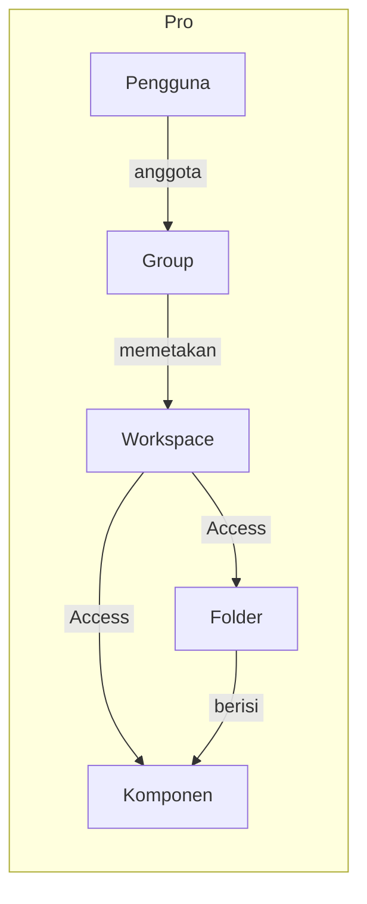

# Apa itu Pro?

>**note** Pro merupakan salah satu konsep dasar di Phoenix, bersama [[Docs/Dasar/Apa itu Folder|Folder]] dan [[Docs/Dasar/Apa itu Komponen|Komponen]]. Pro adalah wadahnya, Folder menatanya, dan Komponen menjadi isinya.

Pro adalah wadah utama di Phoenix. Seluruh [[Docs/Dasar/Apa itu Folder|Folder]], [[Docs/Dasar/Apa itu Komponen|Komponen]], data, pengguna, [[Docs/Modul Developer/Group/Apa itu Group|Group]], dan [[Docs/Modul Developer/Workspace/Apa itu Workspace|Workspace]] yang Anda kelola berada di dalam satu Pro.

Di dalam satu Pro, data, tampilan, logika, dan hak akses saling terhubung. Anda dapat menyimpan data di [[Docs/Modul Data/Table/Apa itu Table|Table]], menampilkannya lewat komponen modul [[Docs/Modul Interface/Pengenalan|Interface]], menjalankan otomasi dengan [[Docs/Modul Logic/Flow/Apa itu Flow|Flow]], lalu mengatur siapa yang boleh melihat dan mengubahnya lewat modul [[Docs/Modul Developer/Pengenalan|Developer]].

## Konsep Utama

| Istilah | Penjelasan |
| --- | --- |
| [[Docs/Dasar/Apa itu Folder|Folder]] | Penata komponen di dalam Pro dalam struktur bertingkat. |
| [[Docs/Dasar/Apa itu Komponen|Komponen]] | Unit penyusun Pro, seperti penyimpan data, tampilan, dan logika. |
| [[Docs/Dasar/Apa itu Komponen#Modul dan Komponen di Phoenix|Modul]] | Pengelompokan komponen berdasarkan peran: Data, Interface, Logic, dan Developer. |
| [[Docs/Modul Developer/Group/Apa itu Group|Group]] | Komponen untuk mengelompokkan anggota dan menentukan Workspace yang dapat mereka akses. |
| [[Docs/Modul Developer/Workspace/Apa itu Workspace|Workspace]] | Komponen yang mengatur folder, komponen, data, dan fungsi yang dapat diakses anggota. |
| [[Docs/Antarmuka#Area Manajemen Folder|Area Manajemen Folder]] | Bagian antarmuka tempat Anda mengelola folder dan komponen di dalam Pro. |

## Isi Pro Saat Dimulai

Saat sebuah Pro dimulai, Phoenix menyiapkan tiga hal berikut secara otomatis. Langkah memulai Pro dijelaskan di [[Inisialisasi/Pengenalan|Inisialisasi Pro]].

| Bawaan | Fungsi | Hal yang perlu diketahui |
| --- | --- | --- |
| [[Docs/Modul Developer/Group/Apa itu Group|Group Administrator]] | Group bawaan yang menjadi default. Pengguna baru ditempatkan sistem ke Group ini. | Satu pengguna hanya dapat berada dalam satu Group. |
| [[Docs/Modul Developer/Workspace/Apa itu Workspace|Workspace Origin]] | Workspace pertama dan bawaan. Seluruh hak aksesnya [[^value/boolean/allow]] dan otomatis terhubung ke Group Administrator. | Tidak dapat dihapus selama belum ada Workspace lain di posisi *root* yang terhubung ke Group. |
| [[Docs/Modul Data/Variable/Apa itu Variable|Variable]] | Komponen yang menyimpan [[Docs/Tipe Data/Variable|Variable Data]] dan dapat dirujuk dari komponen mana pun. | Hanya ada satu per Pro, dibuat di folder *root*, dan tidak dapat ditambah, diduplikasi, atau dihapus. Boleh dipindahkan ke folder lain. |

>**warning** Pengguna baru memperoleh akses penuh
> Pengguna baru ditempatkan ke Group Administrator, sedangkan Group tersebut terhubung ke Workspace Origin yang seluruh hak aksesnya [[^value/boolean/allow]]. Pindahkan pengguna ke Group lain yang Workspace-nya lebih terbatas bila ia tidak perlu mengelola seluruh isi Pro.

## Cara Kerja

### Pro Menyimpan Struktur dan Isi

[[Docs/Dasar/Apa itu Folder|Folder]] menyusun struktur Pro, sedangkan [[Docs/Dasar/Apa itu Komponen|Komponen]] menjadi isinya. Komponen menyimpan data, menampilkan data, menjalankan logika, atau mengatur akses, dan ditempatkan di dalam folder. Folder sendiri tidak menyimpan data.

### Siapa Boleh Melakukan Apa

Akses ke isi Pro mengalir dari pengguna ke Group, lalu ke Workspace, dan terakhir ke folder serta komponen.

Workspace mengatur tiga jenis akses: [[Docs/Modul Developer/Workspace/Component Access|Component Access]] untuk folder dan komponen, [[Docs/Modul Developer/Workspace/Data Access|Data Access]] untuk data di dalam komponen, dan [[Docs/Modul Developer/Workspace/Function Access|Function Access]] untuk fungsi seperti Merge, Event, dan Publish.

Satu pengguna hanya dapat berada dalam satu Group, satu Group dapat memiliki beberapa Workspace. Selengkapnya lihat [[Docs/Modul Developer/Group/Apa itu Group|Group]] dan [[Docs/Modul Developer/Workspace/Apa itu Workspace|Workspace]].

### Workspace Aktif

Saat Anda membuka Phoenix, Anda masuk ke Workspace yang terakhir Anda pakai. Jika Workspace tersebut sudah tidak valid, misalnya karena Workspace pada Group berubah, Anda otomatis dipindahkan ke Workspace pertama pada daftar Group. Untuk berpindah, klik tombol berisi nama Workspace aktif di [[Docs/Antarmuka#Area Manajemen Folder|Area Manajemen Folder]], lalu pilih Workspace pada popup yang tampil.

### Struktur Folder Pro dan Workspace

Struktur folder Pro dan Workspace saling berkesinambungan. Memindahkan folder atau komponen, baik di [[Docs/Antarmuka#Area Manajemen Folder|Area Manajemen Folder]] maupun di halaman kerja Workspace, mengubah struktur folder Pro, bukan hanya tampilan halaman tersebut. Langkahnya ada di [[Docs/Dasar/Apa itu Folder#Memindahkan Folder dan Komponen|Memindahkan Folder dan Komponen]].

>**warning** Tidak ada pengaman bawaan pada hak akses
> Menonaktifkan [[Docs/Modul Developer/Workspace/Component Access#Visible pada Folder dan Komponen|Visible]] atau [[^field|Update]] pada komponen Workspace dan Group yang dipakai administrator dapat mengunci pengelolaan akses Anda sendiri. Satu-satunya pengaman adalah larangan menghapus Workspace *root* terakhir yang terhubung ke Group.

## Jelajahi Lebih Lanjut

| Jika Anda ingin | Baca |
| --- | --- |
| Menata komponen agar mudah ditemukan | [[Docs/Dasar/Apa itu Folder|Folder]] |
| Memahami unit penyusun sistem | [[Docs/Dasar/Apa itu Komponen|Komponen]] |
| Menyimpan data | Modul [[Docs/Modul Data/Pengenalan|Data]] |
| Menampilkan dan mengelola data | Modul [[Docs/Modul Interface/Pengenalan|Interface]] |
| Mengotomasi proses | Modul [[Docs/Modul Logic/Pengenalan|Logic]] dan [[Docs/Dasar/Apa itu Event|Event]] |
| Mengatur tim dan hak akses | Modul [[Docs/Modul Developer/Pengenalan|Developer]], [[Docs/Modul Developer/Group/Apa itu Group|Group]], dan [[Docs/Modul Developer/Workspace/Apa itu Workspace|Workspace]] |
| Mengenali bagian layar Phoenix | [[Docs/Antarmuka|Antarmuka]] |
| Memahami jenis data yang dipakai komponen | [[Docs/Tipe Data/Pengenalan|Tipe Data]] |

## TL:DR

- Pro adalah wadah utama yang menampung [[Docs/Dasar/Apa itu Folder|Folder]], [[Docs/Dasar/Apa itu Komponen|Komponen]], data, pengguna, Group, dan Workspace.
- Saat dimulai, Pro otomatis memiliki Group [[^field/group|Administrator]], Workspace [[^field/workspace|Origin]], dan komponen [[^field/variable|Variable]].
- Akses mengalir dari pengguna ke Group, Workspace, lalu ke folder dan komponen lewat [[Docs/Modul Developer/Workspace/Component Access|Component Access]], [[Docs/Modul Developer/Workspace/Data Access|Data Access]], dan [[Docs/Modul Developer/Workspace/Function Access|Function Access]].
- Anda masuk ke Workspace yang terakhir dipakai dan dapat berpindah lewat tombol nama Workspace di [[Docs/Antarmuka#Area Manajemen Folder|Area Manajemen Folder]].
- Pengguna baru masuk ke Group Administrator yang berakses penuh, jadi atur Group dan Workspace sejak awal.
- Tidak ada pengaman bawaan pada hak akses, jadi jangan menonaktifkan akses komponen Workspace dan Group yang dipakai administrator.

## FAQ : Pertanyaan yang Sering Diajukan

> **faq**
> **Apa perbedaan Pro dan Workspace?**
> Pro menampung seluruh isi sistem Anda. [[Docs/Modul Developer/Workspace/Apa itu Workspace|Workspace]] adalah komponen di dalam Pro yang menentukan folder, komponen, data, dan fungsi yang dapat diakses anggota Group.
> **Apa saja yang otomatis ada saat Pro dimulai?**
> Group [[^field/group|Administrator]], Workspace [[^field/workspace|Origin]], dan komponen [[^field/variable|Variable]] di folder *root*. Selengkapnya lihat [[#Isi Pro Saat Dimulai]].
> **Dapatkah saya menghapus komponen Variable?**
> Tidak. Komponen [[Docs/Modul Data/Variable/Apa itu Variable|Variable]] bersifat unik per Pro, tetapi boleh dipindahkan ke folder lain.