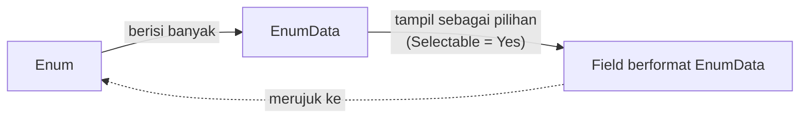

# Cara Kerja Enum

Enum menyimpan banyak [[Docs/Tipe Data/EnumData]], lalu field berformat [[Docs/Tipe Data/EnumData]] di komponen lain menampilkan [[Docs/Tipe Data/EnumData]] tersebut sebagai daftar pilihan.

Hanya [[Docs/Tipe Data/EnumData]] dengan [[^field|Selectable]] bernilai [[^value/boolean/true]] yang tampil pada daftar pilihan. [[Docs/Tipe Data/EnumData]] dengan nilai [[^value/boolean/false]] tidak tampil sebagai pilihan di field, tetapi tetap dapat dipakai di tempat lain.