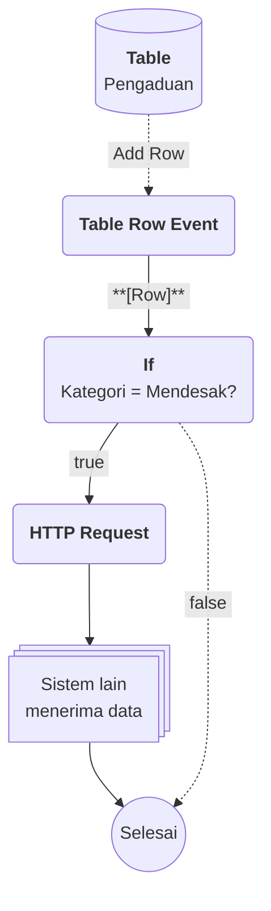

# Contoh Penggunaan

## Studi Kasus : Kategori pengaduan yang seragam dan memicu tindak lanjut otomatis

Tim layanan pelanggan menerima pengaduan dari banyak orang. Agar laporan mudah dikelompokkan dan yang mendesak segera ditangani, kategori pengaduan disimpan sebagai Master Data di Enum, lalu dipakai ulang di form dan tabel pengaduan.

## Komponen yang terlibat

| Komponen | Peran |
| --- | --- |
| [[^field/enum|Kategori Pengaduan]] | Menyimpan daftar kategori sebagai [[Docs/Tipe Data/EnumData]]. |
| [[^field/table|Pengaduan]] | Menyimpan data pengaduan dengan field kategori berformat [[Docs/Tipe Data/EnumData]]. |
| [[^field/flow|Tindak Lanjut Pengaduan]] | Menjalankan otomasi ketika pengaduan baru masuk. |

## Alur di Flow [[^field/flow|Tindak Lanjut Pengaduan]]

| Langkah | Flow Block | Peran dalam alur | Hasil |
| --- | --- | --- | --- |
| 1 | [[Docs/Modul Logic/Flow/Flow Block/Event/Pengenalan|Table Row Event]] | Aktif ketika pengaduan baru ditambahkan. | Baris pengaduan diteruskan ke alur. |
| 2 | [[Docs/Modul Logic/Flow/Flow Block/Operator/Pengenalan|If]] | Memeriksa apakah kategori pengaduan adalah yang mendesak. | Alur terbagi menjadi jalur true dan false. |
| 3 | [[Docs/Modul Logic/Flow/Flow Block/Modular/Pengenalan|HTTP Request]] | Mengirim data pengaduan ke sistem lain. | Sistem lain menerima data. |

## Hasil yang dirasakan

- Petugas memilih kategori dari daftar yang seragam, tanpa mengetik ulang dan tanpa salah ejaan.
- Pengaduan mendesak langsung diteruskan ke sistem lain tanpa menunggu dicek manual.
- Menambah atau menonaktifkan kategori cukup dilakukan di Enum, dan semua field yang merujuk ikut diperbarui.

## Ide skenario lain

| Jenis nilai | Contoh integrasi |
| --- | --- |
| Status pesanan | Menjadi kolom pengelompokan pada [[Docs/Modul Interface/Kanban/Apa itu Kanban|Kanban]] dan pemicu notifikasi di [[Docs/Modul Logic/Flow/Apa itu Flow|Flow]]. |
| Kategori produk | Menjadi pilihan di [[Docs/Modul Interface/Form/Apa itu Form|Form]] input produk dan penyaring pada [[Docs/Modul Interface/Table View/Apa itu Table View|Table View]]. |
| Tingkat prioritas | Menjadi dasar percabangan alur penanganan di [[Docs/Modul Logic/Flow/Apa itu Flow|Flow]]. |
| Wilayah layanan | Menjadi pilihan seragam di berbagai Table sehingga laporan antarwilayah konsisten. |

Dengan satu daftar yang terhubung ke data dan logika, Enum membuat pilihan yang sama dapat dipakai konsisten di seluruh Phoenix.