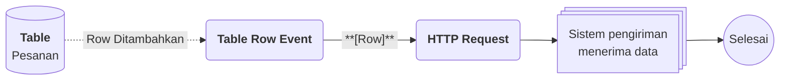

# Contoh Penggunaan

## Studi Kasus : Mencatat pesanan pelanggan dan meneruskannya ke sistem lain

Tim penjualan mencatat pesanan yang masuk dan ingin pesanan tersebut otomatis diteruskan ke sistem pengiriman, tanpa menyalin data satu per satu. Table menyimpan setiap pesanan dengan format kolom yang konsisten, lalu [[Docs/Event/Apa itu Event|Event]] dari Table memicu [[Docs/Modul Logic/Flow/Apa itu Flow|Flow]] untuk mengirim data ke sistem tersebut.

## Komponen yang terlibat

| Komponen                         | Peran                                                                          |
| -------------------------------- | ------------------------------------------------------------------------------ |
| [[^field/table|Pesanan]]         | Menyimpan setiap pesanan sebagai Row, dengan Column seperti Nama Pelanggan dan Jumlah. |
| [[^field/flow|Kirim Pesanan]]    | Menjalankan logika pengiriman data saat ada Row baru.                          |

## Alur di Flow

| Langkah | Flow Block                                                                              | Peran dalam alur                                  | Hasil                                    |
| ------- | --------------------------------------------------------------------------------------- | ------------------------------------------------- | ---------------------------------------- |
| 1       | [[Docs/Modul Logic/Flow/Flow Block/Event/Table Row Event|Table Row Event]]                   | Terpicu saat Row baru ditambahkan pada Table.     | Data Row siap diteruskan.                |
| 2       | [[Docs/Modul Logic/Flow/Flow Block/Modular/HTTP Request|HTTP Request]]                    | Mengirim data Row ke sistem pengiriman.           | Sistem pengiriman menerima pesanan.      |

## Hasil yang dirasakan

- Pesanan cukup dicatat sekali di Table, lalu diteruskan otomatis ke sistem lain.
- Format kolom yang konsisten mengurangi kesalahan data saat dikirim.
- Tim dapat memilih pesanan lewat field berformat Row dengan pola `ID - Alias Value`, sehingga lebih mudah dikenali.

## Ide skenario lain

| Jenis nilai          | Contoh integrasi                                                                          |
| -------------------- | ----------------------------------------------------------------------------------------- |
| Data generik         | Daftar produk atau pelanggan yang dirujuk oleh komponen lain lewat field berformat Row.   |
| Data transaksional   | Catatan stok masuk dan keluar yang memicu pemberitahuan lewat Flow saat stok menipis.     |
| Data publikasi       | Daftar harga atau jadwal yang dipublikasikan lewat [[Docs/Modul Data/Table/Publish|Publish]]. |

Dengan satu Table sebagai sumber data, pencatatan, pemilihan data, dan otomasi dapat berjalan dari data yang sama.