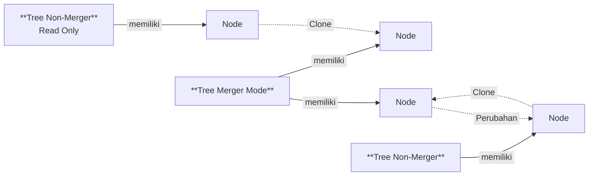

# Cara Kerja Table View

Tree menyimpan [[Docs/Tipe Data/Node]] secara bertingkat, dan hanya Tree dengan Merger Mode yang dapat menambahkan Node dari Tree lain.

Tree yang tidak bersifat merger tidak dapat menambahkan Node dari Tree lain. Node *clone* di Tree penggabung dapat dibuat dengan atau tanpa mengikuti perubahan Node asalnya, dan pilihan ini berkaitan dengan [[#External Read Only]]. Selengkapnya lihat [[Docs/Modul Data/Tree/Konfigurasi Merger Mode]].