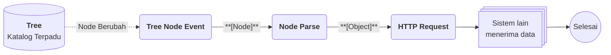

# Contoh Penggunaan Tree

## Studi Kasus : Katalog Kategori Terpadu dari Beberapa Divisi

Setiap divisi menyusun kategori produknya sendiri dalam bentuk pohon, tetapi tim pusat membutuhkan satu katalog terpadu untuk dipakai laporan dan sistem lain. Dengan Tree, setiap divisi tetap mengelola [[Docs/Tipe Data/Node]]-nya sendiri, sementara satu Tree penggabung menghimpun semuanya tanpa menyalin ulang secara manual. Ketika katalog terpadu berubah, sistem lain langsung menerima perubahannya.

## Komponen yang terlibat

| Komponen | Peran |
| --- | --- |
| [[^field/tree|Tree Divisi A]] | Tree non-merger yang menyimpan kategori milik divisi pertama. |
| [[^field/tree|Tree Divisi B]] | Tree non-merger yang menyimpan kategori milik divisi kedua. |
| [[^field/tree|Katalog Terpadu]] | Tree dengan [[Docs/Modul Data/Tree/Konfigurasi Merger Mode|Merger Mode]] yang menambahkan (*clone*) Node dari kedua Tree divisi. |
| [[^field/flow|Sinkronisasi Katalog]] | [[Docs/Modul Logic/Flow/Apa itu Flow|Flow]] yang meneruskan perubahan katalog ke sistem lain. |

## Alur di Flow

| Langkah | Flow Block | Peran dalam alur | Hasil |
| --- | --- | --- | --- |
| 1 | [[Docs/Modul Logic/Flow/Flow Block/Event/Tree Node Event|Tree Node Event]] | Memicu alur ketika Node pada Tree terpadu berubah. | Node yang berubah. |
| 2 | [[Docs/Modul Logic/Flow/Flow Block/Operator/Node Parse|Node Parse]] | Mengurai Node menjadi data yang dapat dikirim. | Data Node yang siap dikirim. |
| 3 | [[Docs/Modul Logic/Flow/Flow Block/Modular/HTTP Request|HTTP Request]] | Mengirim data ke sistem lain. | Sistem lain menerima katalog terbaru. |

## Hasil yang dirasakan

- Setiap divisi tetap bebas mengelola kategorinya sendiri, tanpa mengubah Tree divisi lain.
- Tim pusat memiliki satu katalog terpadu yang tidak perlu disusun ulang secara manual.
- Sistem lain selalu menerima kategori terbaru tanpa proses kirim manual.

## Ide skenario lain

| Jenis nilai | Contoh integrasi |
| --- | --- |
| Struktur organisasi lintas cabang | Tree penggabung menghimpun struktur tiap cabang, lalu [[Docs/Modul Data/Tree/Publikasi|Publish]] membagikannya ke pihak yang membutuhkan. |
| Hierarki kategori produk | [[Docs/Modul Data/Table/Apa itu Table|Table]] memakai Node dari Tree sebagai pilihan kategori pada setiap baris produk. |
| Menu atau navigasi bertingkat | Tree menyimpan susunan menu, lalu Flow memperbarui sistem lain setiap kali susunannya berubah. |

Dengan memisahkan Tree sumber dan Tree penggabung, data tetap dikelola oleh pemiliknya masing-masing, tetapi dapat dipakai bersama oleh seluruh tim.