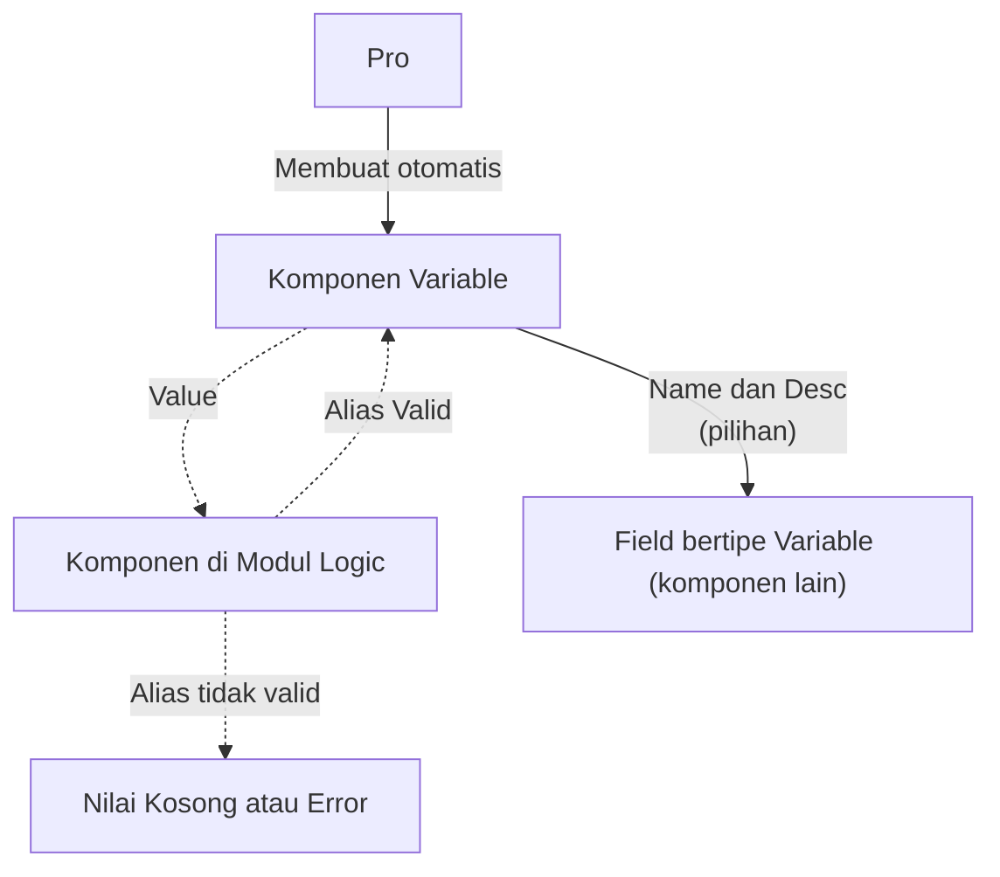

# Cara Kerja Variable

Variable adalah satu sumber data yang dikenali oleh semua komponen di dalam ruang lingkup Pro.

Ada dua cara komponen merujuk ke Variable:

- **Field bertipe Variable.** Pada komponen yang memiliki field dengan [[Docs/Tipe Data/Variable|tipe data Variable]], pilihannya adalah daftar [[^field|Name]] dan [[^field|Description]] dari Variable Data.
- **Komponen di modul Logic.** Komponen dalam [[Docs/Modul Logic]] dapat mengisi field Variable cukup dengan [[^field|Alias]]. Jika [[^field|Alias]] tidak valid di Variable (tidak ada [[^field|Nama]] yang cocok), maka tidak ada nilai yang diterima atau error.