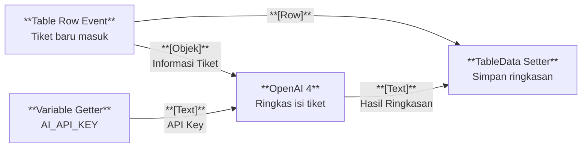

# Contoh Penggunaan

## Studi Kasus : Menjaga API Key Penyedia AI Tetap Aman dalam Otomasi Flow

Sebuah tim ingin setiap tiket baru yang masuk ke tabel diringkas otomatis oleh AI. Layanan AI membutuhkan API Key, tetapi kunci tersebut tidak boleh diketahui seluruh anggota tim. Dengan Variable, kunci disimpan sekali, dan [[Docs/Modul Logic/Flow/Apa itu Flow|Flow]] memanggilnya lewat nama untuk kebutuhan integrasi.

## Komponen yang terlibat

| Komponen | Peran |
| --- | --- |
| [[^field/variable|Variables]] | Menyimpan API Key penyedia AI dengan Name `AI_API_KEY`. |
| [[^field/table|Daftar Tiket]] | Menyimpan tiket yang masuk dan hasil ringkasannya. |
| [[^field/flow|Ringkas Tiket Otomatis]] | Menjalankan proses dari tiket baru sampai ringkasan tersimpan. |

## Alur di Flow

| Langkah | Flow Block | Peran dalam alur | Hasil |
| --- | --- | --- | --- |
| 1 | [[Docs/Modul Logic/Flow/Flow Block/Event/Pengenalan|Table Row Event]] | Berjalan saat baris tiket baru ditambahkan. | Flow dimulai otomatis. |
| 2 | [[Docs/Modul Logic/Flow/Flow Block/Data/Pengenalan|Variable Getter]] | Mengambil nilai Variable dengan mengisi Name `AI_API_KEY`. | API Key tersedia untuk Flow tanpa perlu diketahui tim. |
| 3 | [[Docs/Modul Logic/Flow/Flow Block/Modular/Pengenalan|AI (OpenAI 4)]] | Mengirim isi tiket ke penyedia AI memakai API Key tersebut. | Ringkasan tiket diterima. |
| 4 | [[Docs/Modul Logic/Flow/Flow Block/Data/Pengenalan|TableData Setter]] | Menulis ringkasan ke baris tiket yang sama. | Ringkasan tampil di tabel. |

## Hasil yang dirasakan

- Tiket baru langsung memiliki ringkasan tanpa pekerjaan manual.
- API Key hanya disimpan di satu tempat dan tidak perlu dibagikan ke anggota tim.
- Jika API Key diganti, Anda cukup memperbarui satu baris di [[Docs/Modul Data/Variable/Apa itu Variable|Variable Data]] dan semua Flow yang memanggilnya ikut memakai nilai baru.

## Ide skenario lain

| Jenis nilai | Contoh integrasi |
| --- | --- |
| Alamat IP server *hub* | Beberapa [[Docs/Modul Logic/Flow/Apa itu Flow|Flow]] mengirim data ke perangkat atau layanan yang sama tanpa menuliskan alamatnya berulang kali. |
| Alamat layanan atau URL dasar | [[Docs/Modul Logic/Flow/Apa itu Flow|Flow]] yang memanggil layanan eksternal merujuk satu Name, sehingga perpindahan alamat cukup diubah sekali. |
| Parameter bisnis | Ambang batas atau batas waktu dipakai bersama oleh beberapa [[Docs/Modul Logic/Flow/Apa itu Flow|Flow]] dan tetap konsisten. |
| Konfigurasi notifikasi | data berisi tujuan notifikasi yang dipakai banyak proses. |
