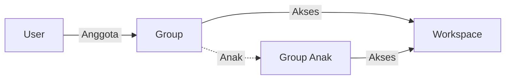

# Apa itu Group?

>**note** Group merupakan salah satu komponen dalam modul [[Docs/Modul Developer/Pengenalan|Developer]] di Phoenix.

Group adalah komponen yang dapat digunakan untuk mengatur komposisi tim Anda serta akses [[Docs/Modul Developer/Workspace/Apa itu Workspace|Workspace]] yang diberikan kepada setiap anggota.

Alih-alih mengatur akses satu per satu untuk setiap orang, Anda cukup mengelompokkan anggota ke dalam Group, lalu menentukan Workspace apa saja yang dapat diakses oleh Group tersebut. Group juga dapat disusun bertingkat dengan Group anak, sehingga struktur tim Anda terlihat jelas dalam satu halaman kerja.

## Mengapa Menggunakan Group?

- **Akses diatur sekali untuk banyak orang.** Tentukan Workspace pada Group, dan seluruh anggotanya langsung mengikuti.
- **Struktur tim terlihat jelas.** Group anak tersusun di bawah Group induk dan dapat dibuka atau ditutup sesuai kebutuhan.
- **Perpindahan anggota menjadi cepat.** Pindahkan User ke Group lain dengan *drag and drop*, tanpa mengubah akses satu per satu.
- **Anggota baru langsung tertangani.** User yang baru terdaftar otomatis ditempatkan oleh sistem ke Group berstatus default.

## Konsep Utama

| Istilah | Penjelasan |
| ------- | ---------- |
| [[#Cara Kerja Group|Group]] | Kelompok anggota yang memiliki daftar Workspace dan daftar User. |
| [[#Mengelola Group Anak|Group Anak]] | Group yang berada di bawah Group lain dan memiliki daftar Workspace dan User sendiri. |
| [[Docs/Modul Developer/Workspace/Apa itu Workspace|Workspace]] | Ruang kerja yang aksesnya diberikan melalui Group. Selengkapnya lihat [[Docs/Modul Developer/Workspace/Apa itu Workspace|Apa itu Workspace]]. |
| [[#Mengelola User dalam Group|User]] | Anggota yang ditempatkan ke dalam Group. |
| [[#Mengelola User dalam Group|Group Berstatus Default]] | Group tempat sistem menempatkan User yang baru terdaftar di [[Inisialisasi/Apa itu Pro?|Pro]]. |
| [[#Menempatkan Group ke Direktori|Place to Directory]] | Menu untuk menempatkan Group anak sebagai komponen di Area Manajemen Folder. |

## Cara Kerja Group

User menjadi anggota Group, dan Group menentukan Workspace yang dapat diakses oleh seluruh anggotanya.

<!--
  * [TODO] Konfirmasi apakah Group anak mewarisi Workspace dari Group induk, atau Workspace pada setiap Group diatur terpisah. Saat ini diagram dan teks hanya menyatakan setiap Group (termasuk Group anak) memiliki daftar Workspace sendiri.
-->

## Membuat Group

Group dapat dibuat dari dua tempat, dan hasilnya sedikit berbeda.

### Dari Area Manajemen Folder

Cara ini menambahkan Group sebagai komponen di dalam folder.

![[Docs/Modul Developer/Group/add-group.png]]

<!--
  * [TODO] Letakkan gambar dialog Create Group (add-group.png) di sini. Anotasi yang disarankan: (1) bagian direktori di kiri tanda `/` dan kolom Name, (2) Description, (3) Parent, (4) tombol Create.
  * [TODO] Konfirmasi bagian di kiri tanda `/` pada baris Name (tampil `root`) adalah direktori tujuan folder, dan nama labelnya di aplikasi.
-->

1. Buka folder tempat Group akan ditempatkan di [[Docs/Antarmuka#Area Manajemen Folder]]
2. Klik kanan ➜ [[^field/add|Add]] ➜ [[^field|Developer]] ➜ [[^field/group|Group]]
3. Isi [[^field|Name]] dan [[^field|Description]]
4. Pilih Group induk pada [[^field|Parent]]
5. Klik [[^button|Create]]

>**note** Parent wajib diisi
> Pada form dari Area Manajemen Folder, [[^field|Parent]] perlu diisi dengan Group induk dari Group yang dibuat.

>**success** Group berhasil dibuat
> Group yang baru dibuat belum memiliki Workspace dan User. Tambahkan Workspace di [[#Mengelola Workspace dalam Group]] dan pindahkan User di [[#Mengelola User dalam Group]].

<!--
  * [TODO] Konfirmasi jalur menu Add ➜ Developer ➜ Group (mengikuti pola komponen Developer lain).
  * [TODO] Konfirmasi Parent benar-benar wajib, dan bagaimana membuat Group induk paling atas bila Parent wajib diisi.
-->

### Dari Halaman Kerja Group

Cara ini menambahkan Group langsung di halaman kerja Group. Form-nya sama dengan form di Area Manajemen Folder, hanya tidak memiliki bagian direktori karena Group tidak langsung ditempatkan sebagai komponen di folder.

1. Buka halaman kerja Group
2. Klik [[^button/add|Add Group]] pada bagian akhir Group anak
3. Isi [[^field|Name]], [[^field|Description]], dan [[^field|Parent]]
4. Klik [[^button|Create]]

>**note** Group belum muncul di Area Manajemen Folder
> Group yang dibuat dari halaman kerja Group tidak otomatis menjadi komponen di folder. Gunakan [[#Menempatkan Group ke Direktori|Place to Directory]] bila Anda ingin menempatkannya.

<!--
  * [TODO] Konfirmasi lokasi, ikon, dan label tombol Add Group (pada screenshot tidak terlihat karena berada di bagian bawah).
  * [TODO] Konfirmasi apakah Parent terisi otomatis dengan Group tempat tombol Add Group diklik.
-->

## Mengubah Group

1. Buka halaman kerja Group
2. Klik [[^button/edit|Edit]]
3. Ubah [[^field|Name]] atau [[^field|Description]]
4. Klik [[^button|Update]]

<!--
  * [TODO] Konfirmasi atribut apa saja yang dapat diubah lewat tombol Edit pada bilah navigasi (Name, Description, atau Parent), dan apakah Edit berlaku untuk seluruh halaman atau Group induk saja.
-->

## Menyegarkan Group

Klik [[^button/refresh|Refresh]] untuk memuat ulang tampilan.

## Menghapus Group

1. Buka folder yang berisi Group di [[Docs/Antarmuka#Area Manajemen Folder]]
2. Klik kanan Group ➜ [[^button/delete|Delete]]
3. Konfirmasi dengan klik [[^button|Delete]]

>**warning** Dampak penghapusan Group
> Daftar Workspace dan User pada Group tersebut tidak lagi dapat dikelola, dan anggotanya tidak lagi mendapat akses Workspace melalui Group itu. Pastikan setiap User sudah dipindahkan ke Group lain sebelum menghapus.

<!--
  * [TODO] Konfirmasi dampak penghapusan: apa yang terjadi pada User di dalam Group, Group anak, dan Workspace-nya.
-->

## Antarmuka Group

![[Docs/Modul Developer/Group/interface-group.png]]

Contoh gambar di atas merupakan halaman kerja Group dengan satu Group induk dan dua Group anak.

<!--
  * [TODO] Letakkan gambar halaman kerja (interface-group.png) di sini. Anotasi yang disarankan: (1) judul dan bilah navigasi, (2) panah buka-tutup Group, (3) judul dan deskripsi Group, (4) kolom Workspace, (5) kolom User, (6) Group anak.
  * [TODO] Sesuaikan keterangan gambar dengan nama Group milik Anda bila perlu. Nama pada screenshot tidak disebut di dokumentasi.
-->

Halaman kerja Group terdiri dari bilah navigasi di bagian atas dan daftar Group di bagian bawah. Setiap Group menampilkan judul, deskripsi, kolom [[^field|Workspace]] di sebelah kiri, dan kolom [[^field|User]] di sebelah kanan. Group anak tersusun di bawah Group induknya.

### Bilah navigasi Group terdiri dari:

| Tombol | Fungsi |
| ------ | ------ |
| Judul Group | Menampilkan ikon Group dan nama Group. |
| [[^button/edit|Edit]] | Mengubah atribut Group. Lihat [[#Mengubah Group]]. |
| [[^button/refresh|Refresh]] | Memuat ulang tampilan halaman kerja. |
| [[^field|Search Group Data...]] | Mencari data pada halaman kerja Group. |

<!--
  * [TODO] Konfirmasi cakupan pencarian Search Group Data... (nama Group, Workspace, User, atau semuanya).
  * [TODO] Konfirmasi perbedaan tampilan desktop dan mobile pada bilah navigasi.
-->

### Interaksi Antarmuka Group

| Fungsi | Aksi |
| ------ | ---- |
| Membuka atau menutup daftar Group anak | Klik panah di sebelah kiri judul Group. |
| Menambahkan Workspace | Klik [[^field|Search workspace to add...]], cari Workspace, lalu pilih. |
| Menghapus Workspace dari Group | Klik Workspace pada daftar, lalu konfirmasi [[^button|Remove]]. |
| Memindahkan User | *Drag and drop* User dari Group lama ke Group tujuan. |
| Membuka menu Group anak | Klik kanan pada Group anak. |

<!--
  * [TODO] Konfirmasi cara membuka menu Group anak (klik kanan atau tombol lain), dan gestur gulir vertikal atau horizontal beserta syarat berlakunya.
-->

## Mengelola Group Anak

Group anak ditampilkan di bawah Group induknya. Setiap Group anak memiliki daftar Workspace dan User sendiri. Bila belum ada anggota, kolom [[^field|User]] menampilkan [[^field|(User Is Empty)]].

Menu pada Group anak terdiri dari:

| Menu | Fungsi |
| ---- | ------ |
| [[^field/edit|Edit]] | Mengubah atribut Group anak. |
| [[^field/add|Add Children]] | Menambahkan Group sebagai anak dari Group anak yang dipilih. |
| [[^field|Place to Directory]] | Menempatkan Group anak sebagai komponen di Area Manajemen Folder. |
| [[^field/delete|Delete]] | Menghapus Group anak. |

### Menambahkan Group Anak

1. Klik kanan Group anak ➜ [[^field/add|Add Children]]
2. Isi [[^field|Name]], [[^field|Description]], dan [[^field|Parent]]
3. Klik [[^button|Create]]

Anda juga dapat menambahkan Group melalui tombol [[^button/add|Add Group]] pada bagian akhir Group anak (lihat [[#Dari Halaman Kerja Group]]).

<!--
  * [TODO] Konfirmasi perbedaan Add Children (menu) dan Add Group (tombol): apakah Add Children membuat anak dari Group yang diklik, sedangkan Add Group membuat Group sejajar.
-->

### Mengubah Group Anak

1. Klik kanan Group anak ➜ [[^field/edit|Edit]]
2. Ubah [[^field|Name]] atau [[^field|Description]]
3. Klik [[^button|Update]]

### Menempatkan Group ke Direktori

Group anak juga merupakan komponen. Gunakan [[^field|Place to Directory]] untuk menampilkannya di Area Manajemen Folder.

1. Klik kanan Group anak ➜ [[^field|Place to Directory]]

>**note** Posisi penempatan
> Group yang dipilih akan ditempatkan di posisi *root* folder. Selengkapnya tentang folder lihat [[Docs/Folder/Apa itu Folder?]].

<!--
  * [TODO] Konfirmasi apakah ada dialog atau konfirmasi setelah memilih Place to Directory, dan apa yang dimaksud root folder (root dari seluruh Pro atau root folder tertentu).
-->

### Menghapus Group Anak

1. Klik kanan Group anak ➜ [[^field/delete|Delete]]
2. Konfirmasi dengan klik [[^button|Delete]]

>**warning** Dampak penghapusan Group anak
> Workspace dan User pada Group anak tersebut tidak lagi terhubung ke Group itu. Pindahkan User ke Group lain terlebih dahulu agar tidak kehilangan akses.

## Mengelola Workspace dalam Group

### Menambahkan Workspace

1. Buka halaman kerja Group
2. Klik [[^field|Search workspace to add...]] pada kolom [[^field|Workspace]] di Group tujuan
3. Cari Workspace yang diinginkan, lalu pilih

Workspace yang dipilih otomatis bertambah ke daftar Workspace pada Group.

### Menghapus Workspace

1. Buka halaman kerja Group
2. Klik Workspace pada daftar Workspace di Group
3. Konfirmasi dengan klik [[^button|Remove]]

>**warning** Akses anggota ikut berubah
> Anggota Group tidak lagi dapat mengakses Workspace yang dihapus dari daftar. Pastikan Group masih memiliki Workspace lain agar anggotanya tetap dapat memakai Phoenix.

## Mengelola User dalam Group

Saat User baru terdaftar di [[Inisialisasi/Apa itu Pro?|Pro]], sistem otomatis menempatkannya ke Group berstatus default. Untuk menempatkan User ke Group yang sebenarnya, pindahkan User dari Group lama ke Group tujuan.

### Memindahkan User

1. Buka halaman kerja Group
2. Klik panah di sebelah kiri judul Group agar Group asal dan Group tujuan sama-sama terlihat
3. Tekan dan tahan User pada kolom [[^field|User]] di Group asal
4. Seret ke kolom [[^field|User]] di Group tujuan, lalu lepaskan

Setelah dipindahkan, akses User mengikuti Workspace milik Group tujuan.

<!--
  * [TODO] Konfirmasi nama Group berstatus default di aplikasi, dan apakah status default dapat diubah ke Group lain.
  * [TODO] Konfirmasi apakah satu User hanya dapat berada di satu Group (memindahkan) atau dapat di beberapa Group (menyalin).
-->

## Contoh Penggunaan

**Mengatur akses tim berdasarkan peran**

Sebuah organisasi memiliki beberapa tim dengan kebutuhan Workspace yang berbeda. Dengan Group, administrator cukup menyusun tim sekali, lalu setiap anggota baru tinggal dipindahkan ke Group yang sesuai tanpa mengatur akses per orang.

**Komponen yang terlibat**

| Komponen | Peran |
| -------- | ----- |
| [[^field/group|Manajemen]] | Group induk yang menaungi seluruh tim. |
| [[^field/group|Tim Lapangan]] | Group anak untuk anggota yang hanya memerlukan Workspace operasional. |
| [[^field/workspace|Operasional]] | Workspace untuk pekerjaan harian tim. |
| [[^field/workspace|Laporan]] | Workspace untuk melihat dan mengelola laporan. |

**Langkah pengaturan**

| Langkah | Aksi | Hasil |
| ------- | ---- | ----- |
| 1 | Buat Group induk dan Group anak. Lihat [[#Membuat Group]] dan [[#Mengelola Group Anak]]. | Struktur tim tersusun. |
| 2 | Tambahkan Workspace ke setiap Group. Lihat [[#Mengelola Workspace dalam Group]]. | Setiap Group memiliki akses yang tepat. |
| 3 | User baru terdaftar di [[Inisialisasi/Apa itu Pro?|Pro]]. | Sistem menempatkan User ke Group berstatus default. |
| 4 | Pindahkan User ke Group tim dengan *drag and drop*. Lihat [[#Mengelola User dalam Group]]. | Akses User langsung mengikuti Workspace Group tujuan. |

**Hasil yang dirasakan**

- Anggota baru langsung bekerja di Workspace yang tepat tanpa pengaturan akses satu per satu.
- Administrator melihat seluruh susunan tim, Workspace, dan anggotanya dalam satu halaman kerja.
- Perubahan akses tim cukup dilakukan pada Group, bukan pada setiap orang.

**Ide skenario lain**

| Kebutuhan | Contoh pengaturan |
| --------- | ----------------- |
| Pemisahan departemen | Satu Group per departemen, masing-masing dengan Workspace sendiri. |
| Tim proyek sementara | Buat Group anak untuk proyek, lalu hapus setelah proyek selesai. |
| Akses terbatas untuk tamu | Group khusus dengan satu Workspace yang hanya berisi data yang boleh dilihat. |

Dengan Group, pengelolaan akses berpindah dari urusan per orang menjadi urusan per tim, sehingga tim yang bertambah besar tetap mudah diatur.

<!--
  * [TODO] Nama Group dan Workspace pada contoh bersifat generik. Sesuaikan dengan contoh yang Anda inginkan.
-->

## Praktik Terbaik

- **Kelompokkan berdasarkan peran atau tim**, bukan berdasarkan perorangan, agar akses mudah dipahami dan dirawat.
- **Berikan Workspace seperlunya** pada setiap Group sesuai prinsip *least privilege*, terutama pada Group berstatus default karena setiap User baru masuk ke sana lebih dulu.
- **Pastikan setiap Group memiliki minimal satu Workspace** agar anggotanya tetap dapat memakai Phoenix.
- **Pindahkan User ke Group tujuan segera** setelah terdaftar, agar tidak terlalu lama berada di Group berstatus default.
- **Gunakan [[^field|Place to Directory]]** hanya untuk Group anak yang perlu dikelola sebagai komponen di [[Docs/Antarmuka#Area Manajemen Folder]].

## Batasan dan Catatan

- Akses Workspace diberikan melalui Group, bukan per User. Baris Group pada halaman kerja [[Docs/Modul Developer/Workspace/Apa itu Workspace|Workspace]] hanya mengatur akses ke komponen Group, bukan akses per anggota.
- Form dari Area Manajemen Folder menambahkan Group sebagai komponen di folder dan mewajibkan [[^field|Parent]] diisi. Form dari halaman kerja Group tidak memiliki bagian direktori.
- Group yang dibuat dari halaman kerja Group tidak otomatis muncul di Area Manajemen Folder sampai ditempatkan dengan [[^field|Place to Directory]].
- [[^field|Place to Directory]] menempatkan Group di posisi *root* folder.
- User baru otomatis masuk Group berstatus default, sehingga aksesnya mengikuti Workspace Group tersebut sampai Anda memindahkannya.
- Menghapus Workspace dari Group langsung memengaruhi akses seluruh anggota Group itu.

## TL:DR

- Group adalah komponen untuk mengatur tim dan akses [[Docs/Modul Developer/Workspace/Apa itu Workspace|Workspace]] bagi anggotanya sekaligus.
- Group dapat dibuat dari Area Manajemen Folder (wajib mengisi [[^field|Parent]]) atau dari halaman kerja Group melalui [[^button/add|Add Group]].
- Group anak tersusun di bawah Group induk. Menu Group anak adalah [[^field/edit|Edit]], [[^field/add|Add Children]], [[^field|Place to Directory]], dan [[^field/delete|Delete]].
- Tambahkan Workspace lewat [[^field|Search workspace to add...]] dan hapus dengan klik Workspace lalu [[^button|Remove]].
- User baru otomatis masuk Group berstatus default. Pindahkan User ke Group tujuan dengan *drag and drop*.
- Klik panah di kiri judul Group untuk membuka atau menutup daftar Group anak.

## FAQ : Pertanyaan yang Sering Diajukan

> **faq**
> **Apa bedanya menambahkan Group dari Area Manajemen Folder dan dari halaman kerja Group?**
> Dari Area Manajemen Folder, Group ditambahkan sebagai komponen di folder dan [[^field|Parent]] perlu diisi. Dari halaman kerja Group, formnya tidak memiliki bagian direktori.
> **Mengapa Group yang saya buat dari halaman kerja tidak muncul di Area Manajemen Folder?**
> Group tersebut belum ditempatkan sebagai komponen. Klik kanan Group ➜ [[^field|Place to Directory]] untuk menempatkannya di posisi *root* folder.
> **Bagaimana cara memindahkan User ke Group lain?**
> Buka halaman kerja Group, lalu *drag and drop* User dari Group lama ke Group tujuan. Lihat [[#Memindahkan User]].
> **Apa yang terjadi bila Group tidak memiliki Workspace?**
> Anggota Group tidak memiliki Workspace untuk dipakai. Pastikan setiap Group masih memiliki minimal satu Workspace.
> **Bagaimana cara menutup daftar Group anak?**
> Klik panah di sebelah kiri judul Group.