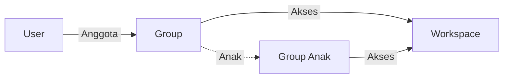

# Cara Kerja Group

User menjadi anggota Group, dan Group menentukan Workspace yang dapat diakses oleh seluruh anggotanya.

Setiap Group, termasuk Group anak, memiliki daftar Workspace sendiri. Group anak tidak mewarisi Workspace dari Group induk, sehingga Workspace perlu ditambahkan kembali pada setiap Group.