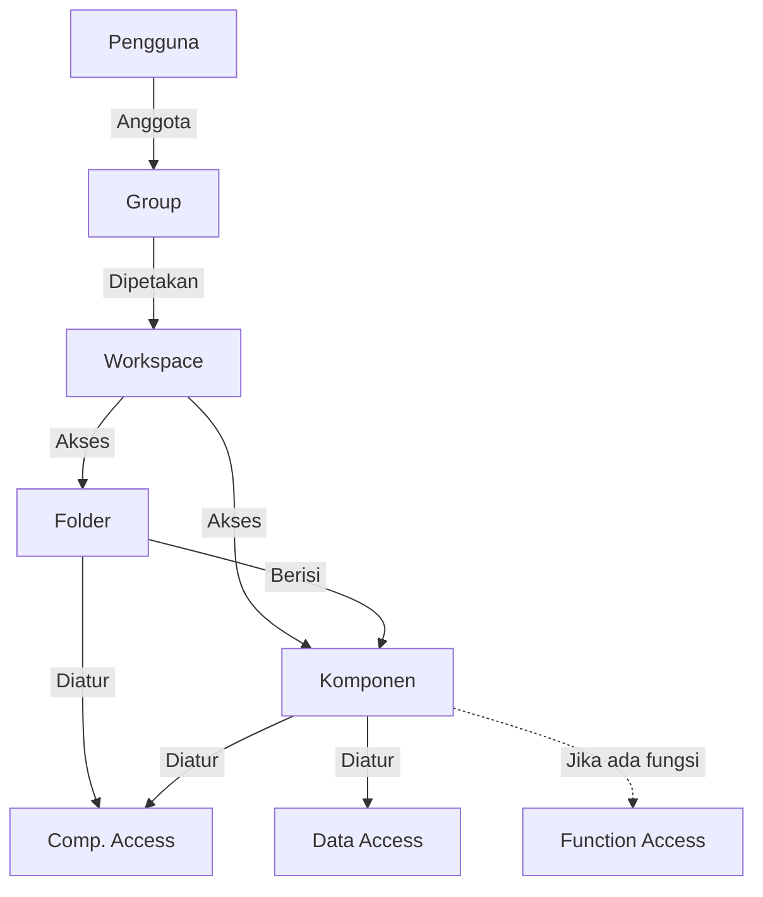

# Apa itu Workspace?

>**note** Workspace merupakan salah satu komponen dalam modul [[Docs/Modul Developer/Pengenalan|Developer]] di Phoenix.

Workspace adalah komponen yang dapat digunakan untuk mengatur ruang kerja pengembangan Anda, termasuk komponen apa saja yang dapat dilihat, dikelola, dan diubah, serta fungsi di dalamnya. Akses Workspace ke setiap anggota dikelola melalui [[Docs/Modul Developer/Group/Apa itu Group|Group]].

Dengan Workspace, Anda tidak perlu mengatur hak akses di banyak tempat. Seluruh folder dan komponen tersaji dalam satu halaman kerja berbentuk pohon, dan setiap hak akses cukup ditentukan dengan memilih [[^value/boolean/allow]] atau [[^value/boolean/disallow]]. Pengaturan ini berlaku sampai ke level data, sehingga Anda dapat menerapkan prinsip *least privilege* tanpa harus membuat komponen baru.

Aturan yang sama berlaku untuk komponen di modul [[Docs/Modul Data/Pengenalan|Data]], [[Docs/Modul Interface/Pengenalan|Interface]], [[Docs/Modul Logic/Pengenalan|Logic]], dan [[Docs/Modul Developer/Pengenalan|Developer]], sehingga seluruh tim bekerja dengan satu aturan akses yang konsisten.

## Mengapa Menggunakan Workspace?

- **Akses terpusat.** Seluruh hak akses folder dan komponen diatur dalam satu halaman kerja.
- **Kontrol sampai level data.** Anda dapat menentukan siapa yang boleh menambah, mengubah, atau menghapus data, bukan hanya siapa yang boleh melihat komponen.
- **Mengikuti struktur folder.** Folder yang tidak dapat dilihat otomatis menyembunyikan seluruh isi di dalamnya.
- **Aman untuk tim.** Anggota hanya melihat dan mengelola bagian yang memang menjadi tanggung jawabnya.
- **Terhubung dengan Group.** Cukup petakan pengguna ke [[Docs/Modul Developer/Group/Apa itu Group|Group]], maka akses Workspace mengikuti.
- **Beberapa ruang kerja untuk satu tim.** Satu Group dapat memiliki beberapa Workspace, dan anggota dapat [[#Berpindah Workspace|berpindah Workspace]] kapan saja dari Area Manajemen Folder.
- **Satu aturan untuk semua tampilan data.** Komponen [[Docs/Modul Interface/Table View/Apa itu Table View|Table View]], [[Docs/Modul Interface/Kanban/Apa itu Kanban|Kanban]], [[Docs/Modul Interface/Gallery/Apa itu Gallery|Gallery]], dan [[Docs/Modul Interface/Timeline/Apa itu Timeline|Timeline]] mengikuti akses data sumbernya, sehingga data tidak dapat diubah lewat tampilan yang berbeda.
- **Terkendali saat dipublikasikan.** [[^field|Publish]] dan [[^field|View Publish]] dipisahkan, sehingga Anda menentukan siapa saja yang boleh mengubah konfigurasi publikasi dan siapa yang hanya boleh menyalin tautannya.

## Konsep Utama

| Istilah | Penjelasan |
| --- | --- |
| [[#Cara Kerja Workspace|Workspace]] | Komponen untuk mengatur ruang kerja pengembangan, yaitu komponen yang dapat dilihat, dikelola, dan diubah, serta fungsi di dalamnya. |
| [[#Cara Kerja Workspace|Origin]] | Workspace bawaan utama sekaligus folder paling atas yang dimiliki setiap [[Docs/Inisialisasi/Apa itu Pro|Pro]]. Seluruh hak akses Origin bernilai [[^value/boolean/allow]], dan Origin otomatis terhubung ke Group bawaan [[^field/group|Administrator]]. |
| [[#Cara Kerja Workspace|Root]] | Folder paling atas pada halaman kerja Workspace. Jika komponen Workspace ditempatkan di folder yang lebih dalam, folder itulah yang menjadi root. |
| [[#Berpindah Workspace|Workspace aktif]] | Workspace yang sedang dipakai pengguna. Workspace aktif menentukan struktur folder dan hak akses yang berlaku, serta ditampilkan pada Area Manajemen Folder. |
| [[Docs/Modul Developer/Group/Apa itu Group|Group]] | Kumpulan pengguna yang dipetakan ke Workspace. Pada halaman kerja, Group tampil sebagai baris dengan angka jumlah anggotanya. Setiap Pro memiliki Group bawaan bernama [[^field/group|Administrator]]. |
| [[Docs/Folder/Apa itu Folder?|Folder]] | Wadah yang berisi banyak komponen dan dapat diperluas atau dilipat. |
| [[Docs/Apa itu Komponen?|Komponen]] | Isi folder yang hak aksesnya diatur oleh Workspace. Selengkapnya lihat [[Docs/Apa itu Komponen?]]. |
| [[#Comp. Access]] | Hak akses pada level komponen (header): [[^field|Visible]], [[^field|Add]], [[^field|Update]], [[^field|Delete]]. |
| [[Docs/Modul Developer/Workspace/Data Access|Data Access]] | Hak akses pada level data: [[^field|Add]], [[^field|Update]], [[^field|Delete]]. |
| [[#Function Access]] | Hak akses pada fungsi komponen: [[^field|Merge]], [[^field|Modify Event]], [[^field|View Publish]], [[^field|Publish]]. |
| [[^value/boolean/allow]] / [[^value/boolean/disallow]] | Nilai pengaturan akses. [[^value/boolean/allow]] berarti diizinkan, [[^value/boolean/disallow]] berarti tidak diizinkan. |

## Cara Kerja Workspace

Ketika komponen Group berhasil memetakan pengguna dengan Workspace, maka Workspace dapat digunakan. Saat pengguna membuka Phoenix, mereka akan masuk ke dalam satu Workspace yang sudah memiliki struktur folder. Jika Group memiliki lebih dari satu Workspace, pengguna dapat [[#Berpindah Workspace|berpindah Workspace]].

Garis putus-putus menandakan bahwa [[#Function Access]] hanya tersedia pada komponen yang memiliki fungsi terkait.

Aturan penting:
- Pengguna hanya dapat memakai Workspace setelah dipetakan melalui [[Docs/Modul Developer/Group/Apa itu Group|Group]].
- Satu pengguna hanya dapat berada di satu [[Docs/Modul Developer/Group/Apa itu Group|Group]], sehingga akses seorang pengguna selalu mengikuti Group tempat ia berada.
- Satu [[Docs/Modul Developer/Group/Apa itu Group|Group]] dapat dipetakan ke lebih dari satu Workspace.
- [[Docs/Modul Developer/Group/Apa itu Group|Group]] anak tidak mewarisi Workspace dari Group induk. Workspace perlu diisi ulang di setiap Group.
- Setiap Pro memiliki satu rangkaian folder yang berawal dari **Origin**. Origin terhubung otomatis ke Group bawaan [[^field/group|Administrator]] dan seluruh hak aksesnya [[^value/boolean/allow]].
- Jika komponen Workspace ditempatkan di folder yang lebih dalam, folder itu menjadi **root** dari Workspace tersebut.
- Menu [[^field|Place to Directory]] pada Group anak menempatkan Group tersebut di root dari Workspace yang aktif saat itu.
- Hak akses bersifat **berjenjang**: jika sebuah folder (induk) diatur [[^value/boolean/disallow]] pada [[^field|Visible]], seluruh isinya tidak dapat diakses meskipun pengaturannya [[^value/boolean/allow]].

## Berpindah Workspace

Jika [[Docs/Modul Developer/Group/Apa itu Group|Group]] Anda memiliki lebih dari satu Workspace, Anda dapat mengganti Workspace yang aktif.

1. Buka [[Docs/Antarmuka#Area Manajemen Folder]]
2. Klik tombol yang berisi nama Workspace aktif
3. Pilih Workspace tujuan pada popup yang muncul

Struktur folder dan hak akses yang berlaku mengikuti Workspace yang Anda pilih.

<!--
  * [TODO] Mohon konfirmasi Workspace mana yang aktif saat pengguna pertama kali masuk (terakhir dipakai, atau yang pertama pada daftar Group), dan apakah popup hanya menampilkan Workspace yang dipetakan ke Group pengguna (diasumsikan ya).
    Jawaban: Terakhir dipakai (jika ada perubahan workspace pada pengguna dan workspace aktif terakhir sudah tidak valid, maka workspace otomatis dipindahkan ke yang valid yaitu yang pertama pada daftar Group). Ya, popup menampilkan workspace yang dipetakan ke Group pengguna.
-->

## Membuat Workspace

1. Buka folder tempat Workspace akan ditempatkan di [[Docs/Antarmuka#Area Manajemen Folder]]
2. Klik kanan ➜ [[^field/add|Add]] ➜ [[^field|Developer]] ➜ [[^field/workspace|Workspace]]
3. Isi [[^field|Name]] dan [[^field|Description]]
4. Klik [[^button|Create]]

Folder tempat Workspace ditempatkan akan menjadi root dari Workspace tersebut.

>**success** Workspace berhasil dibuat
>Nilai awal hak akses Workspace baru mengikuti Workspace yang sedang aktif saat Workspace dibuat. Jika dibuat dari Origin, seluruh hak aksesnya [[^value/boolean/allow]]. Workspace baru belum dapat dipakai oleh anggota sampai dipetakan ke [[Docs/Modul Developer/Group/Apa itu Group|Group]], jadi periksa dan sesuaikan hak aksesnya di [[#Mengatur Hak Akses]] sebelum memetakannya.

## Mengubah Workspace

1. Buka halaman kerja Workspace
2. Klik [[^button/edit|Edit]]
3. Perbarui isian [[^field|Name]] dan [[^field|Description]]
4. Klik [[^button|Update]]

>**note** Tombol Edit berbeda dengan pengaturan hak akses
>Tombol [[^button/edit|Edit]] hanya mengubah atribut Workspace, yaitu [[^field|Name]] dan [[^field|Description]]. Untuk mengubah hak akses, lihat [[#Mengatur Hak Akses]].

## Menyegarkan

Klik [[^button/refresh|Refresh]] untuk memuat ulang tampilan.

## Menghapus Workspace

1. Buka folder yang berisi Workspace di [[Docs/Antarmuka#Area Manajemen Folder]]
2. Klik kanan Workspace
3. Pilih [[^button/delete|Delete]]
4. Konfirmasi dengan [[^button|Delete]]

>**warning** Harap pastikan
>Sebelum menghapus pastikan setiap [[Docs/Modul Developer/Group/Apa itu Group|Group]] tetap memiliki Workspace selain daripada yang akan dihapus. Sehingga pengalaman pengguna tetap lancar menggunakan Phoenix.

>**warning** Pengaturan hak akses ikut hilang
>Seluruh pengaturan hak akses pada Workspace ini hilang dan pemetaannya pada [[Docs/Modul Developer/Group/Apa itu Group|Group]] terputus. Komponen dan data di dalam folder tidak ikut terhapus.

>**note** Workspace root terakhir tidak dapat dihapus
>Phoenix mencegah hilangnya akses ke root utama. Workspace di posisi root tidak dapat dihapus jika setelah dihapus tidak ada lagi Workspace di posisi root yang terhubung ke [[Docs/Modul Developer/Group/Apa itu Group|Group]]. Karena itu, Origin tidak dapat dihapus selama belum ada Workspace root lain yang terhubung ke Group.

## Halaman Kerja Workspace

![[Docs/Modul Developer/Workspace/antarmuka-workspace.png]]
Halaman kerja Workspace menampilkan seluruh struktur ruang kerja dalam satu tabel. Kolom paling kiri berisi daftar [[^field|Folder/ Component]], sedangkan kolom di sebelah kanannya berisi hak akses yang dikelompokkan menjadi [[^field|Comp. Access]], [[^field|Data Access]], dan [[^field|Function Access]].

Bilah navigasi Workspace hanya memiliki dua tombol:

| Tombol | Fungsi |
| --- | --- |
| [[^button/edit|Edit]] | Mengubah atribut Workspace seperti [[^field|Name]] dan [[^field|Description]]. |
| [[^button/refresh|Refresh]] | Memuat ulang halaman kerja. |

### Membaca Baris

| Baris | Penjelasan |
| --- | --- |
| [[^field/workspace|Origin]] | Workspace. Biasanya baris paling atas. |
| [[^field/group|Administrator]] | [[Docs/Modul Developer/Group/Apa itu Group|Group]] yang terhubung ke Workspace. Baris Group hanya mengatur akses dari Workspace ke komponen Group tersebut, bukan akses per anggota. |
| [[^field/folder|Folder]] | Contoh [[Docs/Folder/Apa itu Folder?|Folder]], klik untuk melihat komponen di dalamnya. |
| [[^field/variable|Variable]], [[^field/enum|Role]], [[^field/table|Employee]], [[^field/tree|Organizational Structures]] | Contoh [[Docs/Apa itu Komponen?|Komponen]], setiap komponen memiliki ikon sesuai jenisnya dan informasi datanya di samping nama. Lihat [[Docs/Folder/Apa itu Folder?#Informasi Data]]. |

Sel yang kosong pada kolom hak akses berarti hak akses tersebut tidak relevan untuk komponen itu.

### Interaksi Antarmuka Workspace

| Fungsi | Aksi |
| --- | --- |
| Memperluas atau melipat folder | Klik folder pada kolom [[^field|Folder/ Component]]. |
| Memindahkan folder | Drag and drop folder ke lokasi tujuan. |
| Mengubah hak akses | Klik tombol toggle pada sel di kolom hak akses. Lihat [[#Mengatur Hak Akses]]. |

<!--
  * [TODO] Mohon konfirmasi detail drag and drop: apakah hanya folder atau komponen juga dapat dipindahkan, ke mana saja tujuannya, hak akses apa yang dibutuhkan (diasumsikan Update pada folder), dan apakah pemindahan mengubah struktur folder Pro untuk semua Workspace (diasumsikan ya, sehingga berdampak pada Visible yang berjenjang).
    Jawaban : folder dan komponen yang dipindahkan, tujuannya adalah dimana drop dilepaskan (bisa berubah posisi atau ke folder lain). Hak akses yang dibutuhkan adalah Comp. Access Update pada level komponen atau folder (yang dipindahkan) dan juga Data Access add pada folder tujuan.
-->

## Mengatur Hak Akses

Hak akses diatur per baris dan per kolom pada halaman kerja. Setiap sel memiliki tombol toggle bernilai [[^value/boolean/allow]] atau [[^value/boolean/disallow]]. Klik tombol pada sel yang ingin diubah untuk berpindah antara kedua nilai tersebut.

<!--
  * [TODO] Mohon konfirmasi apakah perubahan langsung tersimpan saat tombol diklik (tanpa tombol simpan) dan apakah langsung berlaku bagi anggota yang sedang membuka Phoenix atau baru setelah muat ulang.
    Jawaban: langsung tersimpan, dan langsung berlaku bagi anggota yang sedang membuka phoenix tanpa perlu muat ulang.
-->

### Comp. Access

Comp. Access berlaku pada level komponen (header).

| Hak Akses | Penjelasan |
| --- | --- |
| [[^field|Visible]] | Jika [[^value/boolean/disallow]], pengguna tidak dapat membuka komponen tersebut pada halaman kerja dan tidak dapat memilihnya, misalnya saat mengisi Query atau membuat komponen Interface. |
| [[^field|Add]] | Mengizinkan penambahan folder atau komponen baru. |
| [[^field|Update]] | Mengizinkan perubahan atribut pada komponen. |
| [[^field|Delete]] | Mengizinkan penghapusan komponen. |

>**note** Add, Update, dan Delete pada baris Folder
>Pada baris folder, ketiganya mengatur isi folder tersebut: [[^field|Add]] mengizinkan menambahkan komponen (baru atau dari folder lain) di folder itu, [[^field|Update]] mengizinkan memindahkan komponen di dalam folder itu, dan [[^field|Delete]] mengizinkan menghapus komponen di dalam folder itu. Hanya [[^field|Visible]] yang bersifat berjenjang ke seluruh isi folder.

<!--
  * [TODO] Jawaban Anda terpotong pada bagian Delete. Mohon konfirmasi bahwa Delete pada folder berarti menghapus komponen di dalam folder tersebut, dan bahwa hanya Visible yang berjenjang (Add, Update, Delete tidak otomatis berlaku untuk subfolder).
    Jawaban: Sebenarnya Visible tidak berjenjang, akan tetapi pengguna tidak bisa melihat isi komponen karena Visible foldernya disallow. Namun, jika visible folder disallow dan visible komponennya allow, artinya pengguna tidak bisa membuka komponen tersebut karena tidak ada dalam kolom manajemen folder namun dapat muncul dalam pilihan field atau Query (semisal memilih data Table dan komponen lain).
-->

>**note** Variable Data tetap dapat dipilih
>Jika [[^field|Visible]] pada komponen [[Docs/Modul Data/Variable/Apa itu Variable|Variable]] diatur [[^value/boolean/disallow]], anggota tidak dapat membuka halaman kerja Variable, sehingga tidak dapat mengetahui [[^field|Value]]-nya, dan tidak dapat memilih komponen Variable saat Query. Namun daftar Variable Data tetap muncul pada pilihan, sehingga tetap dapat dipakai untuk otomasi atau integrasi, misalnya lewat [[Docs/Modul Logic/Flow/Flow Block/Data/Variable/Variable Getter|Variable Getter Block]]. Anggota yang memiliki akses melihat [[^field|Value]] secara terbuka di halaman kerja Variable.

### Data Access

Data Access berlaku pada level data. Jenis datanya bergantung pada komponen: semisal pada [[Docs/Modul Data/Table/Apa itu Table|Table]] datanya adalah [[Docs/Tipe Data/Row]] dan [[Docs/Tipe Data/TableData]], pada [[Docs/Modul Interface/Table View/Apa itu Table View|Table View]] datanya adalah [[Docs/Modul Interface/Table View/Table View Data/Pengenalan|Table View Data]], sedangkan pada [[Docs/Modul Interface/Timeline/Apa itu Timeline|Timeline]] datanya adalah [[Docs/Modul Interface/Timeline/Timeline Data/Pengenalan]].

| Hak Akses | Penjelasan |
| --- | --- |
| [[^field|Add]] | Mengizinkan penambahan data. |
| [[^field|Update]] | Mengizinkan perubahan data. |
| [[^field|Delete]] | Mengizinkan penghapusan data. |

Penjelasan lebih lengkap lihat [[Docs/Modul Developer/Workspace/Data Access]].

<!--
  * [PINDAH] Mulai: seluruh bagian "Data yang Diatur pada Setiap Komponen" (heading dan tabel) akan dipindahkan ke [[Docs/Modul Developer/Workspace/Data Access]]. Setelah dipindahkan, sisakan satu kalimat rujukan di sini.
-->

#### Data yang Diatur pada Setiap Komponen

| Komponen | Data yang diatur | Penjelasan |
| --- | --- | --- |
| [[Docs/Modul Data/Table/Apa itu Table|Table]] | [[Docs/Tipe Data/Row]] dan [[Docs/Tipe Data/TableData]] | Menambah, mengubah, dan menghapus Row beserta isinya. |
| [[Docs/Modul Data/Enum/Apa itu Enum|Enum]] | [[Docs/Tipe Data/EnumData]] | Menambah, mengubah, dan menghapus EnumData. |
| [[Docs/Modul Data/Tree/Apa itu Tree|Tree]] | [[Docs/Tipe Data/Node]] | Menambah, mengubah, dan menghapus Node. |
| [[Docs/Modul Data/Variable/Apa itu Variable|Variable]] | [[Docs/Tipe Data/Variable]] | Menambah, mengubah, dan menghapus Variable Data. |
| [[Docs/Modul Interface/Table View/Apa itu Table View|Table View]] | [[Docs/Modul Interface/Table View/Table View Data/Pengenalan|Table View Data]] | Mengatur pengelolaan Data, yaitu mengubah nama, mengubah Query, dan mengubah konfigurasi. Tidak mengatur Row atau isi sel. |
| [[Docs/Modul Interface/Timeline/Apa itu Timeline|Timeline]] | [[Docs/Modul Interface/Timeline/Timeline Data/Pengenalan]] | Mengatur pengelolaan Timeline Data. Lihat [[Docs/Modul Interface/Timeline/Apa itu Timeline#Hak Akses Timeline Data|Hak Akses Timeline Data]]. |
| [[Docs/Modul Interface/Kanban/Apa itu Kanban|Kanban]] | Template kartu | Kartu adalah data di level Row dan EnumData, jadi memindahkan kartu mengikuti Data Access data sumber. Mengubah template kartu mengikuti Data Access Kanban. |
| [[Docs/Modul Interface/Gallery/Apa itu Gallery|Gallery]] | Template kartu | Kartu adalah data di level Row, jadi mengubah Row dari kartu mengikuti Data Access Table sumber. Mengubah template kartu mengikuti Data Access Gallery. |
| [[Docs/Modul Interface/Canvas/Apa itu Canvas|Canvas]] | Widget | [[^field|Add]] menambahkan widget, [[^field|Update]] mengubah Query, atribut, atau styling widget, dan [[^field|Delete]] menghapus widget. |
| [[Docs/Modul Interface/Form/Apa itu Form|Form]] | Elemen | Setiap perubahan Elemen beserta atributnya di dalam Form. |
| [[Docs/Modul Interface/Space/Apa itu Space|Space]] | Weather, Environment, dan Object | Satu Data Access mewakili ketiga kategori. Lihat [[Docs/Modul Interface/Space/Apa itu Space#Hak Akses Space|Hak Akses Space]]. |
| [[Docs/Modul Logic/Flow/Apa itu Flow|Flow]] | Flow Block | Menambah, mengubah, dan menghapus Flow Block pada Blueprint. |

<!--
  * [PINDAH] Selesai.
-->

#### Akses Berlapis pada Komponen Interface

Komponen Interface yang dapat memanipulasi data di komponen Modul Data tidak membuka akses baru. Baris dan isi sel hanya dapat dikelola jika dua syarat berikut terpenuhi:

| Syarat | Penjelasan |
| --- | --- |
| Konfigurasi komponen Interface | Data pada komponen Interface berstatus `editable`, misalnya pada [[Docs/Modul Interface/Table View/Apa itu Table View|Table View]] dan [[Docs/Modul Interface/Timeline/Apa itu Timeline|Timeline]]. Data berstatus `readonly` tidak dapat dikelola. |
| Data Access data sumber | Data Access komponen Modul Data sumber, misalnya [[Docs/Modul Data/Table/Apa itu Table|Table]], di Workspace mengizinkan aksi yang dilakukan. |

Jika salah satu syarat tidak terpenuhi, baris dan isi sel tidak dapat dikelola.

>**note** Visible komponen sumber hanya dibutuhkan saat mengisi Query
>Komponen sumber perlu [[^field|Visible]] [[^value/boolean/allow]] ketika Anda mengisi Query, misalnya pada [[Docs/Modul Interface/Table View/Table View Data/Pengenalan|Table View Data]]. Setelah Query terisi, [[^field|Visible]] pada komponen sumber tidak perlu lagi [[^value/boolean/allow]].

>**note** Mode Edit pada Canvas dan Form
>Pada [[Docs/Modul Interface/Canvas/Apa itu Canvas|Canvas]] dan [[Docs/Modul Interface/Form/Apa itu Form|Form]], toggle [[^mode/edit|Edit]] hanya dapat dipindahkan jika setidaknya salah satu Data Access ([[^field|Add]], [[^field|Update]], [[^field|Delete]]) bernilai [[^value/boolean/allow]]. Jika ketiganya [[^value/boolean/disallow]], komponen hanya tampil dalam mode [[^mode/view|View]] (*read only*).

### Function Access

Function Access mengatur fungsi tambahan pada komponen.

| Hak Akses | Penjelasan |
| --- | --- |
| [[^field|Merge]] | Mengizinkan penggabungan data. |
| [[^field|Modify Event]] | Mengizinkan perubahan [[Docs/Event/Apa itu Event|Event]] pada komponen. |
| [[^field|View Publish]] | Hanya dapat melihat konfigurasi publikasi, misalnya menyalin atau membuka [[^field|Publish Link]], tanpa mengubah status publikasi. |
| [[^field|Publish]] | Dapat memperbarui konfigurasi publikasi. |

#### Fungsi pada Setiap Komponen

| Fungsi | Komponen | Penjelasan |
| --- | --- | --- |
| [[^field|Merge]] | [[Docs/Modul Data/Table/Apa itu Table|Table]], [[Docs/Modul Data/Enum/Apa itu Enum|Enum]] | Lihat [[Docs/Modul Data/Table/Merge]] dan [[Docs/Modul Data/Enum/Merge]]. |
| [[^field|Modify Event]] | [[Docs/Modul Data/Table/Apa itu Table|Table]], [[Docs/Modul Data/Enum/Apa itu Enum|Enum]], [[Docs/Modul Data/Tree/Apa itu Tree|Tree]], [[Docs/Modul Interface/Timeline/Apa itu Timeline#Mengelola Timeline Event|Timeline Event]] | Mengubah Event yang terhubung ke [[Docs/Modul Logic/Flow/Apa itu Flow|Flow]], termasuk tombol Event untuk menghubungkan Flow Block Event dari komponen. Lihat [[Docs/Event/Menghubungkan Event]]. |
| [[^field|View Publish]] dan [[^field|Publish]] | [[Docs/Modul Data/Table/Apa itu Table|Table]], [[Docs/Modul Data/Tree/Apa itu Tree|Tree]], [[Docs/Modul Interface/Canvas/Apa itu Canvas#Mempublikasikan Canvas|Canvas]], [[Docs/Modul Interface/Form/Apa itu Form|Form]] | Mengatur tautan publikasi komponen. |

>**warning** Publish membuka akses ke publik
>Tautan hasil [[^field|Publish]] dapat dibuka oleh publik. Pada [[Docs/Modul Interface/Canvas/Apa itu Canvas|Canvas]] yang dipublikasikan, widget Button yang sudah disetup dapat memicu [[Docs/Modul Logic/Flow/Apa itu Flow|Flow]] dan dipakai oleh siapa pun yang membuka tautan. Berikan [[^field|Publish]] hanya kepada [[Docs/Modul Developer/Group/Apa itu Group|Group]] yang tepercaya, dan gunakan [[^field|View Publish]] bagi anggota yang hanya perlu menyalin tautan.

### Aturan Pewarisan Akses

Hak akses folder memengaruhi seluruh isinya. Jika [[^field|Visible]] pada folder diatur [[^value/boolean/disallow]], komponen di dalamnya tidak dapat diakses meskipun komponen tersebut diatur [[^value/boolean/allow]]. Hal ini karena folder induknya tidak dapat dilihat.

Pengaturan [[^value/boolean/disallow]] juga dapat diterapkan pada komponen selain folder, misalnya komponen Workspace dan komponen Tree.

>**warning** Tidak ada pengaman bawaan untuk akses administrator
>Menonaktifkan [[^field|Visible]] atau [[^field|Update]] pada komponen Workspace dan [[Docs/Modul Developer/Group/Apa itu Group|Group]] yang Anda pakai dapat mengunci pengelolaan akses Anda sendiri. Phoenix hanya mencegah penghapusan Workspace root terakhir yang terhubung ke Group, dan tidak memiliki pengaman bawaan untuk pengaturan hak akses. Periksa pengaturan sebelum menonaktifkan akses.

## Contoh Penggunaan

**Menyembunyikan folder Keuangan dari Group tertentu**

| Folder/Komponen | Visible | Hasil |
| --- | --- | --- |
| [[^field/folder|Keuangan]] | [[^value/boolean/disallow]] | Folder tidak dapat dilihat. |
| [[^field/tableview|Laporan Bulanan]] | [[^value/boolean/allow]] | Tetap tidak dapat diakses karena folder induknya [[^value/boolean/disallow]]. |
| [[^field/folder|Penjualan]] | [[^value/boolean/allow]] | Folder dapat dilihat. |
| [[^field/tableview|Daftar Pelanggan]] | [[^value/boolean/allow]] | Komponen dapat dilihat dan dibuka. |
| [[^field/canvas|Analisis Pelanggan]] | [[^value/boolean/disallow]] | Komponen tidak dapat diakses meskipun folder induknya [[^value/boolean/allow]]. |

Dengan satu pengaturan pada folder, seluruh komponen keuangan otomatis tersembunyi tanpa perlu mengatur satu per satu.

**Contoh jika Komponen hanya boleh dilihat**

| Komponen | Visible | Update | Delete | Data Access | Function Access |
| --- | --- | --- | --- | --- | --- |
| [[^field/tree|Pohon Kategori Produk]] | [[^value/boolean/allow]] | [[^value/boolean/disallow]] | [[^value/boolean/disallow]] | [[^value/boolean/disallow]] | [[^value/boolean/disallow]] |

Anggota Group tetap dapat membuka komponen untuk dibaca, tetapi tidak dapat mengubah struktur, data, maupun konfigurasi publikasinya.

**Mengizinkan tim memperbarui data pelanggan tanpa mengubah pengaturan tampilannya**

Tim penjualan perlu menambah dan memperbarui data pelanggan setiap hari, tetapi tidak boleh mengubah Query maupun konfigurasi tampilan, dan tidak boleh menghapus data. Dengan Workspace, kebutuhan ini cukup dipenuhi tanpa membuat komponen baru.

| Komponen | Visible | Update | Data Access | Hasil |
| --- | --- | --- | --- | --- |
| [[^field/tableview|Daftar Pelanggan]] | [[^value/boolean/allow]] | [[^value/boolean/disallow]] | [[^value/boolean/disallow]] | Anggota dapat membuka komponen, tetapi tidak dapat mengubah nama, Query, maupun konfigurasi Data. |
| [[^field/table|Data Pelanggan]] | [[^value/boolean/disallow]] | [[^value/boolean/disallow]] | [[^field|Add]] [[^value/boolean/allow]], [[^field|Update]] [[^value/boolean/allow]], [[^field|Delete]] [[^value/boolean/disallow]] | Anggota tidak dapat membuka Table ini, tetapi tetap dapat menambah dan mengubah Row melalui Daftar Pelanggan, tanpa dapat menghapusnya. |

[[^field|Visible]] pada [[^field/table|Data Pelanggan]] cukup [[^value/boolean/disallow]] karena Query pada [[^field/tableview|Daftar Pelanggan]] sudah terisi. Baris pada [[^field/tableview|Daftar Pelanggan]] hanya dapat dikelola jika Data berstatus `editable` dan Data Access [[^field/table|Data Pelanggan]] mengizinkan. Jika Data berstatus `readonly`, anggota tetap hanya dapat membaca.

**Ide skenario lain**

| Kebutuhan | Pengaturan Workspace |
| --- | --- |
| Anggota baru hanya perlu membaca laporan. | [[^field|Visible]] [[^value/boolean/allow]], Data Access dan Function Access [[^value/boolean/disallow]]. |
| Tim operasional menjalankan otomasi tanpa perlu mengetahui nilai rahasia. | Komponen [[Docs/Modul Data/Variable/Apa itu Variable|Variable]] tidak diberi akses, sehingga [[^field|Value]] tersembunyi tetapi Variable Data tetap dapat dipilih. |
| Tim pemasaran menerbitkan [[Docs/Modul Interface/Form/Apa itu Form|Form]] pendaftaran. | [[^field|Publish]] [[^value/boolean/allow]] hanya pada Form tersebut, sedangkan komponen lain tetap [[^value/boolean/disallow]]. |
| Tim lain hanya perlu menyalin tautan laporan publik. | [[^field|View Publish]] [[^value/boolean/allow]] dan [[^field|Publish]] [[^value/boolean/disallow]]. |
| Tim cabang memerlukan ruang kerja sendiri. | Buat Workspace baru dari Workspace yang aksesnya paling mendekati kebutuhan, sesuaikan, lalu petakan ke Group cabang. |

Dengan satu halaman kerja, setiap tim memperoleh akses yang pas dengan perannya, tanpa menambah komponen atau menduplikasi data.

## Praktik Terbaik

- **Atur akses di level folder terlebih dahulu**, baru sesuaikan komponen tertentu bila diperlukan.
- **Berikan akses seminimal mungkin** (*least privilege*) sesuai kebutuhan kerja setiap [[Docs/Modul Developer/Group/Apa itu Group|Group]].
- **Gunakan [[^field|Visible]] = [[^value/boolean/disallow]]** untuk menyembunyikan komponen yang tidak relevan agar tidak muncul saat memilih komponen atau di [[Docs/Antarmuka#Area Manajemen Folder]].
- **Sembunyikan komponen sumber setelah Query terisi**, karena [[^field|Visible]] pada komponen sumber hanya dibutuhkan saat mengisi Query.
- **Pisahkan Function Access** untuk [[^field|Publish]] dan [[^field|View Publish]], sehingga tidak semua anggota dapat mengubah konfigurasi publikasi.
- **Berikan [[^field|Publish]] dengan hati-hati** karena tautan publikasi dapat dibuka publik, terutama pada [[Docs/Modul Interface/Canvas/Apa itu Canvas|Canvas]] yang memiliki widget Button untuk memicu [[Docs/Modul Logic/Flow/Apa itu Flow|Flow]].
- **Periksa dua syarat sekaligus** saat anggota tidak dapat mengubah baris di komponen Interface: Data berstatus `editable` dan [[Docs/Modul Developer/Workspace/Data Access]] komponen sumber bernilai [[^value/boolean/allow]].
- **Buat Workspace baru dari Workspace yang tepat**, karena nilai awal hak akses mengikuti Workspace yang sedang aktif. Periksa seluruh sel sebelum memetakannya ke [[Docs/Modul Developer/Group/Apa itu Group|Group]].
- **Isi ulang Workspace di setiap Group**, karena [[Docs/Modul Developer/Group/Apa itu Group|Group]] anak tidak mewarisi Workspace dari Group induk.
- **Jaga akses administrator.** Hindari menonaktifkan [[^field|Visible]] atau [[^field|Update]] pada komponen Workspace dan Group yang dipakai administrator, karena tidak ada pengaman bawaan yang mencegah pengelolaan akses terkunci.
- **Cek hasilnya dengan [[^button/refresh|Refresh]]** setelah mengubah pengaturan akses.

## Batasan dan Catatan

- Akses Workspace untuk setiap anggota dikelola melalui [[Docs/Modul Developer/Group/Apa itu Group|Group]], bukan langsung pada pengguna.
- Satu pengguna hanya dapat berada di satu [[Docs/Modul Developer/Group/Apa itu Group|Group]], dan [[Docs/Modul Developer/Group/Apa itu Group|Group]] anak tidak mewarisi Workspace dari Group induk.
- Folder yang [[^value/boolean/disallow]] pada [[^field|Visible]] membuat seluruh isinya tidak dapat diakses, meskipun isinya [[^value/boolean/allow]]. Hanya [[^field|Visible]] yang berjenjang.
- Tombol [[^button/edit|Edit]] hanya mengubah atribut Workspace, bukan hak akses.
- Nilai awal hak akses Workspace baru mengikuti Workspace yang sedang aktif, sedangkan seluruh hak akses Origin bernilai [[^value/boolean/allow]].
- Workspace di posisi root yang terakhir terhubung ke [[Docs/Modul Developer/Group/Apa itu Group|Group]] tidak dapat dihapus, termasuk Origin.
- Tidak ada pengaman bawaan untuk pengaturan hak akses. Menonaktifkan akses pada komponen Workspace atau Group dapat mengunci pengelolaan akses.
- [[Docs/Modul Developer/Workspace/Data Access]] bergantung pada jenis komponen. Pada komponen Interface yang menampilkan data, pengelolaan baris juga bergantung pada status `editable` dan Data Access data sumber.
- [[^field|Visible]] pada komponen sumber hanya dibutuhkan saat mengisi Query. Setelah Query terisi, komponen sumber tidak perlu lagi [[^value/boolean/allow]].
- Pada [[Docs/Modul Interface/Canvas/Apa itu Canvas|Canvas]] dan [[Docs/Modul Interface/Form/Apa itu Form|Form]], mode [[^mode/edit|Edit]] tidak dapat dipakai jika [[^field|Add]], [[^field|Update]], dan [[^field|Delete]] pada Data Access semuanya [[^value/boolean/disallow]].
- Komponen yang [[^field|Visible]]-nya [[^value/boolean/disallow]] tidak dapat dibuka maupun dipilih saat Query, kecuali Variable Data yang tetap dapat dipilih meskipun komponen [[Docs/Modul Data/Variable/Apa itu Variable|Variable]] disembunyikan.
- Pengisi [[Docs/Modul Interface/Form/Apa itu Form|Form]] dan pengunjung tautan publikasi tidak diatur melalui Workspace. Akses mereka ditentukan oleh pembuat komponen saat mempublikasikannya.
- Sel yang kosong pada halaman kerja berarti hak akses tidak relevan untuk komponen tersebut.

## TL:DR

- **Workspace** mengatur komponen yang dapat dilihat, dikelola, dan diubah, serta fungsi di dalamnya.
- Akses anggota dikelola lewat [[Docs/Modul Developer/Group/Apa itu Group|Group]]. Satu pengguna hanya berada di satu Group, Group anak tidak mewarisi Workspace dari Group induk, dan anggota dapat berpindah di antara Workspace milik Group-nya.
- Hak akses terbagi tiga: [[^field|Comp. Access]], [[^field|Data Access]], dan [[^field|Function Access]], masing-masing bernilai [[^value/boolean/allow]] atau [[^value/boolean/disallow]].
- Hanya [[^field|Visible]] yang **berjenjang**: folder [[^value/boolean/disallow]] menutup akses ke seluruh isinya.
- Komponen Interface mengikuti **dua syarat**: Data berstatus `editable` dan Data Access data sumber bernilai [[^value/boolean/allow]].
- Berhati-hatilah dengan [[^field|Publish]] dan dengan pengaturan akses komponen Workspace dan Group: tautan publikasi dapat dibuka publik, dan tidak ada pengaman bawaan untuk akses yang terkunci.
- Halaman kerja Workspace memiliki dua tombol: [[^button/edit|Edit]] dan [[^button/refresh|Refresh]].

## FAQ : Pertanyaan yang Sering Diajukan
>**faq**
>**Bagaimana pengguna dapat memakai Workspace?**
>Pengguna harus dipetakan ke Workspace melalui komponen [[Docs/Modul Developer/Group/Apa itu Group|Group]]. Setelah itu, saat membuka Phoenix mereka akan masuk ke Workspace tersebut.
>**Bagaimana cara berpindah Workspace?**
>Klik tombol yang berisi nama Workspace aktif di [[Docs/Antarmuka#Area Manajemen Folder]], lalu pilih Workspace tujuan pada popup yang muncul. Lihat [[#Berpindah Workspace]].
>**Apakah satu pengguna dapat berada di lebih dari satu Group?**
>Tidak. Satu pengguna hanya dapat berada di satu [[Docs/Modul Developer/Group/Apa itu Group|Group]], sehingga akses Workspace-nya mengikuti Group tersebut.
>**Apakah Group anak otomatis memakai Workspace milik Group induk?**
>Tidak. [[Docs/Modul Developer/Group/Apa itu Group|Group]] anak tidak mewarisi Workspace dari Group induk, sehingga Workspace perlu diisi ulang di setiap Group.
>**Apa nilai awal hak akses pada Workspace baru?**
>Nilai awal mengikuti Workspace yang sedang aktif saat Workspace dibuat. Origin, sebagai Workspace pertama, seluruh hak aksesnya [[^value/boolean/allow]].
>**Apakah Origin dapat dihapus?**
>Origin tidak dapat dihapus selama belum ada Workspace lain di posisi root yang terhubung ke [[Docs/Modul Developer/Group/Apa itu Group|Group]]. Ini untuk mencegah hilangnya akses ke root utama.
>**Apa yang terjadi jika folder diatur disallow tetapi komponen di dalamnya allow?**
>Komponen tetap tidak dapat diakses karena folder induknya tidak dapat dilihat.
>**Apa bedanya Comp. Access dan Data Access?**
>[[^field|Comp. Access]] mengatur komponen secara keseluruhan (header), sedangkan [[^field|Data Access]] mengatur data di dalam komponen, misalnya [[Docs/Tipe Data/Row]] pada [[Docs/Modul Data/Table/Apa itu Table|Table]].
>**Apa arti Visible = disallow?**
>Pengguna tidak dapat membuka komponen tersebut pada halaman kerja dan tidak dapat memilihnya, termasuk saat mengisi Query atau membuat komponen Interface.
>**Apa fungsi Add, Update, dan Delete pada baris folder?**
>Ketiganya mengatur isi folder: menambahkan komponen di folder, memindahkan komponen di dalam folder, dan menghapus komponen di dalam folder.
>**Mengapa anggota tidak dapat mengubah baris di Table View padahal Data Access sudah allow?**
>Pengelolaan baris memerlukan dua syarat: Data pada [[Docs/Modul Interface/Table View/Apa itu Table View|Table View]] berstatus `editable` dan [[Docs/Modul Developer/Workspace/Data Access]] komponen sumber mengizinkan. Jika salah satunya tidak terpenuhi, baris tidak dapat dikelola.
>**Apakah komponen sumber harus Visible agar Table View dapat menampilkan datanya?**
>Tidak selalu. Komponen sumber hanya perlu [[^field|Visible]] [[^value/boolean/allow]] ketika Query diisi. Setelah Query terisi, [[^field|Visible]] tidak perlu lagi [[^value/boolean/allow]].
>**Apakah Variable Data tetap dapat dipilih jika komponen Variable disembunyikan?**
>Ya. Anggota tanpa akses ke [[Docs/Modul Data/Variable/Apa itu Variable|Variable]] tidak dapat membuka halamannya dan tidak dapat mengetahui [[^field|Value]], tetapi daftar Variable Data tetap dapat dipilih dan dipakai untuk otomasi atau integrasi.
>**Apa bedanya View Publish dan Publish?**
>[[^field|View Publish]] hanya untuk melihat konfigurasi publikasi, misalnya menyalin [[^field|Publish Link]]. [[^field|Publish]] dapat memperbarui konfigurasi publikasi.
>**Apa arti sel yang kosong pada halaman kerja?**
>Hak akses tersebut tidak relevan untuk komponen yang bersangkutan.
>**Apakah tombol Edit dapat dipakai untuk mengubah hak akses?**
>Tidak. Tombol [[^button/edit|Edit]] hanya mengubah [[^field|Name]] dan [[^field|Description]] Workspace. Hak akses diatur dengan tombol toggle pada sel di halaman kerja.
>**Apakah pengisi Form atau pengunjung tautan publikasi perlu diatur di Workspace?**
>Tidak. Akses mereka tidak dibatasi Workspace dan ditentukan oleh pembuat komponen saat mempublikasikannya, sehingga [[^field|Publish]] sebaiknya hanya diberikan kepada [[Docs/Modul Developer/Group/Apa itu Group|Group]] yang tepercaya.
>**Apakah ada pengaman jika saya tidak sengaja mengunci akses administrator?**
>Tidak ada pengaman bawaan untuk pengaturan hak akses. Phoenix hanya mencegah penghapusan Workspace root terakhir yang terhubung ke Group. Karena itu, periksa pengaturan sebelum menonaktifkan akses pada komponen Workspace dan Group.
>**Tombol apa saja yang tersedia pada bilah navigasi Workspace?**
>Hanya [[^button/edit|Edit]] dan [[^button/refresh|Refresh]].