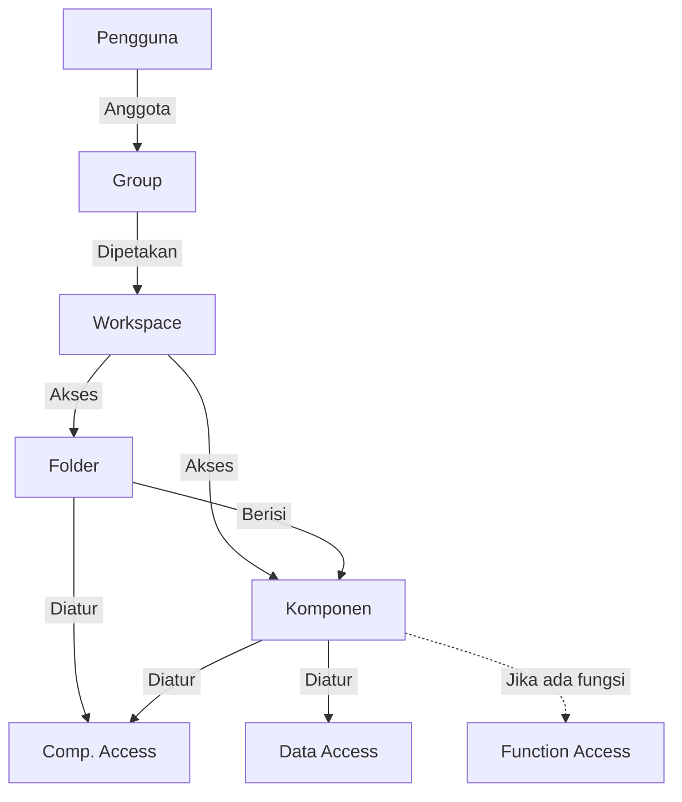

# Apa itu Workspace?

>**note** _Workspace_ merupakan salah satu komponen dalam modul [[Docs/Modul Developer/Pengenalan|Developer]] di Phoenix.

_Workspace_ adalah komponen yang dapat digunakan untuk mengatur ruang kerja pengembangan Anda, termasuk komponen apa saja yang dapat dilihat, dikelola, dan diubah, serta fungsi di dalamnya. Akses Workspace ke setiap anggota dikelola melalui [[Docs/Modul Developer/Group/Apa itu Group|Group]].

Dengan Workspace, Anda tidak perlu mengatur hak akses di banyak tempat. Seluruh folder dan komponen tersaji dalam satu halaman kerja berbentuk pohon, dan setiap hak akses cukup ditentukan dengan memilih [[^value/boolean/allow]] atau [[^value/boolean/disallow]]. Pengaturan ini berlaku sampai ke level data, sehingga Anda dapat menerapkan prinsip *least privilege* tanpa harus membuat komponen baru.

Aturan yang sama berlaku untuk komponen di modul [[Docs/Modul Data/Pengenalan|Data]], [[Docs/Modul Interface/Pengenalan|Interface]], [[Docs/Modul Logic/Pengenalan|Logic]], dan [[Docs/Modul Developer/Pengenalan|Developer]], sehingga seluruh tim bekerja dengan satu aturan akses yang konsisten.

## Mengapa Menggunakan Workspace?

- **Akses terpusat.** Seluruh hak akses folder dan komponen diatur dalam satu halaman kerja.
- **Kontrol sampai level data.** Anda dapat menentukan siapa yang boleh menambah, mengubah, atau menghapus data, bukan hanya siapa yang boleh melihat komponen.
- **Mengikuti struktur folder.** Folder yang tidak dapat dilihat otomatis menyembunyikan seluruh isi di dalamnya.
- **Aman untuk tim.** Anggota hanya melihat dan mengelola bagian yang memang menjadi tanggung jawabnya.
- **Terhubung dengan Group.** Cukup petakan pengguna ke [[Docs/Modul Developer/Group/Apa itu Group|Group]], maka akses Workspace mengikuti.
- **Satu aturan untuk semua tampilan data.** Komponen [[Docs/Modul Interface/Table View/Apa itu Table View|Table View]], [[Docs/Modul Interface/Kanban/Apa itu Kanban|Kanban]], [[Docs/Modul Interface/Gallery/Apa itu Gallery|Gallery]], dan [[Docs/Modul Interface/Timeline/Apa itu Timeline|Timeline]] mengikuti akses data sumbernya, sehingga data tidak dapat diubah lewat tampilan yang berbeda.
- **Terkendali saat dipublikasikan.** [[^field|Publish]] dan [[^field|View Publish]] dipisahkan, sehingga Anda menentukan siapa saja yang boleh mengubah konfigurasi publikasi dan siapa yang hanya boleh menyalin tautannya.

## Konsep Utama

| Istilah | Penjelasan |
| --- | --- |
| [[#Cara Kerja Workspace|Workspace]] | Komponen untuk mengatur ruang kerja pengembangan, yaitu komponen yang dapat dilihat, dikelola, dan diubah, serta fungsi di dalamnya. |
| [[#Cara Kerja Workspace|Origin]] | Workspace utama sekaligus folder paling atas yang dimiliki setiap [[Docs/Inisialisasi/Apa itu Pro|Pro]]. |
| [[#Cara Kerja Workspace|Root]] | Folder paling atas pada halaman kerja Workspace. Jika komponen Workspace ditempatkan di folder yang lebih dalam, folder itulah yang menjadi root. |
| [[Docs/Modul Developer/Group/Apa itu Group|Group]] | Kumpulan pengguna yang dipetakan ke Workspace. Pada halaman kerja, Group tampil sebagai baris dengan angka jumlah anggotanya. Setiap Pro memiliki Group bawaan bernama [[^field/group|Administrator]]. |
| [[Docs/Folder/Apa itu Folder?|Folder]] | Wadah yang berisi banyak komponen dan dapat diperluas atau dilipat. |
| [[Docs/Apa itu Komponen?|Komponen]] | Isi folder yang hak aksesnya diatur oleh Workspace. Selengkapnya lihat [[Docs/Apa itu Komponen?]]. |
| [[#Comp. Access]] | Hak akses pada level komponen (header): [[^field|Visible]], [[^field|Add]], [[^field|Update]], [[^field|Delete]]. |
| [[Docs/Modul Developer/Workspace/Data Access|Data Access]] | Hak akses pada level data: [[^field|Add]], [[^field|Update]], [[^field|Delete]]. |
| [[#Function Access]] | Hak akses pada fungsi komponen: [[^field|Merge]], [[^field|Modify Event]], [[^field|View Publish]], [[^field|Publish]]. |
| [[^value/boolean/allow]] / [[^value/boolean/disallow]] | Nilai pengaturan akses. [[^value/boolean/allow]] berarti diizinkan, [[^value/boolean/disallow]] berarti tidak diizinkan. |

## Cara Kerja Workspace

Ketika komponen Group berhasil memetakan pengguna dengan Workspace, maka Workspace dapat digunakan. Saat pengguna membuka Phoenix, mereka akan masuk ke dalam satu Workspace yang sudah memiliki struktur folder.

Garis putus-putus menandakan bahwa [[#Function Access]] hanya tersedia pada komponen yang memiliki fungsi terkait.

<!--
  * [TODO] Group dapat memiliki lebih dari satu Workspace (daftar Workspace pada Group). Mohon konfirmasi: saat pengguna membuka Phoenix, Workspace mana yang dipakai bila Group-nya memiliki beberapa Workspace? Apakah pengguna dapat berpindah Workspace? Jika ada, tambahkan bagian untuk ini.
    Jawaban : Ada, sudah dijelaskan pada [[Docs/Antarmuka#Area Manajemen Folder]], ada button (isinya nama workspace yang aktif) yang membuka popup ganti current workspace.
-->

Aturan penting:
- Pengguna hanya dapat memakai Workspace setelah dipetakan melalui [[Docs/Modul Developer/Group/Apa itu Group|Group]].
- Satu pengguna hanya dapat berada di satu [[Docs/Modul Developer/Group/Apa itu Group|Group]], sehingga akses seorang pengguna selalu mengikuti Group tempat ia berada.
- Satu [[Docs/Modul Developer/Group/Apa itu Group|Group]] dapat dipetakan ke lebih dari satu Workspace.
- [[Docs/Modul Developer/Group/Apa itu Group|Group]] anak tidak mewarisi Workspace dari Group induk. Workspace perlu diisi ulang di setiap Group.
- Setiap Pro memiliki satu rangkaian folder yang berawal dari **Origin**.
- Jika komponen Workspace ditempatkan di folder yang lebih dalam, folder itu menjadi **root** dari Workspace tersebut.
- Menu [[^field|Place to Directory]] pada Group anak menempatkan Group tersebut di root dari Workspace yang aktif saat itu.
- Hak akses bersifat **berjenjang**: jika sebuah folder (induk) diatur [[^value/boolean/disallow]] pada [[^field|Visible]], seluruh isinya tidak dapat diakses meskipun pengaturannya [[^value/boolean/allow]].

## Membuat Workspace

1. Buka folder tempat Workspace akan ditempatkan di [[Docs/Antarmuka#Area Manajemen Folder]]
2. Klik kanan ➜ [[^field/add|Add]] ➜ [[^field|Developer]] ➜ [[^field/workspace|Workspace]]
3. Isi [[^field|Name]] dan [[^field|Description]]
4. Klik [[^button|Create]]

Folder tempat Workspace ditempatkan akan menjadi root dari Workspace tersebut.

>**success** Workspace berhasil dibuat
>Workspace yang baru dibuat belum dapat dipakai oleh anggota. Petakan Workspace ini ke [[Docs/Modul Developer/Group/Apa itu Group|Group]], lalu atur hak aksesnya di [[#Mengatur Hak Akses]].

<!--
  * [TODO] Mohon konfirmasi nilai awal hak akses pada Workspace yang baru dibuat (semua disallow, atau mengikuti Origin?). Jika ada nilai awal, tulis di callout di atas.
    Jawaban : Nilai awal hak akses ketika workspace dibuat adalah mengikuti workspace yang aktif saat itu. Tapi workspace yang pertama kali ada (Origin) semuanya allow.
  * [TODO] Mohon konfirmasi apakah Group bawaan Administrator otomatis terhubung ke Origin saat Pro dimulai.
    Jawaban : Iya betul
-->

## Mengubah Workspace

1. Buka halaman kerja Workspace
2. Klik [[^button/edit|Edit]]
3. Perbarui isian [[^field|Name]] dan [[^field|Description]]
4. Klik [[^button|Update]]

>**note** Tombol Edit berbeda dengan pengaturan hak akses
>Tombol [[^button/edit|Edit]] hanya mengubah atribut Workspace, yaitu [[^field|Name]] dan [[^field|Description]]. Untuk mengubah hak akses, lihat [[#Mengatur Hak Akses]].

## Menyegarkan

Klik [[^button/refresh|Refresh]] untuk memuat ulang tampilan.

## Menghapus Workspace

1. Buka folder yang berisi Workspace di [[Docs/Antarmuka#Area Manajemen Folder]]
2. Klik kanan Workspace
3. Pilih [[^button/delete|Delete]]
4. Konfirmasi dengan [[^button|Delete]]

>**warning** Harap pastikan
>Sebelum menghapus pastikan setiap [[Docs/Modul Developer/Group/Apa itu Group|Group]] tetap memiliki Workspace selain daripada yang akan dihapus. Sehingga pengalaman pengguna tetap lancar menggunakan Phoenix.

>**warning** Pengaturan hak akses ikut hilang
>Seluruh pengaturan hak akses pada Workspace ini hilang dan pemetaannya pada [[Docs/Modul Developer/Group/Apa itu Group|Group]] terputus. Komponen dan data di dalam folder tidak ikut terhapus.

<!--
  * [TODO] Mohon konfirmasi dampak menghapus Workspace pada callout kedua: apakah pemetaan pada Group otomatis terhapus, apakah komponen dan data di folder root tidak terpengaruh, dan apakah Origin dapat dihapus.
    Jawaban: Iya sudah betul, Origin tidak dapat dihapus jika tidak ada workspace dalam posisi root (utama) dan diikatkan ke Group (langkah preventif sistem agar tidak hilang nya akses ke root utama).
-->

## Halaman Kerja Workspace

![[Docs/Modul Developer/Workspace/antarmuka-workspace.png]]
Halaman kerja Workspace menampilkan seluruh struktur ruang kerja dalam satu tabel. Kolom paling kiri berisi daftar [[^field|Folder/ Component]], sedangkan kolom di sebelah kanannya berisi hak akses yang dikelompokkan menjadi [[^field|Comp. Access]], [[^field|Data Access]], dan [[^field|Function Access]].

Bilah navigasi Workspace hanya memiliki dua tombol:

| Tombol | Fungsi |
| --- | --- |
| [[^button/edit|Edit]] | Mengubah atribut Workspace seperti [[^field|Name]] dan [[^field|Description]]. |
| [[^button/refresh|Refresh]] | Memuat ulang halaman kerja. |

<!--
  * [TODO] Mohon konfirmasi apakah ada perbedaan tampilan bilah navigasi atau halaman kerja pada desktop dan mobile. Jika ada, tambahkan callout note "Perbedaan Icon" atau "Perbedaan Tampilan".
    Jawaban : Tidak ada
-->

### Membaca Baris

| Baris | Penjelasan |
| --- | --- |
| [[^field/workspace|Origin]] | Workspace. Biasanya baris paling atas. |
| [[^field/group|Administrator]] | [[Docs/Modul Developer/Group/Apa itu Group|Group]] yang terhubung ke Workspace. Baris Group hanya mengatur akses dari Workspace ke komponen Group tersebut, bukan akses per anggota. |
| [[^field/folder|Folder]] | Contoh [[Docs/Folder/Apa itu Folder?|Folder]], klik untuk melihat komponen di dalamnya. |
| [[^field/variable|Variable]], [[^field/enum|Role]], [[^field/table|Employee]], [[^field/tree|Organizational Structures]] | Contoh [[Docs/Apa itu Komponen?|Komponen]], setiap komponen memiliki ikon sesuai jenisnya dan informasi datanya di samping nama. Lihat [[Docs/Folder/Apa itu Folder?#Informasi Data]]. |

Sel yang kosong pada kolom hak akses berarti hak akses tersebut tidak relevan untuk komponen itu.

### Interaksi Antarmuka Workspace

| Fungsi | Aksi |
| --- | --- |
| Memperluas atau melipat folder | Klik folder pada kolom [[^field|Folder/ Component]]. |
| Mengubah hak akses | Klik sel pada kolom hak akses. Lihat [[#Mengatur Hak Akses]]. |

<!--
  * [TODO] Mohon konfirmasi cara memperluas atau melipat folder (klik nama folder, klik panah, atau klik kanan) dan apakah ada interaksi lain di halaman kerja (misalnya klik kanan pada baris).
    Jawaban : klik pada folder untuk memperluas atau melipat. tambahkan juga fungsi drag and drop untuk memindahkan folder.
-->

## Mengatur Hak Akses

Hak akses diatur per baris dan per kolom pada halaman kerja. Setiap sel memiliki nilai [[^value/boolean/allow]] atau [[^value/boolean/disallow]]. Klik sel yang ingin diubah untuk berpindah antara kedua nilai tersebut.

<!--
  * [TODO] Mohon konfirmasi cara mengubah nilai sel (klik sel, toggle, atau cara lain), apakah perubahan tersimpan otomatis atau memerlukan tombol, dan apakah perubahan langsung berlaku untuk anggota yang sedang membuka Phoenix atau baru berlaku setelah muat ulang.
    Jawaban : klik sel, tombol di sel adalah toggle allow atau disallow
-->

### Comp. Access

Comp. Access berlaku pada level komponen (header).

| Hak Akses | Penjelasan |
| --- | --- |
| [[^field|Visible]] | Jika [[^value/boolean/disallow]], pengguna tidak dapat melihat komponen tersebut, bahkan ketika ingin memilihnya, misalnya saat membuat komponen Interface. |
| [[^field|Add]] | Mengizinkan penambahan folder atau komponen baru. |
| [[^field|Update]] | Mengizinkan perubahan atribut pada komponen. |
| [[^field|Delete]] | Mengizinkan penghapusan komponen. |

>**note** Variable tetap dapat dipakai untuk otomasi
>Anggota yang tidak memiliki akses ke komponen [[Docs/Modul Data/Variable/Apa itu Variable|Variable]] tidak dapat mengetahui [[^field|Value]]-nya, tetapi tetap dapat memakainya untuk otomasi atau integrasi, misalnya lewat [[Docs/Modul Logic/Flow/Flow Block/Data/Variable/Variable Getter|Variable Getter Block]]. Anggota yang memiliki akses melihat [[^field|Value]] secara terbuka di halaman kerja Variable.

<!--
  * [TODO] Mohon konfirmasi hak akses mana yang dimaksud pada callout Variable (diasumsikan Visible). Apakah komponen lain yang disembunyikan dengan Visible disallow juga tetap dapat dipakai oleh Flow dan otomasi?
    Jawaban: jika visible = disallow maka komponen tersebut tidak dapat dibuka pada halaman kerja dan juga tidak dapat dipilih ketika melakukan query dan lain-lain. Namun daftar dari variable (variable data) tetap bisa digunakan pada pilihan meskipun komponen Variable disallow pada hak akses workspace.
-->

### Data Access

Data Access berlaku pada level data. Jenis datanya bergantung pada komponen: semisal pada [[Docs/Modul Data/Table/Apa itu Table|Table]] datanya adalah [[Docs/Tipe Data/Row]] dan [[Docs/Tipe Data/TableData]], pada [[Docs/Modul Interface/Table View/Apa itu Table View|Table View]] datanya adalah [[Docs/Modul Interface/Table View/Table View Data/Pengenalan|Table View Data]], sedangkan pada [[Docs/Modul Interface/Timeline/Apa itu Timeline|Timeline]] datanya adalah [[Docs/Modul Interface/Timeline/Timeline Data/Pengenalan]].

| Hak Akses | Penjelasan |
| --- | --- |
| [[^field|Add]] | Mengizinkan penambahan data. |
| [[^field|Update]] | Mengizinkan perubahan data. |
| [[^field|Delete]] | Mengizinkan penghapusan data. |

Penjelasan lebih lengkap lihat [[Docs/Modul Developer/Workspace/Data Access]].

#### Data yang Diatur pada Setiap Komponen

| Komponen | Data yang diatur | Penjelasan |
| --- | --- | --- |
| [[Docs/Modul Data/Table/Apa itu Table|Table]] | [[Docs/Tipe Data/Row]] dan [[Docs/Tipe Data/TableData]] | Menambah, mengubah, dan menghapus Row beserta isinya. |
| [[Docs/Modul Data/Enum/Apa itu Enum|Enum]] | [[Docs/Tipe Data/EnumData]] | Menambah, mengubah, dan menghapus EnumData. |
| [[Docs/Modul Data/Tree/Apa itu Tree|Tree]] | [[Docs/Tipe Data/Node]] | Menambah, mengubah, dan menghapus Node. |
| [[Docs/Modul Data/Variable/Apa itu Variable|Variable]] | [[Docs/Tipe Data/Variable]] | Menambah, mengubah, dan menghapus Variable Data. |
| [[Docs/Modul Interface/Table View/Apa itu Table View|Table View]] | [[Docs/Modul Interface/Table View/Table View Data/Pengenalan|Table View Data]] | Mengatur pengelolaan Data, yaitu mengubah nama, mengubah Query, dan mengubah konfigurasi. Tidak mengatur Row atau isi sel. |
| [[Docs/Modul Interface/Timeline/Apa itu Timeline|Timeline]] | [[Docs/Modul Interface/Timeline/Timeline Data/Pengenalan]] | Mengatur pengelolaan Timeline Data. Lihat [[Docs/Modul Interface/Timeline/Apa itu Timeline#Hak Akses Timeline Data|Hak Akses Timeline Data]]. |
| [[Docs/Modul Interface/Kanban/Apa itu Kanban|Kanban]] | Kartu dan template kartu | Memindahkan kartu mengubah nilai [[Docs/Tipe Data/EnumData]] pada Row sumber, sehingga memerlukan izin pada Data Access data sumber. |
| [[Docs/Modul Interface/Gallery/Apa itu Gallery|Gallery]] | Kartu dan template kartu | Mengubah Row dari kartu memerlukan izin pada Data Access Table sumber. Mengubah template kartu memerlukan izin pada Data Access Gallery. |
| [[Docs/Modul Interface/Canvas/Apa itu Canvas|Canvas]] | Widget | [[^field|Add]] menambahkan widget, [[^field|Update]] mengubah Query, atribut, atau styling widget, dan [[^field|Delete]] menghapus widget. |
| [[Docs/Modul Interface/Form/Apa itu Form|Form]] | Elemen | Setiap perubahan Elemen beserta atributnya di dalam Form. |
| [[Docs/Modul Interface/Space/Apa itu Space|Space]] | Weather, Environment, dan Object | Satu Data Access mewakili ketiga kategori. Lihat [[Docs/Modul Interface/Space/Apa itu Space#Hak Akses Space|Hak Akses Space]]. |
| [[Docs/Modul Logic/Flow/Apa itu Flow|Flow]] | Flow Block | Menambah, mengubah, dan menghapus Flow Block pada Blueprint. |

<!--
  * [TODO] Baris Enum, Tree, Variable, dan Flow ditulis berdasarkan asumsi (belum ada informasi Data Access dari penulis). Mohon konfirmasi data yang diatur dan penjelasannya.
    Jawaban : Sudah betul.
  * [TODO] Mohon konfirmasi apakah Add Row dan Delete Row pada Kanban dan Gallery mengikuti Data Access Table sumber (diasumsikan sama seperti memindahkan kartu dan mengubah Row).
    Jawaban : Kartu adalah data di level Row/EnumData jadi mengikuti sumbernya, sedangkan templat kartu mengikuti Data Access pada komponen Gallery/Kanban. sepertinya sudah betul.
  * [TODO] Tabel ini berpotensi menduplikasi isi [[Docs/Modul Developer/Workspace/Data Access]]. Mohon tentukan apakah tabel tetap di halaman ini sebagai ringkasan, atau dipindahkan seluruhnya ke halaman Data Access.
    Jawaban : Akan saya pindahkan nanti. Mungkin bisa disisipkan frontmatter dihalaman ini bagian mana yang harus dipindahkan.
-->

#### Akses Berlapis pada Komponen Interface

Komponen Interface yang dapat memanipulasi data di komponen Modul Data tidak membuka akses baru. Baris dan isi sel hanya dapat dikelola jika dua syarat berikut terpenuhi:

| Syarat | Penjelasan |
| --- | --- |
| Konfigurasi komponen Interface | Data pada komponen Interface berstatus `editable`, misalnya pada [[Docs/Modul Interface/Table View/Apa itu Table View|Table View]] dan [[Docs/Modul Interface/Timeline/Apa itu Timeline|Timeline]]. Data berstatus `readonly` tidak dapat dikelola. |
| Data Access data sumber | Data Access komponen Modul Data sumber, misalnya [[Docs/Modul Data/Table/Apa itu Table|Table]], di Workspace mengizinkan aksi yang dilakukan. |

Jika salah satu syarat tidak terpenuhi, baris dan isi sel tidak dapat dikelola.

>**note** Mode Edit pada Canvas dan Form
>Pada [[Docs/Modul Interface/Canvas/Apa itu Canvas|Canvas]] dan [[Docs/Modul Interface/Form/Apa itu Form|Form]], toggle [[^mode/edit|Edit]] hanya dapat dipindahkan jika setidaknya salah satu Data Access ([[^field|Add]], [[^field|Update]], [[^field|Delete]]) bernilai [[^value/boolean/allow]]. Jika ketiganya [[^value/boolean/disallow]], komponen hanya tampil dalam mode [[^mode/view|View]] (*read only*).

<!--
  * [TODO] Aturan mode Edit sudah terkonfirmasi untuk Canvas. Mohon konfirmasi bahwa Form memakai aturan yang sama (salah satu Data Access allow).
    Jawaban: Iya Canvas dan Form memiliki aturan yang sama.
-->

### Function Access

Function Access mengatur fungsi tambahan pada komponen.

| Hak Akses | Penjelasan |
| --- | --- |
| [[^field|Merge]] | Mengizinkan penggabungan data. |
| [[^field|Modify Event]] | Mengizinkan perubahan [[Docs/Event/Apa itu Event|Event]] pada komponen. |
| [[^field|View Publish]] | Hanya dapat melihat konfigurasi publikasi, misalnya menyalin atau membuka [[^field|Publish Link]], tanpa mengubah status publikasi. |
| [[^field|Publish]] | Dapat memperbarui konfigurasi publikasi. |

#### Fungsi pada Setiap Komponen

| Fungsi | Komponen | Penjelasan |
| --- | --- | --- |
| [[^field|Merge]] | [[Docs/Modul Data/Table/Apa itu Table|Table]], [[Docs/Modul Data/Enum/Apa itu Enum|Enum]] | Lihat [[Docs/Modul Data/Table/Merge]] dan [[Docs/Modul Data/Enum/Merge]]. |
| [[^field|Modify Event]] | [[Docs/Modul Data/Table/Apa itu Table|Table]], [[Docs/Modul Data/Enum/Apa itu Enum|Enum]], [[Docs/Modul Data/Tree/Apa itu Tree|Tree]], [[Docs/Modul Interface/Timeline/Apa itu Timeline#Mengelola Timeline Event|Timeline Event]] | Mengubah Event yang terhubung ke [[Docs/Modul Logic/Flow/Apa itu Flow|Flow]]. Lihat [[Docs/Event/Menghubungkan Event]]. |
| [[^field|View Publish]] dan [[^field|Publish]] | [[Docs/Modul Data/Table/Apa itu Table|Table]], [[Docs/Modul Data/Tree/Apa itu Tree|Tree]], [[Docs/Modul Interface/Canvas/Apa itu Canvas#Mempublikasikan Canvas|Canvas]], [[Docs/Modul Interface/Form/Apa itu Form|Form]] | Mengatur tautan publikasi komponen. |

>**warning** Publish membuka akses ke publik
>Tautan hasil [[^field|Publish]] dapat dibuka oleh publik. Pada [[Docs/Modul Interface/Canvas/Apa itu Canvas|Canvas]] yang dipublikasikan, widget Button yang sudah disetup dapat memicu [[Docs/Modul Logic/Flow/Apa itu Flow|Flow]] dan dipakai oleh siapa pun yang membuka tautan. Berikan [[^field|Publish]] hanya kepada [[Docs/Modul Developer/Group/Apa itu Group|Group]] yang tepercaya, dan gunakan [[^field|View Publish]] bagi anggota yang hanya perlu menyalin tautan.

<!--
  * [DONE] Daftar komponen pada tabel Fungsi pada Setiap Komponen disusun dari komponen yang sudah selesai (Table: Merge, Publish, Event. Enum: Merge, Event. Tree: Publish, Event. Canvas dan Form: Publish. Timeline: Event). Mohon konfirmasi kelengkapannya, termasuk apakah Tree juga memiliki Merge dan apakah Form memiliki View Publish.
  * [TODO] Mohon konfirmasi apakah Modify Event juga mengatur tombol Event untuk menghubungkan Flow Block Event dari komponen (diasumsikan ya).
    Jawaban : Iya betul
-->

### Aturan Pewarisan Akses

Hak akses folder memengaruhi seluruh isinya. Jika [[^field|Visible]] pada folder diatur [[^value/boolean/disallow]], komponen di dalamnya tidak dapat diakses meskipun komponen tersebut diatur [[^value/boolean/allow]]. Hal ini karena folder induknya tidak dapat dilihat.

Pengaturan [[^value/boolean/disallow]] juga dapat diterapkan pada komponen selain folder, misalnya komponen Workspace dan komponen Tree.

<!--
  * [TODO] Mohon konfirmasi apakah pewarisan berjenjang hanya berlaku untuk Visible, atau juga untuk Add, Update, Delete pada folder terhadap isinya.
    
-->

## Contoh Penggunaan

**Menyembunyikan folder Keuangan dari Group tertentu**

| Folder/Komponen | Visible | Hasil |
| --- | --- | --- |
| [[^field/folder|Keuangan]] | [[^value/boolean/disallow]] | Folder tidak dapat dilihat. |
| [[^field/tableview|Laporan Bulanan]] | [[^value/boolean/allow]] | Tetap tidak dapat diakses karena folder induknya [[^value/boolean/disallow]]. |
| [[^field/folder|Penjualan]] | [[^value/boolean/allow]] | Folder dapat dilihat. |
| [[^field/tableview|Daftar Pelanggan]] | [[^value/boolean/allow]] | Komponen dapat dilihat dan dibuka. |
| [[^field/canvas|Analisis Pelanggan]] | [[^value/boolean/disallow]] | Komponen tidak dapat diakses meskipun folder induknya [[^value/boolean/allow]]. |

Dengan satu pengaturan pada folder, seluruh komponen keuangan otomatis tersembunyi tanpa perlu mengatur satu per satu.

**Contoh jika Komponen hanya boleh dilihat**

| Komponen | Visible | Update | Delete | Data Access | Function Access |
| --- | --- | --- | --- | --- | --- |
| [[^field/tree|Pohon Kategori Produk]] | [[^value/boolean/allow]] | [[^value/boolean/disallow]] | [[^value/boolean/disallow]] | [[^value/boolean/disallow]] | [[^value/boolean/disallow]] |

Anggota Group tetap dapat membuka komponen untuk dibaca, tetapi tidak dapat mengubah struktur, data, maupun konfigurasi publikasinya.

**Mengizinkan tim memperbarui data pelanggan tanpa mengubah pengaturan tampilannya**

Tim penjualan perlu menambah dan memperbarui data pelanggan setiap hari, tetapi tidak boleh mengubah Query maupun konfigurasi tampilan, dan tidak boleh menghapus data. Dengan Workspace, kebutuhan ini cukup dipenuhi tanpa membuat komponen baru.

| Komponen | Visible | Update | Data Access | Hasil |
| --- | --- | --- | --- | --- |
| [[^field/tableview|Daftar Pelanggan]] | [[^value/boolean/allow]] | [[^value/boolean/disallow]] | [[^value/boolean/disallow]] | Anggota dapat membuka komponen, tetapi tidak dapat mengubah nama, Query, maupun konfigurasi Data. |
| [[^field/table|Data Pelanggan]] | [[^value/boolean/allow]] | [[^value/boolean/disallow]] | [[^field|Add]] [[^value/boolean/allow]], [[^field|Update]] [[^value/boolean/allow]], [[^field|Delete]] [[^value/boolean/disallow]] | Anggota dapat menambah dan mengubah Row, tetapi tidak dapat menghapusnya. |

Baris pada [[^field/tableview|Daftar Pelanggan]] hanya dapat dikelola jika Data berstatus `editable` dan Data Access [[^field/table|Data Pelanggan]] mengizinkan. Jika Data berstatus `readonly`, anggota tetap hanya dapat membaca.

**Ide skenario lain**

| Kebutuhan | Pengaturan Workspace |
| --- | --- |
| Anggota baru hanya perlu membaca laporan. | [[^field|Visible]] [[^value/boolean/allow]], Data Access dan Function Access [[^value/boolean/disallow]]. |
| Tim operasional menjalankan otomasi tanpa perlu mengetahui nilai rahasia. | Komponen [[Docs/Modul Data/Variable/Apa itu Variable|Variable]] tidak diberi akses, sehingga [[^field|Value]] tersembunyi tetapi tetap dapat dipakai. |
| Tim pemasaran menerbitkan [[Docs/Modul Interface/Form/Apa itu Form|Form]] pendaftaran. | [[^field|Publish]] [[^value/boolean/allow]] hanya pada Form tersebut, sedangkan komponen lain tetap [[^value/boolean/disallow]]. |
| Tim lain hanya perlu menyalin tautan laporan publik. | [[^field|View Publish]] [[^value/boolean/allow]] dan [[^field|Publish]] [[^value/boolean/disallow]]. |

Dengan satu halaman kerja, setiap tim memperoleh akses yang pas dengan perannya, tanpa menambah komponen atau menduplikasi data.

<!--
  * [TODO] Nama folder dan komponen pada Contoh Penggunaan adalah nama generik. Mohon sesuaikan dengan gambar bila diperlukan.
  * [TODO] Contoh ketiga dan Ide skenario lain adalah usulan baru. Mohon konfirmasi apakah komponen sumber (Data Pelanggan) harus [[^field|Visible]] [[^value/boolean/allow]] agar Data Access-nya berlaku lewat Table View.
-->

## Praktik Terbaik

- **Atur akses di level folder terlebih dahulu**, baru sesuaikan komponen tertentu bila diperlukan.
- **Berikan akses seminimal mungkin** (*least privilege*) sesuai kebutuhan kerja setiap [[Docs/Modul Developer/Group/Apa itu Group|Group]].
- **Gunakan [[^field|Visible]] = [[^value/boolean/disallow]]** untuk menyembunyikan komponen yang tidak relevan agar tidak muncul saat memilih komponen atau di [[Docs/Antarmuka#Area Manajemen Folder]].
- **Pisahkan Function Access** untuk [[^field|Publish]] dan [[^field|View Publish]], sehingga tidak semua anggota dapat mengubah konfigurasi publikasi.
- **Berikan [[^field|Publish]] dengan hati-hati** karena tautan publikasi dapat dibuka publik, terutama pada [[Docs/Modul Interface/Canvas/Apa itu Canvas|Canvas]] yang memiliki widget Button untuk memicu [[Docs/Modul Logic/Flow/Apa itu Flow|Flow]].
- **Periksa dua syarat sekaligus** saat anggota tidak dapat mengubah baris di komponen Interface: Data berstatus `editable` dan [[Docs/Modul Developer/Workspace/Data Access]] komponen sumber bernilai [[^value/boolean/allow]].
- **Isi ulang Workspace di setiap Group**, karena [[Docs/Modul Developer/Group/Apa itu Group|Group]] anak tidak mewarisi Workspace dari Group induk.
- **Jaga akses administrator.** Hindari menonaktifkan [[^field|Visible]] atau [[^field|Update]] pada komponen Workspace dan Group yang dipakai administrator, agar pengelolaan akses tidak terkunci.
- **Cek hasilnya dengan [[^button/refresh|Refresh]]** setelah mengubah pengaturan akses.

<!--
  * [TODO] Poin "Jaga akses administrator" adalah asumsi. Mohon konfirmasi apakah menonaktifkan akses pada komponen Workspace atau Group benar-benar dapat mengunci pengelolaan akses, atau ada pengaman bawaan.
-->

## Batasan dan Catatan

- Akses Workspace untuk setiap anggota dikelola melalui [[Docs/Modul Developer/Group/Apa itu Group|Group]], bukan langsung pada pengguna.
- Satu pengguna hanya dapat berada di satu [[Docs/Modul Developer/Group/Apa itu Group|Group]], dan [[Docs/Modul Developer/Group/Apa itu Group|Group]] anak tidak mewarisi Workspace dari Group induk.
- Folder yang [[^value/boolean/disallow]] pada [[^field|Visible]] membuat seluruh isinya tidak dapat diakses, meskipun isinya [[^value/boolean/allow]].
- Tombol [[^button/edit|Edit]] hanya mengubah atribut Workspace, bukan hak akses.
- [[Docs/Modul Developer/Workspace/Data Access]] bergantung pada jenis komponen. Pada komponen Interface yang menampilkan data, pengelolaan baris juga bergantung pada status `editable` dan Data Access data sumber.
- Pada [[Docs/Modul Interface/Canvas/Apa itu Canvas|Canvas]] dan [[Docs/Modul Interface/Form/Apa itu Form|Form]], mode [[^mode/edit|Edit]] tidak dapat dipakai jika [[^field|Add]], [[^field|Update]], dan [[^field|Delete]] pada Data Access semuanya [[^value/boolean/disallow]].
- Anggota tanpa akses ke [[Docs/Modul Data/Variable/Apa itu Variable|Variable]] tidak dapat mengetahui [[^field|Value]], tetapi tetap dapat memakainya untuk otomasi atau integrasi.
- Pengisi [[Docs/Modul Interface/Form/Apa itu Form|Form]] dan pengunjung tautan publikasi tidak diatur melalui Workspace. Akses mereka ditentukan oleh pembuat komponen saat mempublikasikannya.
- Sel yang kosong pada halaman kerja berarti hak akses tidak relevan untuk komponen tersebut.

<!--
  * [TODO] Poin tentang pengisi Form dan pengunjung publik disusun dari informasi Form (akses menambah Row dianggap diizinkan saat pembuat Form memilih Table) dan Canvas (tautan publik hanya View Mode). Mohon konfirmasi bahwa pengunjung publik memang tidak dibatasi Workspace.
-->

## TL:DR

- **Workspace** mengatur komponen yang dapat dilihat, dikelola, dan diubah, serta fungsi di dalamnya.
- Akses anggota dikelola lewat [[Docs/Modul Developer/Group/Apa itu Group|Group]]. Satu pengguna hanya berada di satu Group, dan Group anak tidak mewarisi Workspace dari Group induk.
- Hak akses terbagi tiga: [[^field|Comp. Access]], [[^field|Data Access]], dan [[^field|Function Access]], masing-masing bernilai [[^value/boolean/allow]] atau [[^value/boolean/disallow]].
- Pengaturan **berjenjang**: folder [[^value/boolean/disallow]] menutup akses ke seluruh isinya.
- Komponen Interface mengikuti **dua syarat**: Data berstatus `editable` dan Data Access data sumber bernilai [[^value/boolean/allow]].
- Berhati-hatilah dengan [[^field|Publish]]: tautan publikasi dapat dibuka publik.
- Halaman kerja Workspace memiliki dua tombol: [[^button/edit|Edit]] dan [[^button/refresh|Refresh]].

## FAQ : Pertanyaan yang Sering Diajukan
>**faq**
>**Bagaimana pengguna dapat memakai Workspace?**
>Pengguna harus dipetakan ke Workspace melalui komponen [[Docs/Modul Developer/Group/Apa itu Group|Group]]. Setelah itu, saat membuka Phoenix mereka akan masuk ke Workspace tersebut.
>**Apakah satu pengguna dapat berada di lebih dari satu Group?**
>Tidak. Satu pengguna hanya dapat berada di satu [[Docs/Modul Developer/Group/Apa itu Group|Group]], sehingga akses Workspace-nya mengikuti Group tersebut.
>**Apakah Group anak otomatis memakai Workspace milik Group induk?**
>Tidak. [[Docs/Modul Developer/Group/Apa itu Group|Group]] anak tidak mewarisi Workspace dari Group induk, sehingga Workspace perlu diisi ulang di setiap Group.
>**Apa yang terjadi jika folder diatur disallow tetapi komponen di dalamnya allow?**
>Komponen tetap tidak dapat diakses karena folder induknya tidak dapat dilihat.
>**Apa bedanya Comp. Access dan Data Access?**
>[[^field|Comp. Access]] mengatur komponen secara keseluruhan (header), sedangkan [[^field|Data Access]] mengatur data di dalam komponen, misalnya [[Docs/Tipe Data/Row]] pada [[Docs/Modul Data/Table/Apa itu Table|Table]].
>**Apa arti Visible = disallow?**
>Pengguna tidak dapat melihat komponen tersebut, termasuk ketika memilihnya saat membuat komponen Interface.
>**Mengapa anggota tidak dapat mengubah baris di Table View padahal Data Access sudah allow?**
>Pengelolaan baris memerlukan dua syarat: Data pada [[Docs/Modul Interface/Table View/Apa itu Table View|Table View]] berstatus `editable` dan [[Docs/Modul Developer/Workspace/Data Access]] komponen sumber mengizinkan. Jika salah satunya tidak terpenuhi, baris tidak dapat dikelola.
>**Apakah anggota yang tidak dapat melihat Variable tetap dapat memakainya?**
>Ya. Anggota tanpa akses ke [[Docs/Modul Data/Variable/Apa itu Variable|Variable]] tidak dapat mengetahui [[^field|Value]], tetapi tetap dapat memakainya untuk otomasi atau integrasi.
>**Apa bedanya View Publish dan Publish?**
>[[^field|View Publish]] hanya untuk melihat konfigurasi publikasi, misalnya menyalin [[^field|Publish Link]]. [[^field|Publish]] dapat memperbarui konfigurasi publikasi.
>**Apa arti sel yang kosong pada halaman kerja?**
>Hak akses tersebut tidak relevan untuk komponen yang bersangkutan.
>**Apakah tombol Edit dapat dipakai untuk mengubah hak akses?**
>Tidak. Tombol [[^button/edit|Edit]] hanya mengubah [[^field|Name]] dan [[^field|Description]] Workspace. Hak akses diatur pada sel di halaman kerja.
>**Apakah pengisi Form atau pengunjung tautan publikasi perlu diatur di Workspace?**
>Tidak. Akses mereka ditentukan oleh pembuat komponen saat mempublikasikannya, sehingga [[^field|Publish]] sebaiknya hanya diberikan kepada [[Docs/Modul Developer/Group/Apa itu Group|Group]] yang tepercaya.
>**Tombol apa saja yang tersedia pada bilah navigasi Workspace?**
>Hanya [[^button/edit|Edit]] dan [[^button/refresh|Refresh]].