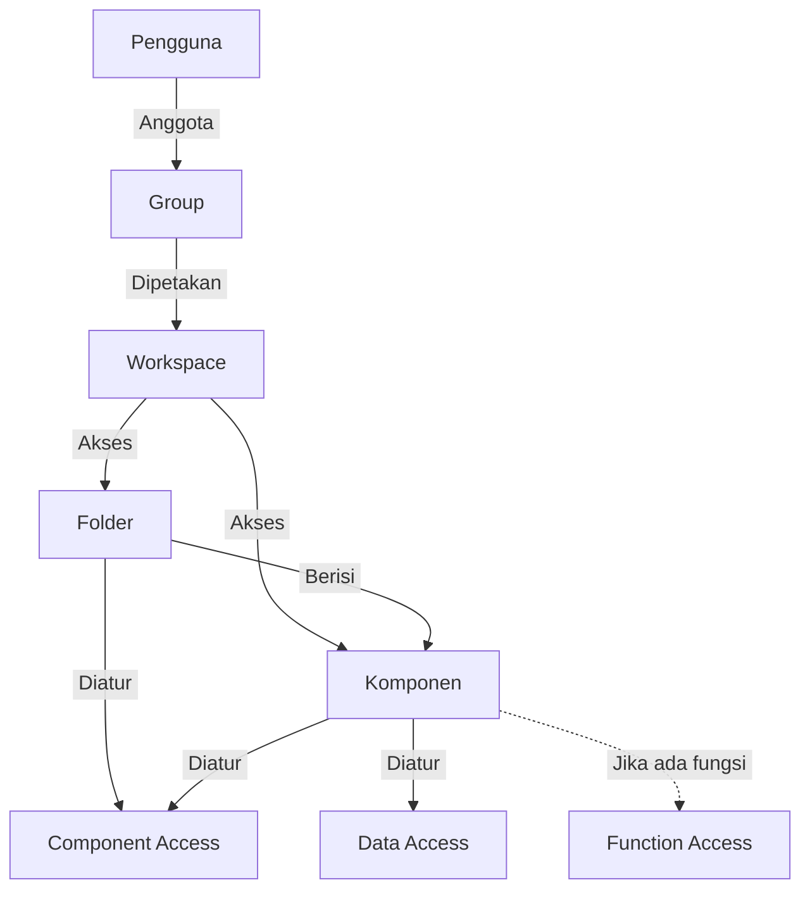

## Cara Kerja Workspace

Ketika komponen Group berhasil memetakan pengguna dengan Workspace, maka Workspace dapat digunakan. Saat pengguna membuka Phoenix, mereka akan masuk ke Workspace yang terakhir dipakai, yang sudah memiliki struktur folder. Jika Group memiliki lebih dari satu Workspace, pengguna dapat [[#Berpindah Workspace|berpindah Workspace]].

Garis putus-putus menandakan bahwa [[Docs/Modul Developer/Workspace/Function Access|Function Access]] hanya tersedia pada komponen yang memiliki fungsi terkait.

Aturan penting:
- Pengguna hanya dapat memakai Workspace setelah dipetakan melalui [[Docs/Modul Developer/Group/Apa itu Group|Group]].
- Satu pengguna hanya dapat berada di satu [[Docs/Modul Developer/Group/Apa itu Group|Group]], sehingga akses seorang pengguna selalu mengikuti Group tempat ia berada.
- Satu [[Docs/Modul Developer/Group/Apa itu Group|Group]] dapat dipetakan ke lebih dari satu Workspace.
- [[Docs/Modul Developer/Group/Apa itu Group|Group]] anak tidak mewarisi Workspace dari Group induk. Workspace perlu diisi ulang di setiap Group.
- Setiap Pro memiliki satu rangkaian folder yang berawal dari **Origin**. Origin terhubung otomatis ke Group bawaan [[^field/group|Administrator]] dan seluruh hak aksesnya [[^value/boolean/allow]].
- Jika komponen Workspace ditempatkan di folder yang lebih dalam, folder itu menjadi **root** dari Workspace tersebut.
- Menu [[^field|Place to Directory]] pada Group anak menempatkan Group tersebut di root dari Workspace yang aktif saat itu.
- [[^field|Visible]] pada folder menentukan apakah folder beserta isinya tampil di [[Docs/Antarmuka/Pengenalan#Area Manajemen Folder]]. Komponen di dalamnya tetap dapat muncul pada pilihan *field* atau Query jika [[^field|Visible]] komponen itu sendiri [[^value/boolean/allow]]. Lihat [[Docs/Modul Developer/Workspace/Component Access#Visible pada Folder dan Komponen|Visible pada Folder dan Komponen]].