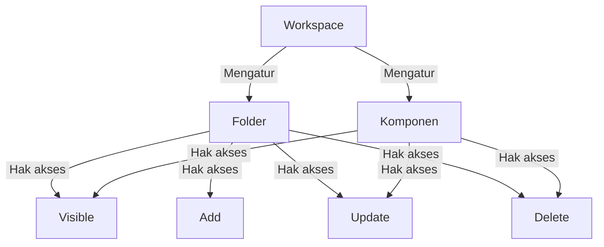
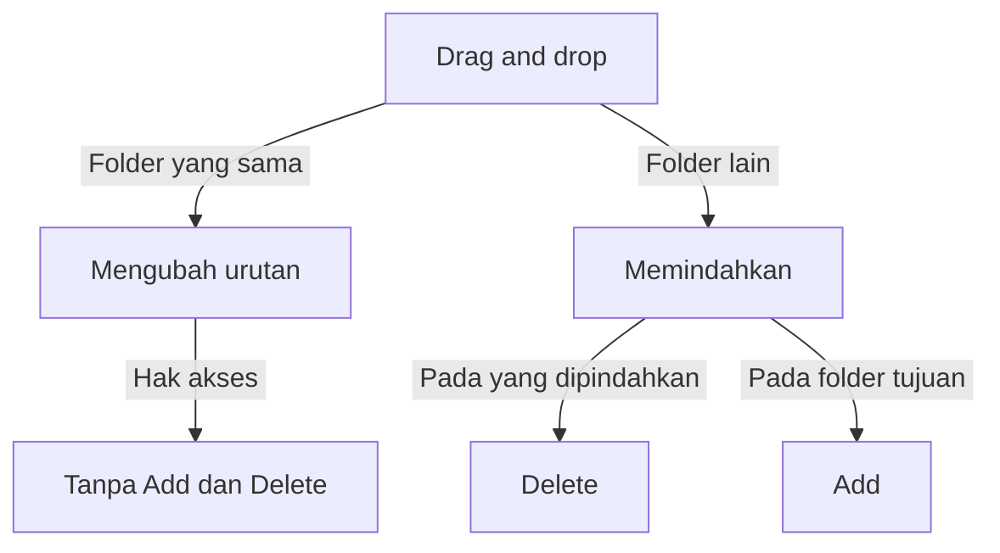

# Component Access

>**note** Component Access merupakan salah satu hak akses pada komponen [[Docs/Modul Developer/Workspace/Apa itu Workspace|Workspace]] dalam modul [[Docs/Modul Developer/Pengenalan|Developer]] di Phoenix.

Component Access adalah hak akses pada Workspace yang mengatur folder dan komponen secara keseluruhan (header): apakah tampil, dapat ditambah, diubah, dihapus, dan dipindahkan. Berbeda dengan [[Docs/Modul Developer/Workspace/Data Access]] yang mengatur data di dalam komponen, Component Access mengatur komponennya sendiri.

Ketika sebuah hak akses diatur [[^value/boolean/disallow]], fungsi yang terkait hilang dari antarmuka, seperti tombol dan menu pada konteks menu. Halaman komponen juga menampilkan [[#Mengenali Ikon Kunci|ikon kunci]] di samping nama komponen, sehingga anggota dapat melihat hak akses apa saja yang diizinkan oleh Workspace.

## Mengapa Menggunakan Component Access?

- **Menyembunyikan yang tidak relevan.** Anggota hanya melihat folder dan komponen yang menjadi tanggung jawabnya.
- **Mengontrol perubahan struktur.** Anda menentukan siapa yang boleh menambah, mengubah, menghapus, atau memindahkan folder dan komponen.
- **Terpisah dari data.** Anggota dapat mengelola data melalui [[Docs/Modul Developer/Workspace/Data Access]] tanpa dapat mengubah komponennya.
- **Antarmuka yang bersih.** Fungsi yang tidak diizinkan hilang dari antarmuka, sehingga anggota tidak mencoba aksi yang memang tidak dapat mereka lakukan.
- **Mudah diperiksa.** Ikon kunci pada halaman komponen memperlihatkan hak akses yang diizinkan.

## Konsep Utama

| Istilah | Penjelasan |
| --- | --- |
| Component Access | Hak akses pada level komponen (header): [[^field|Visible]], [[^field|Add]], [[^field|Update]], [[^field|Delete]]. |
| [[#Visible pada Folder dan Komponen|Visible]] | Hak akses yang mengatur apakah folder atau komponen tampil. |
| [[#Hak Akses Component Access|Add, Update, dan Delete]] | Hak akses yang mengatur penambahan, perubahan, dan penghapusan folder atau komponen. |
| [[#Memindahkan Folder atau Komponen|Memindahkan]] | Mengubah posisi folder atau komponen dengan *drag and drop*, baik di dalam folder yang sama maupun ke folder lain. |
| [[#Mengenali Ikon Kunci|Ikon kunci]] | Ikon di samping nama komponen yang menampilkan hak akses yang diizinkan oleh Workspace. |
| [[Docs/Dasar/Antarmuka#Area Manajemen Folder|Area Manajemen Folder]] | Area tempat folder dan komponen ditampilkan. |
| [[^value/boolean/allow]] / [[^value/boolean/disallow]] | Nilai pengaturan akses. [[^value/boolean/allow]] berarti diizinkan, [[^value/boolean/disallow]] berarti tidak diizinkan. |

## Cara Kerja Component Access

Component Access diatur per baris pada halaman kerja [[Docs/Modul Developer/Workspace/Apa itu Workspace|Workspace]], di bawah kolom [[^field|Component Access]]. Hak akses ini berlaku untuk anggota [[Docs/Modul Developer/Group/Apa itu Group|Group]] yang dipetakan ke Workspace tersebut.

Aturan penting:
- Hak akses yang diatur [[^value/boolean/disallow]] menghilangkan fungsi terkait dari antarmuka, misalnya tombol atau menu pada konteks menu.
- Sel yang kosong pada kolom [[^field|Component Access]] berarti hak akses tersebut tidak relevan untuk baris itu.
- [[^field|Visible]] pada folder dan pada komponen tidak saling menurunkan nilai. Lihat [[#Visible pada Folder dan Komponen]].
- Perubahan tersimpan langsung dan langsung berlaku bagi anggota yang sedang membuka Phoenix, tanpa perlu memuat ulang.
- Tidak ada pengaman bawaan untuk pengaturan Component Access. Lihat [[#Menjaga Akses Administrator]].

## Hak Akses Component Access

| Hak Akses | Penjelasan |
| --- | --- |
| [[^field|Visible]] | Jika [[^value/boolean/disallow]] pada komponen, komponen tidak tampil di [[Docs/Dasar/Antarmuka#Area Manajemen Folder]] dan juga tidak tampil dalam *field*, misalnya saat mengisi Query atau membuat komponen Interface. Jika [[^value/boolean/disallow]] pada folder, folder beserta isinya tidak tampil di [[Docs/Dasar/Antarmuka#Area Manajemen Folder]]. |
| [[^field|Add]] | Mengizinkan penambahan folder atau komponen baru, termasuk menempatkan folder atau komponen dari folder lain. |
| [[^field|Update]] | Mengizinkan perubahan atribut pada folder atau komponen. |
| [[^field|Delete]] | Mengizinkan penghapusan folder atau komponen, termasuk memindahkan folder atau komponen ke folder lain. Pastikan folder tujuan mengizinkan [[^field|Component Access]] [[^field|Add]]. |

### Fungsi yang Hilang Jika Disallow

| Hak Akses | Yang hilang dari antarmuka |
| --- | --- |
| [[^field|Visible]] | Folder atau komponen tidak tampil di Area Manajemen Folder, dan komponen tidak tampil dalam *field*. |
| [[^field|Add]] | Menu [[^field/add|Add]] pada konteks menu folder, serta penempatan folder atau komponen dari folder lain ke folder tersebut. |
| [[^field|Update]] | Tombol [[^button/edit|Edit]] untuk mengubah atribut folder atau komponen. |
| [[^field|Delete]] | Menu [[^button/delete|Delete]] pada konteks menu, serta pemindahan ke folder lain. |

## Visible pada Folder dan Komponen

[[^field|Visible]] bekerja pada dua level dan tidak saling menurunkan nilai:

| Level | Jika [[^value/boolean/disallow]] |
| --- | --- |
| Folder | Folder beserta isinya tidak tampil di [[Docs/Dasar/Antarmuka#Area Manajemen Folder]], sehingga komponen di dalamnya tidak dapat dibuka. |
| Komponen | Komponen tidak tampil di [[Docs/Dasar/Antarmuka#Area Manajemen Folder]] dan tidak tampil dalam *field*, misalnya saat mengisi Query atau memilih data. |

Jika [[^field|Visible]] pada folder diatur [[^value/boolean/disallow]] tetapi [[^field|Visible]] pada komponen di dalamnya [[^value/boolean/allow]], pengguna tidak dapat membuka komponen tersebut karena tidak tampil di Area Manajemen Folder. Namun komponen itu tetap dapat muncul pada pilihan *field* atau Query, misalnya saat memilih data Table.

Pengaturan [[^value/boolean/disallow]] pada komponen dapat diterapkan pada jenis komponen apa pun, misalnya komponen Workspace dan komponen Tree.

>**warning** Menyembunyikan folder tidak menutup akses ke komponennya
>Untuk menutup komponen sepenuhnya, atur [[^field|Visible]] pada komponen itu sendiri menjadi [[^value/boolean/disallow]], bukan hanya pada folder induknya.

>**note** Variable Data tetap dapat dipilih
>Jika [[^field|Visible]] pada komponen [[Docs/Modul Data/Variable/Apa itu Variable|Variable]] diatur [[^value/boolean/disallow]], anggota tidak dapat membuka halaman kerja Variable, sehingga tidak dapat mengetahui [[^field|Value]]-nya, dan tidak dapat memilih komponen Variable saat Query. Namun daftar Variable Data tetap muncul pada pilihan, sehingga tetap dapat dipakai untuk otomasi atau integrasi, misalnya lewat [[Docs/Modul Logic/Flow/Flow Block/Data/Variable/Variable Getter|Variable Getter Block]]. Anggota yang memiliki akses melihat [[^field|Value]] secara terbuka di halaman kerja Variable.

>**note** Visible komponen sumber hanya dibutuhkan saat mengisi Query
>Komponen sumber perlu [[^field|Visible]] [[^value/boolean/allow]] ketika Anda mengisi Query, misalnya pada [[Docs/Modul Interface/Table View/Table View Data/Pengenalan|Table View Data]]. Setelah Query terisi, [[^field|Visible]] pada komponen sumber tidak perlu lagi [[^value/boolean/allow]].

## Memindahkan Folder atau Komponen

Folder dan komponen dapat dipindahkan dengan *drag and drop* pada halaman kerja Workspace, baik untuk mengubah urutan maupun memindahkannya ke folder lain. Hak akses yang dibutuhkan bergantung pada tujuan pemindahan:

| Tujuan | Hak akses yang dibutuhkan |
| --- | --- |
| Mengubah urutan di dalam folder yang sama | Tidak memerlukan [[^field|Add]] maupun [[^field|Delete]]. |
| Memindahkan ke folder lain | [[^field|Delete]] pada folder atau komponen yang dipindahkan, dan [[^field|Add]] pada folder tujuan. |

1. Buka halaman kerja [[Docs/Modul Developer/Workspace/Apa itu Workspace|Workspace]]
2. Tekan dan tahan folder atau komponen pada kolom [[^field|Folder/ Component]]
3. Seret ke posisi tujuan, lalu lepaskan

>**warning** Memindahkan mengubah struktur folder Pro
>Struktur folder Pro dan Workspace saling berkesinambungan. Memindahkan folder atau komponen di halaman kerja Workspace juga mengubah struktur folder Pro.

## Mengenali Ikon Kunci

Ketika Workspace membatasi sebagian hak akses sebuah komponen, halaman komponen menampilkan ikon kunci di samping nama komponen. Arahkan kursor ke ikon tersebut untuk melihat popup *tooltip* yang berisi hak akses apa saja yang diizinkan oleh Workspace.

Gunakan ikon kunci untuk memeriksa mengapa sebuah tombol atau menu tidak tersedia pada komponen tersebut.

## Mengatur Component Access

1. Buka halaman kerja [[Docs/Modul Developer/Workspace/Apa itu Workspace|Workspace]]
2. Cari folder atau komponen pada kolom [[^field|Folder/ Component]]. Klik folder untuk memperluasnya
3. Klik tombol toggle pada [[^field|Visible]], [[^field|Add]], [[^field|Update]], atau [[^field|Delete]] di bawah [[^field|Component Access]] untuk memilih [[^value/boolean/allow]] atau [[^value/boolean/disallow]]

>**warning** Perubahan langsung berlaku
>Setiap perubahan tersimpan langsung dan langsung berlaku bagi anggota yang sedang membuka Phoenix, tanpa perlu memuat ulang.

### Menjaga Akses Administrator

>**warning** Tidak ada pengaman bawaan untuk akses administrator
>Menonaktifkan [[^field|Visible]] atau [[^field|Update]] pada komponen Workspace dan [[Docs/Modul Developer/Group/Apa itu Group|Group]] yang Anda pakai dapat mengunci pengelolaan akses Anda sendiri. Phoenix hanya mencegah penghapusan Workspace root terakhir yang terhubung ke Group, dan tidak memiliki pengaman bawaan untuk pengaturan hak akses. Periksa pengaturan sebelum menonaktifkan akses.

## Contoh Penggunaan

**Menyembunyikan folder Keuangan dari Group tertentu**

| Folder/Komponen | Visible | Hasil |
| --- | --- | --- |
| [[^field/folder|Keuangan]] | [[^value/boolean/disallow]] | Folder tidak tampil di Area Manajemen Folder. |
| [[^field/tableview|Laporan Bulanan]] | [[^value/boolean/allow]] | Tidak dapat dibuka karena folder induknya tidak tampil, tetapi masih dapat muncul pada pilihan *field* atau Query. |
| [[^field/folder|Penjualan]] | [[^value/boolean/allow]] | Folder tampil dan dapat dibuka. |
| [[^field/tableview|Daftar Pelanggan]] | [[^value/boolean/allow]] | Komponen dapat dilihat dan dibuka. |
| [[^field/canvas|Analisis Pelanggan]] | [[^value/boolean/disallow]] | Tidak dapat dibuka dan tidak muncul pada pilihan, meskipun folder induknya [[^value/boolean/allow]]. |

Dengan satu pengaturan pada folder, seluruh isi folder Keuangan tidak tampil di Area Manajemen Folder tanpa perlu mengatur satu per satu. Untuk menutup komponen sepenuhnya, atur juga [[^field|Visible]] pada komponen itu sendiri menjadi [[^value/boolean/disallow]], seperti pada [[^field/canvas|Analisis Pelanggan]].

**Mengizinkan tim merapikan urutan tanpa mengubah struktur**

Tim dokumentasi perlu mengatur urutan komponen di folder Panduan, tetapi tidak boleh memindahkan komponen ke folder lain.

| Folder | Add | Delete | Hasil |
| --- | --- | --- | --- |
| [[^field/folder|Panduan]] | [[^value/boolean/disallow]] | [[^value/boolean/disallow]] | Anggota dapat mengubah urutan di dalam folder, tetapi tidak dapat memindahkan komponen ke folder lain. |

**Ide skenario lain**

| Kebutuhan | Pengaturan Component Access |
| --- | --- |
| Anggota hanya perlu membuka komponen untuk dibaca. | [[^field|Visible]] [[^value/boolean/allow]], [[^field|Update]] dan [[^field|Delete]] [[^value/boolean/disallow]]. |
| Tim hanya boleh menambah komponen baru di folder tertentu. | [[^field|Add]] [[^value/boolean/allow]] pada folder tersebut, [[^field|Delete]] [[^value/boolean/disallow]]. |
| Data keuangan harus benar-benar tertutup bagi Group tertentu. | [[^field|Visible]] [[^value/boolean/disallow]] pada folder dan pada setiap komponen di dalamnya. |

Dengan Component Access, setiap tim hanya melihat dan mengubah komponen yang menjadi tanggung jawabnya.

## Praktik Terbaik

- **Atur folder terlebih dahulu** untuk merapikan tampilan di Area Manajemen Folder dan mengatur penambahan komponen, lalu sesuaikan [[^field|Visible]], [[^field|Update]], dan [[^field|Delete]] pada setiap komponen.
- **Gunakan [[^field|Visible]] = [[^value/boolean/disallow]] pada komponen** untuk menutupnya sepenuhnya, termasuk dari pilihan *field* dan Query. Pada folder, [[^field|Visible]] hanya menyembunyikan isinya dari Area Manajemen Folder.
- **Sembunyikan komponen sumber setelah Query terisi**, karena [[^field|Visible]] pada komponen sumber hanya dibutuhkan saat mengisi Query.
- **Pastikan folder tujuan mengizinkan [[^field|Add]]** sebelum memindahkan folder atau komponen ke folder lain, dan ingat bahwa setiap pemindahan mengubah struktur folder Pro.
- **Berikan [[^field|Delete]] dengan hati-hati**, karena hak akses ini juga mengizinkan pemindahan ke folder lain.
- **Jaga akses administrator.** Hindari menonaktifkan [[^field|Visible]] atau [[^field|Update]] pada komponen Workspace dan Group yang dipakai administrator.
- **Berhati-hati saat mengubah akses Group yang sedang aktif**, karena perubahan langsung berlaku tanpa perlu memuat ulang.
- **Periksa ikon kunci** saat anggota melaporkan tombol atau menu yang tidak tersedia.

## Batasan dan Catatan

- Component Access berlaku untuk anggota [[Docs/Modul Developer/Group/Apa itu Group|Group]] yang dipetakan ke Workspace tersebut, bukan langsung pada pengguna.
- [[^field|Visible]] tidak saling menurunkan nilai antara folder dan komponen. Folder yang [[^value/boolean/disallow]] hanya membuat isinya tidak tampil di Area Manajemen Folder, sehingga tidak dapat dibuka. Komponen di dalamnya tetap dapat muncul pada pilihan *field* atau Query jika [[^field|Visible]] komponen itu [[^value/boolean/allow]].
- Memindahkan ke folder lain memerlukan [[^field|Delete]] pada yang dipindahkan dan [[^field|Add]] pada folder tujuan. Karena itu, anggota yang boleh memindahkan komponen ke folder lain juga boleh menghapus komponen tersebut.
- Mengubah urutan di dalam folder yang sama tidak memerlukan [[^field|Add]] maupun [[^field|Delete]].
- Setiap pemindahan mengubah struktur folder Pro.
- [[^field|Visible]] pada komponen sumber hanya dibutuhkan saat mengisi Query. Setelah Query terisi, komponen sumber tidak perlu lagi [[^value/boolean/allow]].
- Anggota tanpa akses ke [[Docs/Modul Data/Variable/Apa itu Variable|Variable]] tidak dapat membuka halamannya, tetapi daftar Variable Data tetap dapat dipilih.
- Tidak ada pengaman bawaan untuk pengaturan hak akses. Menonaktifkan akses pada komponen Workspace atau Group dapat mengunci pengelolaan akses.
- Fungsi yang diatur [[^value/boolean/disallow]] hilang dari antarmuka, dan perubahan langsung berlaku tanpa perlu memuat ulang.

## TL:DR

- **Component Access** mengatur folder dan komponen secara keseluruhan: [[^field|Visible]], [[^field|Add]], [[^field|Update]], dan [[^field|Delete]], masing-masing bernilai [[^value/boolean/allow]] atau [[^value/boolean/disallow]].
- Hak akses yang diatur [[^value/boolean/disallow]] menghilangkan fungsi terkait dari antarmuka, dan ikon kunci pada halaman komponen menunjukkan hak akses yang diizinkan.
- [[^field|Visible]] pada folder hanya menyembunyikan isinya dari Area Manajemen Folder. Untuk menutup komponen sepenuhnya, atur [[^field|Visible]] pada komponen itu sendiri.
- Memindahkan ke folder lain memerlukan [[^field|Delete]] pada yang dipindahkan dan [[^field|Add]] pada folder tujuan, sedangkan mengubah urutan di folder yang sama tidak memerlukannya.
- Perubahan langsung berlaku, dan tidak ada pengaman bawaan untuk akses administrator.

## FAQ : Pertanyaan yang Sering Diajukan
>**faq**
>**Apa bedanya Component Access dan Data Access?**
>[[^field|Component Access]] mengatur komponen secara keseluruhan (header), sedangkan [[^field|Data Access]] mengatur data di dalam komponen, misalnya [[Docs/Tipe Data/Row]] pada [[Docs/Modul Data/Table/Apa itu Table|Table]]. Selengkapnya lihat [[Docs/Modul Developer/Workspace/Data Access]].
>**Apa arti Visible = disallow?**
>Pada komponen, komponen tidak tampil di Area Manajemen Folder dan tidak tampil dalam *field*, termasuk saat mengisi Query atau membuat komponen Interface. Pada folder, folder beserta isinya tidak tampil di Area Manajemen Folder.
>**Apa yang terjadi jika folder diatur disallow tetapi komponen di dalamnya allow?**
>Komponen tidak dapat dibuka karena folder induknya tidak tampil di Area Manajemen Folder. Namun komponen itu tetap dapat muncul pada pilihan *field* atau Query.
>**Bagaimana cara menyembunyikan komponen sepenuhnya?**
>Atur [[^field|Visible]] pada komponen itu sendiri menjadi [[^value/boolean/disallow]], bukan hanya pada folder induknya.
>**Hak akses apa yang dibutuhkan untuk memindahkan folder atau komponen?**
>Untuk memindahkan ke folder lain, diperlukan [[^field|Delete]] pada folder atau komponen yang dipindahkan, dan [[^field|Add]] pada folder tujuan. Mengubah urutan di dalam folder yang sama tidak memerlukan [[^field|Add]] maupun [[^field|Delete]].
>**Mengapa tombol atau menu tidak muncul pada komponen saya?**
>Hak akses yang terkait diatur [[^value/boolean/disallow]] oleh Workspace. Arahkan kursor ke ikon kunci di samping nama komponen untuk melihat hak akses yang diizinkan.
>**Apakah komponen Variable yang disembunyikan tetap dapat dipakai?**
>Ya. Anggota tanpa akses ke [[Docs/Modul Data/Variable/Apa itu Variable|Variable]] tidak dapat membuka halamannya dan tidak dapat mengetahui [[^field|Value]], tetapi daftar Variable Data tetap dapat dipilih dan dipakai untuk otomasi atau integrasi.
>**Apakah komponen sumber harus Visible agar Table View dapat menampilkan datanya?**
>Tidak selalu. Komponen sumber hanya perlu [[^field|Visible]] [[^value/boolean/allow]] ketika Query diisi. Setelah Query terisi, [[^field|Visible]] tidak perlu lagi [[^value/boolean/allow]].
>**Apa arti sel yang kosong pada kolom Component Access?**
>Hak akses tersebut tidak relevan untuk folder atau komponen yang bersangkutan.
>**Apakah perubahan Component Access perlu disimpan atau dimuat ulang oleh anggota?**
>Tidak. Perubahan tersimpan langsung dan langsung berlaku bagi anggota yang sedang membuka Phoenix.
>**Apakah ada pengaman jika saya tidak sengaja mengunci akses administrator?**
>Tidak ada pengaman bawaan untuk pengaturan hak akses. Phoenix hanya mencegah penghapusan Workspace root terakhir yang terhubung ke Group. Karena itu, periksa pengaturan sebelum menonaktifkan akses pada komponen Workspace dan Group.