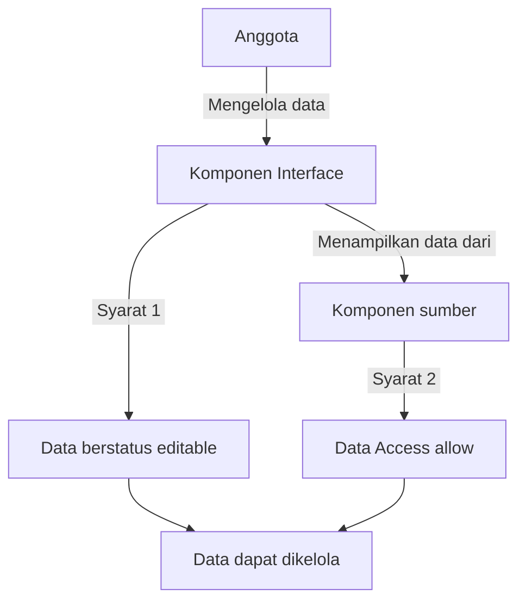
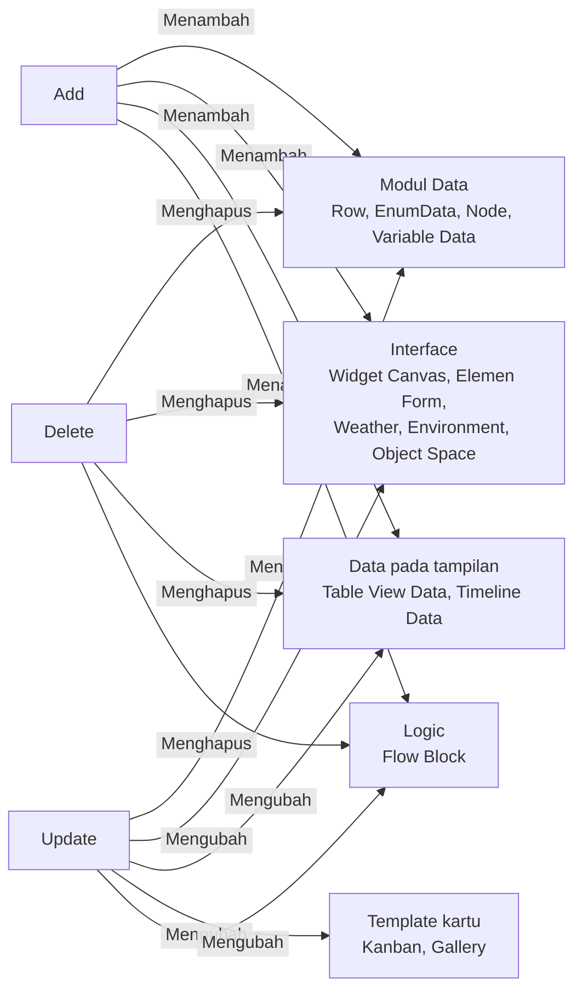

# Data Access

>**note** Data Access merupakan salah satu hak akses pada komponen [[Docs/Modul Developer/Workspace/Apa itu Workspace|Workspace]] dalam modul [[Docs/Modul Developer/Pengenalan|Developer]] di Phoenix.

Data Access adalah hak akses pada Workspace yang mengatur siapa yang boleh menambah, mengubah, dan menghapus data di dalam sebuah komponen. Berbeda dengan [[Docs/Modul Developer/Workspace/Component Access]] yang mengatur komponen secara keseluruhan (header), Data Access bekerja sampai ke level data, misalnya [[Docs/Tipe Data/Row]] pada [[Docs/Modul Data/Table/Apa itu Table|Table]].

Dengan Data Access, Anda dapat mengizinkan anggota mengelola data tanpa memberi mereka akses untuk mengubah komponennya. Aturan ini juga berlaku pada komponen Interface yang menampilkan data, sehingga data tidak dapat diubah lewat tampilan yang berbeda.

## Mengapa Menggunakan Data Access?

- **Kontrol sampai level data.** Anda menentukan siapa yang boleh menambah, mengubah, atau menghapus data, bukan hanya siapa yang boleh melihat komponen.
- **Satu aturan untuk semua tampilan.** [[Docs/Modul Interface/Table View/Apa itu Table View|Table View]], [[Docs/Modul Interface/Kanban/Apa itu Kanban|Kanban]], [[Docs/Modul Interface/Gallery/Apa itu Gallery|Gallery]], dan [[Docs/Modul Interface/Timeline/Apa itu Timeline|Timeline]] mengikuti Data Access komponen sumbernya.
- **Data terpisah dari konfigurasi.** Anggota dapat memperbarui data lewat sebuah tampilan tanpa dapat mengubah Query maupun konfigurasi tampilan tersebut.
- **Tanpa komponen baru.** Prinsip *least privilege* cukup diterapkan di halaman kerja Workspace.
- **Berlaku seketika.** Setiap perubahan tersimpan langsung dan langsung berlaku bagi anggota yang sedang membuka Phoenix, tanpa perlu memuat ulang.

## Konsep Utama

| Istilah | Penjelasan |
| --- | --- |
| [[#Hak Akses Data Access|Data Access]] | Hak akses pada level data: [[^field|Add]], [[^field|Update]], [[^field|Delete]]. |
| [[#Data yang Diatur pada Setiap Komponen|Data]] | Isi komponen yang diatur oleh Data Access. Jenisnya bergantung pada komponen, misalnya [[Docs/Tipe Data/Row]] pada Table atau Widget pada Canvas. |
| [[Docs/Modul Developer/Workspace/Component Access]] | Hak akses pada level komponen (header). Selengkapnya lihat [[Docs/Modul Developer/Workspace/Apa itu Workspace]]. |
| [[#Akses Berlapis pada Komponen Interface|Komponen sumber]] | Komponen Modul Data yang datanya ditampilkan oleh komponen Interface, misalnya [[Docs/Modul Data/Table/Apa itu Table|Table]] untuk [[Docs/Modul Interface/Table View/Apa itu Table View|Table View]]. |
| [[#Akses Berlapis pada Komponen Interface|`editable` dan `readonly`]] | Status Data pada komponen Interface yang menentukan apakah baris dapat dikelola. |
| [[^value/boolean/allow]] / [[^value/boolean/disallow]] | Nilai pengaturan akses. [[^value/boolean/allow]] berarti diizinkan, [[^value/boolean/disallow]] berarti tidak diizinkan. |

## Cara Kerja Data Access

Data Access diatur pada halaman kerja [[Docs/Modul Developer/Workspace/Apa itu Workspace|Workspace]], di bawah kolom [[^field|Data Access]]. Hak akses ini berlaku untuk anggota [[Docs/Modul Developer/Group/Apa itu Group|Group]] yang dipetakan ke Workspace tersebut.

Pada komponen Modul Data, Data Access langsung mengatur datanya. Pada komponen Interface yang menampilkan data, pengelolaan baris harus memenuhi dua syarat sekaligus:

Aturan penting:
- Data Access dan [[Docs/Modul Developer/Workspace/Component Access]] adalah pengaturan terpisah. Anggota dapat diizinkan mengelola data tanpa diizinkan mengubah komponennya.
- Sel yang kosong pada kolom [[^field|Data Access]] berarti hak akses tersebut tidak relevan untuk komponen itu.
- Folder tidak memiliki Data Access karena folder tidak menyimpan data.

## Hak Akses Data Access

| Hak Akses | Penjelasan |
| --- | --- |
| [[^field|Add]] | Mengizinkan penambahan data. |
| [[^field|Update]] | Mengizinkan perubahan data. |
| [[^field|Delete]] | Mengizinkan penghapusan data. |

### Efek Add, Update, dan Delete pada Komponen

Ketiga hak akses menampilkan satu kolom masing-masing pada halaman kerja [[Docs/Modul Developer/Workspace/Apa itu Workspace|Workspace]]. Diagram berikut menunjukkan efeknya pada data di setiap kelompok komponen.

Pada [[Docs/Modul Interface/Table View/Apa itu Table View|Table View]] dan [[Docs/Modul Interface/Timeline/Apa itu Timeline|Timeline]], Data Access mengatur pengelolaan Data, bukan [[Docs/Tipe Data/Row]] atau isi sel. Pada [[Docs/Modul Interface/Kanban/Apa itu Kanban|Kanban]] dan [[Docs/Modul Interface/Gallery/Apa itu Gallery|Gallery]], kartu mengikuti Data Access data sumber, sedangkan template kartu mengikuti Data Access komponen itu sendiri.

<!--
  * [TODO] Diagram disusun dari penjelasan per komponen, dengan asumsi bahwa Add dan Delete pada Table View dan Timeline berarti menambah dan menghapus Data, dan bahwa template kartu pada Kanban dan Gallery hanya terkait Update. Mohon konfirmasi, dan sesuaikan garis pada diagram bila berbeda.
-->

## Mengatur Data Access

1. Buka halaman kerja [[Docs/Modul Developer/Workspace/Apa itu Workspace|Workspace]]
2. Cari komponen pada kolom [[^field|Folder/ Component]]. Klik folder untuk memperluasnya
3. Klik tombol toggle pada [[^field|Add]], [[^field|Update]], atau [[^field|Delete]] di bawah [[^field|Data Access]] untuk memilih [[^value/boolean/allow]] atau [[^value/boolean/disallow]]

>**warning** Perubahan langsung berlaku
>Setiap perubahan tersimpan langsung dan langsung berlaku bagi anggota yang sedang membuka Phoenix, tanpa perlu memuat ulang.

## Data yang Diatur pada Setiap Komponen

| Komponen | Data yang diatur | Penjelasan |
| --- | --- | --- |
| [[Docs/Modul Data/Table/Apa itu Table|Table]] | [[Docs/Tipe Data/Row]] dan [[Docs/Tipe Data/TableData]] | Menambah, mengubah, dan menghapus Row beserta isinya. |
| [[Docs/Modul Data/Enum/Apa itu Enum|Enum]] | [[Docs/Tipe Data/EnumData]] | Menambah, mengubah, dan menghapus EnumData. |
| [[Docs/Modul Data/Tree/Apa itu Tree|Tree]] | [[Docs/Tipe Data/Node]] | Menambah, mengubah, dan menghapus Node. |
| [[Docs/Modul Data/Variable/Apa itu Variable|Variable]] | [[Docs/Tipe Data/Variable]] | Menambah, mengubah, dan menghapus Variable Data. |
| [[Docs/Modul Interface/Table View/Apa itu Table View|Table View]] | [[Docs/Modul Interface/Table View/Table View Data/Pengenalan|Table View Data]] | Mengatur pengelolaan Data, yaitu mengubah nama, mengubah Query, dan mengubah konfigurasi. Tidak mengatur Row atau isi sel. |
| [[Docs/Modul Interface/Timeline/Apa itu Timeline|Timeline]] | [[Docs/Modul Interface/Timeline/Timeline Data/Pengenalan]] | Mengatur pengelolaan Timeline Data. Lihat [[Docs/Modul Interface/Timeline/Apa itu Timeline#Hak Akses Timeline Data|Hak Akses Timeline Data]]. |
| [[Docs/Modul Interface/Kanban/Apa itu Kanban|Kanban]] | Template kartu | Kartu adalah data di level Row dan EnumData, jadi memindahkan kartu mengikuti Data Access data sumber. Mengubah template kartu mengikuti Data Access Kanban. |
| [[Docs/Modul Interface/Gallery/Apa itu Gallery|Gallery]] | Template kartu | Kartu adalah data di level Row, jadi mengubah Row dari kartu mengikuti Data Access Table sumber. Mengubah template kartu mengikuti Data Access Gallery. |
| [[Docs/Modul Interface/Canvas/Apa itu Canvas|Canvas]] | Widget | [[^field|Add]] menambahkan widget, [[^field|Update]] mengubah Query, atribut, atau styling widget, dan [[^field|Delete]] menghapus widget. |
| [[Docs/Modul Interface/Form/Apa itu Form|Form]] | Elemen | Setiap perubahan Elemen beserta atributnya di dalam Form. |
| [[Docs/Modul Interface/Space/Apa itu Space|Space]] | Weather, Environment, dan Object | Satu Data Access mewakili ketiga kategori. Lihat [[Docs/Modul Interface/Space/Apa itu Space#Hak Akses Space|Hak Akses Space]]. |
| [[Docs/Modul Logic/Flow/Apa itu Flow|Flow]] | Flow Block | Menambah, mengubah, dan menghapus Flow Block pada Blueprint. |

## Akses Berlapis pada Komponen Interface

Komponen Interface yang dapat memanipulasi data di komponen Modul Data tidak membuka akses baru. Baris dan isi sel hanya dapat dikelola jika dua syarat berikut terpenuhi:

| Syarat | Penjelasan |
| --- | --- |
| Konfigurasi komponen Interface | Data pada komponen Interface berstatus `editable`, misalnya pada [[Docs/Modul Interface/Table View/Apa itu Table View|Table View]] dan [[Docs/Modul Interface/Timeline/Apa itu Timeline|Timeline]]. Data berstatus `readonly` tidak dapat dikelola. |
| Data Access data sumber | Data Access komponen Modul Data sumber, misalnya [[Docs/Modul Data/Table/Apa itu Table|Table]], di Workspace mengizinkan aksi yang dilakukan. |

Jika salah satu syarat tidak terpenuhi, baris dan isi sel tidak dapat dikelola.

>**note** Visible komponen sumber hanya dibutuhkan saat mengisi Query
>Komponen sumber perlu [[^field|Visible]] [[^value/boolean/allow]] ketika Anda mengisi Query, misalnya pada [[Docs/Modul Interface/Table View/Table View Data/Pengenalan|Table View Data]]. Setelah Query terisi, [[^field|Visible]] pada komponen sumber tidak perlu lagi [[^value/boolean/allow]].

>**note** Mode Edit pada Canvas dan Form
>Pada [[Docs/Modul Interface/Canvas/Apa itu Canvas|Canvas]] dan [[Docs/Modul Interface/Form/Apa itu Form|Form]], toggle [[^mode/edit|Edit]] hanya dapat dipindahkan jika setidaknya salah satu Data Access ([[^field|Add]], [[^field|Update]], [[^field|Delete]]) bernilai [[^value/boolean/allow]]. Jika ketiganya [[^value/boolean/disallow]], komponen hanya tampil dalam mode [[^mode/view|View]] (*read only*).

## Contoh Penggunaan

**Memperbarui status pesanan lewat Kanban tanpa mengubah tampilan kartu**

Tim lapangan perlu memindahkan kartu pesanan antar status setiap hari, tetapi tidak boleh mengubah template kartu dan tidak boleh menghapus pesanan. Dengan Data Access, kebutuhan ini dipenuhi tanpa membuat komponen baru.

**Komponen yang terlibat**

| Komponen | Peran |
| --- | --- |
| [[^field/kanban|Papan Pesanan]] | Menampilkan pesanan sebagai kartu yang dikelompokkan menurut status. |
| [[^field/table|Data Pesanan]] | Menyimpan [[Docs/Tipe Data/Row]] pesanan, termasuk kolom status. |

| Komponen | Visible | Data Access | Hasil |
| --- | --- | --- | --- |
| [[^field/kanban|Papan Pesanan]] | [[^value/boolean/allow]] | [[^field|Add]], [[^field|Update]], dan [[^field|Delete]] [[^value/boolean/disallow]] | Anggota dapat membuka papan, tetapi tidak dapat mengubah template kartu. |
| [[^field/table|Data Pesanan]] | [[^value/boolean/disallow]] | [[^field|Add]] [[^value/boolean/disallow]], [[^field|Update]] [[^value/boolean/allow]], [[^field|Delete]] [[^value/boolean/disallow]] | Anggota dapat memindahkan kartu karena memindahkan kartu mengubah Row sumber, tetapi tidak dapat menambah atau menghapus pesanan. |

**Hasil yang dirasakan**

- Tim lapangan memperbarui status pesanan langsung dari papan.
- Template kartu tetap terjaga karena mengikuti Data Access [[^field/kanban|Papan Pesanan]].
- Data pesanan tidak dapat terhapus tanpa sengaja.

**Ide skenario lain**

| Kebutuhan | Pengaturan Data Access |
| --- | --- |
| Tim penjualan menambah dan memperbarui data pelanggan lewat [[Docs/Modul Interface/Table View/Apa itu Table View|Table View]]. | [[^field|Add]] dan [[^field|Update]] [[^value/boolean/allow]], [[^field|Delete]] [[^value/boolean/disallow]] pada Table sumber. |
| Anggota hanya perlu membaca isi [[Docs/Modul Interface/Canvas/Apa itu Canvas|Canvas]]. | [[^field|Add]], [[^field|Update]], dan [[^field|Delete]] [[^value/boolean/disallow]], sehingga Canvas hanya tampil dalam mode [[^mode/view|View]]. |
| Tim administrasi hanya boleh menambah data baru. | [[^field|Add]] [[^value/boolean/allow]], [[^field|Update]] dan [[^field|Delete]] [[^value/boolean/disallow]] pada Table sumber. |

Dengan Data Access, setiap tim mengelola data sesuai perannya tanpa perlu mengubah komponen atau menduplikasi data.

<!--
  * [TODO] Nama komponen pada Contoh Penggunaan (Papan Pesanan, Data Pesanan) adalah nama generik. Mohon sesuaikan atau tambahkan gambar bila diperlukan.
-->

## Praktik Terbaik

- **Mulai dari akses seminimal mungkin** (*least privilege*), lalu buka [[^field|Add]], [[^field|Update]], dan [[^field|Delete]] sesuai kebutuhan kerja setiap [[Docs/Modul Developer/Group/Apa itu Group|Group]].
- **Pisahkan Data Access dari Component Access.** Izinkan anggota mengelola data tanpa mengizinkan mereka mengubah atau menghapus komponennya.
- **Periksa dua syarat sekaligus** saat anggota tidak dapat mengubah baris di komponen Interface: Data berstatus `editable` dan Data Access komponen sumber bernilai [[^value/boolean/allow]].
- **Sembunyikan komponen sumber setelah Query terisi**, karena [[^field|Visible]] pada komponen sumber hanya dibutuhkan saat mengisi Query.
- **Batasi [[^field|Delete]]** pada data yang sulit dipulihkan, dan izinkan hanya untuk [[Docs/Modul Developer/Group/Apa itu Group|Group]] yang bertanggung jawab atas datanya.
- **Berhati-hati saat mengubah akses Group yang sedang aktif**, karena perubahan langsung berlaku tanpa perlu memuat ulang.

## Batasan dan Catatan

- Data Access hanya berlaku pada komponen yang memiliki data. Folder tidak memiliki Data Access, dan sel yang kosong berarti hak akses tidak relevan untuk komponen tersebut.
- Jenis data yang diatur bergantung pada komponen. Pada [[Docs/Modul Interface/Table View/Apa itu Table View|Table View]], Data Access hanya mengatur pengelolaan Data, bukan [[Docs/Tipe Data/Row]] atau isi sel.
- Pada komponen Interface yang menampilkan data, pengelolaan baris juga bergantung pada status `editable` dan Data Access data sumber.
- Memindahkan kartu pada [[Docs/Modul Interface/Kanban/Apa itu Kanban|Kanban]] dan [[Docs/Modul Interface/Gallery/Apa itu Gallery|Gallery]] mengikuti Data Access data sumber, sedangkan template kartu mengikuti Data Access komponen itu sendiri.
- Pada [[Docs/Modul Interface/Canvas/Apa itu Canvas|Canvas]] dan [[Docs/Modul Interface/Form/Apa itu Form|Form]], mode [[^mode/edit|Edit]] tidak dapat dipakai jika [[^field|Add]], [[^field|Update]], dan [[^field|Delete]] semuanya [[^value/boolean/disallow]].
- [[^field|Visible]] pada komponen sumber hanya dibutuhkan saat mengisi Query. Setelah Query terisi, komponen sumber tidak perlu lagi [[^value/boolean/allow]].
- Pengisi [[Docs/Modul Interface/Form/Apa itu Form|Form]] dan pengunjung tautan publikasi tidak diatur melalui Workspace, sehingga tidak dibatasi Data Access.
- Perubahan Data Access tersimpan langsung dan langsung berlaku bagi anggota yang sedang membuka Phoenix.

## TL:DR

- **Data Access** mengatur siapa yang boleh menambah, mengubah, dan menghapus data di dalam komponen, terpisah dari [[Docs/Modul Developer/Workspace/Component Access]].
- Hak akses terdiri dari [[^field|Add]], [[^field|Update]], dan [[^field|Delete]], masing-masing bernilai [[^value/boolean/allow]] atau [[^value/boolean/disallow]].
- Jenis data yang diatur bergantung pada komponen, misalnya [[Docs/Tipe Data/Row]] pada Table, Widget pada Canvas, dan Elemen pada Form.
- Komponen Interface mengikuti **dua syarat**: Data berstatus `editable` dan Data Access data sumber bernilai [[^value/boolean/allow]].
- Kartu pada Kanban dan Gallery mengikuti data sumber, sedangkan template kartu mengikuti Data Access komponennya.
- Perubahan Data Access langsung berlaku bagi anggota yang sedang membuka Phoenix.

## FAQ : Pertanyaan yang Sering Diajukan
>**faq**
>**Apa bedanya Data Access dan Component Access?**
>[[^field|Component Access]] mengatur komponen secara keseluruhan (header), sedangkan [[^field|Data Access]] mengatur data di dalam komponen, misalnya [[Docs/Tipe Data/Row]] pada [[Docs/Modul Data/Table/Apa itu Table|Table]].
>**Mengapa anggota tidak dapat mengubah baris di Table View padahal Data Access sudah allow?**
>Pengelolaan baris memerlukan dua syarat: Data pada [[Docs/Modul Interface/Table View/Apa itu Table View|Table View]] berstatus `editable` dan Data Access komponen sumber mengizinkan. Jika salah satunya tidak terpenuhi, baris tidak dapat dikelola.
>**Apakah komponen sumber harus Visible agar Table View dapat menampilkan datanya?**
>Tidak selalu. Komponen sumber hanya perlu [[^field|Visible]] [[^value/boolean/allow]] ketika Query diisi. Setelah Query terisi, [[^field|Visible]] tidak perlu lagi [[^value/boolean/allow]].
>**Hak akses apa yang mengatur pemindahan kartu di Kanban?**
>Kartu adalah data di level [[Docs/Tipe Data/Row]] dan [[Docs/Tipe Data/EnumData]], jadi memindahkan kartu mengikuti Data Access data sumber. Template kartu mengikuti Data Access [[Docs/Modul Interface/Kanban/Apa itu Kanban|Kanban]].
>**Mengapa mode Edit pada Canvas atau Form tidak dapat dipakai?**
>Mode [[^mode/edit|Edit]] hanya dapat dipakai jika setidaknya salah satu dari [[^field|Add]], [[^field|Update]], dan [[^field|Delete]] bernilai [[^value/boolean/allow]].
>**Apa arti sel yang kosong pada kolom Data Access?**
>Hak akses tersebut tidak relevan untuk komponen yang bersangkutan.
>**Apakah folder memiliki Data Access?**
>Tidak. Folder tidak menyimpan data, sehingga hanya memiliki [[^field|Component Access]].
>**Apakah pengisi Form atau pengunjung tautan publikasi dibatasi Data Access?**
>Tidak. Akses mereka tidak dibatasi Workspace dan ditentukan oleh pembuat komponen saat mempublikasikannya.
>**Apakah perubahan Data Access perlu disimpan atau dimuat ulang oleh anggota?**
>Tidak. Perubahan tersimpan langsung dan langsung berlaku bagi anggota yang sedang membuka Phoenix.