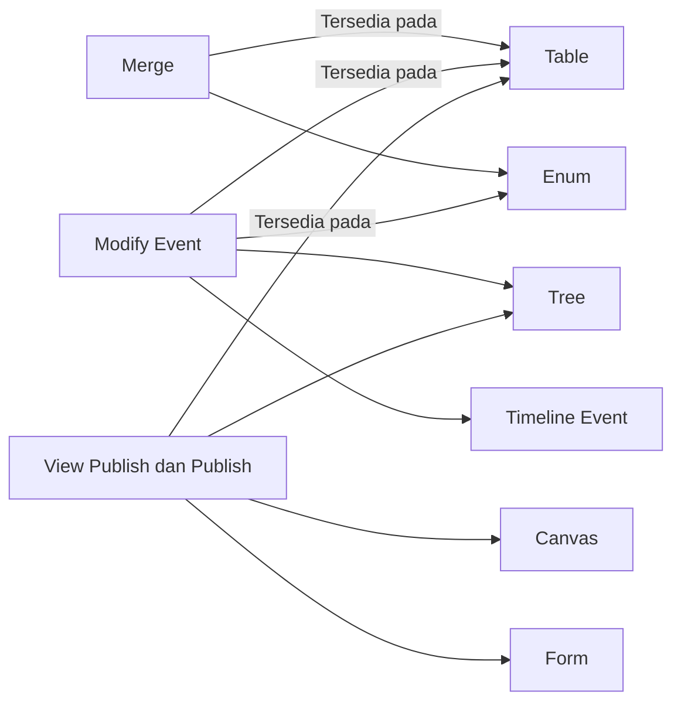

# Function Access

>**note** Function Access merupakan salah satu hak akses pada komponen [[Docs/Modul Developer/Workspace/Apa itu Workspace|Workspace]] dalam modul [[Docs/Modul Developer/Pengenalan|Developer]] di Phoenix.

Function Access adalah hak akses pada Workspace yang mengatur fungsi tambahan pada komponen, yaitu menggabungkan data ([[^field|Merge]]), mengubah [[Docs/Dasar/Apa itu Event|Event]] ([[^field|Modify Event]]), serta melihat dan memperbarui konfigurasi publikasi ([[^field|View Publish]] dan [[^field|Publish]]).

Berbeda dengan [[Docs/Modul Developer/Workspace/Component Access]] dan [[Docs/Modul Developer/Workspace/Data Access]], Function Access hanya tersedia pada komponen yang memiliki fungsi terkait. Ketika sebuah fungsi diatur [[^value/boolean/disallow]], tombol atau menu untuk fungsi tersebut hilang dari antarmuka komponen.

## Mengapa Menggunakan Function Access?

- **Membatasi fungsi yang sensitif.** Fungsi seperti publikasi dan perubahan Event dapat dibatasi hanya untuk [[Docs/Modul Developer/Group/Apa itu Group|Group]] yang bertanggung jawab.
- **Memisahkan melihat dan mengubah.** [[^field|View Publish]] hanya mengizinkan menyalin atau membuka tautan, sedangkan [[^field|Publish]] mengizinkan perubahan konfigurasi.
- **Menjaga alur otomasi.** Anggota tetap dapat bekerja dengan data tanpa dapat mengubah [[Docs/Dasar/Apa itu Event|Event]] yang terhubung ke [[Docs/Modul Logic/Flow/Apa itu Flow|Flow]].
- **Antarmuka yang bersih.** Fungsi yang tidak diizinkan hilang dari antarmuka, sehingga anggota tidak mencoba aksi yang tidak dapat mereka lakukan.
- **Mudah diperiksa.** Ikon kunci di samping nama komponen memperlihatkan hak akses yang diizinkan oleh Workspace.

## Konsep Utama

| Istilah | Penjelasan |
| --- | --- |
| Function Access | Hak akses pada fungsi komponen: [[^field|Merge]], [[^field|Modify Event]], [[^field|View Publish]], [[^field|Publish]]. |
| [[#Hak Akses Function Access|Merge]] | Hak akses untuk menggabungkan data pada komponen. |
| [[#Hak Akses Function Access|Modify Event]] | Hak akses untuk mengubah [[Docs/Dasar/Apa itu Event|Event]] pada komponen. |
| [[#Publish dan View Publish|Publish]] | Hak akses untuk memperbarui konfigurasi publikasi komponen. |
| [[#Publish dan View Publish|View Publish]] | Hak akses untuk hanya melihat konfigurasi publikasi, misalnya menyalin atau membuka [[^field|Publish Link]]. |
| [[Docs/Modul Developer/Workspace/Component Access#Mengenali Ikon Kunci|Ikon kunci]] | Ikon di samping nama komponen yang menampilkan hak akses yang diizinkan oleh Workspace. |
| [[^value/boolean/allow]] / [[^value/boolean/disallow]] | Nilai pengaturan akses. [[^value/boolean/allow]] berarti diizinkan, [[^value/boolean/disallow]] berarti tidak diizinkan. |

## Cara Kerja Function Access

Function Access diatur per baris pada halaman kerja [[Docs/Modul Developer/Workspace/Apa itu Workspace|Workspace]], di bawah kolom [[^field|Function Access]]. Hak akses ini berlaku untuk anggota [[Docs/Modul Developer/Group/Apa itu Group|Group]] yang dipetakan ke Workspace tersebut.

Aturan penting:
- Function Access hanya muncul pada komponen yang memiliki fungsi terkait. Sel yang kosong berarti hak akses tersebut tidak relevan untuk komponen itu.
- Fungsi yang diatur [[^value/boolean/disallow]] hilang dari antarmuka komponen, misalnya tombol [[^button|Merge]], [[^button|Publish]], atau tombol Event.
- Perubahan tersimpan langsung dan langsung berlaku bagi anggota yang sedang membuka Phoenix, tanpa perlu memuat ulang.
- Function Access tidak bergantung pada [[Docs/Modul Developer/Workspace/Data Access]]. Anggota dapat diizinkan mengelola data tanpa diizinkan memublikasikannya.

## Hak Akses Function Access

| Hak Akses | Penjelasan |
| --- | --- |
| [[^field|Merge]] | Mengizinkan penggabungan data. |
| [[^field|Modify Event]] | Mengizinkan perubahan [[Docs/Dasar/Apa itu Event|Event]] pada komponen. |
| [[^field|View Publish]] | Hanya dapat melihat konfigurasi publikasi, misalnya menyalin atau membuka [[^field|Publish Link]], tanpa mengubah status publikasi. |
| [[^field|Publish]] | Dapat memperbarui konfigurasi publikasi. |

### Fungsi pada Setiap Komponen

| Fungsi | Komponen | Penjelasan |
| --- | --- | --- |
| [[^field|Merge]] | [[Docs/Modul Data/Table/Apa itu Table|Table]], [[Docs/Modul Data/Enum/Apa itu Enum|Enum]] | Lihat [[Docs/Modul Data/Table/Merge]] dan [[Docs/Modul Data/Enum/Merge]]. |
| [[^field|Modify Event]] | [[Docs/Modul Data/Table/Apa itu Table|Table]], [[Docs/Modul Data/Enum/Apa itu Enum|Enum]], [[Docs/Modul Data/Tree/Apa itu Tree|Tree]], [[Docs/Modul Interface/Timeline/Apa itu Timeline#Mengelola Timeline Event|Timeline Event]] | Mengubah Event yang terhubung ke [[Docs/Modul Logic/Flow/Apa itu Flow|Flow]], termasuk tombol Event untuk menghubungkan Flow Block Event dari komponen. Lihat [[Docs/Event/Menghubungkan Event]]. |
| [[^field|View Publish]] dan [[^field|Publish]] | [[Docs/Modul Data/Table/Apa itu Table|Table]], [[Docs/Modul Data/Tree/Apa itu Tree|Tree]], [[Docs/Modul Interface/Canvas/Apa itu Canvas#Mempublikasikan Canvas|Canvas]], [[Docs/Modul Interface/Form/Apa itu Form|Form]] | Mengatur tautan publikasi komponen. |

## Publish dan View Publish

[[^field|Publish]] dan [[^field|View Publish]] mengatur tautan publikasi komponen. Keduanya sengaja dipisah agar tidak semua anggota dapat mengubah konfigurasi publikasi.

| Aksi | View Publish | Publish |
| --- | --- | --- |
| Melihat konfigurasi publikasi | [[^value/boolean/allow]] | [[^value/boolean/allow]] |
| Menyalin atau membuka [[^field|Publish Link]] | [[^value/boolean/allow]] | [[^value/boolean/allow]] |
| Memperbarui konfigurasi publikasi, termasuk mengubah status publikasi | [[^value/boolean/disallow]] | [[^value/boolean/allow]] |

>**warning** Publish membuka akses ke publik
>Tautan hasil [[^field|Publish]] dapat dibuka oleh publik. Pada [[Docs/Modul Interface/Canvas/Apa itu Canvas|Canvas]] yang dipublikasikan, widget Button yang sudah disetup dapat memicu [[Docs/Modul Logic/Flow/Apa itu Flow|Flow]] dan dipakai oleh siapa pun yang membuka tautan. Berikan [[^field|Publish]] hanya kepada [[Docs/Modul Developer/Group/Apa itu Group|Group]] yang tepercaya, dan gunakan [[^field|View Publish]] bagi anggota yang hanya perlu menyalin tautan.

>**note** Pengunjung tautan tidak diatur oleh Workspace
>Pengisi [[Docs/Modul Interface/Form/Apa itu Form|Form]] dan pengunjung tautan publikasi tidak dibatasi Workspace. Akses mereka ditentukan oleh pembuat komponen saat mempublikasikannya.

## Mengatur Function Access

1. Buka halaman kerja [[Docs/Modul Developer/Workspace/Apa itu Workspace|Workspace]]
2. Cari komponen pada kolom [[^field|Folder/ Component]]. Klik folder untuk memperluasnya
3. Klik tombol toggle pada [[^field|Merge]], [[^field|Modify Event]], [[^field|View Publish]], atau [[^field|Publish]] di bawah [[^field|Function Access]] untuk memilih [[^value/boolean/allow]] atau [[^value/boolean/disallow]]

>**warning** Perubahan langsung berlaku
>Setiap perubahan tersimpan langsung dan langsung berlaku bagi anggota yang sedang membuka Phoenix, tanpa perlu memuat ulang.

## Contoh Penggunaan

**Menerbitkan Form pendaftaran oleh tim pemasaran**

Tim pemasaran perlu menerbitkan formulir pendaftaran, tetapi tidak boleh mengubah komponen lain.

| Komponen | Publish | Hasil |
| --- | --- | --- |
| [[^field/form|Form Pendaftaran]] | [[^value/boolean/allow]] | Tim pemasaran dapat memperbarui konfigurasi publikasi dan membagikan tautannya. |
| [[^field/table|Data Pendaftar]] | [[^value/boolean/disallow]] | Tim pemasaran tidak dapat memublikasikan Table ini. |

**Membagikan tautan laporan tanpa dapat mengubah publikasi**

| Komponen | View Publish | Publish | Hasil |
| --- | --- | --- | --- |
| [[^field/canvas|Laporan Mingguan]] | [[^value/boolean/allow]] | [[^value/boolean/disallow]] | Anggota dapat menyalin atau membuka tautan, tetapi tidak dapat mengubah konfigurasi publikasi. |

**Ide skenario lain**

| Kebutuhan | Pengaturan Function Access |
| --- | --- |
| Tim operasional mengelola otomasi yang terhubung ke Table. | [[^field|Modify Event]] [[^value/boolean/allow]] pada Table tersebut. |
| Tim data menggabungkan data dari dua sumber. | [[^field|Merge]] [[^value/boolean/allow]] pada Table atau Enum yang bersangkutan. |
| Anggota baru hanya boleh membaca. | Seluruh Function Access [[^value/boolean/disallow]]. |

Dengan Function Access, fungsi yang berdampak luas hanya dapat dijalankan oleh pihak yang bertanggung jawab.

## Praktik Terbaik

- **Pisahkan [[^field|Publish]] dan [[^field|View Publish]]**, sehingga tidak semua anggota dapat mengubah konfigurasi publikasi.
- **Berikan [[^field|Publish]] dengan hati-hati** karena tautan publikasi dapat dibuka publik, terutama pada [[Docs/Modul Interface/Canvas/Apa itu Canvas|Canvas]] yang memiliki widget Button untuk memicu [[Docs/Modul Logic/Flow/Apa itu Flow|Flow]].
- **Batasi [[^field|Modify Event]]** hanya untuk [[Docs/Modul Developer/Group/Apa itu Group|Group]] yang mengelola otomasi, karena perubahan Event memengaruhi [[Docs/Modul Logic/Flow/Apa itu Flow|Flow]] yang terhubung.
- **Berikan [[^field|Merge]] dengan hati-hati** pada data yang sulit dipulihkan.
- **Berhati-hati saat mengubah akses Group yang sedang aktif**, karena perubahan langsung berlaku tanpa perlu memuat ulang.
- **Periksa ikon kunci** saat anggota melaporkan tombol yang tidak tersedia.

## Batasan dan Catatan

- Function Access hanya tersedia pada komponen yang memiliki fungsi terkait. Sel yang kosong berarti hak akses tidak relevan untuk komponen tersebut.
- Fungsi yang diatur [[^value/boolean/disallow]] hilang dari antarmuka komponen.
- [[^field|Merge]] tersedia pada [[Docs/Modul Data/Table/Apa itu Table|Table]] dan [[Docs/Modul Data/Enum/Apa itu Enum|Enum]]. [[^field|Modify Event]] tersedia pada Table, Enum, [[Docs/Modul Data/Tree/Apa itu Tree|Tree]], dan Timeline Event. [[^field|Publish]] dan [[^field|View Publish]] tersedia pada Table, Tree, [[Docs/Modul Interface/Canvas/Apa itu Canvas|Canvas]], dan [[Docs/Modul Interface/Form/Apa itu Form|Form]].
- Tautan publikasi dapat dibuka oleh publik, dan pengunjung tautan tidak dibatasi Workspace.
- Perubahan Function Access tersimpan langsung dan langsung berlaku bagi anggota yang sedang membuka Phoenix.
- Function Access berdiri sendiri, tidak bergantung pada [[Docs/Modul Developer/Workspace/Data Access]] maupun [[Docs/Modul Developer/Workspace/Component Access]].

## TL:DR

- **Function Access** mengatur fungsi tambahan pada komponen: [[^field|Merge]], [[^field|Modify Event]], [[^field|View Publish]], dan [[^field|Publish]], masing-masing bernilai [[^value/boolean/allow]] atau [[^value/boolean/disallow]].
- Hak akses ini hanya tersedia pada komponen yang memiliki fungsi terkait, dan fungsi yang diatur [[^value/boolean/disallow]] hilang dari antarmuka.
- [[^field|View Publish]] hanya untuk melihat atau menyalin tautan, sedangkan [[^field|Publish]] dapat memperbarui konfigurasi publikasi.
- Tautan hasil [[^field|Publish]] dapat dibuka oleh publik, jadi berikan hanya kepada Group yang tepercaya.
- Perubahan langsung berlaku bagi anggota yang sedang membuka Phoenix.

## FAQ : Pertanyaan yang Sering Diajukan
>**faq**
>**Apa bedanya View Publish dan Publish?**
>[[^field|View Publish]] hanya untuk melihat konfigurasi publikasi, misalnya menyalin [[^field|Publish Link]]. [[^field|Publish]] dapat memperbarui konfigurasi publikasi.
>**Komponen apa saja yang memiliki Function Access?**
>[[^field|Merge]] pada Table dan Enum, [[^field|Modify Event]] pada Table, Enum, Tree, dan Timeline Event, serta [[^field|View Publish]] dan [[^field|Publish]] pada Table, Tree, Canvas, dan Form.
>**Apa arti sel yang kosong pada kolom Function Access?**
>Hak akses tersebut tidak relevan untuk komponen yang bersangkutan.
>**Mengapa tombol Merge, Publish, atau Event tidak muncul pada komponen saya?**
>Fungsi yang terkait diatur [[^value/boolean/disallow]] oleh Workspace. Arahkan kursor ke ikon kunci di samping nama komponen untuk melihat hak akses yang diizinkan.
>**Apakah Function Access bergantung pada Data Access?**
>Tidak. Function Access berdiri sendiri, sehingga anggota dapat diizinkan mengelola data tanpa diizinkan memublikasikan komponen.
>**Apakah pengisi Form atau pengunjung tautan publikasi diatur di Workspace?**
>Tidak. Akses mereka tidak dibatasi Workspace dan ditentukan oleh pembuat komponen saat mempublikasikannya, sehingga [[^field|Publish]] sebaiknya hanya diberikan kepada [[Docs/Modul Developer/Group/Apa itu Group|Group]] yang tepercaya.
>**Apakah perubahan Function Access perlu disimpan atau dimuat ulang oleh anggota?**
>Tidak. Perubahan tersimpan langsung dan langsung berlaku bagi anggota yang sedang membuka Phoenix.