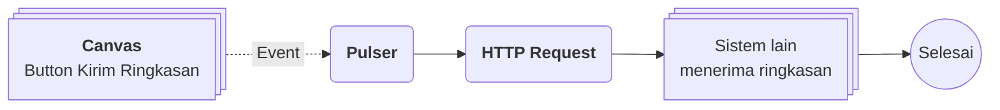

# Apa itu Canvas?

>**note** Canvas merupakan salah satu komponen dalam modul [[Docs/Modul Interface/Pengenalan|Interface]] di Phoenix.

Canvas adalah komponen yang dapat digunakan untuk menyusun, menghubungkan, dan memetakan data atau presentasi secara visual.

Canvas memberi fleksibilitas untuk membuat diagram, tabel, maupun proyeksi tanpa dibatasi struktur baris dan kolom. Anda menyusun tampilan dari [[#Widget Canvas|widget]] yang mengambil data lewat [[Docs/Tipe Data/Query]], menghubungkannya dengan [[Docs/Modul Logic/Flow/Apa itu Flow|Flow]] atau komponen lain melalui tombol, lalu membagikannya sebagai tautan [[#Mempublikasikan Canvas|publish]]. Dengan [[#Binding Canvas|Binding]], satu desain Canvas dapat dipakai ulang untuk data yang berbeda.

## Mengapa Menggunakan Canvas?

- **Bebas dari struktur baris dan kolom.** Anda dapat menyusun diagram, tabel, maupun proyeksi sesuai kebutuhan tampilan.
- **Banyak jenis tampilan dalam satu halaman.** Teks, grafik, tabel, kanban, gantt, timeline, gallery, dan space dapat dikombinasikan dalam satu Canvas.
- **Mulai lebih cepat dengan Template.** [[#Template Canvas|Template]] menggabungkan banyak widget yang sudah didesain dan siap dipakai.
- **Terhubung dengan logika.** Widget Button dapat memicu [[Docs/Modul Logic/Flow/Apa itu Flow|Flow]] atau membuka komponen lain.
- **Satu desain untuk banyak data.** [[#Binding Canvas|Binding]] membuat tampilan yang sama menyesuaikan informasinya dengan nilai parameter yang berbeda.
- **Mudah dibagikan.** Canvas dapat dipublikasikan dan dibuka melalui satu tautan.
- **Data sumber tetap aman.** Menghapus Canvas hanya menghapus template dan propertinya, bukan data sumber.

## Konsep Utama

| Istilah                                                       | Penjelasan                                                                                                                       |
| ------------------------------------------------------------- | -------------------------------------------------------------------------------------------------------------------------------- |
| [[#Widget Canvas|Widget]]                                    | Elemen penyusun tampilan Canvas, misalnya teks, grafik, tabel, atau tombol.                                                      |
| [[#Layout Canvas|Layout]]                                    | Wadah yang mengatur susunan widget secara horizontal atau vertikal. Layout dapat berisi widget maupun Layout lain.               |
| [[#Template Canvas|Template]]                                | Gabungan banyak widget yang sudah didesain dan siap dipakai.                                                                     |
| [[#Header Toolbar dan Design Toolbar|Header Toolbar]]        | Bilah pintasan aksi widget yang tampil ketika widget dipilih pada Edit Mode.                                                     |
| [[#Header Toolbar dan Design Toolbar|Design Toolbar]]        | Panel pengaturan tata letak dan tampilan widget yang tampil ketika widget dipilih pada Edit Mode.                                |
| [[#Mode View dan Edit|View Mode dan Edit Mode]]              | Dua mode Canvas. View Mode bersifat read only, Edit Mode untuk menyusun dan mengubah isi Canvas.                                 |
| [[#Binding Canvas|Binding]]                                  | Parameter Canvas yang dapat dipakai dalam Query widget dan memiliki nilai bawaan.                                                |
| [[#Mempublikasikan Canvas|Publish]]                          | Konfigurasi untuk mengubah Canvas menjadi tautan yang dipublikasikan.                                                            |
| [[Docs/Tipe Data/Query]]                                      | Tipe Data yang dipakai widget untuk mengambil dan menyaring data sumber.                                                         |

## Membuat Canvas

![[Docs/Modul Interface/Canvas/add-canvas.png]]

1. Buka folder tempat Canvas akan ditempatkan di [[Docs/Antarmuka#Area Manajemen Folder]]
2. Klik kanan ➜ [[^field/add|Add]] ➜ [[^field|Interface]] ➜ [[^field/canvas|Canvas]]
3. Isi [[^field|Name]] dan [[^field|Description]]
4. Klik [[^button|Create]]

Bagian kiri tanda `/` pada [[^field|Name]] terisi otomatis sesuai folder yang Anda klik kanan. Jika dikosongkan, Canvas berada di root.

>**success** Canvas berhasil dibuat
> Canvas yang baru dibuat masih kosong dan dibuka dalam View Mode. Pindah ke Edit Mode lalu tambahkan Layout dan widget di [[#Menambahkan Layout dan Widget]].

## Mengubah Canvas

1. Buka halaman kerja Canvas
2. Klik [[^button/edit|Edit]]
3. Ubah [[^field|Name]] atau [[^field|Description]]
4. Klik [[^button|Update]]

>**note** Tombol Edit berbeda dengan Edit Mode
> Tombol [[^button/edit|Edit]] hanya mengubah atribut Canvas (Name dan Description). Untuk mengubah isi Canvas seperti Layout dan widget, pindah ke Edit Mode melalui [[#Mode View dan Edit|toggle mode]].

## Menyegarkan Canvas

Klik [[^button/refresh|Refresh]] untuk memuat ulang tampilan. [[^button/refresh|Refresh]] tidak dapat dilakukan ketika Canvas sedang menyimpan perubahan.

## Menghapus Canvas

1. Buka folder yang berisi Canvas di [[Docs/Antarmuka#Area Manajemen Folder]]
2. Klik kanan Canvas ➜ [[^button/delete|Delete]]
3. Konfirmasi dengan klik [[^button|Delete]]

>**warning** Dampak menghapus Canvas
> Menghapus Canvas hanya menghapus template dan properti yang sudah dibuat, termasuk [[Docs/Tipe Data/Query]] pada setiap widget. Data sumber tetap aman. Tautan yang sudah dibagikan melalui [[#Mempublikasikan Canvas|Publish]] menjadi tidak valid.

## Antarmuka Canvas

![[Docs/Modul Interface/Canvas/interface-canvas.png]]
Halaman kerja Canvas terdiri dari bilah navigasi di bagian atas dan area kerja di bagian bawah. Bilah navigasi memuat judul Canvas (ikon Canvas dan Header Name) di sisi kiri serta tombol aksi di sisi kanan. Area kerja menampilkan isi Canvas, atau pesan Canvas kosong bila belum ada Layout dan widget. Tidak ada perbedaan signifikan antara tampilan desktop dan mobile.

### Bilah navigasi Canvas terdiri dari:

| Tombol                              | Fungsi                                                                                                                                         |
| ----------------------------------- | ---------------------------------------------------------------------------------------------------------------------------------------------- |
| [[^button/edit|Edit]]              | Mengubah atribut Canvas (Name dan Description), lalu klik [[^button|Update]]. Lihat [[#Mengubah Canvas]].                                      |
| [[^button/publish|Publish]]        | Membuka konfigurasi publikasi Canvas. Lihat [[#Mempublikasikan Canvas]].                                                                       |
| [[^field|mode]]                    | Toggle untuk berpindah antara [[^value/radio|View]] dan [[^value/radio|Edit]]. Lihat [[#Mode View dan Edit]].                                |
| [[^button/save|Save]]              | Menyimpan perubahan. Aktif ketika ada perubahan. Lihat [[#Menyimpan Perubahan]].                                                               |
| [[^button/refresh|Refresh]]        | Memuat ulang tampilan. Lihat [[#Menyegarkan Canvas]].                                                                                          |

### Mode View dan Edit

Canvas memiliki dua mode yang dapat dipilih melalui toggle [[^field|mode]]:

| Mode                          | Fungsi                                                                                                                                                   |
| ----------------------------- | -------------------------------------------------------------------------------------------------------------------------------------------------------- |
| [[^value/radio|View]]        | Mode read only. Isi Canvas hanya dapat dilihat dan tidak dapat diubah. Canvas kosong menampilkan [[^field|Read Only]].                                  |
| [[^value/radio|Edit]]        | Mode untuk menyusun dan mengubah isi Canvas. Canvas kosong menampilkan [[^field|Type something here to add...]] untuk menambahkan Layout atau widget. |

Pindah ke Edit Mode dapat dilakukan jika salah satu Data Access Canvas (Add, Update, atau Delete) pada [[Docs/Modul Developer/Workspace/Apa itu Workspace|Workspace]] bernilai [[^value/boolean/allow]]. Jika semuanya [[^value/boolean/disallow]], toggle tidak dapat dipindahkan dan Canvas tetap berada di View Mode. Lihat [[#Hak Akses Canvas]].

![[Docs/Modul Interface/Canvas/edit-canvas.png]]

### Menyimpan Perubahan

Tombol [[^button/save|Save]] aktif ketika ada perubahan pada Canvas. Anda dapat menyimpan secara manual dengan klik [[^button/save|Save]], atau menunggu sekitar 3 detik hingga perubahan tersimpan otomatis (*auto save*).

### Interaksi Antarmuka Canvas

| Fungsi                                                      | Aksi                                                                                                               |
| ----------------------------------------------------------- | ------------------------------------------------------------------------------------------------------------------ |
| Berpindah mode                                              | Klik toggle [[^field|mode]] pada bilah navigasi.                                                                  |
| Menambahkan Layout atau widget                              | Pada Edit Mode, klik [[^field|Type something here to add...]], ketik perintah berawalan `/`, lalu pilih dari dropdown. |
| Memfokuskan widget                                          | Pada Edit Mode, klik kiri widget.                                                                                  |
| Menampilkan [[#Header Toolbar dan Design Toolbar|header toolbar dan design toolbar]] | Klik kiri (*select*) widget. Setiap aksi select pada widget menampilkan keduanya.        |
| Memindahkan widget                                          | Gunakan ikon pegangan ⋮⋮ pada header toolbar untuk memindahkan widget ke posisi atau Layout lain.                  |
| Menghapus widget                                            | Klik [[^button/delete|Remove]] pada header toolbar.                                                               |
| Menyimpan perubahan                                         | Klik [[^button/save|Save]] atau tunggu sekitar 3 detik.                                                           |

## Membangun Canvas

### Menambahkan Layout dan Widget

1. Pindah ke Edit Mode melalui toggle [[^field|mode]]
2. Klik [[^field|Type something here to add...]]
3. Ketik perintah berawalan `/` untuk mencari yang ingin ditambahkan
4. Pilih Layout, Template, atau widget dari dropdown

Perintah yang ditampilkan sebagai contoh pada Canvas kosong:

| Perintah    | Fungsi                          |
| ----------- | ------------------------------- |
| `/layout`   | Mencari Layout                  |
| `/widget`   | Mencari Widget                  |
| `/chart`    | Mencari chart                   |
| `/template` | Mencari Template                |
| `/t`        | Tambah Title                    |
| `/s`        | Tambah Subtitle                 |
| `/p`        | Tambah Paragraph                |
| `/vertical` | Tambah Layout mode Vertical     |
| `/horizontal` | Tambah Layout mode Horizontal |
| `/text`     | Tambah Teks Kosong              |
| `/table`    | Tamabh Tabel Kosong             |

### Layout Canvas

Canvas hanya memiliki satu jenis Layout. Anda dapat menambahkan Layout di dalam Layout lain untuk menyusun tampilan bertingkat. Tipe Layout dapat diubah antara horizontal dan vertical dengan toggle pada [[#Header Toolbar dan Design Toolbar|header toolbar]]. Untuk styling, Anda menggunakan pengaturan layout dan styling yang tersedia pada [[#Header Toolbar dan Design Toolbar|design toolbar]]. Selengkapnya tentang kelas styling lihat [[Docs/Styling/Styling Class]].

### Header Toolbar dan Design Toolbar

Pada Edit Mode, klik kiri widget untuk memfokuskannya. Setiap aksi select pada widget menampilkan dua toolbar:

| Toolbar                | Fungsi                                                                                                                              |
| ---------------------- | ----------------------------------------------------------------------------------------------------------------------------------- |
| Header Toolbar         | Pintasan aksi widget, misalnya memilih data sumber, mengatur Query, memindahkan, dan menghapus widget.                              |
| Design Toolbar         | Pengaturan tata letak dan tampilan widget.                                                                                          |

![[Docs/Modul Interface/Canvas/toolbar-canvas.png]]
Contoh di atas adalah toolbar widget Chart Pie:

| Area                                  | Isi pada contoh Chart Pie                                                                                                                                                           |
| ------------------------------------- | ----------------------------------------------------------------------------------------------------------------------------------------------------------------------------------- |
| Header toolbar                        | Ikon pegangan ⋮⋮ untuk memindahkan widget, [[^field|Data]] (Table sumber), tombol [[^button/q]] untuk membuka [[Docs/Tipe Data/Query]], [[^field|Limit]], dan tombol [[^button/delete|Remove]] untuk menghapus widget. |
| Design toolbar, panel tata letak      | [[^field|min.]] (w dan h dalam persen), [[^field|padding]], dan [[^field|margin]] pada keempat sisi.                                                                             |
| Design toolbar, panel tampilan widget | [[^field|hole]], [[^field|gap]], [[^field|theme]], [[^field|gradient]], [[^field|offset]], [[^field|label]], [[^field|min]], [[^field|legends]], [[^field|total]], dan [[^field|size]]. |

>**note** Isi toolbar berbeda pada setiap widget
> Panel tata letak sama di semua widget. Header toolbar dan panel tampilan widget bersifat unik untuk masing-masing widget. Keunikan setiap widget dijelaskan di halaman widget masing-masing pada [[#Widget Canvas]].

### Widget Canvas

Widget adalah elemen penyusun tampilan Canvas. Widget yang tersedia:

| Widget                                                                                      | Kelompok                |
| ------------------------------------------------------------------------------------------- | ----------------------- |
| [[Docs/Modul Interface/Form/Widget/Text/Penjelasan|Text]]                                  | Teks                    |
| [[Docs/Modul Interface/Form/Widget/Chart Pie/Penjelasan|Chart Pie]]                        | Grafik                  |
| [[Docs/Modul Interface/Form/Widget/Chart Line/Penjelasan|Chart Line]]                      | Grafik                  |
| [[Docs/Modul Interface/Form/Widget/Chart Bar/Penjelasan|Chart Bar]]                        | Grafik                  |
| [[Docs/Modul Interface/Form/Widget/Chart Radial/Penjelasan|Chart Radial]]                  | Grafik                  |
| [[Docs/Modul Interface/Form/Widget/Chart Linear/Penjelasan|Chart Linear]]                  | Grafik                  |
| [[Docs/Modul Interface/Form/Widget/Table/Penjelasan|Table]]                                | Tampilan data           |
| [[Docs/Modul Interface/Form/Widget/Kanban/Penjelasan|Kanban]]                              | Tampilan data           |
| [[Docs/Modul Interface/Form/Widget/Gantt/Penjelasan|Gantt]]                                | Tampilan data           |
| [[Docs/Modul Interface/Form/Widget/Timeline/Penjelasan|Timeline]]                          | Tampilan data           |
| [[Docs/Modul Interface/Form/Widget/Gallery/Penjelasan|Gallery]]                            | Tampilan data           |
| [[Docs/Modul Interface/Form/Widget/Space/Penjelasan|Space]]                                | Tampilan data           |
| [[Docs/Modul Interface/Form/Widget/Button/Penjelasan|Button]]                              | Aksi                    |

Beberapa widget bekerja seperti komponen Interface lain dalam versi lite. Sebagai contoh, komponen [[Docs/Modul Interface/Timeline/Apa itu Timeline|Timeline]] memiliki Event dan banyak data, sedangkan widget Timeline pada Canvas hanya menyajikan satu data.

[[Docs/Tipe Data/Query]] setiap widget diatur melalui tombol [[^button/q]] pada header toolbar. Isi widget, yaitu data hasil Query, tidak dapat dimanipulasi dari Canvas.

Widget Button dapat berfungsi sebagai pemicu [[Docs/Modul Logic/Flow/Apa itu Flow|Flow]] melalui Flow Block [[Docs/Modul Logic/Flow/Flow Block/Event/Pulser|Pulser]], atau membuka komponen apa pun.

Penjelasan keunikan masing-masing widget ada di halaman widget yang bersangkutan.

### Template Canvas

Template adalah gabungan banyak widget yang sudah didesain dan siap dipakai. Tambahkan Template melalui perintah `/template` pada [[^field|Type something here to add...]]. Selengkapnya lihat [[Docs/Modul Interface/Canvas/Template|Template Canvas]].

### Binding Canvas

Binding adalah parameter Canvas yang dapat dipakai dalam [[Docs/Tipe Data/Query]] pada widget. Binding dikonfigurasikan melalui tombol [[^button/setting|Binding]] yang membuka modal. Setiap Binding memiliki nilai bawaan (*default value*), dan Canvas dapat dibuka secara dinamis dengan Binding sebagai parameter.

Modal Binding berisi tabel dengan kolom berikut:

| Kolom                            | Fungsi                                                                                                                                                                  |
| -------------------------------- | ----------------------------------------------------------------------------------------------------------------------------------------------------------------------- |
| [[^field|Name]]                 | Nama Binding. Harus unik.                                                                                                                                               |
| [[^field|Format]]               | Format data Binding.                                                                                                                                                    |
| [[^field|Header]]               | Hanya diisi pada format tertentu, mirip dengan konfigurasi [[Docs/Tipe Data/Column|Column]] pada [[Docs/Modul Data/Table/Apa itu Table|Table]]. Bernilai N/A bila Format tidak membutuhkannya. |
| [[^field|Default Value]]        | Nilai bawaan ketika parameter tidak ditentukan.                                                                                                                         |

**Memakai Binding di Query.** Pada bagian nilai di [[Docs/Tipe Data/Query]] (misalnya pada [[Docs/Tipe Data/Query#Filter|Filter]]), Anda dapat mengisinya dengan Name Binding. Ketika parameter Canvas diubah, nilai dalam Query ikut berubah.

**Membuka Canvas dengan parameter.** Canvas dapat dibuka dengan parameter melalui tautan [[#Mempublikasikan Canvas|Publish]], widget Button yang sudah disiapkan, atau komponen lain yang dapat memanggil Canvas dengan parameter.

Sebagai contoh, Anda membuat Canvas untuk mempresentasikan rincian satu [[Docs/Tipe Data/Row|Row]] pesanan dengan desain menarik. Binding diisi dengan nomor pesanan, lalu dipakai pada Filter Query setiap widget. Ketika nilai Binding diganti dengan nomor pesanan lain, desain yang sama menampilkan informasi pesanan tersebut.

### Mempublikasikan Canvas

Publish adalah konfigurasi untuk mengubah Canvas menjadi dipublikasikan. Klik [[^button/publish|Publish]] untuk membuka modal konfigurasinya, yang hanya berisi dua kolom:

| Kolom                    | Fungsi                                                                                                                         |
| ------------------------ | ------------------------------------------------------------------------------------------------------------------------------ |
| [[^field|Status]]       | Menentukan Canvas dipublikasikan atau tidak: [[^value/radio|Active]] atau [[^value/radio|Non-Active]].                       |
| [[^field|Link]]         | Tautan Canvas yang dibuat otomatis. Anda dapat menyalin tautan (*copy*) atau membukanya di tab baru (*open new tab*).          |

Tautan yang Active dapat dibuka oleh publik dalam View Mode saja. Jika Status [[^value/radio|Non-Active]], tautan tidak dapat dibuka karena Canvas tidak dalam status dipublikasikan.

>**warning** Canvas yang dipublikasikan dapat dipakai publik
> Widget Button pada Canvas yang dipublikasikan dapat ditekan oleh siapa pun yang memiliki tautan. Pastikan Flow atau komponen yang dipicu aman dijalankan oleh publik.

Akses Publish mengikuti Function Access di [[Docs/Modul Developer/Workspace/Apa itu Workspace|Workspace]]. Lihat [[#Hak Akses Canvas]].

## Hak Akses Canvas

Canvas mengikuti Comp. Access, Data Access, dan Function Access di [[Docs/Modul Developer/Workspace/Apa itu Workspace|Workspace]] seperti komponen lain.

| Akses                                                                                                  | Pengaruh pada Canvas                                                                                                                              |
| ------------------------------------------------------------------------------------------------------ | ------------------------------------------------------------------------------------------------------------------------------------------------- |
| [[Docs/Modul Developer/Workspace/Apa itu Workspace#Comp. Access|Comp. Access]]                        | Mengatur apakah Canvas terlihat, dapat ditambahkan, diubah atributnya (Name dan Description), dan dihapus.                                        |
| [[Docs/Modul Developer/Workspace/Data Access|Data Access]] Add                                        | Menambahkan widget ke dalam Canvas.                                                                                                               |
| [[Docs/Modul Developer/Workspace/Data Access|Data Access]] Update                                     | Mengubah Query, atribut, atau styling widget.                                                                                                     |
| [[Docs/Modul Developer/Workspace/Data Access|Data Access]] Delete                                     | Menghapus widget dari Canvas.                                                                                                                     |
| [[Docs/Modul Developer/Workspace/Apa itu Workspace#Function Access|Function Access]] View Publish     | Hanya melihat konfigurasi publikasi, misalnya menyalin tautan.                                                                                    |
| [[Docs/Modul Developer/Workspace/Apa itu Workspace#Function Access|Function Access]] Publish          | Memperbarui konfigurasi publikasi, yaitu mengubah Status.                                                                                         |

Data Access pada Canvas mengatur setiap perubahan widget dan atributnya di dalam Canvas. Jika salah satu dari Add, Update, atau Delete bernilai [[^value/boolean/allow]], toggle [[^field|mode]] dapat dipindahkan ke Edit Mode. Jika ketiganya [[^value/boolean/disallow]], Canvas hanya dapat dilihat.

## Contoh Penggunaan

**Dasbor Ringkasan Pesanan untuk Manajer**

Manajer penjualan ingin melihat kondisi pesanan dalam satu halaman tanpa harus membuka Table satu per satu. Dengan Canvas, data pesanan yang sudah ada di [[Docs/Modul Data/Table/Apa itu Table|Table]] disajikan sebagai grafik dan tabel ringkas, lengkap dengan tombol untuk mengirim ringkasan ke sistem lain. Dasbor dibagikan sebagai tautan [[#Mempublikasikan Canvas|Publish]] sehingga manajer cukup membukanya dari peramban.

**Komponen yang terlibat**

| Komponen                                | Peran                                                                                                                       |
| --------------------------------------- | --------------------------------------------------------------------------------------------------------------------------- |
| [[^field/table|Pesanan]]               | Data sumber pesanan yang dibaca widget melalui [[Docs/Tipe Data/Query]].                                                    |
| [[^field/canvas|Dasbor Pesanan]]       | Menyusun widget Text, Chart Pie, Chart Bar, dan Table dalam satu tampilan, serta widget Button untuk pengiriman.            |
| [[^field/flow|Kirim Ringkasan]]        | Menjalankan proses pengiriman ringkasan ketika Button ditekan.                                                              |

**Alur di Flow**

| Langkah | Flow Block                                                                                         | Peran dalam alur                                    | Hasil                                    |
| ------- | -------------------------------------------------------------------------------------------------- | --------------------------------------------------- | ---------------------------------------- |
| 1       | [[Docs/Modul Logic/Flow/Flow Block/Event/Pulser|Pulser]]                                          | Menerima pemicu dari Button pada Canvas.            | Alur berjalan.                           |
| 2       | [[Docs/Modul Logic/Flow/Flow Block/Modular/HTTP Request|HTTP Request]]                            | Mengirim ringkasan pesanan ke sistem lain.          | Sistem lain menerima ringkasan.          |

**Hasil yang dirasakan**

- Manajer melihat kondisi pesanan sekilas dalam satu halaman, tanpa membuka Table.
- Tampilan selalu mengikuti data terbaru karena widget membaca langsung dari data sumber.
- Ringkasan terkirim ke sistem lain hanya dengan satu tombol, tanpa kerja manual.
- Data pesanan tetap aman karena Canvas hanya menyajikan tampilan.

**Ide skenario lain**
| Jenis nilai                   | Contoh integrasi                                                                                                                                                                 |
| ----------------------------- | -------------------------------------------------------------------------------------------------------------------------------------------------------------------------------- |
| Kartu detail dinamis          | Canvas dengan [[#Binding Canvas|Binding]] untuk menampilkan desain menarik satu pesanan, lalu berganti ke pesanan lain hanya dengan mengubah parameter.                         |
| Pemantauan proyek             | Widget Gantt, Timeline, dan Kanban dalam satu Canvas untuk melihat jadwal dan progres proyek sekaligus.                                                                          |
| Katalog dengan aksi           | Widget Gallery untuk katalog dan widget Button yang membuka komponen lain untuk memesan.                                                                                         |
| Laporan publik                | Canvas berisi grafik dan teks penjelasan yang dibagikan ke pihak luar melalui tautan [[#Mempublikasikan Canvas|Publish]].                                                       |

Dengan Canvas, data, logika, dan tampilan yang sudah ada di Phoenix tersambung dalam satu halaman visual yang mudah dibagikan.

## Praktik Terbaik

- **Pisahkan tampilan dan data.** Gunakan Canvas untuk menyajikan data, dan kelola Row di [[Docs/Modul Data/Table/Apa itu Table|Table]] atau [[Docs/Modul Interface/Table View/Apa itu Table View|Table View]].
- **Manfaatkan [[#Binding Canvas|Binding]] untuk mendesain sekali.** Satu Canvas dengan Binding dapat dipakai untuk banyak data. Isi [[^field|Default Value]] agar Canvas tidak kosong saat dibuka tanpa parameter.
- **Mulai dari [[#Template Canvas|Template]].** Gunakan Template siap pakai lalu sesuaikan widget-nya agar desain lebih cepat selesai.
- **Pastikan perubahan tersimpan.** Tunggu sekitar 3 detik atau klik [[^button/save|Save]] sebelum meninggalkan halaman, terutama setelah mengubah banyak widget.
- **Periksa [[^field|Status]] sebelum membagikan [[^field|Link]].** Pastikan Status sudah [[^value/radio|Active]] sebelum tautan dibagikan.
- **Berhati-hati dengan Button pada Canvas publik.** Siapa pun yang memiliki tautan dapat menekan widget Button, jadi pastikan [[Docs/Modul Logic/Flow/Flow Block/Event/Pulser|Pulser]] dan Flow yang dipicu aman dijalankan publik.
- **Atur Data Access sesuai peran.** Beri [[Docs/Modul Developer/Workspace/Data Access|Data Access]] Add, Update, atau Delete hanya kepada pengguna yang bertugas mendesain.
- **Lihat halaman widget untuk pengaturan lanjutan.** [[#Header Toolbar dan Design Toolbar|Toolbar]] setiap widget berbeda, jadi rujuk halaman widget yang bersangkutan.

## Batasan dan Catatan

- Canvas dalam [[#Mode View dan Edit|View Mode]] bersifat read only. Berpindah ke [[^value/radio|Edit]] hanya dapat dilakukan jika salah satu Data Access Canvas (Add, Update, atau Delete) bernilai [[^value/boolean/allow]].
- Tombol [[^button/edit|Edit]] hanya mengubah atribut Canvas (Name dan Description), bukan isi Canvas.
- Widget yang menyerupai komponen Interface lain bersifat lite. Query diatur melalui [[^button/q]], sedangkan isinya (data hasil [[Docs/Tipe Data/Query|Query]]) tidak dapat dimanipulasi dari Canvas.
- Canvas hanya memiliki satu jenis [[#Layout Canvas|Layout]], yang dapat ditumpuk di dalam Layout lain. Tipe horizontal atau vertical dapat diubah dengan toggle pada header toolbar.
- Panel tata letak pada [[#Header Toolbar dan Design Toolbar|design toolbar]] sama di semua widget, sedangkan header toolbar dan panel tampilan bersifat unik untuk setiap widget.
- Nama [[#Binding Canvas|Binding]] harus unik dan dipakai dalam Query widget. [[^field|Header]] bernilai N/A bila Format tidak membutuhkannya.
- [[^button/refresh|Refresh]] tidak dapat dilakukan ketika Canvas sedang menyimpan perubahan.
- Tautan [[#Mempublikasikan Canvas|Publish]] yang Active dapat dibuka publik dalam View Mode, termasuk menekan widget Button.
- Menghapus Canvas hanya menghapus template dan properti termasuk Query. Data sumber tetap aman, tetapi tautan yang sudah dibagikan melalui [[#Mempublikasikan Canvas|Publish]] menjadi tidak valid.
- Function Access View Publish hanya melihat konfigurasi publikasi, sedangkan Publish dapat mengubahnya.

## TL:DR

- Canvas adalah komponen modul [[Docs/Modul Interface/Pengenalan|Interface]] untuk menyusun, menghubungkan, dan memetakan data atau presentasi secara visual tanpa dibatasi baris dan kolom.
- Halaman kerja memiliki bilah navigasi ([[^button/edit|Edit]], [[^button/publish|Publish]], toggle [[^field|mode]], [[^button/save|Save]], [[^button/refresh|Refresh]]) dan area kerja. Lihat [[#Antarmuka Canvas]].
- [[#Mode View dan Edit|View Mode]] bersifat read only. Untuk berpindah ke Edit Mode, salah satu Data Access Canvas (Add, Update, atau Delete) harus [[^value/boolean/allow]]. Perubahan tersimpan manual atau otomatis sekitar 3 detik.
- Bangun Canvas dengan menambahkan [[#Layout Canvas|Layout]], [[#Widget Canvas|widget]], atau [[#Template Canvas|Template]], lalu atur melalui [[#Header Toolbar dan Design Toolbar|header toolbar dan design toolbar]] yang muncul saat widget dipilih.
- Gunakan [[#Binding Canvas|Binding]] agar satu desain dapat menampilkan data yang berbeda, dan [[#Mempublikasikan Canvas|Publish]] untuk membagikan Canvas lewat [[^field|Link]] yang dapat dibuka publik dalam View Mode.
- Hati-hati: Button pada Canvas publik dapat ditekan siapa saja, dan menghapus Canvas membuat tautan yang sudah dibagikan tidak valid (data sumber aman).

## FAQ : Pertanyaan yang Sering Diajukan

> **faq**
> **Apa bedanya tombol Edit dengan mode Edit?**
> Tombol [[^button/edit|Edit]] mengubah atribut Canvas (Name dan Description), lalu disimpan dengan [[^button|Update]]. Mode [[^value/radio|Edit]] pada toggle [[^field|mode]] dipakai untuk menyusun isi Canvas seperti Layout dan widget.
> **Mengapa saya tidak dapat berpindah ke Edit Mode?**
> Berpindah ke Edit Mode memerlukan salah satu Data Access Canvas (Add, Update, atau Delete) bernilai [[^value/boolean/allow]] pada [[Docs/Modul Developer/Workspace/Apa itu Workspace|Workspace]]. Jika ketiganya [[^value/boolean/disallow]], Canvas hanya dapat dilihat. Hubungi pengelola Workspace Anda untuk memeriksanya.
> **Apakah saya harus menekan Save?**
> [[^button/save|Save]] aktif ketika ada perubahan. Anda dapat menekannya secara manual atau menunggu sekitar 3 detik hingga tersimpan otomatis.
> **Apakah menghapus Canvas menghapus data sumber?**
> Tidak. Menghapus Canvas hanya menghapus template dan propertinya, termasuk [[Docs/Tipe Data/Query]] pada widget. Namun tautan yang sudah dibagikan melalui [[#Mempublikasikan Canvas|Publish]] menjadi tidak valid.
> **Apakah widget dapat dipakai untuk mengubah data sumber?**
> Tidak. Widget bersifat lite: Query diatur melalui [[^button/q]] pada Edit Mode, tetapi data hasil [[Docs/Tipe Data/Query|Query]] tidak dapat dimanipulasi dari Canvas. Untuk mengelola data, gunakan [[Docs/Modul Data/Table/Apa itu Table|Table]] atau [[Docs/Modul Interface/Table View/Apa itu Table View|Table View]].
> **Untuk apa Binding pada Canvas?**
> [[#Binding Canvas|Binding]] adalah parameter yang dapat dipakai dalam Query widget. Dengan Binding, satu desain Canvas dapat menampilkan informasi berbeda, misalnya dari satu pesanan ke pesanan lain, tanpa membuat Canvas baru.
> **Apa itu Template Canvas?**
> [[#Template Canvas|Template]] adalah gabungan banyak widget yang sudah didesain dan siap dipakai. Tambahkan melalui perintah `/template` pada Edit Mode.
> **Apakah Canvas yang dipublikasikan dapat dibuka siapa saja?**
> Ya. Tautan [[^field|Link]] dengan Status [[^value/radio|Active]] dapat dibuka publik dalam View Mode, termasuk menekan widget Button. Pastikan Flow yang dipicu aman dijalankan publik.
> **Apa yang dapat dilakukan widget Button?**
> Widget [[#Widget Canvas|Button]] dapat memicu [[Docs/Modul Logic/Flow/Apa itu Flow|Flow]] melalui Flow Block [[Docs/Modul Logic/Flow/Flow Block/Event/Pulser|Pulser]], atau membuka komponen apa pun.