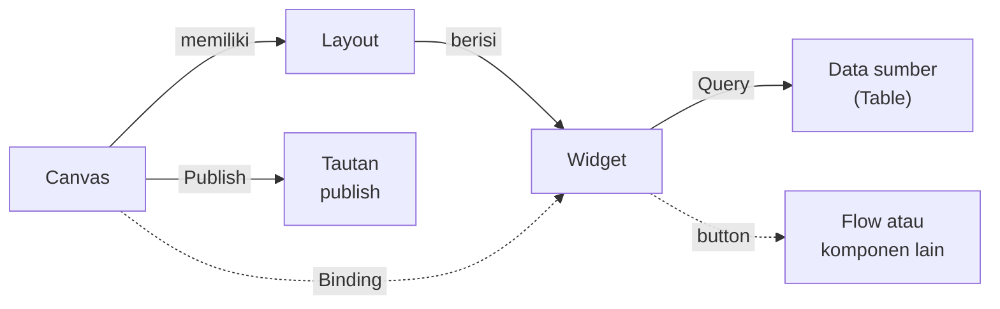
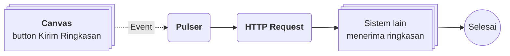

# Apa itu Canvas?

>**note** Canvas merupakan salah satu komponen dalam modul [[Docs/Modul Interface/Pengenalan|Interface]] di Phoenix.

Canvas adalah komponen yang dapat digunakan untuk menyusun, menghubungkan, dan memetakan data atau presentasi secara visual.

Canvas memberi fleksibilitas untuk membuat diagram, tabel, maupun proyeksi tanpa dibatasi struktur baris dan kolom. Anda menyusun tampilan dari [[#Widget Canvas|widget]] yang mengambil data lewat [[Docs/Tipe Data/Query]], menghubungkannya dengan [[Docs/Modul Logic/Flow/Apa itu Flow|Flow]] atau komponen lain melalui tombol, lalu membagikannya sebagai tautan [[#Mempublikasikan Canvas|publish]]. Dengan [[#Binding Canvas|Binding]], satu desain Canvas dapat dipakai ulang untuk data yang berbeda.

## Mengapa Menggunakan Canvas?

- **Bebas dari struktur baris dan kolom.** Anda dapat menyusun diagram, tabel, maupun proyeksi sesuai kebutuhan tampilan.
- **Banyak jenis tampilan dalam satu halaman.** Teks, grafik, tabel, kanban, gantt, timeline, gallery, dan space dapat dikombinasikan dalam satu Canvas.
- **Terhubung dengan logika.** Widget `button` dapat memicu [[Docs/Modul Logic/Flow/Apa itu Flow|Flow]] atau membuka komponen lain.
- **Satu desain untuk banyak data.** [[#Binding Canvas|Binding]] membuat tampilan yang sama menyesuaikan informasinya dengan nilai parameter yang berbeda.
- **Mudah dibagikan.** Canvas dapat dipublikasikan dan dibuka melalui satu tautan.
- **Data sumber tetap aman.** Menghapus Canvas hanya menghapus template dan propertinya, bukan data sumber.

## Konsep Utama

| Istilah                                                       | Penjelasan                                                                                                                       |
| ------------------------------------------------------------- | -------------------------------------------------------------------------------------------------------------------------------- |
| [[#Widget Canvas\|Widget]]                                    | Elemen penyusun tampilan Canvas, misalnya teks, grafik, tabel, atau tombol.                                                      |
| [[#Layout Canvas\|Layout]]                                    | Wadah yang mengatur susunan widget secara horizontal atau vertikal.                                                              |
| [[#Header Toolbar dan Design Toolbar\|Header Toolbar]]        | Bilah pintasan aksi widget yang tampil ketika widget dipilih pada Edit Mode.                                                     |
| [[#Header Toolbar dan Design Toolbar\|Design Toolbar]]        | Panel pengaturan tata letak dan tampilan widget yang tampil ketika widget dipilih pada Edit Mode.                                |
| [[#Mode View dan Edit\|View Mode dan Edit Mode]]              | Dua mode Canvas. View Mode bersifat read only, Edit Mode untuk menyusun dan mengubah isi Canvas.                                 |
| [[#Binding Canvas\|Binding]]                                  | Parameter Canvas yang dapat dipakai dalam Query widget dan memiliki nilai bawaan.                                                |
| [[#Mempublikasikan Canvas\|Publish]]                          | Konfigurasi untuk mengubah Canvas menjadi tautan yang dipublikasikan.                                                            |
| [[Docs/Tipe Data/Query]]                                      | Tipe Data yang dipakai widget untuk mengambil dan menyaring data sumber.                                                         |

## Cara Kerja Canvas

Canvas menyusun widget di dalam satu Layout, setiap widget mengambil data sumber melalui Query, dan seluruh Canvas dapat dibagikan melalui Publish.

## Membuat Canvas

![[Docs/Modul Interface/Canvas/add-canvas.png]]

1. Buka folder tempat Canvas akan ditempatkan di [[Docs/Antarmuka#Area Manajemen Folder]]
2. Klik kanan ➜ [[^field/add|Add]] ➜ [[^field|Interface]] ➜ [[^field/canvas|Canvas]]
3. Isi [[^field|Name]] dan [[^field|Description]]
4. Klik [[^button|Create]]

>**success** Canvas berhasil dibuat
> Canvas yang baru dibuat masih kosong dan dibuka dalam View Mode. Pindah ke Edit Mode lalu tambahkan Layout dan widget di [[#Menambahkan Layout dan Widget]].

<!--
  * [DONE] Penempatan gambar: `add-canvas.png` (dialog Create Canvas) diletakkan di awal bagian Membuat. Anotasi yang disarankan: (1) bagian kiri tanda `/` (tampil "root", diasumsikan folder tujuan, mengikuti pola Gallery dan Kanban), (2) Name, (3) Description, (4) Create.
  * [DONE] Konfirmasi: apakah bagian kiri tanda `/` pada Name terisi otomatis sesuai folder yang diklik kanan dan dapat dikosongkan sehingga berada di root.
    Jawaban : Ya
  * [DONE] Konfirmasi: apakah Canvas yang baru dibuat langsung terbuka dalam View Mode (diasumsikan dari screenshot halaman kosong yang menampilkan Read Only).
    Jawaban : Iya view mode.
  * [DONE] Konfirmasi: jalur menu Add ➜ Interface ➜ Canvas.
    Jawaban : Iya
-->

## Mengubah Canvas

1. Buka halaman kerja Canvas
2. Klik [[^button/edit|Edit]]
3. Ubah [[^field|Name]] atau [[^field|Description]]
4. Klik [[^button|Update]]

>**note** Tombol Edit berbeda dengan Edit Mode
> Tombol [[^button/edit|Edit]] hanya mengubah atribut Canvas (Name dan Description). Untuk mengubah isi Canvas seperti Layout dan widget, pindah ke Edit Mode melalui [[#Mode View dan Edit|toggle mode]].

## Menyegarkan Canvas

Klik [[^button/refresh|Refresh]] untuk memuat ulang tampilan.

<!--
  * [DONE] Konfirmasi: apakah perubahan yang belum tersimpan hilang atau tetap dipertahankan saat Refresh diklik.
    Jawaban : Refresh tidak bisa dilakukan ketika sedang saving.
-->

## Menghapus Canvas

1. Buka folder yang berisi Canvas di [[Docs/Antarmuka#Area Manajemen Folder]]
2. Klik kanan Canvas ➜ [[^button/delete|Delete]]
3. Konfirmasi dengan klik [[^button|Delete]]

>**warning** Dampak menghapus Canvas
> Menghapus Canvas hanya menghapus template dan properti yang sudah dibuat, termasuk [[Docs/Tipe Data/Query]] pada setiap widget. Data sumber tetap aman. Tautan yang sudah dibagikan melalui [[#Mempublikasikan Canvas|Publish]] menjadi tidak valid.

## Antarmuka Canvas

![[Docs/Modul Interface/Canvas/interface-canvas.png]]
Halaman kerja Canvas terdiri dari bilah navigasi di bagian atas dan area kerja di bagian bawah. Bilah navigasi memuat judul Canvas (ikon 2D dan Header Name) di sisi kiri serta tombol aksi di sisi kanan. Area kerja menampilkan isi Canvas, atau pesan Canvas kosong bila belum ada Layout dan widget.

<!--
  * [DONE] Penempatan gambar: `interface-canvas.png` (View Mode, Canvas kosong) di awal bagian Antarmuka. Anotasi yang disarankan: (1) judul Canvas, (2) Edit, (3) Publish, (4) toggle mode, (5) Save, (6) Refresh, (7) area kerja.
  * [DONE] Saran keterangan gambar dengan nama generik: "Contoh gambar di atas merupakan halaman kerja Canvas dalam View Mode yang masih kosong." Mohon sesuaikan nama Canvas pada gambar bila diperlukan.
  * [DONE] Konfirmasi arti ikon "2D" di sebelah Header Name (diasumsikan jenis Canvas, bukan tombol).
    Jawaban : 2D adalah icon interface canvas
  * [DONE] Konfirmasi perbedaan tampilan desktop dan mobile.
    Jawaban : Tidak ada
-->

### Bilah navigasi Canvas terdiri dari:

| Tombol                              | Fungsi                                                                                                                                         |
| ----------------------------------- | ---------------------------------------------------------------------------------------------------------------------------------------------- |
| [[^button/edit\|Edit]]              | Mengubah atribut Canvas (Name dan Description), lalu klik [[^button\|Update]]. Lihat [[#Mengubah Canvas]].                                      |
| [[^button/publish\|Publish]]        | Membuka konfigurasi publikasi Canvas. Lihat [[#Mempublikasikan Canvas]].                                                                       |
| [[^field\|mode]]                    | Toggle untuk berpindah antara [[^value/radio\|View]] dan [[^value/radio\|Edit]]. Lihat [[#Mode View dan Edit]].                                |
| [[^button/save\|Save]]              | Menyimpan perubahan. Aktif ketika ada perubahan. Lihat [[#Menyimpan Perubahan]].                                                               |
| [[^button/refresh\|Refresh]]        | Memuat ulang tampilan. Lihat [[#Menyegarkan Canvas]].                                                                                          |

### Mode View dan Edit

Canvas memiliki dua mode yang dapat dipilih melalui toggle [[^field|mode]]:

| Mode                          | Fungsi                                                                                                                                                   |
| ----------------------------- | -------------------------------------------------------------------------------------------------------------------------------------------------------- |
| [[^value/radio\|View]]        | Mode read only. Isi Canvas hanya dapat dilihat dan tidak dapat diubah. Canvas kosong menampilkan [[^field\|Read Only]].                                  |
| [[^value/radio\|Edit]]        | Mode untuk menyusun dan mengubah isi Canvas. Canvas kosong menampilkan [[^field\|Type something here to add...]] untuk menambahkan Layout atau widget. |

Pindah ke Edit Mode hanya dapat dilakukan jika Data Access Canvas pada [[Docs/Modul Developer/Workspace/Apa itu Workspace|Workspace]] bernilai [[^value/boolean/allow]]. Jika [[^value/boolean/disallow]], Canvas tetap berada di View Mode.

![[Docs/Modul Interface/Canvas/edit-canvas.png]]
<!--
  * [DONE] Penempatan gambar: `interface-canvas-edit.png` (Edit Mode, Canvas kosong) setelah paragraf hak akses mode. Anotasi yang disarankan: (1) toggle mode di posisi Edit, (2) field Type something here to add..., (3) daftar perintah Try.
  * [TODO] Konfirmasi: penulis menyebut "akses workspace edit data = allow". Diasumsikan ini adalah Data Access (kolom Update atau Add/Update/Delete?) untuk Canvas. Mohon konfirmasi kolom tepatnya dan perilaku toggle bila disallow (disabled atau muncul pesan).
    Jawaban : add adalah menambahkan widget, update adalah mengupdate query, atribut atau styling widget, sedangkan delete adalah menghapus widget. Jika ada salah satu diaktifkan maka toggle edit bisa dilakukan, jika tidak ada maka tidak bisa ditoggle.
  * [TODO] Konfirmasi: pesan pada View Mode ("This canvas is in preview mode and cannot be edited." dan "Editing has been disabled for this canvas.") tampil karena mode atau karena akses. Perlu penjelasan kapan pesan itu muncul.
    Jawaban : Mode.
-->

### Menyimpan Perubahan

Tombol [[^button/save|Save]] aktif ketika ada perubahan pada Canvas. Anda dapat menyimpan secara manual dengan klik [[^button/save|Save]], atau menunggu sekitar 3 detik hingga perubahan tersimpan otomatis (*auto save*).

### Interaksi Antarmuka Canvas

| Fungsi                                                      | Aksi                                                                                                               |
| ----------------------------------------------------------- | ------------------------------------------------------------------------------------------------------------------ |
| Berpindah mode                                              | Klik toggle [[^field\|mode]] pada bilah navigasi.                                                                  |
| Menambahkan Layout atau widget                              | Pada Edit Mode, klik [[^field\|Type something here to add...]], lalu ketik perintah berawalan `/`.                |
| Memfokuskan widget                                          | Pada Edit Mode, klik kiri widget.                                                                                  |
| Menampilkan [[#Header Toolbar dan Design Toolbar\|header toolbar dan design toolbar]] | Klik kiri (*select*) widget. Setiap aksi select pada widget menampilkan keduanya.        |
| Menyimpan perubahan                                         | Klik [[^button/save\|Save]] atau tunggu sekitar 3 detik.                                                           |

<!--
  * [TODO] Interaksi lain (menggeser, mengurutkan, atau mengubah ukuran widget, termasuk fungsi ikon pegangan ⋮⋮ pada header toolbar) belum dijelaskan. Mohon tambahkan jika ada.
    ikon pegangan :: adalah untuk memindahkan widget ke posisi atau layout lain.
-->

## Membangun Canvas

### Menambahkan Layout dan Widget

1. Pindah ke Edit Mode melalui toggle [[^field|mode]]
2. Klik [[^field|Type something here to add...]]
3. Ketik perintah berawalan `/` untuk mencari yang ingin ditambahkan
4. Pilih Layout atau widget dari hasil pencarian

Perintah yang ditampilkan sebagai contoh pada Canvas kosong:

| Perintah    | Fungsi                |
| ----------- | --------------------- |
| `/layout`   | Search Layout         |
| `/template` | Search Template       |
| `/chart`    | Search chart          |
| `/text`     | Add text              |
| `/table`    | Add table             |

<!--
  * [TODO] Konfirmasi langkah 3 dan 4 (apakah hasil pencarian tampil sebagai dropdown seperti Form) dan apakah perintah lain tersedia untuk widget kanban, gantt, timeline, gallery, space, dan button.
    Jawaban : Iya sebagai dropdown dan widget lainnya muncul
  * [TODO] Konfirmasi arti `/template` (Search Template): apakah Template Canvas yang siap pakai? Jika ada, perlu penjelasan dan halaman tersendiri.
    Jawaban : Iya template adalah gabungan banyak widget yang sudah didesain dan siap pakai, akan dijelaskan dihalaman sendiri begitu juga semua widget yang ada.
-->

### Layout Canvas

Layout dalam Canvas hanya satu. Tipe Layout dapat diubah antara horizontal dan vertical dengan toggle. Untuk styling, Anda menggunakan pengaturan layout dan styling yang tersedia pada [[#Header Toolbar dan Design Toolbar|design toolbar]]. Selengkapnya tentang kelas styling lihat [[Docs/Styling/Styling Class]].

<!--
  * [TODO] Konfirmasi makna "Layout dalam Canvas hanya satu": apakah (a) Canvas hanya memiliki satu jenis Layout (tidak seperti Form yang punya Card, Full, Split, Accordion), atau (b) satu Canvas hanya boleh memiliki satu Layout. Perintah `/layout` pada Canvas kosong mengesankan (a). Draf ini mengikuti (a).
    Jawaban : A. Layout hanya satu jenis, tapi user bisa tambahkan layout didalamnya (anggap cara kerjanya seperti div pada html).
  * [TODO] Konfirmasi letak toggle horizontal dan vertical (di header toolbar Layout?) dan nama label persis di antarmuka.
    Jawaban : toggle ada di Header toolbar.
-->

### Header Toolbar dan Design Toolbar

Pada Edit Mode, klik kiri widget untuk memfokuskannya. Setiap aksi select pada widget menampilkan dua toolbar:

| Toolbar                | Fungsi                                                                                                       |
| ---------------------- | ------------------------------------------------------------------------------------------------------------ |
| Header Toolbar         | Pintasan aksi widget, misalnya memilih data sumber, mengatur Query, dan menghapus widget.                    |
| Design Toolbar         | Pengaturan tata letak dan tampilan widget.                                                                   |

![[Docs/Modul Interface/Canvas/toolbar-canvas.png]]
Contoh di atas adalah toolbar widget `chart_pie`:

| Area                                  | Isi pada contoh `chart_pie`                                                                                                                                                         |
| ------------------------------------- | ----------------------------------------------------------------------------------------------------------------------------------------------------------------------------------- |
| Header toolbar                        | [[^field\|Data]] (Table sumber), tombol [[^button/q]] untuk membuka [[Docs/Tipe Data/Query]], [[^field\|Limit]], dan tombol [[^button/delete\|Remove]].                              |
| Design toolbar, panel tata letak      | [[^field\|min.]] (w dan h dalam persen), [[^field\|padding]], dan [[^field\|margin]] pada keempat sisi.                                                                             |
| Design toolbar, panel tampilan widget | [[^field\|hole]], [[^field\|gap]], [[^field\|theme]], [[^field\|gradient]], [[^field\|offset]], [[^field\|label]], [[^field\|min]], [[^field\|legends]], [[^field\|total]], dan [[^field\|size]]. |

>**note** Toolbar setiap widget berbeda
> Isi header toolbar dan design toolbar bersifat unik untuk masing-masing widget. Keunikan setiap widget dijelaskan di halaman widget masing-masing pada [[#Widget Canvas]].

<!--
  * [DONE] Penempatan gambar: `toolbar-chart-pie.png` (widget chart_pie dengan toolbar terbuka). Anotasi yang disarankan: (1) header toolbar, (2) panel tata letak, (3) panel tampilan widget. Nama data dan nilai pada gambar adalah kasus pribadi dan tidak disebut di dokumentasi; mohon ganti dengan nama generik bila perlu.
  * [DONE] Saran keterangan gambar: "Contoh gambar di atas merupakan widget chart_pie pada Edit Mode dengan header toolbar dan design toolbar yang terbuka."
  * [DONE] Konfirmasi penamaan: Design Toolbar dari penulis diasumsikan mencakup kedua panel di bawah header toolbar. Panel tata letak (ikon layout) dan panel tampilan (ikon palet) belum diberi nama oleh penulis, jadi ditulis netral.
  * [TODO] Konfirmasi apakah panel tata letak (min., padding, margin) sama untuk semua widget dan hanya panel tampilan yang unik.
    Jawaban : untuk panel tata letak sama disemua widget
  * [TODO] Konfirmasi fungsi Remove (diasumsikan menghapus widget dari Canvas, dengan atau tanpa konfirmasi), serta ikon jenis widget dan ikon pegangan ⋮⋮ di sisi kiri header toolbar.
    Jawaban : Betul, remove untuk menghapus, ikon pegangan untuk memindahkan.
-->

### Widget Canvas

Widget adalah elemen penyusun tampilan Canvas. Widget yang tersedia:

| Widget                                                                                      | Kelompok                |
| ------------------------------------------------------------------------------------------- | ----------------------- |
| [[Docs/Modul Interface/Form/Widget/text/Penjelasan\|text]]                                  | Teks                    |
| [[Docs/Modul Interface/Form/Widget/chart_pie/Penjelasan\|chart_pie]]                        | Grafik                  |
| [[Docs/Modul Interface/Form/Widget/chart_line/Penjelasan\|chart_line]]                      | Grafik                  |
| [[Docs/Modul Interface/Form/Widget/chart_bar/Penjelasan\|chart_bar]]                        | Grafik                  |
| [[Docs/Modul Interface/Form/Widget/chart_radial/Penjelasan\|chart_radial]]                  | Grafik                  |
| [[Docs/Modul Interface/Form/Widget/chart_linear/Penjelasan\|chart_linear]]                  | Grafik                  |
| [[Docs/Modul Interface/Form/Widget/table/Penjelasan\|table]]                                | Tampilan data           |
| [[Docs/Modul Interface/Form/Widget/kanban/Penjelasan\|kanban]]                              | Tampilan data           |
| [[Docs/Modul Interface/Form/Widget/gantt/Penjelasan\|gantt]]                                | Tampilan data           |
| [[Docs/Modul Interface/Form/Widget/timeline/Penjelasan\|timeline]]                          | Tampilan data           |
| [[Docs/Modul Interface/Form/Widget/gallery/Penjelasan\|gallery]]                            | Tampilan data           |
| [[Docs/Modul Interface/Form/Widget/space/Penjelasan\|space]]                                | Tampilan data           |
| [[Docs/Modul Interface/Form/Widget/button/Penjelasan\|button]]                              | Aksi                    |

Beberapa widget bekerja seperti komponen Interface lain dalam versi lite, misalnya [[Docs/Modul Interface/Table View/Apa itu Table View|Table View]], [[Docs/Modul Interface/Kanban/Apa itu Kanban|Kanban]], [[Docs/Modul Interface/Gallery/Apa itu Gallery|Gallery]], [[Docs/Modul Interface/Timeline/Apa itu Timeline|Timeline]], dan [[Docs/Modul Interface/Space/Apa itu Space|Space]], namun [[Docs/Tipe Data/Query]] dan isinya tidak dapat dimanipulasi dari Canvas.

Widget `button` dapat berfungsi sebagai pemicu [[Docs/Modul Logic/Flow/Apa itu Flow|Flow]] atau membuka komponen lain.

Penjelasan keunikan masing-masing widget ada di halaman widget yang bersangkutan.

<!--
  * [TODO] Path halaman widget mengikuti petunjuk penulis: `Docs/Modul Interface/Form/Widget/<Nama Widget>/Penjelasan`. Mohon konfirmasi bahwa folder `Form` memang dipakai untuk widget Canvas (bukan `Canvas/Widget`), serta penulisan nama folder (`chart_pie` atau `Chart Pie`).
    Jawaban : lebih baik Chart Pie. slug hanya informasi pada data key di code.
  * [TODO] Kolom "Kelompok" adalah usulan pengelompokan dari saya. Mohon konfirmasi atau hapus.
    Jawaban : Oke bagus.
  * [TODO] Konfirmasi widget mana saja yang tergolong "versi lite" komponen Interface. Pemetaan komponen pada paragraf di atas hanya asumsi (table = Table View, kanban = Kanban, timeline dan gantt = Timeline, gallery = Gallery, space = Space).
    Jawaban : Seperti contohnya timeline yang memiliki event dan banyak data, pada versi canvas, timeline hanya menyaijkan satu data.
  * [TODO] Makna "Query dan isinya tidak dapat dimanipulasi": diasumsikan Row pada widget bersifat tampilan saja (tidak dapat ditambah, diubah, atau dihapus dari Canvas), sedangkan Query widget tetap diatur lewat tombol Q pada Edit Mode. Mohon luruskan bila berbeda.
    Jawaban : Iya tombol Q untuk mengatur widget, dan “isi” yang dimaksud adalah data hasil query.
  * [TODO] Konfirmasi cara button membuka komponen lain (komponen apa saja) dan cara button memicu Flow (Event apa yang dihasilkan dan Flow Block mana yang menerima). Halaman yang mungkin relevan: `Docs/Event/Menghubungkan Event`.
    Jawaban : Semua komponen, flow block event yang menerima adalah Pulser.
-->

### Binding Canvas

Binding adalah parameter Canvas yang dapat dipakai dalam [[Docs/Tipe Data/Query]] pada widget. Binding dikonfigurasikan melalui tombol [[^button/setting|Binding]] yang membuka modal. Setiap Binding memiliki nilai bawaan (*default value*), dan Canvas dapat dibuka secara dinamis dengan Binding sebagai parameter.

Modal Binding berisi tabel dengan kolom berikut:

| Kolom                            | Fungsi                                                                                                                                                                  |
| -------------------------------- | ----------------------------------------------------------------------------------------------------------------------------------------------------------------------- |
| [[^field\|Name]]                 | Nama Binding. Harus unik.                                                                                                                                               |
| [[^field\|Format]]               | Format data Binding.                                                                                                                                                    |
| [[^field\|Header]]               | Hanya diisi pada format tertentu, mirip dengan konfigurasi [[Docs/Tipe Data/Column\|Column]] pada [[Docs/Modul Data/Table/Apa itu Table\|Table]].                      |
| [[^field\|Default Value]]        | Nilai bawaan ketika parameter tidak ditentukan.                                                                                                                         |

Sebagai contoh, Anda membuat Canvas untuk mempresentasikan satu [[Docs/Tipe Data/Row|Row]] pesanan, yaitu pesanan A, dengan desain menarik yang memuat informasi pesanan A. Ketika Binding diubah ke pesanan B, desain yang sama menyesuaikan informasinya dengan pesanan B.

<!--
  * [DONE] Bagian Binding belum ada pada lampiran karena baru tersedia di rilis berikutnya. Mohon tambahkan screenshot dan verifikasi ulang setelah rilis: letak tombol Binding pada bilah navigasi, ikon (diasumsikan `setting`), tombol di modal (Add, Cancel, Update?), dan cara menambah atau menghapus baris Binding.
    Jawaban : Ok
  * [TODO] Konfirmasi: Header bernilai N/A bila Format tidak membutuhkannya (mengikuti pola Table).
    Jawaban: Ya betul
  * [TODO] Konfirmasi cara memakai Binding di Query (sintaks atau pilihan di Query popup) dan tautkan ke `Docs/Tipe Data/Query#Binding` bila ada.
    Jawaban: Pada binding bagian value (semisal pada Filter) bisa diisi dengan key binding dari Canvas, sehingga ketika parameter Canvas diubah maka nilai dalam Query ikut berubah.
  * [TODO] Konfirmasi cara membuka Canvas secara dinamis dengan parameter (melalui tautan Publish, button, atau komponen lain) dan format penulisan parameternya.
    Jawaban : bisa dengan tautan Publish, button yang sudah disetup atau komponen lain yang dapat memanggil Canvas dengan parameter.
  * [TODO] Konfirmasi apakah contoh "pesanan A dan pesanan B" boleh dipakai apa adanya di dokumentasi atau perlu diganti nama generik.
    Gunakan contoh yang lebih generik dibandingkan inisial
-->

### Mempublikasikan Canvas

Publish adalah konfigurasi untuk mengubah Canvas menjadi dipublikasikan. Klik [[^button/publish|Publish]] untuk membuka konfigurasinya, yang hanya berisi dua kolom:

| Kolom                    | Fungsi                                                                                              |
| ------------------------ | --------------------------------------------------------------------------------------------------- |
| [[^field\|Status]]       | Menentukan Canvas dipublikasikan atau tidak: [[^value/radio\|Active]] atau [[^value/radio\|Non-Active]]. |
| [[^field\|Link]]         | Tautan Canvas. Anda dapat menyalin tautan (*copy*) atau membukanya di tab baru (*open new tab*).    |

Akses Publish mengikuti Function Access di [[Docs/Modul Developer/Workspace/Apa itu Workspace|Workspace]]. Lihat [[#Hak Akses Canvas]].

<!--
  * [TODO] Konfirmasi: Publish membuka modal atau panel (diasumsikan modal) dan ada tombol Update atau Save di dalamnya.
    Jawaban : iya betul
  * [TODO] Konfirmasi: Status Non-Active membuat tautan tidak dapat dibuka. Diasumsikan, belum terkonfirmasi.
    Jawaban : ya tautan akan menampilkan canvas bukan dalam status dipublish
  * [TODO] Konfirmasi: apakah isi Link dibuat otomatis, apakah bisa dibuka tanpa login, dan apakah publik dapat melihat Canvas dalam View Mode saja.
    Jawaban: Isi link di create otomatis, dan bisa dibuka oleh publik (hanya View Mode)
  * [TODO] Bila Publish Canvas nanti punya halaman sendiri seperti Table (`Docs/Modul Data/Table/Publish`), pindahkan bagian ini dan ganti dengan satu tautan.
    Jawaban : Ok
-->

## Hak Akses Canvas

Canvas mengikuti Comp. Access, Data Access, dan Function Access di [[Docs/Modul Developer/Workspace/Apa itu Workspace|Workspace]] seperti komponen lain.

| Akses                                                                                                  | Pengaruh pada Canvas                                                                                                                              |
| ------------------------------------------------------------------------------------------------------ | ------------------------------------------------------------------------------------------------------------------------------------------------- |
| [[Docs/Modul Developer/Workspace/Apa itu Workspace#Comp. Access\|Comp. Access]]                        | Mengatur apakah Canvas terlihat, dapat ditambahkan, diubah atributnya (Name dan Description), dan dihapus.                                        |
| [[Docs/Modul Developer/Workspace/Data Access\|Data Access]]                                            | Mengatur setiap perubahan widget dan atributnya di dalam Canvas. Menentukan juga apakah Anda dapat berpindah ke Edit Mode.                        |
| [[Docs/Modul Developer/Workspace/Apa itu Workspace#Function Access\|Function Access]] View Publish     | Hanya melihat konfigurasi publikasi, misalnya menyalin tautan.                                                                                    |
| [[Docs/Modul Developer/Workspace/Apa itu Workspace#Function Access\|Function Access]] Publish          | Memperbarui konfigurasi publikasi, yaitu mengubah Status.                                                                                         |

<!--
  * [TODO] Konfirmasi: tautan anchor `#Comp. Access` dan `#Function Access` pada halaman Workspace adalah tebakan.
    Jawaban : sudah oke
  * [TODO] Konfirmasi: View Publish hanya dapat menyalin atau membuka Link tanpa mengubah Status (diasumsikan mengikuti definisi di Workspace).
    Jawaban : Iya betul
-->

## Contoh Penggunaan

**Dasbor Ringkasan Pesanan untuk Manajer**

Manajer penjualan ingin melihat kondisi pesanan dalam satu halaman tanpa harus membuka Table satu per satu. Dengan Canvas, data pesanan yang sudah ada di [[Docs/Modul Data/Table/Apa itu Table|Table]] disajikan sebagai grafik dan tabel ringkas, lengkap dengan tombol untuk mengirim ringkasan ke sistem lain. Dasbor dibagikan sebagai tautan [[#Mempublikasikan Canvas|Publish]] sehingga manajer cukup membukanya dari peramban.

**Komponen yang terlibat**

| Komponen                                | Peran                                                                                                                       |
| --------------------------------------- | --------------------------------------------------------------------------------------------------------------------------- |
| [[^field/table\|Pesanan]]               | Data sumber pesanan yang dibaca widget melalui [[Docs/Tipe Data/Query]].                                                    |
| [[^field/canvas\|Dasbor Pesanan]]       | Menyusun widget `text`, `chart_pie`, `chart_bar`, dan `table` dalam satu tampilan, serta widget `button` untuk pengiriman.  |
| [[^field/flow\|Kirim Ringkasan]]        | Menjalankan proses pengiriman ringkasan ketika `button` ditekan.                                                            |

**Alur di Flow**

| Langkah | Flow Block                                                                                         | Peran dalam alur                                    | Hasil                                    |
| ------- | -------------------------------------------------------------------------------------------------- | --------------------------------------------------- | ---------------------------------------- |
| 1       | [[Docs/Modul Logic/Flow/Flow Block/Event/Pulser\|Pulser]]                                          | Menerima pemicu dari `button` pada Canvas.          | Alur berjalan.                           |
| 2       | [[Docs/Modul Logic/Flow/Flow Block/Modular/HTTP Request\|HTTP Request]]                            | Mengirim ringkasan pesanan ke sistem lain.          | Sistem lain menerima ringkasan.          |

**Hasil yang dirasakan**

- Manajer melihat kondisi pesanan sekilas dalam satu halaman, tanpa membuka Table.
- Tampilan selalu mengikuti data terbaru karena widget membaca langsung dari data sumber.
- Ringkasan terkirim ke sistem lain hanya dengan satu tombol, tanpa kerja manual.
- Data pesanan tetap aman karena Canvas hanya menyajikan tampilan.

**Ide skenario lain**
| Jenis nilai                   | Contoh integrasi                                                                                                                                                                 |
| ----------------------------- | -------------------------------------------------------------------------------------------------------------------------------------------------------------------------------- |
| Kartu detail dinamis          | Canvas dengan [[#Binding Canvas\|Binding]] untuk menampilkan desain menarik satu pesanan, lalu berganti ke pesanan lain hanya dengan mengubah parameter.                         |
| Pemantauan proyek             | Widget `gantt`, `timeline`, dan `kanban` dalam satu Canvas untuk melihat jadwal dan progres proyek sekaligus.                                                                    |
| Katalog dengan aksi           | Widget `gallery` untuk katalog dan widget `button` yang membuka komponen lain untuk memesan.                                                                                     |
| Laporan publik                | Canvas berisi grafik dan teks penjelasan yang dibagikan ke pihak luar melalui tautan [[#Mempublikasikan Canvas\|Publish]].                                                       |

Dengan Canvas, data, logika, dan tampilan yang sudah ada di Phoenix tersambung dalam satu halaman visual yang mudah dibagikan.

<!--
  * [DONE] Nama Table "Pesanan", Canvas "Dasbor Pesanan", dan Flow "Kirim Ringkasan" bersifat generik. Mohon sesuaikan atau konfirmasi.
  * [TODO] Konfirmasi alur: apakah widget button memicu Flow melalui Flow Block Pulser (diasumsikan) atau Flow Block Event lain. Jika berbeda, ganti diagram dan tabel langkah.
    Jawaban : Sudah oke menggunakan Pulser
  * [TODO] Konfirmasi: widget button dapat ditempatkan pada Canvas yang dipublikasikan dan dipakai oleh publik atau hanya oleh pengguna Phoenix.
    Jawaban : Publik (developer harus hati-hati)
  * [TODO] Skenario "Kartu detail dinamis" bergantung pada Binding yang belum ada pada lampiran (rilis berikutnya).
    Jawaban : Oke tidak apa-apa
-->

## Praktik Terbaik

- **Pisahkan tampilan dan data.** Gunakan Canvas untuk menyajikan data, dan kelola Row di [[Docs/Modul Data/Table/Apa itu Table|Table]] atau [[Docs/Modul Interface/Table View/Apa itu Table View|Table View]].
- **Manfaatkan [[#Binding Canvas|Binding]] untuk mendesain sekali.** Satu Canvas dengan Binding dapat dipakai untuk banyak data. Isi [[^field|Default Value]] agar Canvas tidak kosong saat dibuka tanpa parameter.
- **Pastikan perubahan tersimpan.** Tunggu sekitar 3 detik atau klik [[^button/save|Save]] sebelum meninggalkan halaman, terutama setelah mengubah banyak widget.
- **Periksa [[^field|Status]] sebelum membagikan [[^field|Link]].** Pastikan Status sudah [[^value/radio|Active]] sebelum tautan dibagikan.
- **Batasi akses Edit Mode.** Beri [[Docs/Modul Developer/Workspace/Data Access|Data Access]] Canvas hanya kepada pengguna yang bertugas mendesain.
- **Lihat halaman widget untuk pengaturan lanjutan.** [[#Header Toolbar dan Design Toolbar|Toolbar]] setiap widget berbeda, jadi rujuk halaman widget yang bersangkutan.

## Batasan dan Catatan

- Canvas dalam [[#Mode View dan Edit|View Mode]] bersifat read only. Berpindah ke [[^value/radio|Edit]] hanya dapat dilakukan jika Data Access Canvas bernilai [[^value/boolean/allow]].
- Tombol [[^button/edit|Edit]] hanya mengubah atribut Canvas (Name dan Description), bukan isi Canvas.
- Widget yang menyerupai komponen Interface lain bersifat lite: [[Docs/Tipe Data/Query]] dan isinya tidak dapat dimanipulasi dari Canvas.
- Canvas hanya memiliki satu [[#Layout Canvas|Layout]]. Tipe horizontal atau vertical dapat diubah dengan toggle.
- [[#Header Toolbar dan Design Toolbar|Header toolbar dan design toolbar]] bersifat unik untuk setiap widget.
- Nama [[#Binding Canvas|Binding]] harus unik dan dipakai dalam Query widget. Kolom [[^field|Header]] hanya diisi pada format tertentu.
- Menghapus Canvas hanya menghapus template dan properti termasuk Query. Data sumber tetap aman, tetapi tautan yang sudah dibagikan melalui [[#Mempublikasikan Canvas|Publish]] menjadi tidak valid.
- Hak akses Data Access Canvas mengatur setiap perubahan widget dan atributnya. Function Access View Publish hanya melihat konfigurasi publikasi, sedangkan Publish dapat mengubahnya.

## TL:DR

- Canvas adalah komponen modul [[Docs/Modul Interface/Pengenalan|Interface]] untuk menyusun, menghubungkan, dan memetakan data atau presentasi secara visual tanpa dibatasi baris dan kolom.
- Halaman kerja memiliki bilah navigasi ([[^button/edit|Edit]], [[^button/publish|Publish]], toggle [[^field|mode]], [[^button/save|Save]], [[^button/refresh|Refresh]]) dan area kerja. Lihat [[#Antarmuka Canvas]].
- [[#Mode View dan Edit|View Mode]] bersifat read only. Untuk berpindah ke Edit Mode, Data Access Canvas harus [[^value/boolean/allow]]. Perubahan tersimpan manual atau otomatis sekitar 3 detik.
- Bangun Canvas dengan menambahkan [[#Layout Canvas|Layout]] dan [[#Widget Canvas|widget]], lalu atur melalui [[#Header Toolbar dan Design Toolbar|header toolbar dan design toolbar]] yang muncul saat widget dipilih.
- Gunakan [[#Binding Canvas|Binding]] agar satu desain dapat menampilkan data yang berbeda, dan [[#Mempublikasikan Canvas|Publish]] untuk membagikan Canvas lewat [[^field|Link]].
- Hati-hati saat menghapus: template dan Query hilang, data sumber aman, tetapi tautan yang sudah dibagikan tidak valid.

## FAQ : Pertanyaan yang Sering Diajukan

> **faq**
> **Apa bedanya tombol Edit dengan mode Edit?**
> Tombol [[^button/edit|Edit]] mengubah atribut Canvas (Name dan Description), lalu disimpan dengan [[^button|Update]]. Mode [[^value/radio|Edit]] pada toggle [[^field|mode]] dipakai untuk menyusun isi Canvas seperti Layout dan widget.
> **Mengapa saya tidak dapat berpindah ke Edit Mode?**
> Berpindah ke Edit Mode memerlukan Data Access Canvas bernilai [[^value/boolean/allow]] pada [[Docs/Modul Developer/Workspace/Apa itu Workspace|Workspace]]. Hubungi pengelola Workspace Anda untuk memeriksanya.
> **Apakah saya harus menekan Save?**
> [[^button/save|Save]] aktif ketika ada perubahan. Anda dapat menekannya secara manual atau menunggu sekitar 3 detik hingga tersimpan otomatis.
> **Apakah menghapus Canvas menghapus data sumber?**
> Tidak. Menghapus Canvas hanya menghapus template dan propertinya, termasuk [[Docs/Tipe Data/Query]] pada widget. Namun tautan yang sudah dibagikan melalui [[#Mempublikasikan Canvas|Publish]] menjadi tidak valid.
> **Apakah widget dapat dipakai untuk mengubah data sumber?**
> Widget yang menyerupai komponen Interface lain bersifat lite, sehingga [[Docs/Tipe Data/Query]] dan isinya tidak dapat dimanipulasi dari Canvas. Untuk mengelola data, gunakan [[Docs/Modul Data/Table/Apa itu Table|Table]] atau [[Docs/Modul Interface/Table View/Apa itu Table View|Table View]].
> **Untuk apa Binding pada Canvas?**
> [[#Binding Canvas|Binding]] adalah parameter yang dapat dipakai dalam Query widget. Dengan Binding, satu desain Canvas dapat menampilkan informasi berbeda, misalnya dari pesanan A ke pesanan B, tanpa membuat Canvas baru.
> **Apa yang dapat dilakukan widget button?**
> Widget [[#Widget Canvas|button]] dapat memicu [[Docs/Modul Logic/Flow/Apa itu Flow|Flow]] atau membuka komponen lain.