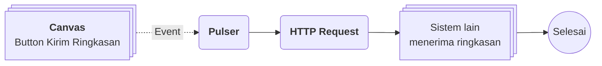

# Contoh Penggunaan Kanban

## Studi Kasus : Dasbor Ringkasan Pesanan untuk Manajer

Manajer penjualan ingin melihat kondisi pesanan dalam satu halaman tanpa harus membuka Table satu per satu. Dengan Canvas, data pesanan yang sudah ada di [[Docs/Modul Data/Table/Apa itu Table|Table]] disajikan sebagai grafik dan tabel ringkas, lengkap dengan tombol untuk mengirim ringkasan ke sistem lain. Dasbor dibagikan sebagai tautan [[#Mempublikasikan Canvas|Publish]] sehingga manajer cukup membukanya dari peramban.

## Komponen yang terlibat

| Komponen                                | Peran                                                                                                                       |
| --------------------------------------- | --------------------------------------------------------------------------------------------------------------------------- |
| [[^field/table|Pesanan]]               | Data sumber pesanan yang dibaca widget melalui [[Docs/Tipe Data/Query]].                                                    |
| [[^field/canvas|Dasbor Pesanan]]       | Menyusun widget Text, Chart Pie, Chart Bar, dan Table dalam satu tampilan, serta widget Button untuk pengiriman.            |
| [[^field/flow|Kirim Ringkasan]]        | Menjalankan proses pengiriman ringkasan ketika Button ditekan.                                                              |

## Alur di Flow

| Langkah | Flow Block                                                                                         | Peran dalam alur                                    | Hasil                                    |
| ------- | -------------------------------------------------------------------------------------------------- | --------------------------------------------------- | ---------------------------------------- |
| 1       | [[Docs/Modul Logic/Flow/Flow Block/Event/Pulser|Pulser]]                                          | Menerima pemicu dari Button pada Canvas.            | Alur berjalan.                           |
| 2       | [[Docs/Modul Logic/Flow/Flow Block/Modular/HTTP Request|HTTP Request]]                            | Mengirim ringkasan pesanan ke sistem lain.          | Sistem lain menerima ringkasan.          |

## Hasil yang dirasakan

- Manajer melihat kondisi pesanan sekilas dalam satu halaman, tanpa membuka Table.
- Tampilan selalu mengikuti data terbaru karena widget membaca langsung dari data sumber.
- Ringkasan terkirim ke sistem lain hanya dengan satu tombol, tanpa kerja manual.
- Data pesanan tetap aman karena Canvas hanya menyajikan tampilan.

## Ide skenario lain

| Jenis nilai                   | Contoh integrasi                                                                                                                                                                 |
| ----------------------------- | -------------------------------------------------------------------------------------------------------------------------------------------------------------------------------- |
| Kartu detail dinamis          | Canvas dengan [[#Binding Canvas|Binding]] untuk menampilkan desain menarik satu pesanan, lalu berganti ke pesanan lain hanya dengan mengubah parameter.                         |
| Pemantauan proyek             | Widget Gantt, Timeline, dan Kanban dalam satu Canvas untuk melihat jadwal dan progres proyek sekaligus.                                                                          |
| Katalog dengan aksi           | Widget Gallery untuk katalog dan widget Button yang membuka komponen lain untuk memesan.                                                                                         |
| Laporan publik                | Canvas berisi grafik dan teks penjelasan yang dibagikan ke pihak luar melalui tautan [[#Mempublikasikan Canvas|Publish]].                                                       |

Dengan Canvas, data, logika, dan tampilan yang sudah ada di Phoenix tersambung dalam satu halaman visual yang mudah dibagikan.