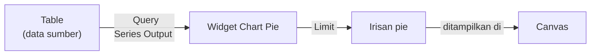
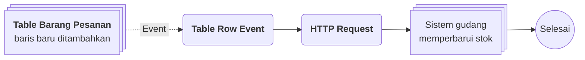

# Widget Chart Pie

>**note** Widget Chart Pie merupakan salah satu widget pada [[Docs/Modul Interface/Canvas/Apa itu Canvas|Canvas]]. Daftar widget lainnya ada di [[Docs/Modul Interface/Canvas/Apa itu Canvas#Widget Canvas|Widget Canvas]].

Widget Chart Pie adalah widget untuk menampilkan data [[Docs/Modul Data/Table/Apa itu Table|Table]] sebagai diagram pie di dalam Canvas. Data diambil melalui [[Docs/Tipe Data/Query]] yang mengikuti kaidah Series Output, lalu setiap data menjadi satu irisan pie.

Anda dapat mengatur jumlah data yang muncul, bentuk pie, warna, label, legenda, dan total di tengah pie melalui header toolbar dan design toolbar.

## Mengapa Menggunakan Widget Chart Pie?

- **Komposisi terbaca sekilas.** Pembaca langsung melihat porsi setiap data terhadap keseluruhan.
- **Tampilan mudah disesuaikan.** Lubang, gap, tema warna, gradasi, label, legenda, dan total dapat diatur sesuai desain Canvas.
- **Jumlah data terkendali.** [[^field|Limit]] membatasi jumlah data yang muncul agar pie tidak terlalu padat.
- **Selalu mengikuti data.** Pie membaca Table sumber melalui Query, sehingga tampilan mengikuti data terbaru.

## Konsep Utama

| Istilah                                                                     | Penjelasan                                                                                             |
| --------------------------------------------------------------------------- | ------------------------------------------------------------------------------------------------------ |
| [[#Mengatur Data dan Query\|Data]]                                          | Table sumber yang dibaca widget.                                                                       |
| [[Docs/Tipe Data/Query]]                                                    | Tipe Data yang menyiapkan data pie dan harus mengikuti kaidah Series Output.                           |
| [[#Mengatur Data dan Query\|Limit]]                                         | Jumlah maksimal data yang muncul pada pie.                                                             |
| [[#Mengatur Tampilan Pie\|Panel tampilan]]                                  | Panel design toolbar untuk mengatur lubang, warna, label, legenda, dan total.                          |
| [[#Mengatur Tampilan Pie\|Legenda]]                                         | Keterangan warna setiap data, dengan posisi yang dapat diatur.                                         |
| [[Docs/Modul Interface/Canvas/Apa itu Canvas#Header Toolbar dan Design Toolbar\|Header Toolbar dan Design Toolbar]] | Toolbar yang tampil ketika widget dipilih pada Edit Mode. |

## Cara Kerja Widget Chart Pie

Widget Chart Pie membaca Table sumber melalui Query, membatasi jumlah data dengan Limit, lalu menggambar setiap data sebagai irisan pie.

## Menambahkan Widget Chart Pie

1. Pindah ke Edit Mode melalui toggle [[^field|mode]] pada [[Docs/Modul Interface/Canvas/Apa itu Canvas#Mode View dan Edit|Canvas]]
2. Klik [[^field|Type something here to add...]]
3. Ketik `/chart`, lalu pilih Chart Pie dari dropdown
4. Pilih Table sumber pada [[^field|Data]], lalu atur Query melalui [[^button/q]]. Lihat [[#Mengatur Data dan Query]].

>**success** Widget Chart Pie berhasil ditambahkan
> Widget tampil di Canvas. Klik kiri widget untuk menampilkan [[#Antarmuka Widget Chart Pie|header toolbar dan design toolbar]].

<!--
  * [TODO] Konfirmasi: tampilan widget sebelum Data dan Query diisi, serta cara memilih Table pada Data (dropdown atau popup).
  * [TODO] Konfirmasi: nama persis Chart Pie pada dropdown hasil `/chart` (Search chart).
-->

## Antarmuka Widget Chart Pie

![[Docs/Modul Interface/Form/Widget/Chart Pie/interface-widget-chart-pie.png]]
Pada Edit Mode, klik kiri widget untuk menampilkan header toolbar di atas widget dan design toolbar di bawah widget. Bagian tengah menampilkan diagram pie: setiap data menjadi satu irisan, total tampil di tengah pie, dan legenda tampil di salah satu sisi sesuai pengaturan. Contoh gambar di atas menampilkan Widget Chart Pie dengan total aktif dan legenda di sisi kanan.

### Header toolbar terdiri dari:

| Elemen                                    | Fungsi                                                                                                                         |
| ----------------------------------------- | ------------------------------------------------------------------------------------------------------------------------------ |
| Ikon pie (paling kiri)                    | Menandai jenis widget.                                                                                                         |
| Ikon pegangan ⋮⋮                          | Memindahkan widget ke posisi atau Layout lain.                                                                                 |
| [[^field\|Data]]                          | Memilih Table sumber. Menampilkan ikon Table dan nama Table yang dipilih.                                                      |
| [[^button/q]]                             | Membuka konfigurasi [[Docs/Tipe Data/Query]] yang mengikuti kaidah Series Output.                                              |
| [[^field\|Limit]]                         | Jumlah maksimal data yang muncul pada pie. Menampilkan [[^field\|Empty]] bila belum diisi.                                     |
| [[^button/delete\|Remove]]                | Menghapus widget dari Canvas. Lihat [[#Menghapus Widget Chart Pie]].                                                           |

### Design toolbar terdiri dari:

Design toolbar Widget Chart Pie memiliki dua panel. Panel pertama (ikon tata letak) sama di semua widget, sedangkan panel kedua (ikon palet) khusus untuk Chart Pie.

| Panel                                | Isi                                                                                                                                                                   |
| ------------------------------------ | --------------------------------------------------------------------------------------------------------------------------------------------------------------------- |
| Panel tata letak                     | [[^field\|min.]] ([[^field\|w]] dan [[^field\|h]] dalam persen), [[^button/expand\|Expand]], [[^field\|padding]] dan [[^field\|margin]] pada empat sisi.              |
| Panel tampilan                       | [[^field\|hole]], [[^field\|gap]], [[^field\|theme]], [[^field\|gradient]], [[^field\|offset]], [[^field\|label]], [[^field\|min]], [[^field\|legends]], [[^field\|total]], dan [[^field\|size]]. Lihat [[#Mengatur Tampilan Pie]]. |

Selengkapnya tentang panel tata letak lihat [[Docs/Modul Interface/Canvas/Apa itu Canvas#Header Toolbar dan Design Toolbar|Header Toolbar dan Design Toolbar]].

### Tampilan pie

| Bagian                         | Isi                                                                                                                                                |
| ------------------------------ | -------------------------------------------------------------------------------------------------------------------------------------------------- |
| Irisan pie                     | Satu irisan untuk setiap data, dengan warna sesuai [[^field\|theme]].                                                                              |
| Angka di tengah                | Total, tampil bila toggle [[^field\|total]] aktif.                                                                                                 |
| Legenda                        | Keterangan warna setiap data beserta persentasenya, dengan posisi sesuai [[^field\|legends]].                                                      |
| Label di dalam irisan          | Sesuai pilihan [[^field\|label]] dan batas [[^field\|min]].                                                                                        |

Tidak ada perbedaan signifikan antara tampilan desktop dan mobile.

### Interaksi Antarmuka Widget Chart Pie

| Fungsi                              | Aksi                                                                                                                  |
| ----------------------------------- | --------------------------------------------------------------------------------------------------------------------- |
| Menampilkan toolbar widget          | Pada Edit Mode, klik kiri widget.                                                                                     |
| Mengubah Query                      | Klik [[^button/q]] pada header toolbar.                                                                               |
| Mengubah tampilan pie               | Atur nilai pada panel tampilan di design toolbar.                                                                     |
| Memindahkan widget                  | Gunakan ikon pegangan ⋮⋮ pada header toolbar.                                                                         |

<!--
  * [TODO] Konfirmasi fungsi tombol Expand dan arti panah ▼ di sisi kiri panel (diasumsikan melipat panel). Juga ikon di sisi kanan baris hole dan gap pada panel tampilan yang belum dijelaskan penulis.
  * [TODO] Konfirmasi: nilai Limit kosong ([[^field|Empty]]) berarti tanpa batas (diasumsikan).
  * [TODO] Konfirmasi: persentase pada legenda dihitung dari total seluruh data yang muncul (setelah Limit).
  * [TODO] Screenshot menampilkan nama Table "Barang pesanan" dan data pribadi (nama barang). Mohon ganti dengan data generik pada gambar bila perlu. Saran keterangan gambar: "Contoh gambar di atas merupakan Widget Chart Pie dengan total aktif dan legenda di sisi kanan."
-->

## Mengatur Widget Chart Pie

### Mengatur Data dan Query

1. Klik kiri widget pada Edit Mode
2. Pilih Table sumber pada [[^field|Data]]
3. Klik [[^button/q]] untuk membuka konfigurasi [[Docs/Tipe Data/Query]]
4. Atur Query agar mengikuti kaidah Series Output, lalu tutup popup
5. Isi [[^field|Limit]] bila ingin membatasi jumlah data yang muncul

| Pengaturan                       | Fungsi                                                                                                                                  |
| -------------------------------- | --------------------------------------------------------------------------------------------------------------------------------------- |
| [[^field\|Data]]                 | Table sumber widget.                                                                                                                    |
| [[^button/q]]                    | Query yang menyiapkan data pie. Query harus mengikuti kaidah [[Docs/Tipe Data/Query#Series Output\|Series Output]].                     |
| [[^field\|Limit]]                | Jumlah maksimal data yang muncul pada pie.                                                                                              |

Query diatur melalui [[^button/q]], sedangkan isi widget, yaitu data hasil Query, tidak dapat dimanipulasi dari Canvas.

### Mengatur Tampilan Pie

Atur tampilan pie melalui panel tampilan pada design toolbar:

| Pengaturan                  | Fungsi                                                                                                                                                         |
| --------------------------- | -------------------------------------------------------------------------------------------------------------------------------------------------------------- |
| [[^field\|hole]]            | Besar lubang di tengah pie, dalam persen.                                                                                                                      |
| [[^field\|gap]]             | Jarak antar data (antar irisan).                                                                                                                               |
| [[^field\|theme]]           | Tema warna pie.                                                                                                                                                |
| [[^field\|gradient]]        | Gradasi warna dari tengah ke pinggir (dari transparan ke warna), dalam persen.                                                                                 |
| [[^field\|offset]]          | Batas akhir gradasi. Jika 75%, gradasi berjalan dari tengah sampai sekitar 75% ke ujung lingkaran.                                                             |
| [[^field\|label]]           | Isi label di dalam pie: `none`, `label`, `value`, `percent`, atau `all` (label - value).                                                                       |
| [[^field\|min]]             | Derajat minimum irisan agar label ditampilkan.                                                                                                                 |
| [[^field\|legends]]         | Posisi legenda: `right`, `bottom`, atau `hidden`.                                                                                                              |
| [[^field\|total]]           | Toggle untuk menampilkan total di tengah pie.                                                                                                                  |
| [[^field\|size]]            | Ukuran font total yang tampil di tengah pie.                                                                                                                   |

Pada contoh di atas, nilai yang tampil adalah [[^field|hole]] 45%, [[^field|gap]] 6, [[^field|theme]] `fun`, [[^field|gradient]] 0%, [[^field|offset]] 0%, [[^field|label]] `none`, [[^field|min]] 20, [[^field|legends]] `right`, [[^field|total]] aktif, dan [[^field|size]] 22.

### Mengatur Tata Letak

Atur ukuran dan jarak widget melalui panel tata letak: [[^field|min.]], [[^field|padding]], dan [[^field|margin]]. Selengkapnya lihat [[Docs/Modul Interface/Canvas/Apa itu Canvas#Header Toolbar dan Design Toolbar|Header Toolbar dan Design Toolbar]].

<!--
  * [TODO] Kaidah Series Output belum ada di knowledge. Mohon definisikan di halaman Query (anchor `Docs/Tipe Data/Query#Series Output`): kolom apa yang diperlukan (label dan value), contoh Query, dan pesan Error bila tidak valid.
  * [TODO] Konfirmasi satuan dan rentang: gap (px?), min (derajat, 0 sampai 360), size (px?), dan arti nilai persen pada gradient (kekuatan gradasi?).
  * [TODO] Konfirmasi pilihan theme selain `fun` (daftar tema) dan apakah `all` pada label hanya label - value atau juga percent.
  * [TODO] Konfirmasi: nilai yang tampil pada contoh adalah nilai bawaan widget baru (bukan hasil pengaturan penulis).
  * [TODO] Konfirmasi: apakah perubahan Query dan pengaturan tampilan tersimpan dengan Save pada Canvas.
-->

## Menghapus Widget Chart Pie

1. Pindah ke Edit Mode, lalu klik kiri widget
2. Klik [[^button/delete|Remove]] pada header toolbar

>**warning** Dampak menghapus Widget Chart Pie
> Menghapus widget hanya menghapus tampilan dan konfigurasi widget, termasuk [[Docs/Tipe Data/Query]] dan pengaturan tampilan pie. Table sumber dan barisnya tetap aman.

<!--
  * [TODO] Konfirmasi: Remove langsung menghapus atau meminta konfirmasi.
-->

## Hak Akses Widget Chart Pie

Widget Chart Pie mengikuti Data Access Canvas di [[Docs/Modul Developer/Workspace/Apa itu Workspace|Workspace]]:

| Akses                                                                  | Pengaruh pada Widget Chart Pie                                                                       |
| ---------------------------------------------------------------------- | ---------------------------------------------------------------------------------------------------- |
| [[Docs/Modul Developer/Workspace/Data Access\|Data Access]] Add        | Menambahkan Widget Chart Pie ke Canvas.                                                              |
| [[Docs/Modul Developer/Workspace/Data Access\|Data Access]] Update     | Mengubah Data, Query, Limit, tampilan pie, dan tata letak widget.                                    |
| [[Docs/Modul Developer/Workspace/Data Access\|Data Access]] Delete     | Menghapus Widget Chart Pie dari Canvas.                                                              |

Selengkapnya lihat [[Docs/Modul Interface/Canvas/Apa itu Canvas#Hak Akses Canvas|Hak Akses Canvas]].

## Contoh Penggunaan

**Komposisi Barang Pesanan untuk Pemilik Usaha**

Pemilik usaha ingin tahu barang apa yang paling banyak dipesan, tanpa membuka Table dan menghitung manual. Dengan Widget Chart Pie pada Canvas, komposisi barang pesanan tampil sebagai pie dengan total di tengah. Ketika barang pesanan baru ditambahkan, Flow juga memperbarui stok di sistem gudang, sehingga pie dan stok selalu sejalan.

**Komponen yang terlibat**

| Komponen                                    | Peran                                                                                                             |
| ------------------------------------------- | ----------------------------------------------------------------------------------------------------------------- |
| [[^field/table\|Barang Pesanan]]            | Data sumber barang pesanan. Query menyiapkan data untuk pie dengan kaidah Series Output.                          |
| [[^field/canvas\|Dasbor Komposisi Pesanan]] | Menampilkan Widget Chart Pie dengan [[^field\|Limit]] tertentu agar hanya barang terbanyak yang muncul.           |
| [[^field/flow\|Perbarui Stok]]              | Mengirim perubahan stok ke sistem gudang ketika barang pesanan baru ditambahkan.                                  |

**Alur di Flow**

| Langkah | Flow Block                                                                              | Peran dalam alur                                         | Hasil                                      |
| ------- | --------------------------------------------------------------------------------------- | -------------------------------------------------------- | ------------------------------------------ |
| 1       | [[Docs/Modul Logic/Flow/Flow Block/Event/Table Row Event\|Table Row Event]]             | Menangkap baris baru pada Table Barang Pesanan sebagai Row. | Alur berjalan dengan data barang baru.  |
| 2       | [[Docs/Modul Logic/Flow/Flow Block/Modular/HTTP Request\|HTTP Request]]                 | Mengirim perubahan stok ke sistem gudang.                | Stok di sistem gudang diperbarui.          |

**Hasil yang dirasakan**

- Pemilik usaha melihat barang terlaris sekilas lewat pie, tanpa menghitung manual.
- Stok di sistem gudang ikut diperbarui otomatis, tanpa input ganda.
- Tampilan pie selalu mengikuti data terbaru di Table sumber.
- Data pesanan tetap aman karena widget hanya menampilkan.

**Ide skenario lain**

| Jenis nilai                | Contoh integrasi                                                                                                                            |
| -------------------------- | ------------------------------------------------------------------------------------------------------------------------------------------- |
| Status tugas               | Widget Chart Pie menampilkan komposisi status tugas bersama [[Docs/Modul Interface/Form/Widget/Table/Penjelasan\|Widget Table]] berisi daftar tugasnya. |
| Sumber pendapatan          | Pie komposisi pendapatan per kategori pada dasbor yang dibagikan lewat tautan [[Docs/Modul Interface/Canvas/Apa itu Canvas#Mempublikasikan Canvas\|Publish]]. |
| Hasil survei               | Pie komposisi jawaban survei dengan label `percent` untuk presentasi ke pihak luar.                                                         |

Dengan Widget Chart Pie, data yang sudah ada di Phoenix berubah menjadi gambaran komposisi yang mudah dipahami, tanpa menghitung atau menyalin data ke aplikasi lain.

<!--
  * [TODO] Nama Table "Barang Pesanan", Canvas "Dasbor Komposisi Pesanan", dan Flow "Perbarui Stok" bersifat generik. Mohon sesuaikan atau konfirmasi.
  * [TODO] Konfirmasi: Table Row Event dapat dipakai sebagai pemicu perubahan stok untuk baris baru dan struktur alurnya sesuai.
  * [TODO] Skenario bergantung pada kaidah Series Output yang belum didefinisikan. Sesuaikan setelah kaidah tersedia.
-->

## Praktik Terbaik

- **Isi [[^field|Limit]] agar pie tidak terlalu padat.** Batasi jumlah data yang muncul supaya irisan tetap terbaca.
- **Atur [[^field|label]] sesuai kebutuhan.** Gunakan `percent` untuk komposisi, `value` untuk jumlah, atau `none` bila tampilan ingin bersih.
- **Atur [[^field|min]] untuk irisan kecil.** Label hanya tampil pada irisan yang cukup besar sehingga tidak menumpuk.
- **Sesuaikan [[^field|legends]] dengan ruang.** Gunakan `hidden` pada widget kecil, `bottom` untuk widget lebar.
- **Aktifkan [[^field|total]] untuk ringkasan.** Total di tengah memudahkan pembaca melihat jumlah keseluruhan.
- **Pastikan Query mengikuti kaidah [[Docs/Tipe Data/Query#Series Output|Series Output]].** Query yang tidak sesuai membuat pie tidak tampil dengan benar.

## Batasan dan Catatan

- [[Docs/Tipe Data/Query|Query]] wajib mengikuti kaidah [[Docs/Tipe Data/Query#Series Output|Series Output]] dan diatur melalui [[^button/q]], sedangkan isinya (data hasil Query) tidak dapat dimanipulasi dari Canvas.
- [[^field|Limit]] membatasi jumlah data yang muncul pada pie.
- [[^field|min]] adalah derajat minimum irisan agar label tampil, jadi irisan yang lebih kecil tidak menampilkan label.
- [[^field|total]] adalah toggle, dan [[^field|size]] mengatur ukuran font total di tengah pie.
- Panel tata letak sama di semua widget, sedangkan panel tampilan khusus Chart Pie.
- Menghapus widget hanya menghapus tampilan dan Query, Table sumber tetap aman.
- Menambah, mengubah, dan menghapus widget mengikuti Data Access Canvas (Add, Update, Delete).

## TL:DR

- Widget Chart Pie menampilkan data [[Docs/Modul Data/Table/Apa itu Table|Table]] sebagai diagram pie di [[Docs/Modul Interface/Canvas/Apa itu Canvas|Canvas]].
- Tambahkan melalui [[^field|Type something here to add...]] dengan perintah `/chart` pada Edit Mode. Lihat [[#Menambahkan Widget Chart Pie]].
- Header toolbar berisi [[^field|Data]], [[^button/q]], [[^field|Limit]], dan [[^button/delete|Remove]]. Design toolbar berisi panel tata letak dan panel tampilan. Lihat [[#Antarmuka Widget Chart Pie]].
- Query harus mengikuti kaidah [[Docs/Tipe Data/Query#Series Output|Series Output]], dan [[^field|Limit]] membatasi jumlah data yang muncul.
- Atur tampilan lewat [[^field|hole]], [[^field|gap]], [[^field|theme]], [[^field|gradient]], [[^field|offset]], [[^field|label]], [[^field|min]], [[^field|legends]], [[^field|total]], dan [[^field|size]]. Lihat [[#Mengatur Tampilan Pie]].
- Menghapus widget tidak menghapus data sumber, dan semua perubahan mengikuti Data Access Canvas.

## FAQ : Pertanyaan yang Sering Diajukan

> **faq**
> **Query seperti apa yang dipakai Widget Chart Pie?**
> Query harus mengikuti kaidah [[Docs/Tipe Data/Query#Series Output|Series Output]]. Atur melalui [[^button/q]] pada header toolbar.
> **Apa fungsi Limit?**
> [[^field|Limit]] menentukan jumlah maksimal data yang muncul pada pie. Menampilkan [[^field|Empty]] bila belum diisi.
> **Apa bedanya gradient dan offset?**
> [[^field|gradient]] mengatur gradasi warna dari tengah ke pinggir (dari transparan ke warna), sedangkan [[^field|offset]] mengatur batas akhir gradasi. Jika [[^field|offset]] 75%, gradasi berjalan dari tengah sampai sekitar 75% ke ujung lingkaran.
> **Mengapa label tidak muncul pada irisan kecil?**
> [[^field|min]] adalah derajat minimum irisan agar label tampil. Irisan yang lebih kecil dari nilai tersebut tidak menampilkan label.
> **Bagaimana menampilkan atau menyembunyikan legenda?**
> Atur [[^field|legends]] ke `right`, `bottom`, atau `hidden`.
> **Bagaimana menampilkan total di tengah pie?**
> Aktifkan toggle [[^field|total]], lalu atur ukuran font dengan [[^field|size]].
> **Apakah menghapus widget menghapus data sumber?**
> Tidak. Menghapus widget hanya menghapus tampilan dan konfigurasinya, termasuk [[Docs/Tipe Data/Query|Query]]. Table sumber tetap aman.