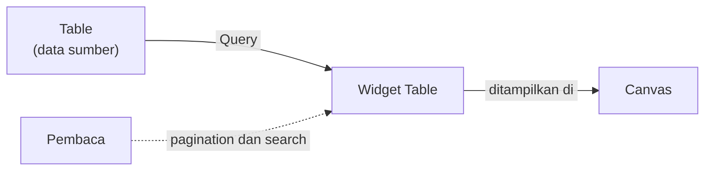
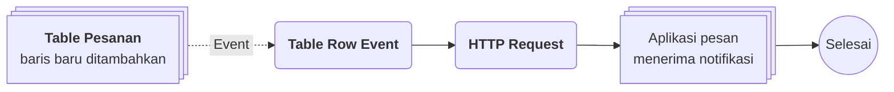

# Widget Table

>**note** Widget Table merupakan salah satu widget pada [[Docs/Modul Interface/Canvas/Apa itu Canvas|Canvas]]. Daftar widget lainnya ada di [[Docs/Modul Interface/Canvas/Apa itu Canvas#Widget Canvas|Widget Canvas]].

Widget Table adalah widget untuk menampilkan data [[Docs/Modul Data/Table/Apa itu Table|Table]] dalam bentuk tabel di dalam Canvas. Data diambil melalui [[Docs/Tipe Data/Query]], lalu dapat dilengkapi pagination dan toolbar search agar pembaca mudah menelusuri baris.

Widget Table bekerja seperti [[Docs/Modul Interface/Table View/Apa itu Table View|Table View]] dalam versi lite: widget hanya menyajikan satu data, dan isinya tidak dapat dimanipulasi dari Canvas.

## Mengapa Menggunakan Widget Table?

- **Tabel ringkas di tengah desain.** Anda dapat menempatkan tabel berdampingan dengan grafik, teks, dan widget lain dalam satu Canvas.
- **Mudah ditelusuri.** Pagination dan toolbar search dapat diaktifkan sesuai kebutuhan pembaca.
- **Hanya menampilkan yang perlu.** Kolom dan baris ditentukan oleh [[Docs/Tipe Data/Query]], sehingga tampilan tetap ringkas.
- **Data sumber tetap aman.** Isi widget tidak dapat diubah dari Canvas, sehingga cocok untuk dibagikan melalui [[Docs/Modul Interface/Canvas/Apa itu Canvas#Mempublikasikan Canvas|Publish]].

## Konsep Utama

| Istilah                                                                     | Penjelasan                                                                                             |
| --------------------------------------------------------------------------- | ------------------------------------------------------------------------------------------------------ |
| [[#Mengatur Data dan Query|Data]]                                          | Table sumber yang dibaca widget.                                                                       |
| [[Docs/Tipe Data/Query]]                                                    | Tipe Data yang menentukan kolom dan baris yang ditampilkan widget.                                     |
| [[#Pagination dan Search|Pagination]]                                      | Bilah di bagian bawah widget untuk berpindah halaman data.                                             |
| [[#Pagination dan Search|Toolbar Search]]                                  | Toolbar di bagian atas widget untuk menyegarkan dan mencari data.                                      |
| [[Docs/Modul Interface/Canvas/Apa itu Canvas#Header Toolbar dan Design Toolbar|Header Toolbar dan Design Toolbar]] | Toolbar yang tampil ketika widget dipilih pada Edit Mode. |

## Cara Kerja Widget Table

Widget Table membaca Table sumber melalui Query, lalu menampilkan hasilnya sebagai tabel di Canvas. Pembaca dapat menelusuri baris dengan pagination dan search.

## Menambahkan Widget Table

1. Pindah ke Edit Mode melalui toggle [[^field|mode]] pada [[Docs/Modul Interface/Canvas/Apa itu Canvas#Mode View dan Edit|Canvas]]
2. Klik [[^field|Type something here to add...]]
3. Ketik `/table`, lalu pilih Table dari dropdown
4. Pilih Table sumber pada [[^field|Data]], lalu atur Query melalui [[^button/q]]. Lihat [[#Mengatur Data dan Query]].

>**success** Widget Table berhasil ditambahkan
> Widget tampil di Canvas. Klik kiri widget untuk menampilkan [[#Antarmuka Widget Table|header toolbar dan design toolbar]].

<!--
  * [TODO] Konfirmasi: tampilan widget sebelum Data dipilih (kosong, pesan khusus, atau Empty) dan cara memilih Table pada Data (dropdown atau popup).
  * [TODO] Konfirmasi: apakah `/table` (Add table) langsung menambahkan Widget Table atau menampilkan pilihan lain pada dropdown.
-->

## Antarmuka Widget Table

![[Docs/Modul Interface/Form/Widget/Table/interface-widget-table.png]]
Pada Edit Mode, klik kiri widget untuk menampilkan header toolbar di atas widget dan design toolbar di bawah widget. Bagian tengah menampilkan tabel hasil Query, dilengkapi toolbar search di bagian atas dan pagination di bagian bawah bila diaktifkan. Contoh gambar di atas menampilkan Widget Table dengan pagination dan toolbar search aktif.

### Header toolbar terdiri dari:

| Elemen                                    | Fungsi                                                                                                                         |
| ----------------------------------------- | ------------------------------------------------------------------------------------------------------------------------------ |
| Ikon Table (paling kiri)                  | Menandai jenis widget.                                                                                                         |
| Ikon pegangan ⋮⋮                          | Memindahkan widget ke posisi atau Layout lain.                                                                                 |
| [[^button|123]]                          | Toggle pagination. Menampilkan atau menyembunyikan bilah pagination di bagian bawah widget.                                    |
| [[^button/search|Search]] (kaca pembesar) | Toggle toolbar search. Memunculkan atau menyembunyikan toolbar search di bagian atas widget.                                   |
| [[^field|Data]]                          | Memilih Table sumber. Menampilkan ikon Table dan nama Table yang dipilih.                                                      |
| [[^button/q]]                             | Membuka konfigurasi [[Docs/Tipe Data/Query]] untuk widget.                                                                     |
| [[^button/delete|Remove]]                | Menghapus widget dari Canvas. Lihat [[#Menghapus Widget Table]].                                                               |

Tombol toggle yang aktif ditandai dengan latar berwarna.

### Design toolbar terdiri dari:

Widget Table hanya memiliki satu panel pada design toolbar, yaitu panel tata letak yang sama di semua widget:

| Elemen                                  | Fungsi                                                                                                                          |
| --------------------------------------- | ------------------------------------------------------------------------------------------------------------------------------- |
| [[^field|min.]]                        | Ukuran minimum widget dalam persen: [[^field|w]] untuk lebar dan [[^field|h]] untuk tinggi.                                   |
| [[^button/expand|Expand]]              | Tombol toggle di samping [[^field|min.]].                                                                                      |
| [[^field|padding]]                     | Jarak di dalam widget pada empat sisi (atas, kanan, bawah, kiri).                                                               |
| [[^field|margin]]                      | Jarak di luar widget pada empat sisi (atas, kanan, bawah, kiri).                                                                |

Selengkapnya tentang design toolbar lihat [[Docs/Modul Interface/Canvas/Apa itu Canvas#Header Toolbar dan Design Toolbar|Header Toolbar dan Design Toolbar]].

### Tampilan tabel

| Bagian                         | Isi                                                                                                                                                |
| ------------------------------ | -------------------------------------------------------------------------------------------------------------------------------------------------- |
| Kolom                          | Kolom ID dan kolom hasil [[Docs/Tipe Data/Query|Query]]. Ikon kecil di samping nama kolom menunjukkan tipe data kolom.                            |
| Baris                          | Baris hasil Query. Cell yang kosong menampilkan teks [[^field|Empty]].                                                                            |
| Toolbar search                 | Tombol [[^button/refresh|Refresh List]] dan kolom [[^field|Search Data...]]. Tampil bila toggle [[^button/search|Search]] aktif.               |
| Pagination                     | Informasi [[^field|Show 50 of 8 items, on page]] (50 adalah batas data per halaman), input nomor halaman dengan [[^button|Go]], serta [[^button|Prev]] dan [[^button|Next]]. Tampil bila toggle [[^button|123]] aktif. |

Tidak ada perbedaan signifikan antara tampilan desktop dan mobile.

### Interaksi Antarmuka Widget Table

| Fungsi                              | Aksi                                                                                                                  |
| ----------------------------------- | --------------------------------------------------------------------------------------------------------------------- |
| Menampilkan toolbar widget          | Pada Edit Mode, klik kiri widget.                                                                                     |
| Mengaktifkan pagination             | Klik [[^button|123]] pada header toolbar.                                                                            |
| Mengaktifkan toolbar search         | Klik [[^button/search|Search]] pada header toolbar.                                                                  |
| Mencari data                        | Ketik kata kunci pada [[^field|Search Data...]].                                                                     |
| Menyegarkan daftar                  | Klik [[^button/refresh|Refresh List]].                                                                               |
| Berpindah halaman                   | Klik [[^button|Prev]] atau [[^button|Next]], atau isi nomor halaman lalu klik [[^button|Go]].                      |
| Memindahkan widget                  | Gunakan ikon pegangan ⋮⋮ pada header toolbar.                                                                         |

<!--
  * [TODO] Ikon tabel di sebelah kiri tombol 123 pada header toolbar belum dijelaskan penulis. Mohon jelaskan fungsinya.
  * [TODO] Konfirmasi bahwa Widget Table memang tidak memiliki panel tampilan (palet) seperti Widget Chart Pie, atau panel tersebut tersembunyi.
  * [TODO] Konfirmasi fungsi tombol Expand pada design toolbar (pada screenshot aktif dengan h = 40%) dan arti panah ▼ di sisi kiri panel (diasumsikan melipat panel).
  * [TODO] Konfirmasi: nama tombol kaca pembesar (diberi nama Search), cakupan Search Data... (diasumsikan semua kolom, seperti Table View), dan apakah toolbar search serta pagination yang aktif juga tampil pada View Mode dan tautan Publish.
  * [TODO] Konfirmasi: tombol Refresh List hanya memuat ulang data widget (bukan seluruh Canvas) dan pengaruh pada pagination.
  * [TODO] Screenshot menampilkan nama Table "Pesanan" serta kolom dan data pribadi. Mohon ganti dengan data generik pada gambar bila perlu. Saran keterangan gambar: "Contoh gambar di atas merupakan Widget Table dengan pagination dan toolbar search aktif."
-->

## Mengatur Widget Table

### Mengatur Data dan Query

1. Klik kiri widget pada Edit Mode
2. Pilih Table sumber pada [[^field|Data]]
3. Klik [[^button/q]] untuk membuka konfigurasi [[Docs/Tipe Data/Query]]
4. Atur Query sesuai kebutuhan, lalu tutup popup

Query menentukan kolom dan baris yang tampil pada widget. Query diatur melalui [[^button/q]], sedangkan isi widget, yaitu data hasil Query, tidak dapat dimanipulasi dari Canvas. Widget tidak memiliki kolom [[^field|Action]] maupun tombol [[^button/add|Add Row]].

### Pagination dan Search

| Pengaturan                                  | Fungsi                                                                                                               |
| ------------------------------------------- | -------------------------------------------------------------------------------------------------------------------- |
| [[^button|123]]                            | Aktifkan untuk menampilkan pagination di bagian bawah widget. Cocok untuk data yang banyak.                          |
| [[^button/search|Search]]                  | Aktifkan untuk menampilkan toolbar search di bagian atas widget, berisi [[^button/refresh|Refresh List]] dan [[^field|Search Data...]]. |

Kedua pengaturan bersifat toggle dan dapat diaktifkan sendiri-sendiri.

### Mengatur Tata Letak

Atur ukuran dan jarak widget melalui panel tata letak pada design toolbar: [[^field|min.]], [[^field|padding]], dan [[^field|margin]]. Selengkapnya lihat [[Docs/Modul Interface/Canvas/Apa itu Canvas#Header Toolbar dan Design Toolbar|Header Toolbar dan Design Toolbar]].

<!--
  * [TODO] Konfirmasi: kaidah Query Widget Table (diasumsikan Table Output seperti Table View, anchor `Docs/Tipe Data/Query#Table Output`) dan pesan Error bila Query tidak valid.
  * [TODO] Konfirmasi: apakah pilihan kolom yang tampil dan urutan kolom hanya diatur lewat Query (bagian Show), serta apakah ada pengaturan lain pada widget (misalnya tampilan ID atau jumlah data per halaman).
  * [TODO] Konfirmasi: apakah perubahan Query pada widget tersimpan otomatis saat popup ditutup (seperti Table View) atau mengikuti Save pada Canvas.
-->

## Menghapus Widget Table

1. Pindah ke Edit Mode, lalu klik kiri widget
2. Klik [[^button/delete|Remove]] pada header toolbar

>**warning** Dampak menghapus Widget Table
> Menghapus widget hanya menghapus tampilan dan konfigurasi widget, termasuk [[Docs/Tipe Data/Query]] yang sudah dibuat. Table sumber dan barisnya tetap aman.

<!--
  * [TODO] Konfirmasi: Remove langsung menghapus atau meminta konfirmasi, dan apakah perubahan perlu disimpan dengan Save pada Canvas.
-->

## Hak Akses Widget Table

Widget Table mengikuti Data Access Canvas di [[Docs/Modul Developer/Workspace/Apa itu Workspace|Workspace]]:

| Akses                                                                  | Pengaruh pada Widget Table                                                                          |
| ---------------------------------------------------------------------- | --------------------------------------------------------------------------------------------------- |
| [[Docs/Modul Developer/Workspace/Data Access|Data Access]] Add        | Menambahkan Widget Table ke Canvas.                                                                 |
| [[Docs/Modul Developer/Workspace/Data Access|Data Access]] Update     | Mengubah Data, Query, pengaturan pagination dan search, serta tata letak widget.                    |
| [[Docs/Modul Developer/Workspace/Data Access|Data Access]] Delete     | Menghapus Widget Table dari Canvas.                                                                 |

Selengkapnya lihat [[Docs/Modul Interface/Canvas/Apa itu Canvas#Hak Akses Canvas|Hak Akses Canvas]].

## Contoh Penggunaan

**Layar Pantau Pesanan untuk Tim Dapur**

Tim dapur ingin melihat pesanan yang sedang diproses di satu layar, tanpa membuka aplikasi pengelolaan data. Dengan Widget Table pada Canvas, daftar pesanan aktif tampil ringkas lengkap dengan search untuk mencari pesanan tertentu. Ketika pesanan baru masuk, Flow langsung mengirim notifikasi ke aplikasi pesan tim, sehingga tim tidak perlu memeriksa layar terus-menerus.

**Komponen yang terlibat**

| Komponen                                  | Peran                                                                                                           |
| ----------------------------------------- | --------------------------------------------------------------------------------------------------------------- |
| [[^field/table|Pesanan]]                 | Data sumber pesanan. Query hanya menampilkan pesanan yang belum selesai.                                        |
| [[^field/canvas|Layar Pantau Pesanan]]   | Menampilkan Widget Table dengan toolbar search aktif, dan dibagikan sebagai tautan Publish ke layar dapur.      |
| [[^field/flow|Notifikasi Pesanan Baru]]  | Mengirim notifikasi ke aplikasi pesan ketika pesanan baru ditambahkan.                                          |

**Alur di Flow**

| Langkah | Flow Block                                                                              | Peran dalam alur                                         | Hasil                                      |
| ------- | --------------------------------------------------------------------------------------- | -------------------------------------------------------- | ------------------------------------------ |
| 1       | [[Docs/Modul Logic/Flow/Flow Block/Event/Table Row Event|Table Row Event]]             | Menangkap baris baru pada Table Pesanan sebagai Row.     | Alur berjalan dengan data pesanan baru.    |
| 2       | [[Docs/Modul Logic/Flow/Flow Block/Modular/HTTP Request|HTTP Request]]                 | Mengirim notifikasi pesanan baru ke aplikasi pesan.      | Tim dapur menerima notifikasi.             |

**Hasil yang dirasakan**

- Tim dapur melihat daftar pesanan aktif dalam satu layar dan mencarinya dengan cepat.
- Pesanan baru langsung diketahui lewat notifikasi, tanpa memeriksa layar terus-menerus.
- Tampilan mengikuti data terbaru di Table sumber.
- Data pesanan tetap aman karena widget hanya menampilkan.

**Ide skenario lain**

| Jenis nilai                | Contoh integrasi                                                                                                                            |
| -------------------------- | ------------------------------------------------------------------------------------------------------------------------------------------- |
| Daftar tugas harian        | Widget Table menampilkan tugas hari ini pada Canvas bersama Widget Chart Pie yang menunjukkan komposisi status tugas.                      |
| Tabel referensi publik     | Widget Table dengan pagination dan search untuk daftar harga atau jadwal yang dibagikan lewat tautan [[Docs/Modul Interface/Canvas/Apa itu Canvas#Mempublikasikan Canvas|Publish]]. |
| Ringkasan pada dasbor      | Widget Table berisi sepuluh data terbaru di sisi dasbor, sedangkan pengelolaan data lengkap tetap di [[Docs/Modul Interface/Table View/Apa itu Table View|Table View]]. |

Dengan Widget Table, data yang sudah ada di Phoenix dapat tampil dalam desain Canvas yang rapi dan mudah ditelusuri, tanpa membuka komponen sumbernya.

<!--
  * [TODO] Nama Table "Pesanan", Canvas "Layar Pantau Pesanan", dan Flow "Notifikasi Pesanan Baru" bersifat generik. Mohon sesuaikan atau konfirmasi.
  * [TODO] Konfirmasi: Table Row Event dapat dipakai sebagai pemicu notifikasi untuk baris baru dan struktur alurnya sesuai.
-->

## Praktik Terbaik

- **Aktifkan [[^button|123]] untuk data yang banyak.** Pagination menjaga widget tetap ringkas dan mudah dibaca.
- **Aktifkan [[^button/search|Search]] bila pembaca perlu mencari.** Toolbar search memudahkan menemukan baris tanpa menggulir seluruh data.
- **Batasi data lewat [[Docs/Tipe Data/Query|Query]].** Tampilkan hanya kolom dan baris yang dibutuhkan pembaca agar tabel tetap ringkas.
- **Atur [[^field|min.]] tinggi dan lebar.** Beri ruang cukup agar tabel dan pagination tidak terpotong oleh widget lain pada Canvas.
- **Gunakan [[Docs/Modul Interface/Table View/Apa itu Table View|Table View]] untuk mengelola data.** Widget Table hanya untuk menampilkan.
- **Perhatikan Canvas yang dipublikasikan.** Data pada widget dapat dilihat publik bila Canvas berstatus [[^value/radio|Active]].

## Batasan dan Catatan

- Widget Table adalah versi lite dari [[Docs/Modul Interface/Table View/Apa itu Table View|Table View]]: hanya menyajikan satu data, tanpa kolom [[^field|Action]] dan [[^button/add|Add Row]].
- [[Docs/Tipe Data/Query|Query]] diatur melalui [[^button/q]], sedangkan isinya (data hasil Query) tidak dapat dimanipulasi dari Canvas.
- [[^button|123]] dan [[^button/search|Search]] bersifat toggle dan dapat diaktifkan sendiri-sendiri.
- Batas data per halaman pada pagination adalah 50.
- Widget Table hanya memiliki panel tata letak pada design toolbar. Tidak ada panel tampilan tambahan.
- Menghapus widget hanya menghapus tampilan dan Query, Table sumber tetap aman.
- Menambah, mengubah, dan menghapus widget mengikuti Data Access Canvas (Add, Update, Delete).

## TL:DR

- Widget Table menampilkan data [[Docs/Modul Data/Table/Apa itu Table|Table]] sebagai tabel di [[Docs/Modul Interface/Canvas/Apa itu Canvas|Canvas]], dalam versi lite dari [[Docs/Modul Interface/Table View/Apa itu Table View|Table View]].
- Tambahkan melalui [[^field|Type something here to add...]] dengan perintah `/table` pada Edit Mode. Lihat [[#Menambahkan Widget Table]].
- Header toolbar berisi [[^button|123]], [[^button/search|Search]], [[^field|Data]], [[^button/q]], dan [[^button/delete|Remove]]. Design toolbar berisi panel tata letak. Lihat [[#Antarmuka Widget Table]].
- Pilih Table sumber di [[^field|Data]] dan atur [[Docs/Tipe Data/Query]] lewat [[^button/q]]. Isi widget tidak dapat dimanipulasi dari Canvas.
- Aktifkan [[^button|123]] untuk pagination dan [[^button/search|Search]] untuk toolbar search.
- Menghapus widget tidak menghapus data sumber, dan semua perubahan mengikuti Data Access Canvas.

## FAQ : Pertanyaan yang Sering Diajukan

> **faq**
> **Apa arti tombol 123 pada header toolbar?**
> [[^button|123]] adalah toggle pagination. Saat aktif, bilah pagination tampil di bagian bawah widget untuk berpindah halaman data.
> **Untuk apa tombol kaca pembesar?**
> [[^button/search|Search]] adalah toggle untuk memunculkan toolbar search di bagian atas widget, berisi [[^button/refresh|Refresh List]] dan [[^field|Search Data...]].
> **Mengapa saya tidak dapat mengubah isi tabel?**
> Widget Table adalah versi lite dari Table View, sehingga isinya (data hasil [[Docs/Tipe Data/Query|Query]]) tidak dapat dimanipulasi dari Canvas. Gunakan [[Docs/Modul Interface/Table View/Apa itu Table View|Table View]] untuk mengelola baris.
> **Bagaimana mengatur kolom yang tampil?**
> Kolom dan baris yang tampil ditentukan oleh [[Docs/Tipe Data/Query|Query]]. Klik [[^button/q]] pada header toolbar untuk mengaturnya.
> **Berapa data yang tampil per halaman?**
> Batasnya 50 data per halaman, seperti tertulis pada informasi [[^field|Show 50 of 8 items, on page]].
> **Apakah menghapus widget menghapus data sumber?**
> Tidak. Menghapus widget hanya menghapus tampilan dan konfigurasinya, termasuk [[Docs/Tipe Data/Query|Query]]. Table sumber tetap aman.