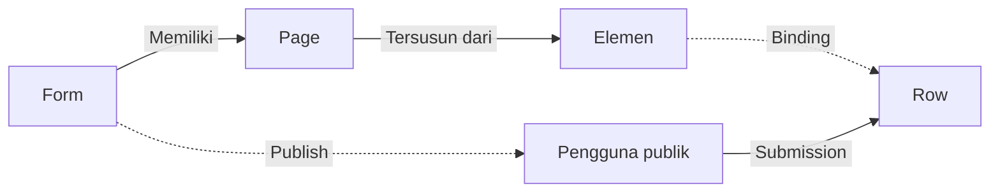
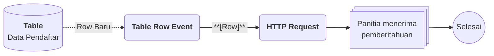

# Apa itu Form?

>**note** Form merupakan salah satu komponen dalam modul [[Docs/Modul Interface/Pengenalan|Interface]] di Phoenix.

Form adalah komponen yang dapat digunakan untuk menginput, melihat, dan mengubah data secara terstruktur. Setiap kolom ditampilkan sebagai *field* yang jelas dan terarah, sehingga proses pengisian data menjadi lebih rapi, konsisten, dan minim kesalahan.

Anda dapat menyusun tampilan Form sendiri dari beberapa [[#Memahami Elemen|Elemen]], mengikatnya ke data di [[Docs/Modul Data/Table/Apa itu Table|Table]], lalu membagikannya kepada publik lewat [[#Mempublikasikan Form|Publish]] agar proses pengumpulan data menjadi lebih cepat dan efektif.

## Mengapa Menggunakan Form?

- **Pengisian data lebih rapi.** Setiap kolom tampil sebagai *field* yang jelas, sehingga pengisi tahu persis apa yang harus diisi.
- **Data konsisten dan minim kesalahan.** Setiap *field* terikat ke [[Docs/Tipe Data/Column]] pada [[Docs/Tipe Data/Row]] yang tepat lewat [[#Binding Form|Binding]], sehingga hasil isian masuk ke tempat yang benar.
- **Pengumpulan data lebih cepat.** Form dapat dibagikan kepada publik lewat tautan, tanpa pengisi perlu masuk ke Phoenix.
- **Tampilan dapat disesuaikan.** Anda menyusun Form dari [[#Memahami Elemen|Elemen]] dan mengatur gayanya sesuai kebutuhan.
- **Pengiriman mudah dipantau.** Setiap pengiriman tercatat sebagai Submission, lengkap dengan status dan grafiknya di [[#Mengelola Submission|Submission List]].

## Konsep Utama

| Istilah | Penjelasan |
| --- | --- |
| [[#Mengelola Page Form|Page]] | Satu halaman di dalam Form. Satu Form dapat memiliki beberapa Page. |
| [[#Mengelola Page Form|Form Flow]] | Alur Page pada Form. Page paling kiri tampil pertama, dan Form dapat disubmit setelah pengisi mencapai Page terakhir. |
| [[#Memahami Elemen|Elemen]] | Satu objek penyusun isi Form, misalnya teks, tabel, atau kolom isian. |
| [[#Elemen Layout|Layout]] | Kategori Elemen yang berfungsi sebagai templat tempat Elemen lain diletakkan. |
| [[#Elemen Display|Display]] | Kategori Elemen yang menampilkan informasi, baik statis maupun hasil dari nilai Binding. |
| [[#Elemen Input|Input]] | Kategori Elemen untuk mengisi atau menampilkan informasi yang berlaku pada Binding. |
| [[#Binding Form|Binding]] | Ikatan antara Elemen dan data di [[Docs/Modul Data/Table/Apa itu Table|Table]] agar isian dan hasil akhirnya sesuai. |
| [[#Mode View dan Edit Mode|Edit Mode]] | Mode untuk menyusun Form, termasuk melihat informasi Binding dan konfigurasi Elemen. |
| [[#Mempublikasikan Form|Publish]] | Konfigurasi untuk membagikan Form kepada publik. |
| [[#Mengelola Submission|Submission]] | Catatan setiap pengiriman Form, dengan status sukses, menunggu, atau gagal. |

Selengkapnya tentang penjelasan khusus setiap Elemen dapat dilihat pada halaman masing-masing di [[#Memahami Elemen]].

## Cara Kerja Form

Form tersusun dari [[#Mengelola Page Form|Page]], setiap Page tersusun dari [[#Memahami Elemen|Elemen]], dan Elemen yang diikat lewat [[#Binding Form|Binding]] menghubungkan isian Form ke [[Docs/Tipe Data/Row]] pada [[Docs/Modul Data/Table/Apa itu Table|Table]].

## Membuat Form

![[Docs/Modul Interface/Form/add-form.png]]

1. Buka folder tempat Form akan ditempatkan di [[Docs/Antarmuka#Area Manajemen Folder]]
2. Klik kanan ➜ [[^field/add|Add]] ➜ [[^field|Interface]] ➜ [[^field/form|Form]]
3. Isi [[^field|Name]] dan [[^field|Description]]
4. Klik [[^button|Create]]

>**success** Form berhasil dibuat
> Form yang baru dibuat belum memiliki Page. Tambahkan Page di [[#Mengelola Page Form]], lalu susun isinya dengan [[#Mengelola Elemen Form|Elemen]].

## Mengubah Form

1. Buka halaman kerja Form
2. Klik [[^button/edit|Edit]]
3. Ubah [[^field|Name]] atau [[^field|Description]]
4. Klik [[^button|Update]]

Tombol [[^button/edit|Edit]] di sini hanya mengubah atribut Form. Untuk mengubah isi Form (Page dan Elemen), gunakan [[#Mode View dan Edit Mode|Edit Mode]].

## Menyegarkan Form

Klik [[^button/refresh|Refresh]] untuk memuat ulang tampilan.

## Menghapus Form

1. Buka folder yang berisi Form di [[Docs/Antarmuka#Area Manajemen Folder]]
2. Klik kanan Form ➜ [[^button/delete|Delete]]
3. Konfirmasi dengan klik [[^button|Delete]]

>**warning** Dampak penghapusan Form
> Menghapus Form akan menghapus templat Form, yaitu Page, Elemen, dan Binding yang sudah dipetakan, beserta riwayat Submission-nya. Data yang sudah tersimpan di [[Docs/Modul Data/Table/Apa itu Table|Table]] tidak langsung terhapus.
> Tautan Publish menjadi tidak valid setelah Form dihapus. Jika publik sedang mengisi Form yang dipublikasikan, mereka akan mengalami *error* saat mencoba mengirim.

## Antarmuka Form

![[Docs/Modul Interface/Form/interface-form.png]]

Halaman kerja Form terdiri dari bilah navigasi di bagian atas, area kerja di bagian tengah, dan panel [[^field|form flow]] di bagian bawah yang menampilkan daftar [[#Mengelola Page Form|Page]].

### Bilah navigasi Form terdiri dari:

Berikut penjelasan terkait beberapa fungsi halaman kerja Form:

| Tombol | Fungsi |
| --- | --- |
| Judul Form | Menampilkan ikon Form dan nama Form. |
| [[^button/edit|Edit]] | Mengubah atribut Form ([[^field|Name]] dan [[^field|Description]]). Lihat [[#Mengubah Form]]. |
| [[^button/publish|Publish]] | Membuka konfigurasi publikasi Form. Lihat [[#Mempublikasikan Form]]. |
| [[mode/view|View]] | Saklar saat Form berada di mode View. Klik untuk beralih ke Edit Mode agar isi Form dapat disunting. Lihat [[#Mode View dan Edit Mode]]. |
| [[mode/edit|Edit]] | Saklar saat Form berada di Edit Mode. Klik untuk beralih ke mode View agar isi Form hanya dapat dilihat. Lihat [[#Mode View dan Edit Mode]]. |
| [[^button/save|Save]] | Menyimpan perubahan isi Form. Aktif saat ada perubahan, dan perubahan juga tersimpan otomatis (*auto save*) setelah sekitar 3 detik. |
| [[^button/refresh|Refresh]] | Memuat ulang tampilan Form. |
| [[^button/submission|Informasi Submission]] | Menampilkan jumlah Submission sukses, menunggu, dan gagal. Klik untuk membuka [[#Mengelola Submission|Submission List]]. |

>**note** Perbedaan Icon
> Pada tampilan desktop, tombol [[^button/submission|Submission]] menampilkan susunan informasi Submission sekaligus, yaitu Submitted, Waiting, dan Failure.
> Pada tampilan mobile, tombol [[^button/submission|Submission]] didalam menu navigasi.

> **warning** Harap hati-hati
> Saat melakukan [[^button/refresh|Refresh]] halaman, pastikan bahwa perubahan Anda saat ini sudah disimpan. Jika tombol [[^button/save|Save]] masih aktif, berarti perubahan belum disimpan.

### Mode View dan Edit Mode

Form memiliki dua mode yang dipilih lewat toggle [[^field|mode]]:

| Mode | Fungsi |
| --- | --- |
| [[^value/radio|View]] | Melihat Form tanpa dapat mengubah isinya. Pada mode ini Form tampil sebagai [[^field|Read Only]]. |
| [[^value/radio|Edit]] | Menyusun Form: menambah [[#Mengelola Page Form|Page]], mengelola [[#Mengelola Elemen Form|Elemen]], dan melihat informasi [[#Binding Form|Binding]]. |

>**note** Syarat beralih ke Edit Mode
> Anda hanya dapat beralih ke Edit Mode jika [[^field|Data Access]] di [[Docs/Modul Developer/Workspace/Apa itu Workspace|Workspace]] mengizinkan perubahan Form (lihat [[#Hak Akses Form]]).

### Interaksi Antarmuka Form

| Fungsi | Aksi |
| --- | --- |
| Memfokuskan Elemen (Edit Mode) | Klik kiri pada Elemen. [[#Properties Panel]] dan [[#Header Toolbar]] akan tampil. |
| Membuka Layout Panel (Edit Mode) | Klik ikon kecil di bawah Elemen yang difokuskan. Lihat [[#Layout Panel]]. |
| Membuka menu konteks Elemen (Edit Mode) | Klik kanan pada Elemen. Lihat [[#Menu Konteks Elemen]]. |

## Mengelola Page Form

Form dapat memiliki beberapa Page. Daftar Page tampil pada panel [[^field|form flow]] di bagian bawah halaman kerja. Form baru yang belum memiliki Page menampilkan keterangan [[^field|No Page]].

Panel [[^field|form flow]] menunjukkan alur Form. Page paling kiri adalah halaman yang pertama kali tampil, dan Form hanya dapat disubmit setelah pengisi mencapai Page terakhir.

### Start Building

Pada setiap Page yang masih kosong, Edit Mode menampilkan informasi **Start Building**. Informasi ini hanya tampil di [[#Mode View dan Edit Mode|Edit Mode]].

![[Docs/Modul Interface/Form/fresh-form.png]]

| Bagian | Fungsi |
| --- | --- |
| [[^field|Page Name]] | Nama Page. Bawaannya `Page 1`. |
| Basic | Pilihan layout dasar: [[^field|Card Layout]], [[^field|Full Layout]], [[^field|Split Layout]], dan [[^field|Accordion Layout]]. Layout adalah [[#Elemen Layout|Elemen Layout]] yang menjadi fondasi isi Page. |
| Template | Bagian untuk mempermudah *styling*, sama halnya dengan memakai Elemen yang tersedia lalu mengubah konfigurasi gayanya. Saat ini masih kosong ([[^field|Template is empty]]). |

### Menambahkan Page

1. Aktifkan [[#Mode View dan Edit Mode|Edit Mode]]
2. Klik [[^button/add|Add Page]] pada panel [[^field|form flow]]
3. Isi [[^field|Page Name]]
4. Pilih salah satu layout pada bagian Basic

## Mengelola Elemen Form

### Memahami Elemen

Elemen adalah satu objek penyusun isi Form. Setiap bagian yang Anda lihat di Form, mulai dari judul, kolom isian, hingga tabel, adalah sebuah Elemen. Anda menyusun Form dengan menambahkan Elemen, mengaturnya, lalu mengikatnya ke data lewat [[#Binding Form|Binding]].

Elemen dikelompokkan dalam tiga kategori:

| Kategori | Fungsi | Elemen |
| --- | --- | --- |
| [[#Elemen Layout|Layout]] | Menjadi templat tempat Elemen lain diletakkan. | [[Docs/Modul Interface/Form/Layout/Card/Penjelasan|Card]], [[Docs/Modul Interface/Form/Layout/Full/Penjelasan|Full]], [[Docs/Modul Interface/Form/Layout/Split/Penjelasan|Split]], [[Docs/Modul Interface/Form/Layout/Accordion/Penjelasan|Accordion]] |
| [[#Elemen Display|Display]] | Menampilkan informasi. | [[Docs/Modul Interface/Form/Display/Text/Penjelasan|Text]], [[Docs/Modul Interface/Form/Display/Table/Penjelasan|Table]], [[Docs/Modul Interface/Form/Display/Tooltip/Penjelasan|Tooltip]], [[Docs/Modul Interface/Form/Display/Qr/Penjelasan|Qr]], [[Docs/Modul Interface/Form/Display/Chrono/Penjelasan|Chrono]] |
| [[#Elemen Input|Input]] | Mengisi atau menampilkan informasi yang berlaku pada Binding. | [[Docs/Modul Interface/Form/Input/Basic/Penjelasan|Basic]], [[Docs/Modul Interface/Form/Input/Quiz/Penjelasan|Quiz]], [[Docs/Modul Interface/Form/Input/Table/Penjelasan|Table]], [[Docs/Modul Interface/Form/Input/List/Penjelasan|List]] |

Penjelasan keunikan masing-masing Elemen ada di halaman Elemen tersebut.

### Elemen Layout

Layout berfungsi sebagai templat. Elemen Layout adalah satu-satunya kategori yang memiliki *field* [[^field|Type something here to add...]], yaitu tempat Anda menambahkan Elemen lain ke dalamnya. Dengan begitu, Layout mengatur tata letak, sedangkan isinya diisi oleh Elemen Display dan Elemen Input.

### Elemen Display

Display berfungsi menampilkan informasi. Informasi yang ditampilkan dapat berupa isi statis (misalnya judul atau keterangan), atau hasil dari [[Docs/Tipe Data/Expression]] terhadap nilai Binding (misalnya nilai total).

### Elemen Input

Input berfungsi untuk mengisi atau menampilkan informasi yang berlaku pada Binding. Pada Form yang dipublikasikan, Elemen Input inilah yang diisi oleh pengguna dan dikirim sebagai Submission.

### Menambahkan Elemen

1. Aktifkan [[#Mode View dan Edit Mode|Edit Mode]]
2. Buka Page yang akan diisi
3. Klik [[^field|Type something here to add...]] pada Elemen Layout
4. Pilih Elemen pada dropdown yang muncul, atau ketik untuk mencari Elemen yang diinginkan

### Mengonfigurasi Elemen

![[Docs/Modul Interface/Form/panel-form.png]]

Klik kiri pada Elemen di [[#Mode View dan Edit Mode|Edit Mode]] untuk memfokuskannya. Setelah itu muncul [[#Properties Panel]] dan [[#Header Toolbar]]. Selain itu, [[#Layout Panel]] dapat dibuka lewat ikon kecil di bawah Elemen yang difokuskan.

#### Properties Panel

Panel untuk mengatur properti Elemen secara rinci, seperti [[^field|Binding]], [[^field|State]], [[^field|Validators]], [[^field|Attributes]], [[^field|Children]], dan [[^field|Parent]]. Isinya berbeda-beda pada setiap Elemen.

| Bagian | Fungsi |
| --- | --- |
| [[^field|Binding]] | Mengikat Elemen ke data. Lihat [[#Binding Form]]. |
| [[^field|State]] | Mengatur kondisi Elemen, misalnya [[^field|Visible]] untuk menampilkan atau menyembunyikan Elemen. |
| [[^field|Validators]] | Aturan yang harus dipenuhi pengisi agar dapat mengirim Form, misalnya [[^field|Required]]. |
| [[^field|Attributes]] | Mengatur pengaturan khusus Elemen, termasuk gayanya. Isinya berbeda-beda pada setiap Elemen. |
| [[^field|Children]] atau [[^field|Parent]] | Menampilkan Elemen yang berada di dalam Elemen ini (*children*), atau Elemen tempat Elemen ini berada (*parent*). |

#### Header Toolbar

Bilah pintasan aksi yang selalu memiliki tombol [[^button/delete|Remove]] untuk menghapus Elemen.

#### Layout Panel

Panel untuk mengatur ukuran, *padding*, *margin*, dan beberapa *styling* Elemen. Setiap Elemen memiliki pengaturan ini, dan panel dibuka lewat ikon kecil di bawah Elemen yang difokuskan.

| Bagian | Fungsi |
| --- | --- |
| [[^field|min.]] layout | Ukuran persentase minimum Elemen terhadap layar. |
| [[^field/resize]] | Kontrol tambahan terkait ukuran atau tampilan pengaturan dimensi. |
| [[^field|padding]] | Mengatur jarak di bagian dalam Elemen, yaitu antara batas Elemen dan kontennya. |
| [[^field|margin]] | Mengatur jarak di luar Elemen, yaitu ruang antara Elemen tersebut dan Elemen lain di sekitarnya. |

### Menu Konteks Elemen

Klik kanan pada Elemen untuk membuka menu konteks.

| Menu | Fungsi |
| --- | --- |
| [[^field/copy|Copy Layout Style]] | Menyalin konfigurasi *styling* Elemen. |
| [[^field/paste|Paste Layout Style]] | Menerapkan salinan konfigurasi *styling* Elemen. |
| [[^field/up|Move Back]] | Memindahkan posisi dengan Elemen sebelumnya (tidak berpengaruh jika Elemen berada di barisan pertama). |
| [[^field/down|Move Next]] | Memindahkan posisi dengan Elemen setelahnya (tidak berpengaruh jika Elemen berada di barisan akhir). |

### Menghapus Elemen

1. Aktifkan [[#Mode View dan Edit Mode|Edit Mode]]
2. Klik kiri Elemen yang akan dihapus
3. Klik [[^button/delete|Remove]] pada [[#Header Toolbar]]
4. Konfirmasi penghapusan Elemen

>**warning** Dampak penghapusan Elemen
> Menghapus Elemen Layout akan menghapus semua Elemen yang berada di dalamnya. Binding yang dipakai Elemen tersebut juga terputus dari Form.

## Binding Form

Binding adalah ikatan berjenjang yang menghubungkan Elemen dengan data. Tujuannya agar isian pengguna dan hasil akhirnya tersimpan pada [[Docs/Tipe Data/Row]] dan relasi yang tepat di [[Docs/Modul Data/Table/Apa itu Table|Table]].

Setiap Elemen Layout memiliki [[^field|Type]] Binding berupa [[^value/radio|table]] dan [[^value/radio|pivot]]. Artinya, Layout tersebut ditentukan sebagai header bagi Elemen di bawahnya.

| Type | Fungsi |
| --- | --- |
| [[^value/radio|table]] | Memilih [[Docs/Modul Data/Table/Apa itu Table|Table]] sebagai header Layout. |
| [[^value/radio|pivot]] | Dipakai pada Layout anak bila Layout induknya sudah memiliki Table. Pivot menjadi relasi lanjutan dari Table tersebut. |

>**note** Pilihan pivot bisa kosong
> Table pada header harus memiliki pivot dengan Table lain. Jika tidak ada, pilihan pada pivot akan kosong.

Secara umum, urutannya seperti ini:

1. Layout paling atas diikat ke [[Docs/Modul Data/Table/Apa itu Table|Table]] sumber datanya lewat Type [[^value/radio|table]].
2. Elemen Input di dalamnya diikat ke [[Docs/Tipe Data/Column]] pada Table tersebut, sehingga setiap *field* tahu ke kolom mana isiannya disimpan.
3. Layout anak yang mewakili data turunan diikat lewat Type [[^value/radio|pivot]] sebagai relasi lanjutan dari Table pada Layout induknya.

Informasi Binding dapat dilihat di [[#Mode View dan Edit Mode|Edit Mode]] sebagai label pada Elemen. Klik kiri Elemen untuk memfokuskannya dan melihat pengaturan [[^field|Binding]] pada [[#Properties Panel]]. Selengkapnya lihat [[Docs/Modul Interface/Form/Layout/Card/Penjelasan#Binding Card|Binding Card]].

## Mengelola Submission

Setiap kali Form dikirim, Phoenix mencatatnya sebagai Submission dengan status sukses (*Submitted*), menunggu (*Waiting*), atau gagal (*Failure*). Ringkasan jumlahnya ada pada [[^button/submission|Informasi Submission]] di bilah navigasi.

Klik [[^button/submission|Informasi Submission]] untuk membuka **Submission List** di sebelah kanan.

![[Docs/Modul Interface/Form/submission-form.png]]

| Bagian | Fungsi |
| --- | --- |
| Grafik | Menampilkan jumlah Submission dari waktu ke waktu untuk status Submitted, Waiting, dan Failure. Arahkan kursor ke grafik untuk melihat rinciannya pada tanggal tertentu. |
| Daftar | Menampilkan setiap Submission dengan kolom [[^field|ID/Name]], [[^field|Status/ID]], [[^field|Start At]], dan [[^field|Updated At]]. |
| Rincian Submission | Klik panah di kiri baris untuk membuka rincian Submission, seperti data yang ditambahkan, ID, atau error yang terjadi. |
| Tombol salin ID Submission | Klik [[^ubtton/copy]] di baris untukmenyalin ID dari submission. |
| Filter waktu | Memfilter data dengan pilihan [[^value/radio|All Time]], [[^value/radio|This Month]], [[^value/radio|This Week]], dan [[^value/radio|Today]]. |
| [[^field|Search Submission...]] | Mencari Submission berdasarkan ID dan Name. |
| [[^button/refresh|Refresh List]] | Memuat ulang daftar Submission. |

## Mempublikasikan Form

Publish adalah konfigurasi untuk mengubah Form menjadi dipublikasikan, sehingga dapat dibuka dan diisi oleh publik lewat sebuah tautan.

1. Buka halaman kerja Form
2. Klik [[^button/publish|Publish]]
3. Atur konfigurasi publikasi
4. Klik [[^button|Update]]

![[Docs/Modul Interface/Form/publish-form.png]]

| Konfigurasi | Fungsi |
| --- | --- |
| [[^field|Status]] | Mengaktifkan atau menonaktifkan publikasi. Jika berstatus Non-Active, Form hanya dapat dilihat dan tidak dapat dikirim. |
| [[^field|Link]] | Tautan Form publik. Klik [[^button|Copy]] untuk menyalin, atau [[^button|Open New Tab]] untuk membukanya di tab baru. |
| [[^field|Language]] | Bahasa tampilan Form publik. |
| [[^field|Single Submission]] | Jika aktif, setiap perangkat hanya dapat mengirim Form satu kali. |

>**note** Perubahan konfigurasi tidak memengaruhi Submission yang sudah masuk
> Mengubah [[^field|Status]] atau [[^field|Single Submission]] hanya berlaku untuk pengiriman berikutnya.

## Hak Akses Form

Akses Form di [[Docs/Modul Developer/Workspace/Apa itu Workspace|Workspace]] mengikuti tiga jenis akses berikut:

| Jenis akses | Cakupan pada Form |
| --- | --- |
| [[^field|Comp. Access]] | Melihat ([[^field|Visible]]), menambah ([[^field|Add]]), mengubah atribut ([[^field|Update]]), dan menghapus ([[^field|Delete]]) komponen Form. |
| [[^field|Data Access]] | Setiap perubahan Elemen dan atributnya di dalam Form, termasuk beralih ke [[#Mode View dan Edit Mode|Edit Mode]]. Selengkapnya lihat [[Docs/Modul Developer/Workspace/Data Access]]. |
| [[^field|Function Access]] | [[^field|View Publish]] untuk melihat konfigurasi publikasi (misalnya menyalin tautan), dan [[^field|Publish]] untuk memperbarui konfigurasi publikasi. |

## Contoh Penggunaan

**Pendaftaran peserta kegiatan secara daring**

Panitia sebuah kegiatan ingin peserta mendaftar sendiri lewat tautan, tanpa harus mencatat data satu per satu. Dengan Form, pendaftar mengisi data di perangkat mereka, data langsung masuk ke Table, dan panitia mendapat pemberitahuan otomatis setiap ada pendaftar baru.

**Komponen yang terlibat**

| Komponen | Peran |
| --- | --- |
| [[^field/form|Form Pendaftaran]] | Tempat pendaftar mengisi data lewat tautan publik. |
| [[^field/table|Data Pendaftar]] | Menyimpan setiap pendaftaran sebagai Row lewat Binding. |
| [[^field/flow|Notifikasi Pendaftaran]] | Mengirim pemberitahuan ke panitia saat ada Row baru. |

**Alur di Flow**

| Langkah | Flow Block | Peran dalam alur | Hasil |
| --- | --- | --- | --- |
| 1 | [[Docs/Modul Logic/Flow/Flow Block/Event/Table Row Event|Table Row Event]] | Memicu alur saat ada Row baru di [[Docs/Modul Data/Table/Apa itu Table|Table]]. | Alur berjalan dengan data Row pendaftar. |
| 2 | [[Docs/Modul Logic/Flow/Flow Block/Modular/HTTP Request|HTTP Request]] | Mengirim data pendaftar ke sistem pemberitahuan. | Panitia menerima pemberitahuan. |

**Hasil yang dirasakan**

- Pendaftar cukup membuka tautan dan mengisi Form, tanpa perlu akun.
- Data pendaftar tersimpan rapi di [[Docs/Modul Data/Table/Apa itu Table|Table]] tanpa input ulang oleh panitia.
- Panitia langsung tahu setiap ada pendaftar baru lewat [[Docs/Modul Logic/Flow/Apa itu Flow|Flow]].

**Ide skenario lain**

| Jenis kebutuhan | Contoh integrasi |
| --- | --- |
| Pengumpulan data | Survei kepuasan yang hasilnya dirangkum di [[Docs/Modul Interface/Table View/Apa itu Table View|Table View]]. |
| Permintaan layanan | Form permintaan yang otomatis membuat tugas bagi tim lewat [[Docs/Modul Logic/Flow/Apa itu Flow|Flow]]. |
| Kuis | Form dengan Elemen [[Docs/Modul Interface/Form/Input/Quiz/Penjelasan|Quiz]] untuk menguji pemahaman peserta pelatihan. |
| Pelaporan | Form laporan lapangan yang datanya tampil di [[Docs/Modul Interface/Kanban/Apa itu Kanban|Kanban]] sesuai statusnya. |

Dengan Form, pengumpulan data dari publik tersambung langsung ke data dan otomasi di Phoenix, sehingga pendaftaran tidak berhenti di formulir, tetapi langsung ditindaklanjuti.

## Praktik Terbaik

- **Mulai dari Binding.** Tentukan [[Docs/Modul Data/Table/Apa itu Table|Table]] dan [[Docs/Tipe Data/Column]] tujuan sebelum menyusun [[#Memahami Elemen|Elemen]], agar setiap Elemen Input terikat ke kolom yang tepat.
- **Gunakan Layout untuk tata letak.** Letakkan Elemen Display dan Elemen Input di dalam [[#Elemen Layout|Layout]] agar susunan Form rapi dan mudah dikelola.
- **Gunakan Page untuk memecah isian panjang.** Bagi Form yang panjang ke beberapa [[#Mengelola Page Form|Page]] agar pengisi tidak kewalahan.
- **Uji sebelum dibagikan.** Periksa tampilan di [[#Mode View dan Edit Mode|View]], lalu aktifkan [[^field|Status]] dan salin [[^field|Link]] di [[#Mempublikasikan Form|Publish]] hanya setelah Form siap.
- **Pantau Submission secara berkala.** Gunakan [[#Mengelola Submission|Submission List]] untuk memeriksa Submission berstatus Failure.

>**success** Form siap dibagikan
> Setelah semua [[#Memahami Elemen|Elemen]] terikat dan [[^field|Status]] aktif, tautan [[^field|Link]] dapat dibagikan kepada publik.

## Batasan dan Catatan

- [[#Mode View dan Edit Mode|Edit Mode]] hanya dapat diaktifkan bila [[^field|Data Access]] di [[Docs/Modul Developer/Workspace/Apa itu Workspace|Workspace]] mengizinkan.
- Menghapus Form menghapus templat (Page, Elemen, dan Binding) beserta riwayat Submission, tetapi data yang sudah tersimpan di [[Docs/Modul Data/Table/Apa itu Table|Table]] tidak langsung terhapus.
- Tautan Publish menjadi tidak valid setelah Form dihapus, dan pengisi yang sedang mengisi Form publik akan mengalami *error* saat mengirim.
- Form hanya dapat disubmit setelah pengisi mencapai Page terakhir pada [[#Mengelola Page Form|Form Flow]].
- Menghapus Elemen Layout menghapus semua Elemen di dalamnya.
- Jika [[^field|Status]] berstatus Non-Active, Form publik hanya dapat dilihat dan tidak dapat dikirim.
- [[^field|Single Submission]] membatasi pengiriman per perangkat, bukan per orang.
- Tombol [[^button/edit|Edit]] hanya mengubah atribut Form, bukan isi Form.
- Start Building dan informasi Binding hanya tampil di [[#Mode View dan Edit Mode|Edit Mode]].

## TL:DR

- **Definisi.** [[#Apa itu Form?|Form]] adalah komponen untuk menginput, melihat, dan mengubah data secara terstruktur, serta dapat dibagikan kepada publik.
- **Antarmuka.** [[#Antarmuka Form|Bilah navigasi]] berisi [[^button/edit|Edit]], [[^button/publish|Publish]], toggle [[^field|mode]], [[^button/save|Save]], [[^button/refresh|Refresh]], dan [[^button/submission|Informasi Submission]].
- **Menyusun.** Tambahkan [[#Mengelola Page Form|Page]], lalu susun isinya dari [[#Memahami Elemen|Elemen]] Layout, Display, dan Input di [[#Mode View dan Edit Mode|Edit Mode]].
- **Menghubungkan data.** [[#Binding Form|Binding]] mengikat Elemen ke [[Docs/Modul Data/Table/Apa itu Table|Table]], [[Docs/Tipe Data/Column]], dan [[Docs/Tipe Data/Row]] agar isian tersimpan di tempat yang tepat.
- **Membagikan dan memantau.** [[#Mempublikasikan Form|Publish]] membagikan Form lewat tautan, dan [[#Mengelola Submission|Submission List]] memantau pengiriman.
- **Hati-hati.** Menghapus Form menghapus templat (Page, Elemen, dan Binding) beserta riwayat Submission, tautan Publish menjadi tidak valid, dan publik yang sedang mengisi akan *error* saat mengirim.

## FAQ : Pertanyaan yang Sering Diajukan

> **faq**
> **Apa bedanya tombol Edit dan toggle mode?**
> Tombol [[^button/edit|Edit]] mengubah atribut Form ([[^field|Name]] dan [[^field|Description]]), sedangkan toggle [[^field|mode]] berpindah antara [[^value/radio|View]] dan [[^value/radio|Edit]] untuk menyusun isi Form.
> **Mengapa saya tidak bisa beralih ke Edit Mode?**
> Beralih ke Edit Mode membutuhkan [[^field|Data Access]] di [[Docs/Modul Developer/Workspace/Apa itu Workspace|Workspace]] yang mengizinkan perubahan Form. Hubungi pengelola Workspace Anda.
> **Apakah saya harus menekan Save setiap kali mengubah Form?**
> Tidak harus. Perubahan tersimpan otomatis setelah sekitar 3 detik, dan Anda juga dapat menekan [[^button/save|Save]] secara manual.
> **Apakah satu orang hanya bisa mengirim Form sekali?**
> Hanya bila [[^field|Single Submission]] aktif, dan pembatasannya berlaku per perangkat.
> **Apa yang terjadi pada data jika Form dihapus?**
> Templat (Page, Elemen, dan Binding) serta riwayat Submission terhapus, tetapi data yang sudah tersimpan di [[Docs/Modul Data/Table/Apa itu Table|Table]] tidak langsung terhapus. Tautan Publish juga menjadi tidak valid.
> **Kapan Form dapat disubmit?**
> Form hanya dapat disubmit setelah pengisi mencapai Page terakhir pada [[#Mengelola Page Form|Form Flow]].
> **Di mana penjelasan setiap Elemen?**
> Setiap Elemen punya halaman sendiri, misalnya [[Docs/Modul Interface/Form/Layout/Card/Penjelasan|Card]] dan [[Docs/Modul Interface/Form/Input/Basic/Penjelasan|Basic]]. Lihat daftarnya di [[#Memahami Elemen]].