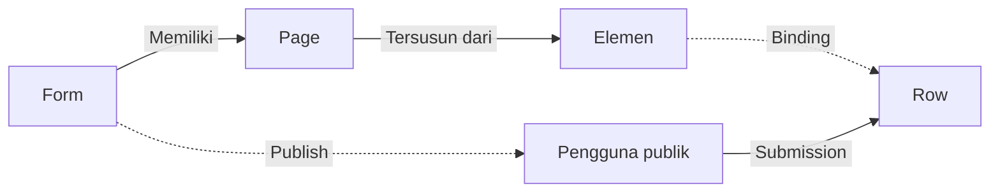

# Cara Kerja Form

Form tersusun dari [[#Mengelola Page Form|Page]], setiap Page tersusun dari [[#Memahami Elemen|Elemen]], dan Elemen yang diikat lewat [[#Binding Form|Binding]] menghubungkan isian Form ke [[Docs/Tipe Data/Row]] pada [[Docs/Modul Data/Table/Apa itu Table|Table]].

