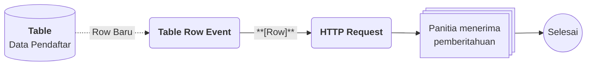

# Contoh Penggunaan Form

## Studi Kasus : Pendaftaran peserta kegiatan secara daring

Panitia sebuah kegiatan ingin peserta mendaftar sendiri lewat tautan, tanpa harus mencatat data satu per satu. Dengan Form, pendaftar mengisi data di perangkat mereka, data langsung masuk ke Table, dan panitia mendapat pemberitahuan otomatis setiap ada pendaftar baru.

## Komponen yang terlibat

| Komponen | Peran |
| --- | --- |
| [[^field/form|Form Pendaftaran]] | Tempat pendaftar mengisi data lewat tautan publik. |
| [[^field/table|Data Pendaftar]] | Menyimpan setiap pendaftaran sebagai Row lewat Binding. |
| [[^field/flow|Notifikasi Pendaftaran]] | Mengirim pemberitahuan ke panitia saat ada Row baru. |

## Alur di Flow

| Langkah | Flow Block | Peran dalam alur | Hasil |
| --- | --- | --- | --- |
| 1 | [[Docs/Modul Logic/Flow/Flow Block/Event/Table Row Event|Table Row Event]] | Memicu alur saat ada Row baru di [[Docs/Modul Data/Table/Apa itu Table|Table]]. | Alur berjalan dengan data Row pendaftar. |
| 2 | [[Docs/Modul Logic/Flow/Flow Block/Modular/HTTP Request|HTTP Request]] | Mengirim data pendaftar ke sistem pemberitahuan. | Panitia menerima pemberitahuan. |

## Hasil yang dirasakan

- Pendaftar cukup membuka tautan dan mengisi Form, tanpa perlu akun.
- Data pendaftar tersimpan rapi di [[Docs/Modul Data/Table/Apa itu Table|Table]] tanpa input ulang oleh panitia.
- Panitia langsung tahu setiap ada pendaftar baru lewat [[Docs/Modul Logic/Flow/Apa itu Flow|Flow]].

## Ide skenario lain

| Jenis kebutuhan | Contoh integrasi |
| --- | --- |
| Pengumpulan data | Survei kepuasan yang hasilnya dirangkum di [[Docs/Modul Interface/Table View/Apa itu Table View|Table View]]. |
| Permintaan layanan | Form permintaan yang otomatis membuat tugas bagi tim lewat [[Docs/Modul Logic/Flow/Apa itu Flow|Flow]]. |
| Kuis | Form dengan Elemen [[Docs/Modul Interface/Form/Input/Quiz/Penjelasan|Quiz]] untuk menguji pemahaman peserta pelatihan. |
| Pelaporan | Form laporan lapangan yang datanya tampil di [[Docs/Modul Interface/Kanban/Apa itu Kanban|Kanban]] sesuai statusnya. |

Dengan Form, pengumpulan data dari publik tersambung langsung ke data dan otomasi di Phoenix, sehingga pendaftaran tidak berhenti di formulir, tetapi langsung ditindaklanjuti.