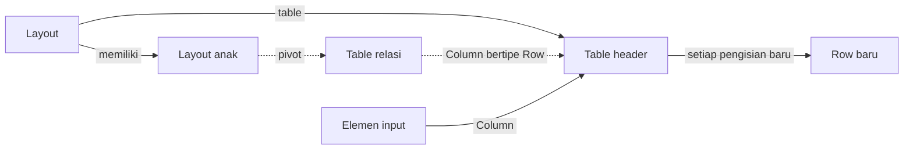

# Binding Elemen Form

>**note** Binding merupakan bagian dari [[Docs/Modul Interface/Form/Apa itu Form#Properties Panel|Properties Panel]] pada Elemen di komponen [[Docs/Modul Interface/Form/Apa itu Form|Form]], salah satu komponen dalam modul [[Docs/Modul Interface/Pengenalan|Interface]] di Phoenix.

Binding adalah pengaturan yang mengikat Elemen Form ke data di [[Docs/Modul Data/Table/Apa itu Table|Table]]. Elemen layout terikat ke Table sebagai header, sedangkan Elemen input terikat ke [[Docs/Tipe Data/Column|Column]]. Dengan Binding, isian pengisi tersimpan sebagai [[Docs/Tipe Data/Row|Row]] tanpa Anda perlu membuat alur penyimpanan sendiri.

Binding juga menjadi dasar relasi antar Table pada satu Form, penanda title [[Docs/Modul Interface/Form/Apa itu Form#Submission List|Submission]], dan Alias yang memungkinkan Elemen lain merujuk isian sebuah Elemen.

## Mengapa Menggunakan Binding?

- **Isian langsung tersimpan ke Table.** Setiap pengisian Form baru menambah satu Row di Table yang terikat.
- **Data berelasi dalam satu Form.** Dengan pivot, satu Form dapat mengisi beberapa Table yang saling berelasi.
- **Kesalahan terdeteksi lebih awal.** *Binding checker* menampilkan pesan bila ada binding yang belum lengkap atau tidak cocok.
- **Elemen saling merujuk.** Alias menjadikan isian sebuah Elemen sebagai parameter yang dapat dipakai Elemen lain.
- **Submission mudah dicari.** Satu isian dapat dijadikan title, misalnya nama pengisi.

## Konsep Utama

| Istilah | Penjelasan |
| ------- | ---------- |
| [[#Binding Layout]] | Binding pada Elemen layout dengan Binding Type table atau pivot. Layout menjadi header bagi Elemen di bawahnya. |
| [[#Table]] | Binding Type yang memilih sebuah Table sebagai header Layout. |
| [[#Pivot]] | Binding Type untuk relasi lanjutan ke Table lain melalui Column bertipe Row. |
| [[#Binding Elemen Input]] | Binding pada Elemen input yang mengikat isian ke sebuah Column. |
| [[#Alias]] | Nama opsional pada Elemen input agar Elemen lain dapat memakai isiannya sebagai parameter. |
| [[#Title Submission]] | Pengaturan [[^field|As Title]] agar isian menjadi judul Submission, biasanya nama pengisi. |
| [[#Binding Checker]] | Pemeriksa yang menampilkan pesan bila binding belum lengkap atau tidak cocok. |
| [[Docs/Tipe Data/Row]] | Satu baris data di Table. Setiap pengisian Form baru menambah satu Row. |

## Cara Kerja Binding

Layout menentukan Table sebagai header, Elemen input memilih Column dari header tersebut, dan setiap pengisian baru menyimpan isian sebagai Row baru.

## Jenis Binding

| Elemen | Binding | Yang dipilih |
| ------ | ------- | ------------ |
| Elemen layout, misalnya [[Docs/Modul Interface/Form/Layout/Card/Penjelasan|Card]] | Binding Type [[^value/radio|table]] atau [[^value/radio|pivot]] | Table sebagai header, atau Column untuk pivot. |
| Elemen input satu isian, misalnya [[Docs/Modul Interface/Form/Input/Basic/Penjelasan|Basic]] | Column | Column dari Table header. Table terisi otomatis dari Layout. |
| Elemen input multi row, yaitu [[Docs/Modul Interface/Form/Input/Table/Penjelasan|Table]] dan [[Docs/Modul Interface/Form/Input/List/Penjelasan|List]] | Column | Column dari Table lain (pivot). |

### Binding Layout

Setiap Elemen layout memiliki Binding Type yang menjadikannya header bagi Elemen di bawahnya.

#### Table

[[^value/radio|table]] memilih sebuah Table sebagai header Layout. Elemen input di dalam Layout ini akan memilih Column dari Table tersebut.

#### Pivot

[[^value/radio|pivot]] dipakai pada Layout anak bila Layout induknya sudah memiliki [[^value/radio|table]], sebagai relasi lanjutan. Pilihan pivot hanya tersedia bila Table header memiliki relasi:

| Kondisi relasi | Keterangan |
| -------------- | ---------- |
| Table header memiliki Column bertipe [[Docs/Tipe Data/Row|Row]] | Table header menunjuk ke Table lain. |
| Table lain memiliki Column bertipe [[Docs/Tipe Data/Row|Row]] dengan [[^field|Header]] berupa Table header | Table lain menunjuk ke Table header. |

Pada pivot, satu-satunya isian yang dipilih adalah [[^field|Column]], dengan informasi Table yang dimaksud. Bila tidak ada relasi, pilihan pivot kosong.

### Binding Elemen Input

Elemen input tidak memiliki pilihan Binding Type. Anda langsung mengisi [[^field|Column]], sedangkan [[^field|Table]] terisi otomatis dari Layout tempat Elemen berada. Anda cukup memilih [[^field|Column]] dari Table header yang sudah ditunjukkan oleh Phoenix.

Elemen input multi row seperti [[Docs/Modul Interface/Form/Input/Table/Penjelasan|Table]] dan [[Docs/Modul Interface/Form/Input/List/Penjelasan|List]] mengisi [[^field|Column]] dari Table lain (pivot). Table tersebut harus memiliki Column bertipe [[Docs/Tipe Data/Row|Row]] dengan [[^field|Header]] berupa Table header.

### Alias

Alias bersifat opsional dan berfungsi mendaftarkan Elemen input sebagai parameter yang dapat dipakai Elemen lain, misalnya pada [[Docs/Tipe Data/Expression]] di [[Docs/Modul Interface/Form/State|State]] dan [[Docs/Modul Interface/Form/Validators|Validators]]. Tampilannya berupa checkbox. Saat checkbox bernilai [[^value/boolean/true]], kolom isian teks tampil untuk menulis nama Alias.

Nama Alias harus unik dalam satu Form dan boleh memakai karakter ASCII apa pun.

Contoh: Elemen dengan Alias `email` dapat dirujuk dengan expression `email not empty`.

### Title Submission

Bagian [[^field|Binding]] pada Elemen input memiliki label [[^field|As Title]] dengan toggle [[^value/radio|Yes]] atau [[^value/radio|No]]. Isian yang diatur [[^value/radio|Yes]] menjadi title [[Docs/Modul Interface/Form/Apa itu Form#Submission List|Submission]] dan ditandai bintang di samping [[^field|Column]]. Biasanya isian yang dipilih adalah nama pengisi, sehingga pencarian di Submission List menjadi mudah berdasarkan title.

<!--
  * [TODO] Konfirmasi: apakah bintang di samping Column muncul saat As Title bernilai Yes, apakah hanya satu Elemen per Form yang boleh As Title Yes, dan bagaimana title tampil di Submission List.
-->

## Antarmuka Binding

![[Docs/Modul Interface/Form/properties-binding.png]]

Binding berada di Properties Panel, di bagian paling atas. Bagian yang tampil bergantung pada jenis Elemen.

| Bagian | Fungsi |
| ------ | ------ |
| [[^field|Table]] | Table header. Pada Elemen input terisi otomatis dari Layout. |
| [[^field|Column]] | Column yang diikat oleh Elemen input. Bintang di sampingnya menandai isian title Submission. |
| Checkbox Alias | Mengaktifkan Alias. Saat bernilai [[^value/boolean/true]], kolom isian teks Alias tampil. |
| [[^field|As Title]] | Toggle [[^value/radio|Yes]] atau [[^value/radio|No]] untuk menjadikan isian sebagai title Submission. |

### Label Binding di Edit Mode

Pada [[Docs/Modul Interface/Form/Apa itu Form#Mode View dan Edit|Edit Mode]], Phoenix menampilkan label binding di atas Elemen agar Anda mudah melihat ikatan yang sudah dibuat.

| Label | Warna | Menandai |
| ----- | ----- | -------- |
| Table | Ungu | Layout yang terikat ke Table. |
| Pivot | Biru | Layout yang terikat dengan pivot. |
| Column | Oranye | Elemen input yang terikat ke Column. |

## Mengatur Binding Layout

1. Beralih ke [[Docs/Modul Interface/Form/Apa itu Form#Mode View dan Edit|Edit Mode]]
2. Klik kiri Layout yang ingin diatur
3. Pada bagian [[^field|Binding]] di Properties Panel, pilih Binding Type [[^value/radio|table]] atau [[^value/radio|pivot]]
4. Pilih Table sebagai header untuk [[^value/radio|table]], atau pilih [[^field|Column]] untuk [[^value/radio|pivot]]
5. Klik [[^button/save|Save]], atau tunggu *auto save* sekitar 3 detik

>**note** Pivot membutuhkan relasi
> Pilihan pivot hanya muncul bila Table header memiliki relasi dengan Table lain. Lihat [[#Pivot]].

## Mengatur Binding Elemen Input

1. Beralih ke [[Docs/Modul Interface/Form/Apa itu Form#Mode View dan Edit|Edit Mode]]
2. Klik kiri Elemen input yang berada di dalam Layout yang sudah terikat
3. Pada bagian [[^field|Binding]], periksa [[^field|Table]] yang terisi otomatis
4. Isi [[^field|Column]]
5. Centang checkbox Alias lalu isi namanya bila Elemen ini akan dirujuk Elemen lain (opsional)
6. Atur [[^field|As Title]] ke [[^value/radio|Yes]] bila isian ini menjadi title Submission (opsional)
7. Klik [[^button/save|Save]], atau tunggu *auto save* sekitar 3 detik

## Binding dan Submission

Binding menentukan bagaimana isian tersimpan saat Form dikirim.

| Situasi | Hasil |
| ------- | ----- |
| Form diisi dari awal | Setiap pengisian menambah [[Docs/Tipe Data/Row|Row]] baru di Table yang terikat. |
| Mengubah isian yang sudah dikirim | Membutuhkan Submission ID. |

Submission ID dapat disalin dari [[Docs/Modul Interface/Form/Apa itu Form#Submission List|Submission List]] di halaman kerja Form lewat tombol [[^button/copy|Copy]]. Di tampilan pengisi, tersedia menu untuk mengakses tautan tersebut. Secara teknis tautan itu tersimpan di *local cache*.

Karena tersimpan di *local cache*, tautan hanya tersedia di perangkat yang sama dan hilang bila cache dihapus. Dalam kasus itu, admin dapat mengirim ulang tautan lewat tombol [[^button/copy|Copy]] agar pengisi dapat mengubah isiannya kembali.

Pengisi tidak membutuhkan pengaturan akses tambahan. Saat pembuat Form memilih Table dan relasinya pada Binding, akses untuk menambah Row lewat Form sudah dianggap diizinkan.

## Binding Checker

*Binding checker* memeriksa seluruh binding pada Form dan menampilkan pesan di layar bila ada yang belum lengkap atau tidak cocok. Pesan tidak menghalangi [[^button/save|Save]] maupun [[^button/publish|Publish]], tetapi sebaiknya diselesaikan agar Form bekerja sesuai rancangan.

| Pesan | Penyebab | Cara memperbaiki |
| ----- | -------- | ---------------- |
| [[^field|The selected column and its header do not match]] | Column yang dipilih tidak cocok dengan header-nya. | Pilih ulang [[^field|Column]] dari Table header, atau perbaiki Table pada Layout. |
| [[^field|There is a layout bound by a pivot, but the pivot is not defined yet]] | Layout memakai pivot tetapi [[^field|Column]]-nya belum dipilih. | Pilih [[^field|Column]] pada Binding Layout. |
| [[^field|There is an input bound by a column, but the header is not defined yet]] | Elemen input terikat ke Column tetapi Layout belum memiliki Table header. | Tentukan Binding Layout terlebih dahulu. |
| [[^field|There is an input bound by a column, but the column type and the Format Type do not match]] | Tipe Column tidak cocok dengan [[^field|Format Type]] yang diatur pada Elemen input. | Samakan [[^field|Format Type]] pada Elemen input dengan tipe Column, atau pilih Column lain. |

>**warning** Mengganti Table pada Layout memicu pesan kesalahan
> Bila Table pada Layout diganti, Elemen input di dalamnya akan menampilkan pesan [[^field|There is an input bound by a column, but the header is not defined yet]] atau [[^field|The selected column and its header do not match]]. Pilih ulang [[^field|Column]] pada setiap Elemen input terdampak.

## Contoh Penggunaan

**Form pendaftaran peserta dengan data berelasi**

Panitia ingin satu Form mencatat data diri peserta sekaligus riwayat pendidikannya. Data diri masuk ke satu Table, riwayat pendidikan masuk ke Table lain yang berelasi, dan pengurus dapat mencari pendaftar lewat namanya.

**Komponen yang terlibat**

| Komponen | Peran |
| -------- | ----- |
| [[^field/form|Form Pendaftaran Peserta]] | Form yang diisi pengisi. |
| [[^field/table|Data Peserta]] | Table header untuk data diri. |
| [[^field/table|Riwayat Pendidikan]] | Table relasi dengan Column [[^field/column|Peserta]] bertipe [[Docs/Tipe Data/Row|Row]] dengan [[^field|Header]] [[^field/table|Data Peserta]]. |

**Pengaturan Binding**

| Elemen | Binding | Keterangan |
| ------ | ------- | ---------- |
| [[Docs/Modul Interface/Form/Layout/Card/Penjelasan|Card]] "Data Diri" | [[^value/radio|table]]: [[^field/table|Data Peserta]] | Menjadi header bagi Elemen di dalamnya. |
| [[Docs/Modul Interface/Form/Input/Basic/Penjelasan|Basic]] "Nama Lengkap" | Column [[^field/column|Nama]], [[^field|As Title]] [[^value/radio|Yes]], Alias `nama` | Menjadi title Submission. |
| [[Docs/Modul Interface/Form/Input/Basic/Penjelasan|Basic]] "Email" | Column [[^field/column|Email]], Alias `email` | Dapat dirujuk Elemen lain. |
| [[Docs/Modul Interface/Form/Layout/Card/Penjelasan|Card]] "Pendidikan" | [[^value/radio|pivot]]: Column [[^field/column|Peserta]] | Relasi ke [[^field/table|Riwayat Pendidikan]]. |
| [[Docs/Modul Interface/Form/Input/Basic/Penjelasan|Basic]] "Nama Sekolah" | Column [[^field/column|Nama Sekolah]] | Tersimpan di Table relasi. |
| [[Docs/Modul Interface/Form/Input/Basic/Penjelasan|Basic]] "Konfirmasi Email" | [[^field|Visible]] dengan expression `email not empty` | Muncul setelah Email diisi, memakai Alias. |

**Hasil yang dirasakan**

- Satu pengisian menambah Row baru di Table data diri dan menambah Row di Table relasi yang otomatis terhubung ke Row data diri tersebut.
- Pengurus mencari pendaftar di Submission List lewat nama karena title Submission adalah nama lengkap.
- Form menyesuaikan diri tanpa pengisi menyadarinya karena Elemen dapat saling merujuk lewat Alias.

**Ide skenario lain**

| Kebutuhan | Binding |
| --------- | ------- |
| Daftar item dalam satu pesanan | Elemen input multi row dengan pivot ke Table item |
| Cari pengajuan lewat nama pemohon | [[^field|As Title]] [[^value/radio|Yes]] pada Column nama pemohon |
| Isian muncul bergantung pada isian lain | Alias dipakai pada expression [[^field|Visible]] |

Binding menghubungkan isian pengisi langsung ke data Anda, lengkap dengan relasi dan pencariannya.

## Praktik Terbaik

>**success** Rancang Binding dari Table terlebih dahulu
> - Tentukan **Table header pada Layout paling atas** sebelum mengatur Elemen input.
> - Pastikan **relasi Table sudah ada** (Column bertipe Row) sebelum memakai pivot.
> - Pilih **satu isian yang mudah dicari**, seperti nama pengisi, sebagai title Submission.
> - Beri **Alias singkat, jelas, dan unik** hanya pada Elemen yang akan dirujuk Elemen lain.
> - Setelah mengganti Table pada Layout, **periksa ulang Column** pada setiap Elemen input di dalamnya.
> - Perhatikan **pesan *binding checker*** dan selesaikan sebelum membagikan Form.

## Batasan dan Catatan

- Layout memiliki Binding Type [[^value/radio|table]] atau [[^value/radio|pivot]], sedangkan Elemen input tidak memiliki pilihan Binding Type dan langsung mengisi Column.
- [[^field|Table]] pada Elemen input terisi otomatis dari Layout. Anda hanya mengisi [[^field|Column]].
- Pilihan pivot hanya tersedia bila Table header memiliki relasi, dan pilihannya kosong bila tidak ada.
- Elemen input multi row ([[Docs/Modul Interface/Form/Input/Table/Penjelasan|Table]] dan [[Docs/Modul Interface/Form/Input/List/Penjelasan|List]]) mengisi Column dari Table lain yang memiliki Column bertipe [[Docs/Tipe Data/Row|Row]].
- Setiap pengisian baru menambah [[Docs/Tipe Data/Row|Row]] baru. Mengubah isian yang sudah dikirim membutuhkan Submission ID.
- Alias bersifat opsional, harus unik, boleh memakai karakter ASCII apa pun, dan dipakai Elemen lain sebagai parameter expression.
- Mengganti Table pada Layout membuat Elemen input di dalamnya menampilkan pesan dari *binding checker*. Pesan tidak menghalangi Save maupun Publish.
- Tautan update Submission tersimpan di *local cache* sehingga bergantung pada perangkat pengisi. Admin dapat mengirim ulang tautan lewat tombol Copy.
- Pengisi tidak membutuhkan pengaturan akses tambahan untuk menambah Row lewat Form.
- Binding diatur di [[Docs/Modul Interface/Form/Apa itu Form#Mode View dan Edit|Edit Mode]], yang membutuhkan akses edit data Workspace bernilai [[^value/boolean/allow]]. Selengkapnya lihat [[Docs/Modul Developer/Workspace/Data Access|Data Access]].

## TL:DR

- Binding mengikat Layout ke Table (table atau pivot) dan Elemen input ke Column.
- Setiap pengisian baru menambah Row baru. Mengubah isian lama membutuhkan Submission ID.
- Pivot membutuhkan relasi, yaitu Column bertipe [[Docs/Tipe Data/Row|Row]] dengan Header berupa Table header.
- Alias mendaftarkan Elemen input sebagai parameter bagi Elemen lain, dan As Title menjadikan isian sebagai title Submission.
- Label binding di Edit Mode: Table ungu, pivot biru, Column oranye.
- *Binding checker* menampilkan pesan bila binding belum lengkap atau tidak cocok, tanpa menghalangi Save atau Publish.

## FAQ : Pertanyaan yang Sering Diajukan

>**faq**
>**Mengapa pilihan pivot kosong?**
>Table header belum memiliki relasi. Pivot membutuhkan Column bertipe [[Docs/Tipe Data/Row|Row]] pada Table header, atau pada Table lain dengan [[^field|Header]] berupa Table header.
>**Apakah mengisi Form lagi mengubah data yang lama?**
>Tidak. Setiap pengisian baru menambah [[Docs/Tipe Data/Row|Row]] baru. Untuk mengubah isian yang sudah dikirim, gunakan Submission ID dari [[Docs/Modul Interface/Form/Apa itu Form#Submission List|Submission List]].
>**Bagaimana Elemen lain memakai isian sebuah Elemen?**
>Aktifkan Alias pada Elemen input, lalu rujuk Alias tersebut pada expression, misalnya `email not empty`.
>**Apa fungsi As Title?**
>[[^field|As Title]] menjadikan isian sebagai title Submission, biasanya nama pengisi, agar mudah dicari di Submission List.
>**Mengapa muncul pesan bahwa header belum ditentukan?**
>Elemen input terikat ke Column tetapi Layout belum memiliki Table header. Tentukan Binding Layout terlebih dahulu.
>**Tautan update saya hilang, apa yang harus dilakukan?**
>Tautan tersimpan di *local cache* sehingga hilang bila cache dihapus. Minta admin mengirim ulang tautan lewat tombol [[^button/copy|Copy]] di Submission List.