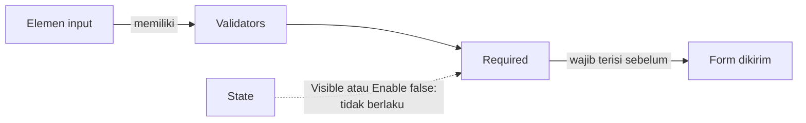

# Validators Elemen Form

>**note** Validators merupakan bagian dari [[Docs/Modul Interface/Form/Apa itu Form#Properties Panel|Properties Panel]] pada Elemen input di komponen [[Docs/Modul Interface/Form/Apa itu Form|Form]], salah satu komponen dalam modul [[Docs/Modul Interface/Pengenalan|Interface]] di Phoenix.

Validators adalah aturan pemeriksaan yang harus dipenuhi isian pengisi sebelum Form dapat dikirim. Saat ini Validators hanya memiliki satu aturan, yaitu [[^field|Required]], dan hanya tersedia pada Elemen input.

Seperti [[Docs/Modul Interface/Form/State|State]], [[^field|Required]] dapat diisi dengan nilai statis atau [[Docs/Tipe Data/Expression]], sehingga sebuah isian dapat menjadi wajib hanya pada kondisi tertentu.

<!--
  * [TODO] Konsolidasi tautan tebakan pada halaman ini: anchor #Properties Panel di Apa itu Form, halaman Elemen Docs/Modul Interface/Form/Input/<Nama Elemen>/Penjelasan (Basic, Quiz, Table, List), dan halaman pendamping Docs/Modul Interface/Form/State (dibuat bersama halaman ini). Mohon sesuaikan bila path berbeda.
-->

## Mengapa Menggunakan Validators?

- **Data yang masuk lebih lengkap.** Isian penting tidak terlewat karena Form tidak dapat dikirim sebelum Elemen yang wajib terisi.
- **Aturan mengikuti situasi.** Dengan expression, sebuah isian hanya wajib bila kondisi tertentu terpenuhi.
- **Pengisi tahu apa yang harus dilengkapi.** Aturan ditentukan pembuat Form, bukan ditebak pengisi.

## Konsep Utama

| Istilah | Penjelasan |
| ------- | ---------- |
| [[Docs/Modul Interface/Form/Apa itu Form#Input\|Elemen input]] | Elemen yang menerima isian pengisi dan satu-satunya yang memiliki Validators. |
| [[#Required]] | Validator yang mewajibkan Elemen input terisi sebelum Form dapat dikirim. Saat ini satu-satunya Validator. |
| [[#Mengisi Required dengan Nilai Statis\|Nilai statis]] | Nilai [[Docs/Tipe Data/Boolean\|Boolean]] yang dipilih lewat saklar dan tidak berubah selama pengisi mengisi Form. |
| [[Docs/Tipe Data/Expression]] | Logika atau kondisi yang menghasilkan Boolean dan dihitung ulang saat pengisi mengisi Form, misalnya `inputA not empty`. |

## Cara Kerja Validators

Saat [[^field|Required]] bernilai [[^value/boolean/true]], pengisi wajib mengisi Elemen tersebut agar Form dapat dikirim (*submit*).

## Required

[[^field|Required]] mewajibkan pengisi mengisi Elemen input. Selama Elemen yang wajib belum terisi, Form belum dapat dikirim.

| Kondisi | Hasil |
| ------- | ----- |
| [[^field\|Required]] bernilai [[^value/boolean/true]] | Pengisi wajib mengisi Elemen agar dapat mengirim Form. |
| [[^field\|Required]] bernilai [[^value/boolean/false]] | Elemen boleh dikosongkan. |
| [[^field\|Visible]] atau [[^field\|Enable]] bernilai [[^value/boolean/false]] | [[^field\|Required]] tidak berlaku, apa pun nilainya. |

Nilai awal [[^field|Required]] pada Elemen input yang baru ditambahkan adalah [[^value/boolean/false]].

>**note** Required mengikuti State
> Elemen yang tidak terlihat atau tidak aktif tidak dapat diisi oleh pengisi, sehingga [[^field|Required]] tidak berlaku pada Elemen tersebut. Selengkapnya lihat [[Docs/Modul Interface/Form/State|State]].

<!--
  * [TODO] Bentuk umpan balik kepada pengisi saat ada Elemen wajib yang belum terisi (pesan, penanda, atau tombol kirim nonaktif) belum dikonfirmasi, sehingga belum ditulis.
  * [TODO] Perilaku [[^field|Required]] pada Elemen yang [[^field|Readonly]] bernilai [[^value/boolean/true]] belum dikonfirmasi.
-->

## Antarmuka Validators

![[Docs/Modul Interface/Form/properties-validators.png]]

Validators berada di Properties Panel, di bawah bagian [[^field|State]]. Baris [[^field|Required]] terdiri dari label, ikon saklar, dan nilai.

| Bagian | Fungsi |
| ------ | ------ |
| Label Validator | Nama aturan, saat ini [[^field\|Required]]. |
| Ikon saklar | Ikon kecil di sebelah kanan label. Klik untuk beralih antara nilai statis dan expression. |
| Saklar nilai | Tampil saat memakai nilai statis. Hijau berarti [[^value/boolean/true]], abu-abu berarti [[^value/boolean/false]]. |
| Kolom isian expression | Tampil menggantikan saklar nilai saat memakai expression. Memiliki *autocomplete* dan *checker*. |

<!--
  * [TODO] Penempatan gambar: `properties-validators.png` berisi panel Elemen Basic dengan bagian Validators terlihat. Anotasi yang disarankan: (1) label Required, (2) ikon saklar, (3) saklar nilai. Gunakan penamaan Elemen yang generik pada gambar.
  * [TODO] Ikon saklar dan kolom isian expression belum punya nama resmi di antarmuka, mohon beri nama bila ada.
-->

## Mengisi Required dengan Nilai Statis

Nilai statis tidak berubah selama pengisi mengisi Form.

1. Beralih ke [[Docs/Modul Interface/Form/Apa itu Form#Mode View dan Edit|Edit Mode]]
2. Klik kiri Elemen input yang ingin diatur
3. Pada bagian [[^field|Validators]] di Properties Panel, klik saklar pada [[^field|Required]]
4. Klik [[^button/save|Save]], atau tunggu *auto save* sekitar 3 detik

## Mengisi Required dengan Expression

Expression membuat Elemen menjadi wajib hanya saat kondisinya terpenuhi. Hasil [[^value/boolean/true]] berarti Elemen wajib diisi.

1. Beralih ke [[Docs/Modul Interface/Form/Apa itu Form#Mode View dan Edit|Edit Mode]]
2. Klik kiri Elemen input yang ingin diatur
3. Pada baris [[^field|Required]], klik ikon saklar di sebelah kanan label. Saklar nilai berganti menjadi kolom isian expression
4. Ketik expression. *Autocomplete* membantu melengkapi penulisan
5. Periksa hasil *checker* sampai tidak ada kesalahan
6. Klik [[^button/save|Save]], atau tunggu *auto save* sekitar 3 detik

Aturan penulisan expression pada Validators:

- Hasil expression harus [[Docs/Tipe Data/Boolean|Boolean]]. *Checker* akan memeriksanya.
- Parameter pada expression merujuk ke nama [[^field|Label]] Elemen yang ada di Form.
- Expression dihitung ulang saat pengisi mengisi Form, sehingga Elemen dapat berubah dari tidak wajib menjadi wajib selama pengisian.

| Contoh expression | Arti |
| ----------------- | ---- |
| `Email not empty` | Elemen menjadi wajib bila isian dengan [[^field\|Label]] "Email" sudah terisi. |

<!--
  * [TODO] Daftar operator dan fungsi yang bisa dipakai pada expression belum dikonfirmasi. Contoh hanya memakai pola `not empty` dari penulis.
-->

## Contoh Penggunaan

**Form pendaftaran peserta dengan isian wajib bersyarat**

Panitia membutuhkan data peserta yang lengkap, tetapi tidak ingin membebani pengisi dengan isian yang belum relevan. Nama lengkap selalu wajib, sedangkan konfirmasi email hanya wajib setelah pengisi mengisi email. Isian yang lengkap langsung tersimpan sebagai Row di Table.

**Komponen yang terlibat**

| Komponen | Peran |
| -------- | ----- |
| [[^field/form\|Form Pendaftaran Peserta]] | Form yang diisi pengisi. |
| [[^field/table\|Data Peserta]] | [[Docs/Modul Data/Table/Apa itu Table\|Table]] tujuan penyimpanan isian. Setiap pendaftaran menjadi satu [[Docs/Tipe Data/Row\|Row]]. |

**Pengaturan Elemen**

| Elemen | Validator | Nilai | Perilaku yang dirasakan pengisi |
| ------ | --------- | ----- | ------------------------------- |
| [[Docs/Modul Interface/Form/Input/Basic/Penjelasan\|Basic]] "Nama Lengkap" | [[^field\|Required]] | Statis, aktif | Form tidak dapat dikirim sebelum nama diisi. |
| [[Docs/Modul Interface/Form/Input/Basic/Penjelasan\|Basic]] "Konfirmasi Email" | [[^field\|Required]] | Expression `Email not empty` | Konfirmasi hanya wajib setelah Email terisi. |

**Hasil yang dirasakan**

- Data peserta di Table selalu memuat isian yang benar-benar dibutuhkan.
- Pengisi tidak dipaksa mengisi isian yang belum relevan bagi mereka.

**Ide skenario lain**

| Kebutuhan | Validator | Contoh kondisi |
| --------- | --------- | -------------- |
| Alamat wajib bila memilih pengiriman | [[^field\|Required]] | `Metode Pengiriman not empty` |
| Alasan wajib bila ada keterangan tambahan | [[^field\|Required]] | `Keterangan not empty` |

Validators menjaga kelengkapan data dari sumbernya, sebelum data masuk ke Table.

<!--
  * [TODO] Penamaan Form, Table, Elemen, dan Label pada contoh di atas bersifat generik. Mohon sesuaikan dengan gambar Anda.
-->

## Praktik Terbaik

>**success** Gunakan Required seperlunya
> - Wajibkan hanya **isian yang benar-benar dibutuhkan** agar pengisi tidak terbebani.
> - Gunakan **expression** untuk isian yang hanya wajib pada kondisi tertentu.
> - Beri **[[^field|Label]] yang jelas dan berbeda** pada Elemen yang dirujuk expression.
> - Pastikan Elemen yang wajib **tidak tersembunyi atau nonaktif** bila Anda ingin [[^field|Required]] berlaku.

## Batasan dan Catatan

- Saat ini Validators hanya memiliki [[^field|Required]].
- Validators hanya tersedia pada Elemen input, tidak pada Elemen layout dan display.
- [[^field|Required]] tidak berlaku bila [[^field|Visible]] atau [[^field|Enable]] bernilai [[^value/boolean/false]]. Selengkapnya lihat [[Docs/Modul Interface/Form/State|State]].
- Hasil expression harus [[Docs/Tipe Data/Boolean|Boolean]], dan parameternya merujuk ke nama [[^field|Label]] Elemen di Form.
- Nilai awal [[^field|Required]] pada Elemen input baru adalah [[^value/boolean/false]].
- Validators diatur di [[Docs/Modul Interface/Form/Apa itu Form#Mode View dan Edit|Edit Mode]], yang membutuhkan akses edit data Workspace bernilai [[^value/boolean/allow]]. Selengkapnya lihat [[Docs/Modul Developer/Workspace/Data Access|Data Access]].

## TL:DR

- Validators adalah aturan yang harus dipenuhi isian sebelum Form dapat dikirim.
- Saat ini hanya ada [[^field|Required]], dan hanya pada Elemen input.
- [[^field|Required]] diisi dengan nilai statis atau [[Docs/Tipe Data/Expression]], dipilih lewat ikon saklar di sebelah kanan label.
- Expression harus menghasilkan [[Docs/Tipe Data/Boolean|Boolean]] dan merujuk ke nama [[^field|Label]] Elemen di Form.
- [[^field|Required]] tidak berlaku bila [[^field|Visible]] atau [[^field|Enable]] bernilai [[^value/boolean/false]].

## FAQ : Pertanyaan yang Sering Diajukan

>**faq**
>**Apakah Elemen Text bisa diberi Required?**
>Tidak. Validators hanya tersedia pada Elemen input karena hanya Elemen input yang menerima isian pengisi.
>**Mengapa Required tidak berlaku pada Elemen yang tersembunyi?**
>Pengisi tidak dapat melihat atau mengisi Elemen yang [[^field|Visible]] atau [[^field|Enable]]-nya [[^value/boolean/false]], sehingga tidak ada isian yang dapat diwajibkan.
>**Apakah akan ada Validators selain Required?**
>Saat ini hanya [[^field|Required]] yang tersedia.
>**Bagaimana membuat isian wajib hanya pada kondisi tertentu?**
>Beralih ke expression lewat ikon saklar di sebelah kanan label [[^field|Required]], lalu tulis kondisinya, misalnya `Email not empty`.

<!--
  * [TODO] Jawaban FAQ ketiga: mohon konfirmasi bila ada rencana Validators lain yang boleh disebut di dokumentasi.
-->