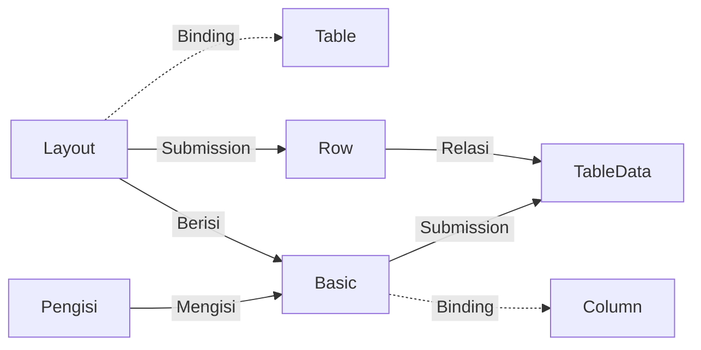

# Form Input : Basic

>**note** Basic merupakan salah satu [[Docs/Modul Interface/Form/Apa itu Form#Elemen Input|Elemen Input]] dalam [[Docs/Modul Interface/Form/Apa itu Form|Form]] di Phoenix.

Basic adalah Elemen Input yang dapat digunakan untuk mengisi satu [[Docs/Tipe Data/Column]] dari [[Docs/Modul Data/Table/Apa itu Table|Table]]. Format isiannya mengikuti Column yang diikat, sehingga pengisi hanya memasukkan data sesuai tipe yang benar.

Dengan Basic, Anda dapat mengatur isian wajib, nilai bawaan, kondisi tampil, dan kondisi aktif langsung dari Properties Panel tanpa menulis logika tambahan.

Penjelasan umum tentang Elemen, Header Toolbar, Layout Panel, Menu Konteks Elemen, dan cara menghapus Elemen ada di [[Docs/Modul Interface/Form/Apa itu Form#Mengelola Elemen Form|Apa itu Form?]]. Halaman ini fokus pada keunikan Basic.

## Mengapa Menggunakan Basic?

- **Isian sesuai tipe data.** Format isian mengikuti Column, sehingga data yang masuk konsisten.
- **Isian wajib mudah diatur.** Cukup aktifkan [[^field|Required]] agar pengisi tidak dapat mengirim Form sebelum field terisi.
- **Nilai bawaan siap pakai.** [[^field|Default Value]] mengisi field otomatis saat pengisi membuka Form.
- **Kontrol kondisi tampil dan aktif.** [[^field|Visible]], [[^field|Enable]], dan [[^field|Readonly]] mengatur perilaku field tanpa menghapusnya.

## Konsep Utama

| Istilah | Penjelasan |
| --- | --- |
| [[Docs/Tipe Data/Column]] | Kolom Table tempat isian Basic disimpan. |
| [[#Binding Basic|Binding]] | Ikatan Basic ke Table dan Column agar isian tersimpan pada Row yang tepat. |
| [[#State Basic|State]] | Pengaturan kondisi field: [[^field|Visible]], [[^field|Enable]], dan [[^field|Readonly]]. |
| [[#Validators|Validators]] | Aturan yang harus dipenuhi pengisi agar dapat mengirim Form. Saat ini baru [[^field|Required]]. |
| [[#Attributes Basic|Attributes]] | Pengaturan tampilan dan nilai awal: [[^field|Label]], [[^field|Placeholder]], [[^field|Format Type]], dan [[^field|Default Value]]. |

## Cara Kerja Basic

Basic terikat ke Column pada Table yang ditentukan Layout di atasnya, lalu isian pengguna dikirim sebagai Submission dan disimpan pada Row.

## Menambahkan Basic

1. Aktifkan [[Docs/Modul Interface/Form/Apa itu Form#Mode View dan Edit Mode|Edit Mode]]
2. Klik [[^field|Type something here to add...]] pada Layout
3. Pilih Basic dari daftar, atau ketik untuk mencarinya
4. Pilih [[^field|Column]] pada [[^field|Binding]]

Selengkapnya lihat [[Docs/Modul Interface/Form/Apa itu Form#Menambahkan Elemen]].

## Mengonfigurasi Basic

![[Docs/Modul Interface/Form/Input/properties-form-input.png]]
Klik kiri Basic di [[Docs/Modul Interface/Form/Apa itu Form#Mode View dan Edit Mode|Edit Mode]] untuk menampilkan Properties Panel dan Header Toolbar. Label Column (berikon kolom) juga tampil di atas Basic sebagai informasi Binding.

### Binding Basic

| Bagian | Fungsi |
| --- | --- |
| [[^field|Table]] | Table sumber data Basic. |
| [[^field|Column]] | Column tempat isian Basic disimpan. Format isian Basic mengikuti Column ini. |

### State Basic

| State | Fungsi |
| --- | --- |
| [[^field|Visible]] | Menampilkan atau menyembunyikan Basic. |
| [[^field|Enable]] | Mengaktifkan Binding. Jika [[^value/boolean/false]], Binding tidak aktif dan isian tidak berpengaruh ke Row. |
| [[^field|Readonly]] | Jika [[^value/boolean/true]], isi Basic tidak dapat diubah oleh pengisi. |

### Validators

| Validator | Fungsi |
| --- | --- |
| [[^field|Required]] | Pengisi wajib mengisi field ini agar dapat mengirim Form. |

>**note** Kapan Required tidak berlaku
> [[^field|Required]] tidak berlaku jika [[^field|Visible]] atau [[^field|Enable]] bernilai [[^value/boolean/false]].

Saat ini [[^field|Required]] adalah satu-satunya validator.

### Attributes Basic

| Atribut | Fungsi |
| --- | --- |
| [[^field|Label]] | Teks judul field yang tampil di atas isian. |
| [[^field|Placeholder]] | Teks petunjuk yang tampil saat field masih kosong. |
| [[^field|Format Type]] | Format isian. Mengikuti Column pada Binding, misalnya `String` untuk teks. |
| [[^field|Default Value]] | Nilai bawaan yang sudah terisi saat pengisi baru (publik) membuka Form. |

### Header Toolbar teks

Selain tombol [[^button/delete|Remove]], Header Toolbar Basic memiliki pengaturan teks untuk Label: ukuran font, *bold*, *italic*, *underline*, serta rata kiri, tengah, dan kanan. Pengaturan ini berlaku pada teks Label yang sedang dipilih.

### Parent

Menampilkan Layout tempat Basic berada. Mengubah ukuran, *padding*, dan *margin* Basic dilakukan lewat Layout Panel (ikon kecil di bawah Elemen yang difokuskan). Lihat [[Docs/Modul Interface/Form/Apa itu Form#Layout Panel]].

## Praktik Terbaik

- **Ikat ke Column yang tepat.** [[^field|Format Type]] mengikuti Column, jadi pilih Column dengan tipe yang sesuai.
- **Tandai field penting dengan Required.** Aktifkan [[^field|Required]] hanya pada isian yang benar-benar wajib.
- **Gunakan Default Value untuk isian umum.** Isi [[^field|Default Value]] agar pengisi tidak mengetik hal yang sama berulang.
- **Beri Placeholder yang jelas.** [[^field|Placeholder]] membantu pengisi memahami format isian.

## Batasan dan Catatan

- [[^field|Format Type]] mengikuti Column pada Binding.
- [[^field|Required]] adalah satu-satunya validator saat ini, dan tidak berlaku jika [[^field|Visible]] atau [[^field|Enable]] bernilai [[^value/boolean/false]].
- Jika [[^field|Enable]] bernilai [[^value/boolean/false]], isian tidak berpengaruh ke Row.
- [[^field|Readonly]] hanya mencegah pengisi mengubah isi, tidak menonaktifkan Binding.
- [[^field|Default Value]] berlaku saat pengisi baru (publik) membuka Form.

## TL:DR

- **Definisi.** Basic adalah [[Docs/Modul Interface/Form/Apa itu Form#Elemen Input|Elemen Input]] untuk mengisi satu [[Docs/Tipe Data/Column]].
- **Binding.** Pilih [[^field|Table]] dan [[^field|Column]]; [[^field|Format Type]] mengikuti Column.
- **Kondisi.** [[^field|Visible]], [[^field|Enable]], dan [[^field|Readonly]] mengatur tampil, aktif, dan bisa diubahnya field.
- **Validasi.** [[^field|Required]] mewajibkan pengisi mengisi field sebelum mengirim Form.
- **Nilai awal.** [[^field|Default Value]] terisi otomatis saat pengisi membuka Form.
- **Hati-hati.** [[^field|Enable]] [[^value/boolean/false]] membuat isian tidak berpengaruh ke Row.

## FAQ : Pertanyaan yang Sering Diajukan

> **faq**
> **Apa bedanya Enable dan Readonly?**
> [[^field|Enable]] mengaktifkan Binding, sehingga jika [[^value/boolean/false]] isian tidak berpengaruh ke Row. [[^field|Readonly]] hanya membuat isi tidak dapat diubah.
> **Mengapa Required saya tidak berlaku?**
> [[^field|Required]] tidak berlaku jika [[^field|Visible]] atau [[^field|Enable]] bernilai [[^value/boolean/false]].
> **Dari mana Format Type ditentukan?**
> [[^field|Format Type]] mengikuti [[Docs/Tipe Data/Column]] yang diikat pada Binding.
> **Kapan Default Value dipakai?**
> Saat pengisi baru (publik) membuka Form, [[^field|Default Value]] menjadi nilai bawaan field.