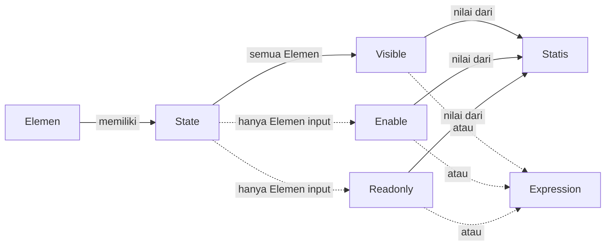

# ---

## status: draft title: State Elemen Form description: Penjelasan tiga State pada Elemen Form (Visible, Enable, Readonly) dan cara mengisinya dengan nilai statis atau expression.

# State Elemen Form

> **note** State merupakan bagian dari \[\[Docs/Modul Interface/Form/Apa itu Form#Properties Panel|Properties Panel\]\] pada Elemen di komponen \[\[Docs/Modul Interface/Form/Apa itu Form|Form\]\], salah satu komponen dalam modul \[\[Docs/Modul Interface/Pengenalan|Interface\]\] di Phoenix.

State adalah pengaturan pada Elemen yang menentukan apakah sebuah Elemen tampil, aktif, atau hanya dapat dibaca oleh pengisi Form. Setiap State dapat diisi dengan nilai statis atau \[\[Docs/Tipe Data/Expression\]\], sehingga Elemen dapat berubah mengikuti isian pengisi saat Form sedang diisi.

Dengan State, satu Form dapat menyesuaikan diri dengan pengisinya: pertanyaan lanjutan hanya muncul saat dibutuhkan, isian yang belum relevan dinonaktifkan, dan isian bawaan dikunci agar tidak berubah.

## Mengapa Menggunakan State?

*   **Form menyesuaikan diri dengan pengisi.** Elemen dapat muncul, aktif, atau terkunci sesuai isian yang sudah diisi pengisi.
*   **Form lebih ringkas.** Sembunyikan satu \[\[Docs/Modul Interface/Form/Layout/Card/Penjelasan|Card\]\] berisi banyak Elemen sampai isinya memang dibutuhkan.
*   **Data tersimpan sesuai kebutuhan.** Elemen input hanya menyimpan isiannya ke \[\[Docs/Tipe Data/Row\]\] saat \[\[^field|Enable\]\] aktif.
*   **Satu pengaturan, dua cara mengisi.** Gunakan nilai statis untuk aturan tetap, atau expression untuk aturan yang bergantung pada isian lain.

## Konsep Utama

| Istilah | Penjelasan |
| --- | --- |
| \[\[Docs/Modul Interface/Form/Apa itu Form#Elemen\|Elemen\]\] | Objek penyusun isi Form. State berada di Properties Panel setiap Elemen. |
| \[\[#Visible\]\] | State yang menentukan apakah Elemen tampil atau tersembunyi. Tersedia pada semua Elemen. |
| \[\[#Enable\]\] | State yang menentukan apakah Elemen input aktif dan menyimpan isiannya ke Row. Hanya pada Elemen input. |
| \[\[#Readonly\]\] | State yang mengunci isi Elemen input agar tidak dapat diubah pengisi. Hanya pada Elemen input. |
| \[\[#Mengisi State dengan Nilai Statis\|Nilai statis\]\] | Nilai \[\[Docs/Tipe Data/Boolean\|Boolean\]\] yang dipilih lewat saklar dan tidak berubah selama pengisi mengisi Form. |
| \[\[Docs/Tipe Data/Expression\]\] | Logika atau kondisi yang menghasilkan Boolean dan dihitung ulang saat pengisi mengisi Form, misalnya `inputA not empty`. |

## Cara Kerja State

Setiap State pada sebuah Elemen mengambil nilainya dari saklar statis atau dari expression, lalu menentukan perilaku Elemen saat Form diisi.

## Jenis State

Jenis State yang tersedia bergantung pada jenis Elemen. Elemen layout dan display hanya memiliki \[\[^field|Visible\]\], sedangkan Elemen input memiliki ketiganya.

| Jenis Elemen | Elemen | \[\[^field\|Visible\]\] | \[\[^field\|Enable\]\] | \[\[^field\|Readonly\]\] |
| --- | --- | --- | --- | --- |
| Layout | \[\[Docs/Modul Interface/Form/Layout/Card/Penjelasan\|Card\]\], \[\[Docs/Modul Interface/Form/Layout/Full/Penjelasan\|Full\]\], \[\[Docs/Modul Interface/Form/Layout/Split/Penjelasan\|Split\]\], \[\[Docs/Modul Interface/Form/Layout/Accordion/Penjelasan\|Accordion\]\] | Ada | Tidak ada | Tidak ada |
| Display | \[\[Docs/Modul Interface/Form/Display/Text/Penjelasan\|Text\]\], \[\[Docs/Modul Interface/Form/Display/Table/Penjelasan\|Table\]\], \[\[Docs/Modul Interface/Form/Display/Tooltip/Penjelasan\|Tooltip\]\], \[\[Docs/Modul Interface/Form/Display/Qr/Penjelasan\|Qr\]\], \[\[Docs/Modul Interface/Form/Display/Chrono/Penjelasan\|Chrono\]\] | Ada | Tidak ada | Tidak ada |
| Input | \[\[Docs/Modul Interface/Form/Input/Basic/Penjelasan\|Basic\]\], \[\[Docs/Modul Interface/Form/Input/Quiz/Penjelasan\|Quiz\]\], \[\[Docs/Modul Interface/Form/Input/Table/Penjelasan\|Table\]\], \[\[Docs/Modul Interface/Form/Input/List/Penjelasan\|List\]\] | Ada | Ada | Ada |

Nilai awal ketiga State pada Elemen input yang baru ditambahkan selalu sama:

| State | Nilai awal | Jika \[\[^value/boolean/true\]\] | Jika \[\[^value/boolean/false\]\] |
| --- | --- | --- | --- |
| \[\[^field\|Visible\]\] | \[\[^value/boolean/true\]\] | Elemen tampil. | Elemen tersembunyi. Pada Elemen layout, semua Elemen di dalamnya ikut tersembunyi. |
| \[\[^field\|Enable\]\] | \[\[^value/boolean/true\]\] | Elemen aktif dan menyimpan isiannya ke Row saat Form dikirim. | Elemen tidak menyimpan isiannya ke Row. |
| \[\[^field\|Readonly\]\] | \[\[^value/boolean/false\]\] | Isi Elemen tidak dapat diubah pengisi. | Pengisi dapat mengisi Elemen. |

### Visible

\[\[^field|Visible\]\] menentukan apakah Elemen terlihat oleh pengisi. Pengaturan ini tersedia pada semua Elemen, baik layout, display, maupun input.

Bila \[\[^field|Visible\]\] pada Elemen layout bernilai \[\[^value/boolean/false\]\], semua Elemen di dalamnya ikut tersembunyi. Anda cukup mengatur satu Layout untuk menyembunyikan sekelompok Elemen sekaligus.

> **warning** Elemen input yang tersembunyi tetap dapat menyimpan data \[\[^field|Visible\]\] tidak memengaruhi penyimpanan. Elemen input yang tersembunyi tetap menyimpan isiannya ke \[\[Docs/Tipe Data/Row|Row\]\] selama \[\[^field|Enable\]\] bernilai \[\[^value/boolean/true\]\]. Atur \[\[^field|Enable\]\] bila isian yang tersembunyi tidak boleh ikut tersimpan.

### Enable

\[\[^field|Enable\]\] menentukan apakah Elemen input aktif. Elemen input hanya menyimpan isiannya ke \[\[Docs/Tipe Data/Row|Row\]\] saat Form dikirim jika \[\[^field|Enable\]\] bernilai \[\[^value/boolean/true\]\]. Bila bernilai \[\[^value/boolean/false\]\], binding Elemen tidak aktif sehingga tidak berpengaruh ke Row.

\[\[^field|Enable\]\] tersedia hanya pada Elemen input.

### Readonly

\[\[^field|Readonly\]\] mengunci isi Elemen input. Elemen tetap tampil, tetapi pengisi tidak dapat mengubah isinya. Pengaturan ini berguna untuk menampilkan nilai bawaan yang tidak boleh diubah.

\[\[^field|Readonly\]\] tersedia hanya pada Elemen input.

> **note** Perbedaan Enable dan Readonly \[\[^field|Enable\]\] bernilai \[\[^value/boolean/false\]\] membuat Elemen tidak menyimpan isiannya ke Row. \[\[^field|Readonly\]\] bernilai \[\[^value/boolean/true\]\] hanya mengunci isi: isian tetap tampil dan tetap tersimpan selama \[\[^field|Enable\]\] bernilai \[\[^value/boolean/true\]\]. State lain tidak memengaruhi penyimpanan ke Row.

## Antarmuka State

!\[\[Docs/Modul Interface/Form/properties-state.png\]\]

State berada di Properties Panel, di bawah bagian \[\[^field|Binding\]\]. Setiap baris State terdiri dari label, ikon saklar, dan nilai.

| Bagian | Fungsi |
| --- | --- |
| Label State | Nama State, yaitu \[\[^field\|Visible\]\], \[\[^field\|Enable\]\], atau \[\[^field\|Readonly\]\]. |
| Ikon saklar | Ikon kecil di sebelah kanan label. Klik untuk beralih antara nilai statis dan expression. |
| Saklar nilai | Tampil saat memakai nilai statis. Hijau berarti \[\[^value/boolean/true\]\], abu-abu berarti \[\[^value/boolean/false\]\]. |
| Kolom isian expression | Tampil menggantikan saklar nilai saat memakai expression. Memiliki *autocomplete* dan *checker*. |

## Mengisi State dengan Nilai Statis

Nilai statis tidak berubah selama pengisi mengisi Form.

1.  Beralih ke \[\[Docs/Modul Interface/Form/Apa itu Form#Mode View dan Edit|Edit Mode\]\]
2.  Klik kiri Elemen yang ingin diatur
3.  Pada bagian \[\[^field|State\]\] di Properties Panel, klik saklar pada \[\[^field|Visible\]\], \[\[^field|Enable\]\], atau \[\[^field|Readonly\]\]
4.  Klik \[\[^button/save|Save\]\], atau tunggu *auto save* sekitar 3 detik

## Mengisi State dengan Expression

Expression membuat State berubah mengikuti kondisi saat pengisi mengisi Form.

1.  Beralih ke \[\[Docs/Modul Interface/Form/Apa itu Form#Mode View dan Edit|Edit Mode\]\]
2.  Klik kiri Elemen yang ingin diatur
3.  Pada baris State yang ingin diatur, klik ikon saklar di sebelah kanan label. Saklar nilai berganti menjadi kolom isian expression
4.  Ketik expression. *Autocomplete* membantu melengkapi penulisan
5.  Periksa hasil *checker* sampai tidak ada kesalahan
6.  Klik \[\[^button/save|Save\]\], atau tunggu *auto save* sekitar 3 detik

Aturan penulisan expression pada State:

*   Hasil expression harus \[\[Docs/Tipe Data/Boolean|Boolean\]\]. *Checker* akan memeriksanya.
*   Parameter pada expression merujuk ke nama \[\[^field|Label\]\] Elemen yang ada di Form.
*   Expression dihitung ulang saat pengisi mengisi Form, sehingga State dapat berubah selama pengisian.

| Contoh expression | Arti |
| --- | --- |
| `Asal Instansi not empty` | Bernilai \[\[^value/boolean/true\]\] bila isian dengan \[\[^field\|Label\]\] "Asal Instansi" sudah terisi. |

## Contoh Penggunaan

**Form pendaftaran peserta yang menyesuaikan diri**

Panitia ingin pendaftaran tetap ringkas. Pengisi perorangan tidak perlu melihat isian instansi, kategori peserta harus tetap "Umum", dan kolom nomor voucher baru boleh diisi setelah email terisi. Dengan State, satu Form melayani semua kebutuhan itu dan hasilnya tersimpan rapi ke Table.

**Komponen yang terlibat**

| Komponen | Peran |
| --- | --- |
| \[\[^field/form\|Form Pendaftaran Peserta\]\] | Form yang diisi pengisi. |
| \[\[^field/table\|Data Peserta\]\] | \[\[Docs/Modul Data/Table/Apa itu Table\|Table\]\] tujuan penyimpanan isian. Setiap pendaftaran menjadi satu \[\[Docs/Tipe Data/Row\|Row\]\]. |

**Pengaturan Elemen**

| Elemen | State | Nilai | Perilaku yang dirasakan pengisi |
| --- | --- | --- | --- |
| \[\[Docs/Modul Interface/Form/Layout/Card/Penjelasan\|Card\]\] "Detail Instansi" | \[\[^field\|Visible\]\] | Expression `Asal Instansi not empty` | Detail instansi hanya muncul setelah Asal Instansi diisi. |
| \[\[Docs/Modul Interface/Form/Input/Basic/Penjelasan\|Basic\]\] "Kategori Peserta" | \[\[^field\|Readonly\]\] | Statis, aktif | Kategori terlihat dan tidak dapat diubah, nilainya tetap tersimpan ke Row. |
| \[\[Docs/Modul Interface/Form/Input/Basic/Penjelasan\|Basic\]\] "Nomor Voucher" | \[\[^field\|Enable\]\] | Expression `Email not empty` | Nomor voucher baru aktif setelah Email diisi, dan baru tersimpan saat aktif. |

**Hasil yang dirasakan**

*   Pengisi perorangan melihat Form yang lebih pendek karena detail instansi tersembunyi.
*   Kategori peserta konsisten di semua pendaftaran tanpa perlu dikoreksi manual.
*   Data di Table hanya berisi isian yang memang relevan bagi pengisi.

**Ide skenario lain**

| Kebutuhan | State | Contoh kondisi |
| --- | --- | --- |
| Pertanyaan lanjutan hanya muncul bila relevan | \[\[^field\|Visible\]\] pada Layout | `Punya Kendaraan not empty` |
| Isian dikunci setelah terisi oleh sistem | \[\[^field\|Readonly\]\] | `Nomor Pendaftaran not empty` |
| Isian yang tidak berlaku tidak boleh tersimpan | \[\[^field\|Enable\]\] | `Metode Pembayaran not empty` |

State menjadikan Form bukan sekadar daftar isian, tetapi alur pengisian yang mengikuti jawaban pengisinya.

## Praktik Terbaik

> **success** Rancang State dari kebutuhan pengisi
> 
> *   Gunakan **\[\[^field|Visible\]\] pada Layout** untuk menyembunyikan sekelompok Elemen sekaligus, daripada mengatur satu per satu.
> *   Pilih **\[\[^field|Readonly\]\]** bila nilainya harus tetap tersimpan, dan **\[\[^field|Enable\]\]** bila nilainya tidak boleh tersimpan.
> *   Mulailah dengan **nilai statis**, lalu beralih ke expression hanya bila State perlu berubah mengikuti isian.
> *   Beri **\[\[^field|Label\]\] yang jelas dan berbeda** pada Elemen yang akan dirujuk oleh expression.
> *   Periksa hasil ***checker*** sebelum menyimpan agar expression pasti menghasilkan Boolean.

## Batasan dan Catatan

*   Elemen layout dan display hanya memiliki \[\[^field|Visible\]\]. \[\[^field|Enable\]\] dan \[\[^field|Readonly\]\] hanya ada pada Elemen input.
*   \[\[^field|Visible\]\] bernilai \[\[^value/boolean/false\]\] pada Elemen layout menyembunyikan semua Elemen di dalamnya.
*   Elemen input hanya menyimpan isiannya ke \[\[Docs/Tipe Data/Row|Row\]\] saat \[\[^field|Enable\]\] bernilai \[\[^value/boolean/true\]\]. State lain tidak memengaruhi penyimpanan.
*   Hasil expression harus \[\[Docs/Tipe Data/Boolean|Boolean\]\], dan parameternya merujuk ke nama \[\[^field|Label\]\] Elemen di Form.
*   Nilai statis tidak berubah selama pengisian, sedangkan expression berubah mengikuti isian.
*   Validator \[\[^field|Required\]\] tidak berlaku bila \[\[^field|Visible\]\] atau \[\[^field|Enable\]\] bernilai \[\[^value/boolean/false\]\]. Selengkapnya lihat \[\[Docs/Modul Interface/Form/Validators\]\].
*   State diatur di \[\[Docs/Modul Interface/Form/Apa itu Form#Mode View dan Edit|Edit Mode\]\], yang membutuhkan akses edit data Workspace bernilai \[\[^value/boolean/allow\]\]. Selengkapnya lihat \[\[Docs/Modul Developer/Workspace/Data Access|Data Access\]\].

## TL:DR

*   State menentukan apakah Elemen tampil, aktif, atau hanya dibaca oleh pengisi Form.
*   Ada tiga State: \[\[^field|Visible\]\], \[\[^field|Enable\]\], dan \[\[^field|Readonly\]\]. Elemen layout dan display hanya punya \[\[^field|Visible\]\].
*   Setiap State diisi dengan nilai statis atau \[\[Docs/Tipe Data/Expression\]\], dipilih lewat ikon saklar di sebelah kanan label.
*   Expression harus menghasilkan \[\[Docs/Tipe Data/Boolean|Boolean\]\] dan merujuk ke nama \[\[^field|Label\]\] Elemen di Form.
*   Elemen input hanya menyimpan ke \[\[Docs/Tipe Data/Row|Row\]\] bila \[\[^field|Enable\]\] aktif.
*   Elemen input baru selalu dimulai dengan \[\[^field|Visible\]\] dan \[\[^field|Enable\]\] aktif, \[\[^field|Readonly\]\] nonaktif.

## FAQ : Pertanyaan yang Sering Diajukan

> **faq** **Apa beda Enable dan Readonly?** \[\[^field|Enable\]\] \[\[^value/boolean/false\]\] membuat Elemen tidak menyimpan isiannya ke Row. \[\[^field|Readonly\]\] \[\[^value/boolean/true\]\] hanya mengunci isi agar tidak dapat diubah, dan isiannya tetap tersimpan selama \[\[^field|Enable\]\] aktif. **Mengapa Elemen Text tidak punya Enable dan Readonly?** Elemen display dan layout tidak menerima isian pengisi, sehingga hanya \[\[^field|Visible\]\] yang tersedia. Enable dan Readonly hanya ada pada Elemen input. **Bila Layout disembunyikan, apakah isian di dalamnya tetap tersimpan?** Elemen input di dalamnya tetap menyimpan ke \[\[Docs/Tipe Data/Row|Row\]\] selama \[\[^field|Enable\]\] miliknya aktif, karena \[\[^field|Visible\]\] tidak memengaruhi penyimpanan. **Kapan memilih nilai statis dan kapan expression?** Pilih nilai statis untuk aturan yang selalu sama. Pilih expression bila State perlu berubah mengikuti isian lain, misalnya `Asal Instansi not empty`. **Bagaimana bila expression tidak menghasilkan Boolean?** *Checker* pada kolom isian expression akan memeriksa dan memberi tahu Anda.