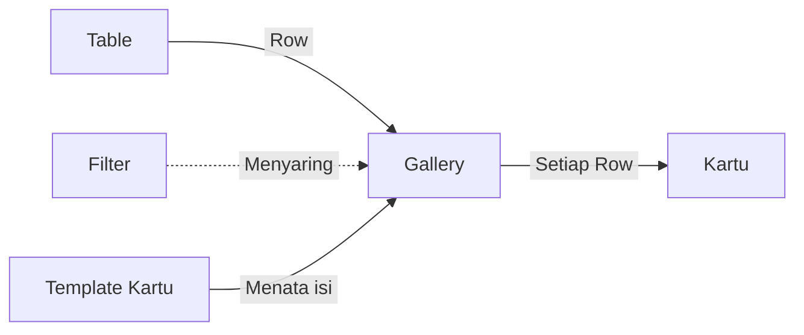
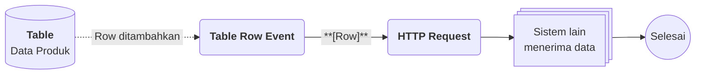

# Apa itu Gallery?

>**note** Gallery merupakan salah satu komponen dalam modul [[Docs/Modul Interface/Pengenalan|Interface]] di Phoenix.

Gallery adalah komponen yang dapat digunakan untuk menyajikan data dalam bentuk kartu visual yang menonjolkan konten dari setiap data.

Gallery ideal untuk koleksi yang bersifat visual, seperti katalog, portofolio, atau daftar aset, sehingga data lebih mudah dikenali sekilas. Setiap [[Docs/Tipe Data/Row]] dari [[Docs/Tipe Data/Table]] tampil sebagai satu kartu, dan isi kartu dapat Anda atur sendiri melalui template.

## Mengapa Menggunakan Gallery?

- **Data dikenali sekilas.** Setiap data tampil sebagai kartu visual, sehingga Anda tidak perlu membaca baris demi baris.
- **Cocok untuk koleksi visual.** Katalog, portofolio, dan daftar aset tampil lebih hidup dibandingkan tampilan tabel.
- **Format data tampil sebaik mungkin.** Semua format data ditampilkan di kartu, termasuk gambar.
- **Tampilan kartu dapat disesuaikan.** Anda menentukan [[Docs/Tipe Data/Column]] yang tampil, posisinya pada kartu, dan desainnya melalui [[Docs/Styling/Pengenalan|Styling]].
- **Data tetap terhubung ke sumbernya.** [[Docs/Tipe Data/Row]] dapat dilihat, diubah, ditambah, dan dihapus langsung dari Gallery sesuai hak akses Anda.

## Konsep Utama

| Istilah | Penjelasan |
| ------- | ---------- |
| [[Docs/Tipe Data/Table]] | Sumber data Gallery. Wajib dipilih saat membuat Gallery dan tidak dapat diubah setelahnya. |
| [[Docs/Tipe Data/Row]] | Satu baris pada Table. Setiap Row tampil sebagai satu kartu di Gallery. |
| [[#Cara Kerja Gallery|Kartu]] | Tampilan satu Row di Gallery. Isi dan tata letaknya ditentukan oleh template. |
| [[Docs/Modul Interface/Gallery/Template Kartu|Template Kartu]] | Pengaturan tata letak kartu yang terdiri dari [[^field|Header]], [[^field|Body]], dan [[^field|Footer]]. |
| [[Docs/Tipe Data/Column]] | Kolom Table yang ditambahkan ke template dan tampil pada kartu sesuai posisinya. |
| [[Docs/Styling/Styling Class|Styling]] | Nama class yang menyesuaikan desain Column pada kartu. |
| [[Docs/Tipe Data/Query#Filter|Filter]] | Daftar kondisi (kolom, operator, dan operand) untuk menyaring Row yang tampil sebagai kartu. |
| [[Docs/Modul Data/Table/Apa itu Table#Membuat Table|Alias]] | Column Table yang menjadi isi kartu bila template masih kosong. |

## Cara Kerja Gallery

Gallery mengambil Row dari satu Table, lalu menampilkan setiap Row sebagai satu kartu yang isinya ditata oleh template.

## Membuat Gallery

![[Docs/Modul Interface/Gallery/add-gallery2.png]]
1. Buka folder tempat Gallery akan ditempatkan di [[Docs/Antarmuka#Area Manajemen Folder]]
2. Klik kanan ➜ [[^field/add|Add]] ➜ [[^field|Interface]] ➜ [[^field/gallery|Gallery]]
3. Isi [[^field|Name]] dan [[^field|Description]]
4. Pilih [[Docs/Tipe Data/Table]] pada [[^field|Table]]
5. Isi [[^field|Filter]] jika dibutuhkan
6. Klik [[^button|Create]]

Bagian di kiri tanda `/` pada [[^field|Name]] adalah folder tempat Gallery ditempatkan. Bagian ini terisi sesuai folder tempat Anda menambahkan Gallery, dan dapat dikosongkan sehingga Gallery berada di root.

[[^field|Table]] wajib diisi dan tidak dapat diubah setelah Gallery dibuat. Pilih Table sumber dengan tepat.

>**success** Gallery berhasil dibuat
> Setiap Row pada Table langsung tampil sebagai kartu. Karena template masih kosong, kartu menampilkan [[Docs/Modul Data/Table/Apa itu Table#Membuat Table|Alias]] dari Table. Atur tampilan kartu di [[#Mengatur Template Kartu]].

## Mengubah Gallery

1. Buka halaman kerja Gallery
2. Klik [[^button/edit|Edit]]
3. Ubah [[^field|Name]], [[^field|Description]], atau [[^field|Filter]]
4. Klik [[^button|Update]]

Anda dapat klik [[^button/x|Cancel]] untuk membatalkan perubahan.

>**warning** Table tidak dapat diubah
> [[^field|Table]] tidak dapat diubah setelah Gallery dibuat. Jika Anda ingin memakai Table lain, buat Gallery baru. Mengubah [[^field|Filter]] hanya memengaruhi Row yang tampil sebagai kartu, Row di Table sumber tidak terhapus.

## Menyegarkan Gallery

Klik [[^button/refresh|Refresh]] untuk memuat ulang tampilan.

## Menghapus Gallery

1. Buka folder yang berisi Gallery di [[Docs/Antarmuka#Area Manajemen Folder]]
2. Klik kanan Gallery ➜ [[^button/delete|Delete]]
3. Konfirmasi dengan klik [[^button|Delete]]

>**warning** Dampak penghapusan Gallery
> Gallery beserta [[^field|Filter]] dan template kartunya terhapus. Row di Table sumber tidak terhapus karena Gallery hanya menampilkan data.

## Antarmuka Gallery

![[Docs/Modul Interface/Gallery/interface-gallery2.png]]
Halaman kerja Gallery terdiri dari bilah navigasi di bagian atas dan area kartu di bagian bawah. Setiap Row pada Table tampil sebagai satu kartu di area kartu.

### Bilah navigasi Gallery terdiri dari:

| Tombol | Fungsi |
| ------ | ------ |
| [[^button/edit|Edit]] | Mengubah [[^field|Name]], [[^field|Description]], dan [[^field|Filter]] Gallery. |
| [[^button/setting|Column]] | Membuka modal [[^field|Setup Gallery Template]] untuk mengatur template kartu. Selengkapnya lihat [[#Mengatur Template Kartu]]. |
| [[^button/refresh|Refresh]] | Memuat ulang tampilan. |
| [[^field|Search Gallery Data...]] | Mencari data pada Gallery. |

### Interaksi Antarmuka Gallery

| Fungsi | Aksi |
| ------ | ---- |
| Mengubah Row | Klik kiri kartu, Row tampil dalam bentuk Form Table untuk diperbarui. Berlaku jika Data Access Table di Workspace mengizinkan. |
| Melihat detail Row | Klik kanan kartu ➜ [[^field|Detail]] |
| Menambah Row | Klik kanan kartu ➜ [[^field|Add Row]] |
| Menghapus Row | Klik kanan kartu ➜ [[^field|Delete]] |

>**warning** Menghapus Row dari Gallery
> Row yang dihapus lewat Gallery terhapus dari Table sumber dan tidak dapat dikembalikan.

## Mengatur Template Kartu

Klik [[^button/setting|Column]] untuk membuka modal [[^field|Setup Gallery Template]]. Template menentukan [[^field|Column]] mana yang tampil pada kartu dan di posisi mana. Setiap bagian memiliki tombol tambah ([[^button/add|Add Header Column]], [[^button/add|Add Body Column]], [[^button/add|Add Footer Column]]) dan tabel dengan kolom [[^field|No.]], [[^field|Column]], [[^field|Styling]], dan [[^field|Action]].

![[Docs/Modul Interface/Gallery/gallery-modal.png]]
Kartu memiliki tiga bagian template:

- [[^field|Header]] berada di bagian paling atas kartu dan tersusun mendatar (*flex-row*). Urutan pertama hingga terakhir dalam daftar adalah dari kiri ke kanan.
- [[^field|Body]] tersusun menurun (*flex-col*). Urutan dalam daftar adalah dari atas ke bawah.
- [[^field|Footer]] berada di bagian paling bawah kartu dan tersusun mendatar (*flex-row*). Urutan pertama hingga terakhir dalam daftar adalah dari kiri ke kanan.

[[Docs/Tipe Data/Column]] yang Anda isi akan tampil sesuai posisi template-nya. Semua format data ditampilkan sebaik mungkin, termasuk gambar. Isi [[^field|Styling]] dengan nama class styling untuk menyesuaikan desain, misalnya `text-right` atau `font-semibold`. Daftar class lengkap ada di [[Docs/Styling/Pengenalan|Styling]].

Jika template masih kosong, seperti saat Gallery pertama kali dibuat, kartu menampilkan [[Docs/Modul Data/Table/Apa itu Table#Membuat Table|Alias]] dari Table, yang biasanya berformat [[Docs/Format Data/String/Short Text]].

Langkah rinci menambah Column, mengisi Styling, dan menghapus Column dari template ada di [[Docs/Modul Interface/Gallery/Templat Kartu]].

## Contoh Penggunaan

**Katalog produk yang selalu terbarui**

Tim penjualan menyimpan data produk di Table, lalu membutuhkan katalog yang menarik untuk dilihat sekilas dan tetap terhubung dengan sistem lain, misalnya toko daring. Dengan Gallery, setiap produk tampil sebagai kartu bergambar, dan Flow mengirim produk baru ke sistem lain secara otomatis.

**Komponen yang terlibat**

| Komponen | Peran |
| -------- | ----- |
| [[^field/table|Data Produk]] | Menyimpan data produk, termasuk gambar, nama, dan harga. |
| [[^field/gallery|Katalog Produk]] | Menyajikan setiap produk sebagai kartu visual. |
| [[^field/flow|Kirim Produk Baru]] | Mengirim data produk baru ke sistem lain. |

**Alur di Flow**

| Langkah | Flow Block | Peran dalam alur | Hasil |
| ------- | ---------- | ---------------- | ----- |
| 1 | [[Docs/Modul Logic/Flow/Flow Block/Event/Table Row Event|Table Row Event]] | Mendeteksi Row produk baru pada Table. | Output bertipe [[Docs/Tipe Data/Row]]. |
| 2 | [[Docs/Modul Logic/Flow/Flow Block/Modular/HTTP Request|HTTP Request]] | Mengirim data produk ke sistem lain. | Sistem lain menerima data produk. |

**Hasil yang dirasakan**

- Produk baru langsung muncul sebagai kartu bergambar di Gallery tanpa perlu menyusun ulang tampilan.
- Sistem lain menerima data produk yang sama secara otomatis, sehingga tidak ada input ganda.
- Kartu tampil seragam karena template dan [[Docs/Styling/Pengenalan|Styling]] berlaku untuk semua produk.

**Ide skenario lain**

| Jenis nilai | Contoh integrasi |
| ----------- | ---------------- |
| Portofolio | Karya baru yang dikirim lewat [[Docs/Modul Interface/Form/Apa itu Form|Form]] langsung tampil sebagai kartu di Gallery. |
| Daftar aset | [[Docs/Tipe Data/Query#Filter|Filter]] menampilkan hanya aset yang berstatus tersedia, dan Flow memberi kabar saat status berubah. |
| Katalog menu | Perubahan harga di Table langsung tampil pada kartu, dan Flow mengirim pembaruan ke sistem pemesanan. |

Dengan Gallery, data produk tidak hanya tersimpan, tetapi juga tampil menarik dan terhubung ke sistem lain.

## Praktik Terbaik

- **Pilih Table sumber dengan tepat** karena [[^field|Table]] tidak dapat diubah setelah Gallery dibuat. Jika salah, buat Gallery baru.
- **Atur template sejak awal.** Template kosong hanya menampilkan [[Docs/Modul Data/Table/Apa itu Table#Membuat Table|Alias]], sehingga kartu belum memanfaatkan gambar atau konten lain.
- **Letakkan konten yang paling menonjol**, seperti gambar, pada [[^field|Header]] atau awal [[^field|Body]] agar mudah dikenali sekilas.
- **Gunakan [[^field|Styling]]** untuk menyeragamkan tampilan, misalnya rata kanan atau teks tebal pada Column tertentu.
- **Gunakan [[^field|Filter]]** agar hanya [[Docs/Tipe Data/Row]] yang relevan tampil sebagai kartu.

## Batasan dan Catatan

- Satu Gallery hanya menampilkan [[Docs/Tipe Data/Row]] dari satu [[Docs/Tipe Data/Table]], dan [[^field|Table]] tidak dapat diubah setelah Gallery dibuat.
- Mengubah [[Docs/Tipe Data/Row]] lewat Form Table hanya dapat dilakukan jika Data Access Table di [[Docs/Modul Developer/Workspace/Data Access|Workspace]] mengizinkan.
- Menghapus Row lewat [[^field|Delete]] menghapusnya dari Table sumber dan tidak dapat dikembalikan.
- Menghapus Gallery tidak menghapus [[Docs/Tipe Data/Row]] di Table sumber.
- Template kosong menampilkan [[Docs/Modul Data/Table/Apa itu Table#Membuat Table|Alias]], bukan seluruh Column.

## TL:DR

- Gallery adalah komponen modul [[Docs/Modul Interface/Pengenalan|Interface]] yang menyajikan setiap [[Docs/Tipe Data/Row]] dari [[Docs/Tipe Data/Table]] sebagai kartu visual.
- Halaman kerja terdiri dari bilah navigasi ([[^button/edit|Edit]], [[^button/setting|Column]], [[^button/refresh|Refresh]], dan pencarian) serta area kartu.
- Saat membuat Gallery, [[^field|Table]] wajib diisi dan [[^field|Filter]] diisi jika dibutuhkan. Table tidak dapat diubah setelahnya.
- Atur tampilan kartu lewat [[^button/setting|Column]] ➜ [[^field|Setup Gallery Template]] dengan bagian [[^field|Header]], [[^field|Body]], dan [[^field|Footer]].
- Klik kanan kartu untuk mengubah Row, klik kiri kartu untuk [[^field|Detail]], [[^field|Add Row]], dan [[^field|Delete]].
- Berhati-hatilah pada [[^field|Delete]] karena menghapus Row dari Table sumber.

## FAQ : Pertanyaan yang Sering Diajukan

> **faq**
> **Apa yang tampil pada kartu jika template masih kosong?**
> Kartu menampilkan [[Docs/Modul Data/Table/Apa itu Table#Membuat Table|Alias]] dari Table, yang biasanya berformat [[Docs/Format Data/String/Short Text]].
> **Apakah Table dapat diganti setelah Gallery dibuat?**
> Tidak. [[^field|Table]] tidak dapat diubah. Buat Gallery baru jika Anda ingin memakai Table lain.
> **Apakah Gallery dapat menampilkan gambar?**
> Ya. Semua format data ditampilkan sebaik mungkin di kartu, termasuk gambar. Anda dapat menyesuaikan desainnya lewat [[^field|Styling]].
> **Apakah mengubah Row lewat Gallery memerlukan izin?**
> Ya. Mengubah Row lewat Form Table hanya dapat dilakukan jika Data Access Table di [[Docs/Modul Developer/Workspace/Data Access|Workspace]] mengizinkan.
> **Apa isi kolom Styling?**
> Isi dengan nama class styling, misalnya `text-right` atau `font-semibold`. Selengkapnya lihat [[Docs/Styling/Pengenalan|Styling]].

