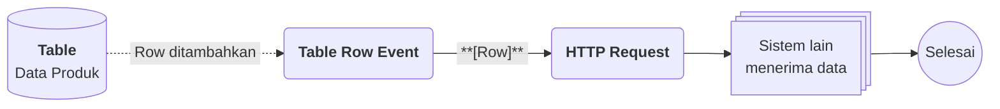

# Contoh Penggunaan Gallery

## Studi Kasus : Katalog produk yang selalu terbarui

Tim penjualan menyimpan data produk di Table, lalu membutuhkan katalog yang menarik untuk dilihat sekilas dan tetap terhubung dengan sistem lain, misalnya toko daring. Dengan Gallery, setiap produk tampil sebagai kartu bergambar, dan Flow mengirim produk baru ke sistem lain secara otomatis.

## Komponen yang terlibat

| Komponen | Peran |
| -------- | ----- |
| [[^field/table|Data Produk]] | Menyimpan data produk, termasuk [[^field|Foto]], [[^field|Nama]], [[^field|Deskripsi]] dan [[^field|Harga]]. |
| [[^field/gallery|Katalog Produk]] | Menyajikan setiap produk sebagai kartu visual. |
| [[^field/flow|Kirim Produk Baru]] | Mengirim data produk baru ke sistem lain. |

## Susunan template [[^field/gallery|Katalog Produk]]

| Bagian | Column | Styling | Hasil pada kartu |
| ------ | ------ | ------- | ---------------- |
| [[^field|Header]] | [[^field/column|Foto]] | object-cover | Foto produk tampil sebagai gambar. |
| [[^field|Body]] | [[^field/column|Nama]] | `font-semibold` | Nama produk tampil tebal di bagian atas kartu. |
| [[^field|Body]] | [[^field/column|Deskripsi]] | | Deskripsi tampil di bawah foto. |
| [[^field|Footer]] | [[^field/column|Harga]] | `font-semibold` | Harga tampil tebal di bagian bawah kartu. |

## Alur di Flow [[^field/flow|Kirim Produk Baru]]

| Langkah | Flow Block | Peran dalam alur | Hasil |
| ------- | ---------- | ---------------- | ----- |
| 1 | [[Docs/Modul Logic/Flow/Flow Block/Event/Table Row Event|Table Row Event]] | Mendeteksi Row produk baru pada Table. | Output bertipe [[Docs/Tipe Data/Row]]. |
| 2 | [[Docs/Modul Logic/Flow/Flow Block/Modular/HTTP Request|HTTP Request]] | Mengirim data produk ke sistem lain. | Sistem lain menerima data produk. |

## Hasil yang dirasakan

- Produk baru langsung muncul sebagai kartu bergambar di Gallery tanpa perlu menyusun ulang tampilan.
- Sistem lain menerima data produk yang sama secara otomatis, sehingga tidak ada input ganda.
- Kartu tampil seragam karena template dan [[Docs/Styling/Pengenalan|Styling]] berlaku untuk semua produk.

## Ide skenario lain

| Jenis nilai | Contoh integrasi |
| ----------- | ---------------- |
| Portofolio | Karya baru yang dikirim lewat [[Docs/Modul Interface/Form/Apa itu Form|Form]] langsung tampil sebagai kartu di Gallery. |
| Daftar aset | [[Docs/Tipe Data/Query#Filter|Filter]] menampilkan hanya aset yang berstatus tersedia, dan Flow memberi kabar saat status berubah. |
| Katalog menu | Perubahan harga di Table langsung tampil pada kartu, dan Flow mengirim pembaruan ke sistem pemesanan. |

Dengan Gallery, data produk tidak hanya tersimpan, tetapi juga tampil menarik dan terhubung ke sistem lain.