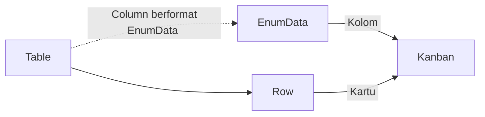
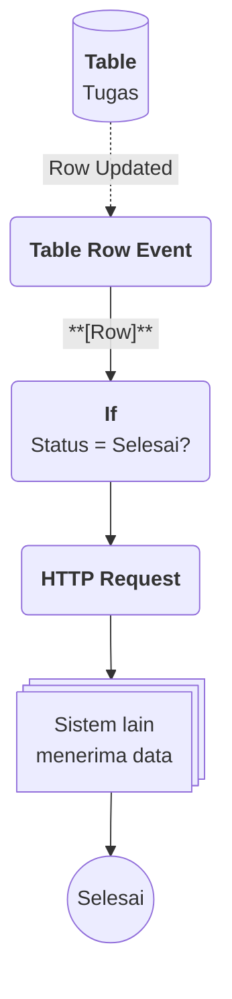

# Apa itu Kanban?

>**note** Kanban merupakan salah satu komponen dalam modul [[Docs/Modul Interface/Pengenalan|Interface]] di Phoenix.

Kanban adalah komponen yang menampilkan data dalam bentuk kolom-kolom berdasarkan status atau kategori. Setiap data direpresentasikan sebagai kartu yang dapat dipindahkan antar kolom.

Dengan Kanban, Anda dapat memvisualisasikan data secara segmentatif seperti untuk data yang memiliki tahapan atau kategori. Kolom diambil dari [[Docs/Tipe Data/EnumData|EnumData]], kartu berasal dari [[Docs/Tipe Data/Row]] pada [[Docs/Modul Data/Table/Apa itu Table|Table]], dan tampilan kartu dapat Anda atur sendiri melalui template.

## Mengapa Menggunakan Kanban?

- **Segmentasi terlihat sekilas.** Setiap tahapan atau kategori tampil sebagai kolom sehingga posisi setiap data langsung terbaca.
- **Progres terpantau.** Header kolom menampilkan jumlah item, sehingga Anda tahu tahap mana yang menumpuk.
- **Terhubung langsung dengan data.** Setiap [[Docs/Tipe Data/Row]] pada [[Docs/Modul Data/Table/Apa itu Table|Table]] otomatis menjadi kartu sesuai nilai [[Docs/Tipe Data/EnumData|EnumData]] miliknya.
- **Tampilan kartu dapat diatur.** Anda menentukan [[Docs/Tipe Data/Column]] apa yang tampil pada bagian [[^field|Header]], [[^field|Body]], dan [[^field|Footer]] kartu, lengkap dengan gaya tampilannya.

## Konsep Utama

| Istilah | Penjelasan |
| ------- | ---------- |
| [[Docs/Modul Data/Table/Apa itu Table|Table]] | Sumber data Kanban. Setiap [[Docs/Tipe Data/Row]] menjadi satu kartu. |
| [[Docs/Tipe Data/EnumData]] | Nilai dari [[Docs/Modul Data/Enum/Apa itu Enum|Enum]] yang dijadikan kolom Kanban. |
| [[#Membuat Kanban|Table - Column]] | Column berformat [[Docs/Tipe Data/EnumData]] yang wajib dipilih saat Kanban dibuat. |
| [[#Header Kolom Kanban|Kolom]] | Satu [[Docs/Tipe Data/EnumData]] ditampilkan sebagai satu kolom Kanban. |
| [[#Mengatur Template Kartu|Kartu]] | Representasi satu [[Docs/Tipe Data/Row]]. Kartu berada pada kolom sesuai nilai [[Docs/Tipe Data/EnumData]]-nya. |
| [[#Mengatur Template Kartu|Template]] | Pengaturan isi dan tata letak kartu: [[^field|Header]], [[^field|Body]], dan [[^field|Footer]]. |
| [[#Global dan Local]] | Cakupan template: berlaku untuk seluruh [[Docs/Tipe Data/EnumData]] lain atau hanya untuk satu [[Docs/Tipe Data/EnumData]]. |

## Cara Kerja Kanban

Kanban membaca satu Column berformat EnumData pada Table, membuat satu kolom untuk setiap EnumData, lalu menempatkan setiap Row sebagai kartu pada kolom sesuai nilai Column tersebut.

## Membuat Kanban

![[Docs/Modul Interface/Kanban/add-kanban.png]]
1. Buka folder tempat Kanban akan ditempatkan di [[Docs/Antarmuka#Area Manajemen Folder]]
2. Klik kanan ➜ [[^field/add|Add]] ➜ [[^field|Interface]] ➜ [[^field/kanban|Kanban]]
3. Isi [[^field|Name]] dan [[^field|Description]]
4. Pilih [[^field|Table - Column]]
5. Klik [[^button|Create]]

>**note** Table - Column wajib diisi
>[[^field|Table - Column]] berisi daftar [[Docs/Tipe Data/Column]] berformat [[Docs/Tipe Data/EnumData|EnumData]]. Setiap [[Docs/Tipe Data/EnumData]] pada [[Docs/Tipe Data/Enum]] tersebut menjadi satu kolom Kanban. Misalnya, jika [[Docs/Tipe Data/Enum]] Status memiliki 4 [[Docs/Tipe Data/EnumData]], maka Kanban memiliki 4 kolom.

>**success** Kanban berhasil dibuat
>Kanban yang baru dibuat belum memiliki template, sehingga setiap kartu hanya menampilkan [[Docs/Modul Data/Table/Apa itu Table#Membuat Table|Alias]] dari Table. Atur tampilan kartu di [[#Mengatur Template Kartu]].

## Mengubah Kanban

1. Buka halaman kerja Kanban
2. Klik [[^button/edit|Edit]]
3. Ubah [[^field|Name]] atau [[^field|Description]]
4. Klik [[^button|Update]]

>**warning** Template kartu dapat terhapus
>Mengubah Table pada [[^field|Table - Column]]otomatis menghapus template kartunya. [[Docs/Tipe Data/Row]] pada [[Docs/Modul Data/Table/Apa itu Table|Table]] sumber tidak ikut terhapus karena Kanban hanya menampilkan data.
>Abaikan peringatan ini jika perubahan hanya pada [[Docs/Tipe Data/Column]] pada [[Docs/Modul Data/Table/Apa itu Table|Table]] yang sama.

## Menyegarkan Kanban

Klik [[^button/refresh|Refresh]] untuk memuat ulang tampilan.

## Menghapus Kanban

1. Buka folder yang berisi Kanban di [[Docs/Antarmuka#Area Manajemen Folder]]
2. Klik kanan Kanban ➜ [[^button/delete|Delete]]
3. Konfirmasi dengan klik [[^button|Delete]]

>**warning** Template kartu ikut terhapus
>Menghapus Kanban menghapus tampilan Kanban beserta template kartunya. Row pada [[Docs/Modul Data/Table/Apa itu Table|Table]] sumber tidak ikut terhapus karena Kanban hanya menampilkan data.

## Antarmuka Kanban
![[Docs/Modul Interface/Kanban/interface-kanban.png]]
Halaman kerja Kanban terdiri dari bilah navigasi di bagian atas dan area kolom di bagian bawah. Setiap kolom mewakili satu [[Docs/Tipe Data/EnumData]], dan kartu berada di dalam kolom sesuai nilai [[Docs/Tipe Data/EnumData]] pada [[Docs/Tipe Data/Row]]-nya.

### Bilah navigasi Kanban terdiri dari:

| Elemen | Fungsi |
| ------ | ------ |
| Judul Kanban | Menampilkan ikon Kanban dan Header Name. |
| [[^button/edit|Edit]] | Mengubah atribut Kanban. |
| [[^button/refresh|Refresh]] | Memuat ulang tampilan Kanban. |
| [[^field|Search Kanban Data...]] | Mencari data pada Kanban. |

### Header Kolom Kanban

Header setiap kolom berisi tiga bagian dari kiri ke kanan:

| Bagian | Fungsi |
| ------ | ------ |
| Jumlah item | Angka yang menunjukkan banyaknya kartu pada kolom tersebut. |
| [[^field|Name]] - [[^field|Description]] | Nama EnumData yang menjadi kolom. |
| Tombol [[^button/setting]] | Membuka modal pengaturan template untuk EnumData tersebut. Lihat [[#Mengatur Template Kartu]]. |

### Interaksi Antarmuka Kanban

| Fungsi | Aksi |
| ------ | ---- |
| Memindahkan kartu antar kolom | Seret kartu ke kolom tujuan. |
| Mengulir daftar kartu | Arahkan kursor pada satu kolom, lalu gulir ke bawah atau ke atas. Ini berlaku jika tinggi tampilan kartu lebih besar dari layar Anda |
| Mengulir kolom | Arahkan kursor pada halaman kerja, lalu gulir ke kiri atau ke kanan. Ini berlaku jika jumlah kolom cukup banyak sehingga lebar tampilan lebih besar dari layar Anda |

<!--
  * [TODO] Mohon konfirmasi cara memindahkan kartu (*drag and drop*?). Mohon konfirmasi juga: apakah memindahkan kartu otomatis mengubah nilai EnumData pada Column di Row tersebut? Jika ya, tambahkan penjelasannya di sini.
    Jawaban: Iya dapat dengan drag and drop, atau klik kanan pada kartu lalu Move To
  * [TODO] Apakah ada interaksi lain, misalnya klik kartu untuk melihat atau mengubah Row?
    Jawaban: Iya dapat klik kartu untuk menampilkan Form Table (Row dalam bentuk form), agar dapat mengubah isinya secara langsung. Termasuk juga contextmenu yaitu: Detail (hasilnya sama seperti klik kiri), Add Row (menambahkan row baru dengan nilai kolom enumdata yang langsung terisi sesuai posisi kursor pada kolom), Delete Row, dan Move To (ketika diklik akan menampilkan lagi daftar kolom yang tersedia kecuali nilai enumdatanya saat itu)
-->

## Mengatur Template Kartu

![[Docs/Modul Interface/Kanban/setup-kanban.png]]
Template menentukan Column apa saja yang tampil pada kartu dan di mana letaknya. Template dibagi menjadi tiga bagian:

| Bagian | Tata letak | Urutan |
| ------ | ---------- | ------ |
| Header | Berbentuk baris (*flex-row*), berada di bagian paling atas kartu. | Dari kiri ke kanan sesuai urutan dalam daftar. |
| Body | Berbentuk kolom (*flex-col*), berada di antara Header dan Footer. | Dari atas ke bawah sesuai urutan dalam daftar. |
| Footer | Berbentuk baris (*flex-row*), berada di bagian paling bawah kartu. | Dari kiri ke kanan sesuai urutan dalam daftar. |

Setiap baris template berisi [[^field|Column]] yang akan ditampilkan, [[^field|Class]], dan [[^field|Action]] berupa tombol [[^button/delete|Delete]] untuk menghapus baris tersebut dari template. Isi [[^field|Class]] dengan [[Docs/Styling/Styling Class]] yang dapat digunakan untuk mengatur tampilan [[^field|Column]] pada kartu, misalnya ukuran atau ketebalan teks.

1. Klik [[^button/setting|Setting]] pada header kolom [[Docs/Tipe Data/EnumData]] yang ingin diatur
2. Pada modal [[^field|Setup Kanban Template]], pilih cakupan template di [[^field|Column Template]] (lihat [[#Global dan Local]])
3. Tambahkan Column pada bagian [[^field|Header]], [[^field|Body]] atau [[^field|Footer]]. Langkah rincinya ada di [[Docs/Modul Interface/Kanban/Template Kartu]]
4. Klik [[^button|Update]]

<!--
  * [DONE] Penempatan gambar `setup-template-kanban.png` (modal Setup Kanban Template). Saran anotasi nomor: ① Enum Data, ② Column Template, ③ Header, ④ Body, ⑤ Footer, ⑥ Update. Saran keterangan: "Contoh gambar di atas merupakan modal pengaturan template untuk satu EnumData."
  * [DONE] Subhalaman `Template Kartu` perlu dibuat: tombol Add Header/Body/Footer Column, mengisi Column dan Class, urutan, dan menghapus baris.
-->

### Global dan Local

Setiap EnumData dapat memiliki pengaturan template dengan cakupan [[^value/radio|Global]] atau [[^value/radio|Local]].

| Cakupan | Penjelasan |
| ------- | ---------- |
| [[^value/radio|Global]] | Bawaan. Perubahan template memengaruhi EnumData lain yang juga memakai cakupan Global. |
| [[^value/radio|Local]] | Perubahan template hanya diterapkan pada EnumData tersebut. |

<!--
  * [TODO] Pada screenshot, toggle [[^field|Column Template]] dalam posisi mati dan berlabel Global. Mohon konfirmasi apakah toggle aktif berlabel Local.
    Jawaban : Ya
  * [TODO] Mohon konfirmasi cakupan Global: apakah hanya dalam satu Kanban, atau lintas Kanban?
    Jawaban : tidak lintas, hanya di kanban itu.
-->

### Template Kosong

Jika template masih kosong (seperti saat Kanban baru dibuat), kartu hanya menampilkan [[Docs/Modul Data/Table/Apa itu Table#Membuat Table|Alias]] dari Table, yang biasanya berupa [[Docs/Tipe Data/Column]] berformat [[Docs/Format Data/String/Short Text]].

## Contoh Penggunaan

**Memantau Alur Pengerjaan Tugas Tim**

Sebuah tim ingin melihat posisi setiap tugas, apakah masih direncanakan, sedang dikerjakan, atau sudah selesai. Dengan Kanban, anggota tim memindahkan kartu tugas antar kolom, dan saat tugas selesai, sistem lain langsung diberi tahu tanpa pesan manual.

**Komponen yang terlibat**

| Komponen | Peran |
| -------- | ----- |
| [[^field/enum|Status Tugas]] | Menyimpan [[Docs/Tipe Data/EnumData]] tahapan kerja yang menjadi kolom Kanban. |
| [[^field/table|Tugas]] | Menyimpan [[Docs/Tipe Data/Row]] tugas dan [[^field/column|Status]] berformat [[Docs/Tipe Data/EnumData]]. |
| [[^field/kanban|Papan Tugas]] | Menampilkan setiap [[Docs/Tipe Data/Row]] [[^field/table|Tugas]] sebagai kartu pada kolom sesuai [[^field|Status]]. |
| [[^field/flow|Notifikasi Tugas Selesai]] | Mengirim data ke sistem lain saat Status berubah menjadi [[^value/enumdata|Selesai]]. |

**Alur di Flow**

| Langkah | Flow Block | Peran dalam alur | Hasil |
| ------- | ---------- | ---------------- | ----- |
| 1 | [[Docs/Modul Logic/Flow/Flow Block/Event/Table Row Event|Table Row Event]] | Memicu alur saat Row Tugas berubah. | Row tugas yang berubah. |
| 2 | [[Docs/Modul Logic/Flow/Flow Block/Operator/If|If]] | Memeriksa apakah Status sudah [[^value/enumdata|Selesai]]. | Alur lanjut hanya untuk tugas selesai. |
| 3 | [[Docs/Modul Logic/Flow/Flow Block/Modular/HTTP Request|HTTP Request]] | Mengirim data tugas ke sistem lain. | Sistem lain menerima data tugas. |

**Hasil yang dirasakan**

- Anggota tim melihat seluruh tugas dan posisinya dalam satu halaman.
- Setiap kartu menampilkan informasi yang dipilih tim, misalnya judul pada Header dan penanggung jawab pada Footer.
- Sistem lain menerima kabar tugas selesai secara otomatis.

**Ide skenario lain**

| Variasi | Contoh integrasi |
| ------- | ---------------- |
| Kartu masuk ke tahap persetujuan | [[Docs/Modul Logic/Flow/Apa itu Flow|Flow]] mengirim pemberitahuan kepada penyetuju melalui [[Docs/Modul Logic/Flow/Flow Block/Modular/HTTP Request|HTTP Request]]. |
| Kartu menumpuk pada satu tahap | [[Docs/Modul Logic/Flow/Apa itu Flow|Flow]] menghitung jumlah Row per Status lalu menyimpannya ke [[^field/variable|Variable]] untuk dipantau. |
| [[Docs/Tipe Data/Row]] baru ditambahkan | [[Docs/Modul Logic/Flow/Apa itu Flow|Flow]] mengisi [[^field|Status]] awal otomatis agar kartu langsung muncul di kolom pertama. |

Skenario ini menunjukkan Kanban sebagai tampilan alur kerja yang tersambung dengan data dan logika Phoenix, bukan sekadar papan visual.

## Praktik Terbaik

- Pilih [[^field|Table - Column]] yang benar-benar mewakili **tahapan kerja**, karena setiap EnumData menjadi satu kolom.
- Gunakan cakupan [[^value/radio|Global]] agar **tampilan kartu seragam** di semua kolom, dan [[^value/radio|Local]] hanya untuk kolom yang butuh tampilan khusus.
- Tampilkan **informasi yang paling penting** saja pada [[^field|Header]], [[^field|Body]], dan [[^field|Footer]] agar kartu mudah dipindai.
- Isi [[^field|Class]] secara **sederhana dan konsisten** supaya tampilan kartu rapi.

>**success** Mulai dari template kosong
>Setelah Kanban dibuat, periksa dulu tampilan [[Docs/Modul Data/Table/Apa itu Table#Membuat Table|Alias]] pada kartu. Tambahkan Column ke template hanya jika Alias belum cukup informatif.

## Batasan dan Catatan

- [[^field|Table - Column]] wajib diisi dan harus berformat [[Docs/Tipe Data/EnumData|EnumData]]. Jumlah kolom Kanban mengikuti jumlah [[Docs/Tipe Data/EnumData]].
- Perubahan template dengan cakupan [[^value/radio|Global]] memengaruhi [[Docs/Tipe Data/EnumData]] lain, sedangkan [[^value/radio|Local]] hanya memengaruhi satu [[Docs/Tipe Data/EnumData]].
- Jika template kosong, kartu hanya menampilkan [[Docs/Modul Data/Table/Apa itu Table#Membuat Table|Alias]] dari [[Docs/Modul Data/Table/Apa itu Table|Table]].
- Menghapus Kanban menghapus template kartu, tetapi tidak menghapus [[Docs/Tipe Data/Row]] pada [[Docs/Modul Data/Table/Apa itu Table|Table]].
- Memindahkan kartu mengubah data pada [[Docs/Modul Data/Table/Apa itu Table|Table]] sumber, sehingga memerlukan izin pada [[Docs/Modul Developer/Workspace/Data Access]] untuk data sumber.

## TL:DR

- **Definisi:** Kanban menampilkan Row [[Docs/Modul Data/Table/Apa itu Table|Table]] sebagai kartu pada kolom status atau kategori.
- **Membuat:** isi [[^field|Table - Column]] berformat [[Docs/Tipe Data/EnumData|EnumData]]; setiap EnumData menjadi satu kolom ([[#Membuat Kanban]]).
- **Antarmuka:** header kolom berisi jumlah item, Name - Description, dan [[^button/setting]] ([[#Antarmuka Kanban]]).
- **Template:** atur Header, Body, dan Footer kartu lewat [[^button/setting|Setting]] ([[#Mengatur Template Kartu]]).
- **Cakupan:** [[^value/radio|Global]] memengaruhi EnumData lain, [[^value/radio|Local]] hanya satu EnumData ([[#Global dan Local]]).
- **Hati-hati:** template kosong hanya menampilkan [[^field|Alias]], dan memindahkan kartu memerlukan izin data sumber.

## FAQ : Pertanyaan yang Sering Diajukan

> **faq**
> **Mengapa Kanban saya memiliki jumlah kolom tertentu?**
> Kolom Kanban mengikuti jumlah [[Docs/Tipe Data/EnumData|EnumData]] pada [[Docs/Tipe Data/Enum]] yang dipilih di [[^field|Table - Column]]. Jika [[Docs/Tipe Data/Enum]] memiliki 4 [[Docs/Tipe Data/EnumData]], Kanban memiliki 4 kolom.
> **Mengapa kartu hanya menampilkan satu teks?**
> Template kartu masih kosong, sehingga kartu menampilkan [[Docs/Modul Data/Table/Apa itu Table#Membuat Table|Alias]] dari [[Docs/Modul Data/Table/Apa itu Table|Table]]. Tambahkan [[^field|Column]] pada template di [[#Mengatur Template Kartu]].
> **Apa bedanya [[^value/radio|Global]] dan [[^value/radio|Local]]?**
> [[^value/radio|Global]] membuat perubahan template memengaruhi EnumData lain, sedangkan [[^value/radio|Local]] hanya menerapkannya pada satu EnumData. Selengkapnya lihat [[#Global dan Local]].
> **Apakah Row hilang jika Kanban dihapus?**
> Tidak. Kanban hanya menampilkan data, jadi Row pada [[Docs/Modul Data/Table/Apa itu Table|Table]] tetap ada. Yang terhapus adalah Kanban beserta template kartunya.

