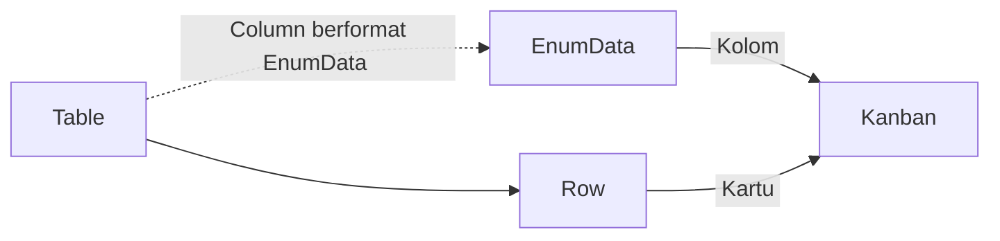

# Cara Kerja Kanban

Kanban membaca satu [[Docs/Tipe Data/Column]] berformat [[Docs/Tipe Data/EnumData]] pada [[Docs/Modul Data/Table/Apa itu Table|Table]], membuat satu kolom untuk setiap [[Docs/Tipe Data/EnumData]], lalu menempatkan setiap [[Docs/Tipe Data/Row]] sebagai kartu pada kolom sesuai nilai [[Docs/Tipe Data/Column]] tersebut.

