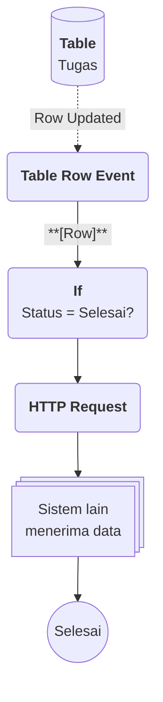

# Contoh Penggunaan Kanban

## Studi Kasus : Memantau Alur Pengerjaan Tugas Tim

Sebuah tim ingin melihat posisi setiap tugas, apakah masih direncanakan, sedang dikerjakan, atau sudah selesai. Dengan Kanban, anggota tim memindahkan kartu tugas antar kolom, dan saat tugas selesai, sistem lain langsung diberi tahu tanpa pesan manual.

## Komponen yang terlibat

| Komponen | Peran |
| -------- | ----- |
| [[^field/enum|Status Tugas]] | Menyimpan [[Docs/Tipe Data/EnumData]] tahapan kerja yang menjadi kolom Kanban. |
| [[^field/table|Tugas]] | Menyimpan [[Docs/Tipe Data/Row]] tugas dan [[^field/column|Status]] berformat [[Docs/Tipe Data/EnumData]]. |
| [[^field/kanban|Papan Tugas]] | Menampilkan setiap [[Docs/Tipe Data/Row]] [[^field/table|Tugas]] sebagai kartu pada kolom sesuai [[^field/column|Status]]. |
| [[^field/flow|Notifikasi Tugas Selesai]] | Mengirim data ke sistem lain saat [[^field/column|Status]] berubah menjadi [[^value/enumdata|Selesai]]. |

## Alur di Flow [[^field/flow|Notifikasi Tugas Selesai]]

| Langkah | Flow Block | Peran dalam alur | Hasil |
| ------- | ---------- | ---------------- | ----- |
| 1 | [[Docs/Modul Logic/Flow/Flow Block/Event/Table Row Event|Table Row Event]] | Memicu alur saat [[Docs/Tipe Data/Row]] Tugas berubah. | [[Docs/Tipe Data/Row]] tugas yang berubah. |
| 2 | [[Docs/Modul Logic/Flow/Flow Block/Operator/If|If]] | Memeriksa apakah [[^field/column|Status]] sudah [[^value/enumdata|Selesai]]. | Alur lanjut hanya untuk tugas selesai. |
| 3 | [[Docs/Modul Logic/Flow/Flow Block/Modular/HTTP Request|HTTP Request]] | Mengirim data tugas ke sistem lain. | Sistem lain menerima data tugas. |

## Hasil yang dirasakan

- Anggota tim melihat seluruh tugas dan posisinya dalam satu halaman.
- Setiap kartu menampilkan informasi yang dipilih tim, misalnya judul pada [[^field|Header]] dan penanggung jawab pada [[^field|Footer]].
- Sistem lain menerima kabar tugas selesai secara otomatis.

## Ide skenario lain

| Variasi | Contoh integrasi |
| ------- | ---------------- |
| Kartu masuk ke tahap persetujuan | [[Docs/Modul Logic/Flow/Apa itu Flow|Flow]] mengirim pemberitahuan kepada penyetuju melalui [[Docs/Modul Logic/Flow/Flow Block/Modular/HTTP Request|HTTP Request]]. |
| Kartu menumpuk pada satu tahap | [[Docs/Modul Logic/Flow/Apa itu Flow|Flow]] menghitung jumlah [[Docs/Tipe Data/Row]] per [[^field/column|Status]] lalu menyimpannya ke [[^field/variable|Variable]] untuk dipantau. |
| [[Docs/Tipe Data/Row]] baru ditambahkan | [[Docs/Modul Logic/Flow/Apa itu Flow|Flow]] mengisi [[^field/column|Status]] awal otomatis agar kartu langsung muncul di kolom pertama. |

Skenario ini menunjukkan Kanban sebagai tampilan data bertahap yang tersambung dengan data dan logika Phoenix, bukan sekadar papan visual.

