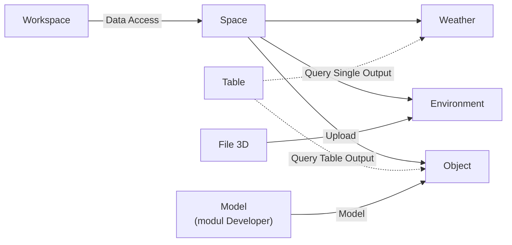
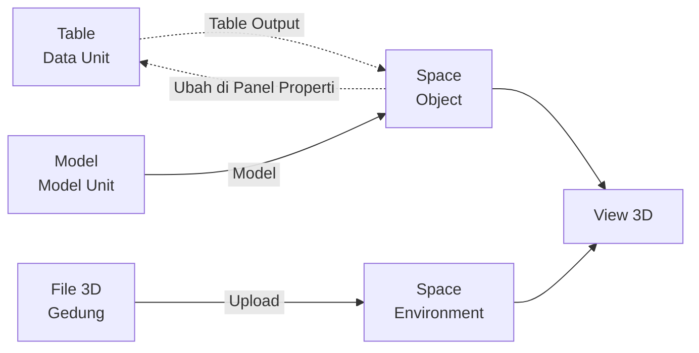

# Apa itu Space?

>**note** Space merupakan salah satu komponen dalam modul [[Docs/Modul Interface/Pengenalan|Interface]] di Phoenix.

Space adalah komponen yang menaungi dan mengorganisasi data dalam bentuk 3D (tiga dimensi).

Dengan Space, Anda dapat memvisualisasikan data beserta hubungan antar data dalam ruang tiga dimensi dan menjelajahinya dari berbagai sudut pandang, sehingga pola dan keterkaitan yang sulit terlihat pada tampilan tabel menjadi lebih mudah dipahami. Isi Space dibangun dari tiga jenis data, yaitu [[#Mengelola Weather|Weather]] untuk suasana ruang, [[#Mengelola Environment|Environment]] untuk benda statis, dan [[#Mengelola Object|Object]] untuk data riil yang tampil sebagai objek 3D.

## Mengapa Menggunakan Space?

- **Melihat pola yang tersembunyi di tabel.** Data dan hubungan antar data ditampilkan dalam ruang 3D, sehingga keterkaitan yang sulit terlihat pada [[Docs/Tipe Data/Table]] menjadi lebih mudah dipahami.
- **Menjelajah dari berbagai sudut pandang.** Anda dapat memutar, menggeser, dan memperbesar tampilan untuk melihat data dari sisi mana pun.
- **Terhubung langsung dengan data riil.** [[#Mengelola Object|Object]] memakai [[Docs/Tipe Data/Query|Query]] dengan kaidah Table Output, sehingga setiap [[Docs/Tipe Data/Row]] pada data sumber dapat tampil sebagai objek 3D.
- **Ruang yang dapat dirancang sesuai kebutuhan.** [[#Mengelola Weather|Weather]], [[#Mengelola Environment|Environment]], dan [[#Mengelola Object|Object]] dapat digabungkan dalam satu ruang untuk membentuk suasana, latar, dan data yang dipantau.
- **Mengubah nilai langsung dari panel.** Nilai pada [[#Panel Properti|Panel Properti]] dapat diubah dan, untuk Object, memengaruhi Row sebenarnya pada data sumber.

## Konsep Utama

| Istilah | Penjelasan |
| --- | --- |
| [[#Antarmuka Space|Outliner]] | Panel di sisi kiri halaman kerja yang mengelompokkan data Space menjadi Weather, Environment, dan Object beserta jumlah datanya. |
| [[#Mengelola Weather|Weather]] | Data yang tampil sebagai *world effect*, yaitu efek yang berlaku pada seluruh ruang 3D. |
| [[#Mengelola Environment|Environment]] | Data berupa benda statis tanpa logika yang dibuat dari file 3D. |
| [[#Mengelola Object|Object]] | Data berlogika yang dirender sebagai objek 3D sesuai jumlah Row hasil Query. |
| [[Docs/Tipe Data/Query]] | Pengambil data untuk Weather (kaidah Single Output) dan Object (kaidah Table Output). |
| [[Docs/Modul Developer/Model/Apa itu Model|Model]] | Komponen di modul Developer yang menyiapkan wujud dan logika Object, termasuk daftar Key. |
| [[#Mengatur Model Attribute|Model Attribute]] | Tabel yang menentukan nilai setiap Key Model pada Object, secara static atau bind. |
| [[#Panel Properti]] | Panel di sisi kanan halaman kerja untuk melihat dan mengubah nilai data yang difokuskan. |
| [[Docs/Modul Developer/Workspace/Data Access|Data Access]] | Pengaturan di Workspace yang menentukan siapa yang dapat menambah, mengubah, dan menghapus data. |

## Cara Kerja Space

Space menaungi data Weather, Environment, dan Object lalu menampilkannya bersama dalam satu ruang 3D, dengan Weather dan Object mengambil nilainya dari [[Docs/Tipe Data/Query]] sedangkan Environment memakai file 3D.

## Membuat Space

![[Docs/Modul Interface/Space/add-space.png]]
1. Buka folder tempat Space akan ditempatkan di [[Docs/Antarmuka#Area Manajemen Folder]]
2. Klik kanan ➜ [[^field/add|Add]] ➜ [[^field|Interface]] ➜ [[^field/space|Space]]
3. Isi [[^field|Name]] dan [[^field|Description]]
4. Klik [[^button|Create]]

Bagian di kiri tanda `/` pada [[^field|Name]] menunjukkan folder tempat Space ditempatkan, dan dapat dikosongkan agar Space berada di root.

>**success** Space berhasil dibuat
> Space yang baru dibuat belum memiliki data. Tambahkan [[#Mengelola Weather|Weather]], [[#Mengelola Environment|Environment]], atau [[#Mengelola Object|Object]] melalui [[#Antarmuka Space|Outliner]].

<!--

  * [DONE] Letakkan screenshot dialog Create Space pada `add-space.png`. Nama folder pada gambar (bagian kiri tanda `/`) sebaiknya memakai penamaan generik.
  * [DONE] Pada dialog Create, bagian kiri tanda `/` bertuliskan "root". Saya asumsikan perilakunya sama seperti komponen lain (folder tujuan, dapat dikosongkan). Mohon konfirmasi.
    Jawab : betul
  * [DONE] Slug ikon menu Space saya tulis `space` (`[[^field/space|Space]]`). Mohon konfirmasi.
    Jawab : betul

-->

## Mengubah Space

1. Buka halaman kerja Space
2. Klik [[^button/edit|Edit]]
3. Ubah [[^field|Name]] atau [[^field|Description]]
4. Klik [[^button|Update]]

Anda dapat klik [[^button/x|Cancel]] untuk membatalkan perubahan Space. Tombol [[^button/edit|Edit]] hanya mengubah atribut Space; untuk mengubah nilai Weather, Environment, dan Object gunakan [[#Panel Properti]].

## Menyegarkan Space

Klik [[^button/refresh|Refresh]] untuk memuat ulang tampilan.

## Menghapus Space

1. Buka folder yang berisi Space di [[Docs/Antarmuka#Area Manajemen Folder]]
2. Klik kanan Space ➜ [[^button/delete|Delete]]
3. Konfirmasi dengan klik [[^button|Delete]]

>**warning** Seluruh isi Space ikut terhapus
> Seluruh data [[#Mengelola Weather|Weather]], [[#Mengelola Environment|Environment]], dan [[#Mengelola Object|Object]] beserta konfigurasi [[Docs/Tipe Data/Query|Query]] dan [[#Mengatur Model Attribute|Model Attribute]] akan hilang. [[Docs/Tipe Data/Row]] pada data sumber tidak ikut terhapus.

<!--

  * [DONE] Dampak penghapusan Space (Row sumber tidak terhapus) adalah asumsi berdasarkan perilaku Table View dan Timeline. Mohon konfirmasi, termasuk bila ada dampak ke komponen lain.
    Jawab : betul

-->

## Antarmuka Space

![[Docs/Modul Interface/Space/interface-space.png]]
Halaman kerja Space terdiri dari bilah navigasi di bagian atas dan area kerja di bagian bawah. Bilah navigasi menampilkan ikon Space dan [[^field|Header Name]] di sisi kiri.

### Bilah navigasi Space terdiri dari:

| Tombol | Fungsi |
| --- | --- |
| [[^button/edit|Edit]] | Mengubah [[^field|Name]] dan [[^field|Description]] Space. |
| [[^button/refresh|Refresh]] | Memuat ulang tampilan halaman kerja. |
| [[^field|Search Space Data...]] | Mencari data pada Outliner berdasarkan Name, termasuk data milik Object yang jumlahnya banyak. |

### Area kerja Space

Area kerja berisi tiga bagian:

1. **View 3D** menampilkan ruang berupa grid lantai dengan penanda sumbu berwarna di titik pusat. Di sinilah Weather, Environment, dan Object ditampilkan.
2. **Outliner** di sisi kiri mengelompokkan data menjadi [[^field|Weather]], [[^field|Environment]], dan [[^field|Object]]. Angka di samping nama kelompok, misalnya `(0)`, adalah jumlah data pada kelompok tersebut.
3. **Panel Properti** di sisi kanan menampilkan nilai data yang difokuskan. Jika belum ada data yang difokuskan, panel menampilkan [[^field|No selection]]. Selengkapnya lihat [[#Panel Properti]].

>**note** Perbedaan tampilan desktop dan mobile
> Pada desktop, view 3D dikendalikan dengan mouse dan keyboard. Pada mobile, view 3D dikendalikan dengan gestur sentuh.

### Interaksi Antarmuka Space

| Fungsi | Aksi |
| --- | --- |
| Memutar sudut pandang | Tekan dan tahan klik kiri pada view 3D, lalu gerakkan kursor. |
| Menggeser tampilan | Tahan tombol Shift, lalu tekan dan tahan klik kiri pada view 3D dan gerakkan kursor. |
| Memperbesar atau memperkecil tampilan | Putar roda mouse (*wheel*) pada view 3D. |
| Memindahkan data yang difokuskan | Gunakan alat bantu pemindah yang muncul pada data yang difokuskan. |
| Menambah data | Klik kanan pada Outliner ➜ [[^field/add|Add Weather]], [[^field/add|Add Environment]], atau [[^field/add|Add Object]]. |
| Menghapus data | Klik kanan data pada Outliner ➜ [[^button/delete|Delete]]. |
| Mengendalikan view 3D di mobile | Gunakan gestur sentuh seperti biasa untuk memutar, menggeser, dan memperbesar atau memperkecil tampilan. |

<!--

  * [DONE] Letakkan screenshot halaman kerja pada `interface-space.png` dengan nama Space generik. Anotasi yang disarankan: (1) ikon dan Header Name, (2) tombol Edit, Refresh dan Search Space Data..., (3) Outliner, (4) Panel Properti, (5) view 3D dengan grid dan penanda sumbu. Saran keterangan: "Contoh gambar di atas merupakan halaman kerja Space tanpa data."
  * [TODO] Penanda sumbu berwarna di titik pusat grid belum dijelaskan penulis. Mohon konfirmasi nama dan warna masing-masing sumbu agar bisa ditulis.
    Jawaban : seperti pada 3d scene pada umumnya, x adalah merah, z adalah biru dan y ada hijau.
  * [DONE] Panah di samping nama kelompok Outliner saya asumsikan membuka dan menutup daftar data. Mohon konfirmasi.
    Jawaban : betul
  * [TODO] Alat bantu pemindah: mohon konfirmasi apakah saat ini hanya untuk memindah, apakah hasil pemindahan langsung tersimpan ke [[^field|Position]] (Environment) atau [[^field|Origin]] (Object), dan bagaimana bentuknya di layar. Penulis menyebut belum ada pergantian mode.
    Jawaban : Environment tidak bisa dipindahkan dengan alat bantu, hanya melalui panel. Origin tidak bisa diubah kecuali lewat klik kanan -> edit pada panel Outliner.
  * [TODO] Rincian gestur sentuh di mobile (jumlah jari untuk memutar, menggeser, dan memperbesar) belum diketahui. Mohon konfirmasi.
    Jawaban : semua nya menggunakan gestur sentuh jari pada umumnya. asumsikan sendiri, saya yakin anda tau.
  * [TODO] Cara memfokuskan data (klik data pada Outliner, klik objek 3D di view, atau keduanya) belum dikonfirmasi.
    Jawaban : fokus bisa dilakukan dengan klik pada outliner, atau klik langsung di 3D view. (keduanya)

-->

## Mengelola Weather

Weather adalah data yang tampil sebagai *world effect*, yaitu efek yang berlaku pada seluruh ruang 3D dan bukan pada satu benda tertentu.

| Atribut | Tipe Data | Penjelasan |
| --- | --- | --- |
| [[^field|Priority]] | [[Docs/Tipe Data/Number]] | Urutan prioritas Weather. Bila ada banyak Weather dengan Jenis yang sama, yang dipakai adalah Priority terkecil. |
| [[^field|Name]] | [[Docs/Tipe Data/String]] | Nama Weather. |
| [[^field|Description]] | [[Docs/Tipe Data/String]] | Keterangan Weather. |
| [[^field|Jenis]] | - | Jenis efek yang menentukan properti uniknya. |
| [[^field|Status]] | [[Docs/Tipe Data/Boolean]] | [[^value/boolean/true]] berarti Weather ikut dipertimbangkan, [[^value/boolean/false]] berarti diabaikan. |

Jenis Weather yang dapat digunakan saat ini:

| Jenis | Properti | Tipe Data | Penjelasan |
| --- | --- | --- | --- |
| [[^value/radio|earth sky]] | [[^field|Time]] | [[Docs/Tipe Data/DateTime]] atau [[Docs/Tipe Data/DateTimeZone]] | Waktu yang digunakan untuk langit. |
| [[^value/radio|sea]] | [[^field|Level]] | [[Docs/Tipe Data/Number]] | Level laut. |
| [[^value/radio|sea]] | [[^field|Wave Rate]] | [[Docs/Tipe Data/Number]] | Laju gelombang laut. |

Properti pada Jenis dapat berupa nilai statis atau memakai [[Docs/Tipe Data/Query|Query]] dengan kaidah [[Docs/Tipe Data/Query#Single Output|Single Output]]. Karena Query Single Output menghasilkan satu nilai hasil kalkulasi, nilai tersebut mengikuti data sumbernya.

>**note** Aturan Priority dan Status
> Hanya satu Weather untuk setiap Jenis yang berlaku, yaitu Weather dengan [[^field|Status]] [[^value/boolean/true]] dan [[^field|Priority]] terkecil. Weather dengan [[^field|Status]] [[^value/boolean/false]] tidak ikut dihitung.

### Menambahkan Weather

1. Buka halaman kerja Space
2. Klik kanan pada [[#Antarmuka Space|Outliner]] ➜ [[^field/add|Add Weather]]
3. Isi [[^field|Name]], [[^field|Description]], [[^field|Priority]], [[^field|Jenis]], dan [[^field|Status]]
4. Isi properti sesuai Jenis, secara statis atau dengan [[Docs/Tipe Data/Query|Query]]

### Mengubah Weather

1. Fokuskan Weather yang akan diubah
2. Ubah nilai pada [[#Panel Properti]]

Perubahan [[^field|Priority]] atau [[^field|Status]] dapat mengubah Weather mana yang berlaku untuk Jenis yang sama.

### Menghapus Weather

1. Klik kanan Weather pada [[#Antarmuka Space|Outliner]]
2. Klik [[^button/delete|Delete]]

>**warning** Efek Weather hilang dari ruang
> Efek Weather tidak lagi tampil di ruang 3D. Jika masih ada Weather lain dengan Jenis yang sama dan [[^field|Status]] [[^value/boolean/true]], Weather dengan [[^field|Priority]] terkecil berikutnya yang akan dipakai.

<!--

  * [TODO] Label field persis pada Weather mohon dikonfirmasi: [[^field|Jenis]] (apakah "Jenis" atau "Type"), nama pilihan Jenis (`earth sky` dan `sea`, huruf kecil atau kapital), serta label properti [[^field|Time]], [[^field|Level]], dan [[^field|Wave Rate]]. Saya menulis nama properti memakai bahasa Inggris sesuai pola antarmuka lain.
    Jawaban : lebih jelasnya [[^field|Type]], dan pilihannya titlecase. Semua properti di Phoenix menggunakan bahasa inggris.
  * [DONE] Arti Level dan Wave Rate pada sea saya tulis netral. Mohon dijelaskan fungsi masing-masing (misalnya ketinggian dan kecepatan gelombang) dan satuannya.
  * [TODO] Cara memilih antara nilai statis dan Query pada properti Weather belum diketahui (tombol atau pilihan). Mohon konfirmasi, dan sebutan sumber Query Single Output (Table, Variable, atau lainnya).
    Jawaban : dibagian field nilai properti ada toggle untuk mengisi menggunakan nilai langsung atau query.
  * [DONE] Langkah Menambahkan (dialog Create atau isian langsung), tombol penyimpan setelah mengubah nilai di panel (Update atau Save), dan konfirmasi saat Delete pada data Outliner belum diketahui. Draf di atas adalah tebakan terbaik.
    Jawaban : sudah betul.

-->

## Mengelola Environment

Environment adalah data yang tampil sebagai objek 3D statis tanpa logika. Anda cukup meng-*upload* file 3D untuk menjadikannya benda di dalam ruang, misalnya bangunan, lantai, atau perabot.

| Atribut | Tipe Data | Penjelasan |
| --- | --- | --- |
| [[^field|Name]] | [[Docs/Tipe Data/String]] | Nama Environment. |
| [[^field|Description]] | [[Docs/Tipe Data/String]] | Keterangan Environment. |
| [[^field|Position]] | [[Docs/Format Data/Complex/3D Vector|3D Vector]] | Posisi Environment di ruang 3D. |
| [[^field|Scale]] | [[Docs/Format Data/Complex/Volume Unit|Volume Unit]] | Ukuran (skala) Environment. |
| [[^field|Rotation]] | [[Docs/Format Data/Complex/Euler Angle|Euler Angle]] | Rotasi Environment. |
| [[^field|Model]] | [[Docs/Format Data/File/3D Model|3D Model]] | File 3D yang menjadi wujud Environment. |

### Menambahkan Environment

1. Buka halaman kerja Space
2. Klik kanan pada [[#Antarmuka Space|Outliner]] ➜ [[^field/add|Add Environment]]
3. Isi [[^field|Name]] dan [[^field|Description]]
4. Upload file 3D pada [[^field|Model]]
5. Atur [[^field|Position]], [[^field|Scale]], dan [[^field|Rotation]]

### Mengubah Environment

1. Fokuskan Environment yang akan diubah
2. Ubah nilai pada [[#Panel Properti]]

Environment hanya berisi data statis, sehingga perubahan nilai tidak memengaruhi data sumber lain.

### Menghapus Environment

1. Klik kanan Environment pada [[#Antarmuka Space|Outliner]]
2. Klik [[^button/delete|Delete]]

>**warning** Benda hilang dari ruang
> Environment yang dihapus tidak lagi tampil di ruang 3D. File 3D yang pernah di-*upload* tidak dipakai lagi oleh Space.

<!--

  * [DONE] Label atribut Environment pada antarmuka mohon dikonfirmasi: base knowledge menulis "Desc" sedangkan Weather menulis "Description". Saya memakai [[^field|Description]].
    Jawaban : asumsi anda sudah betul.
  * [TODO] Format Data untuk [[^field|Rotation]] (Euler Angle) dan [[^field|Model]] (3D Model) belum ada di daftar Format Data, tautan di atas adalah tebakan. Mohon konfirmasi nama dan path-nya.
    Jawaban : saya akan menambahkan tipe data Model dan format data Euler Angle.
  * [TODO] Makna [[^field|Scale]] bertipe Volume Unit (satu nilai atau per sumbu) dan format file 3D yang didukung belum diketahui.
    Jawaban : Volume Unit memiliki 3 nilai x, y dan z.
  * [TODO] Nasib file 3D setelah Environment dihapus (tersimpan atau tidak di penyimpanan) adalah asumsi. Mohon konfirmasi.
    Jawaban : Iya ikut terhapus.

-->

## Mengelola Object

Object adalah data berlogika yang tampil sebagai objek 3D. Object mengambil datanya dari [[Docs/Tipe Data/Query|Query]] dengan kaidah [[Docs/Tipe Data/Query#Table Output|Table Output]], sehingga yang dirender adalah data riil, bukan hasil kalkulasi. Satu Object dapat menghasilkan banyak objek 3D, sebanyak [[Docs/Tipe Data/Row]] hasil Query.

| Atribut | Tipe Data | Penjelasan |
| --- | --- | --- |
| [[^field|Name]] | [[Docs/Tipe Data/String]] | Nama Object. |
| [[^field|Description]] | [[Docs/Tipe Data/String]] | Keterangan Object. |
| [[^field|Origin]] | [[Docs/Format Data/Complex/3D Vector|3D Vector]] | Titik asal Object di ruang 3D. |
| [[^field|Model]] | - | Model yang menjadi wujud dan logika Object, disiapkan di komponen [[Docs/Modul Developer/Model/Apa itu Model|Model]] pada modul Developer. |
| [[^field|Query]] | [[Docs/Tipe Data/Query]] | Pengambil data dengan kaidah Table Output. Klik [[^button/q]] untuk membuka popup Query. |

Karena logika Object yang kompleks disiapkan di komponen Model, daftar Key yang dapat diisi mengikuti Model yang dipilih pada [[^field|Model]].

### Mengatur Model Attribute

Ketika [[^field|Query]] sudah diisi, tabel [[^field|Model Attribute]] akan tampil dengan kolom [[^field|Key]], [[^field|Static]], dan [[^field|Value]]. Kolom [[^field|Static]] berisi pilihan radio yang menentukan cara nilai atribut diisi:

| Pilihan | Value yang diisi | Hasil pada objek 3D |
| --- | --- | --- |
| [[^value/radio|static]] | Nilai bebas sesuai kebutuhan. | Seluruh objek 3D yang dirender memiliki nilai atribut yang sama. |
| [[^value/radio|bind]] | Kolom yang tersedia pada [[Docs/Tipe Data/Query|Query]]. | Nilai atribut tiap objek 3D mengikuti [[Docs/Tipe Data/Row]] masing-masing. |

Perlu diketahui bahwa Query dapat memanggil banyak data. Jika atribut bernilai [[^value/radio|static]], semua objek 3D yang dirender akan memiliki nilai atribut yang sama, sedangkan atribut [[^value/radio|bind]] dapat berbeda pada setiap objek 3D.

### Menambahkan Object

1. Buka halaman kerja Space
2. Klik kanan pada [[#Antarmuka Space|Outliner]] ➜ [[^field/add|Add Object]]
3. Isi [[^field|Name]], [[^field|Description]], dan [[^field|Origin]]
4. Pilih [[^field|Model]]
5. Isi [[^field|Query]] dengan klik [[^button/q]]
6. Atur [[^field|Model Attribute]] pada kolom [[^field|Static]] dan [[^field|Value]]

### Mengubah Object

1. Fokuskan Object yang akan diubah
2. Ubah nilai pada [[#Panel Properti]]

Nilai yang diubah pada Object memengaruhi [[Docs/Tipe Data/Row]] sebenarnya pada data sumber, selama [[#Hak Akses Space|hak akses]] mengizinkan.

### Menghapus Object

1. Klik kanan Object pada [[#Antarmuka Space|Outliner]]
2. Klik [[^button/delete|Delete]]

>**warning** Objek 3D hilang dari ruang
> Seluruh objek 3D milik Object tidak lagi tampil di ruang, dan konfigurasi [[^field|Query]] serta [[^field|Model Attribute]] ikut terhapus. [[Docs/Tipe Data/Row]] pada data sumber tidak ikut terhapus.

<!--

  * [TODO] Makna [[^field|Origin]] pada Object belum dijelaskan (titik asal seluruh objek 3D atau titik asal tiap Row). Mohon dijelaskan agar bisa ditulis lebih tepat.
    Jawaban : titik asal tiap row.
  * [DONE] Pemilihan [[^field|Model]] pada Object saya asumsikan berupa pilihan komponen Model. Mohon konfirmasi bentuk isiannya (placeholder, bila ada) dan tipe datanya.
    Jawaban : sudah betul. menggunakan tipe data Model.
  * [DONE] Dampak hapus Object (Row sumber tidak terhapus) adalah asumsi berdasarkan perilaku Table View. Mohon konfirmasi.
    Jawaban : Betul
  * [TODO] Letak tombol [[^button/q]] pada Object dan apakah Query tersimpan otomatis saat popup ditutup (seperti Table View) belum dikonfirmasi.
    Jawaban : letak tombol pada object hanya di modal Object. Tidak dapat muncul langsung di antarmuka (seperti Table View).

-->

## Panel Properti

Panel Properti tampil di sisi kanan halaman kerja. Selama belum ada data yang difokuskan, panel menampilkan [[^field|No selection]]. Ketika Anda memfokuskan data, panel menampilkan propertinya dan nilai tersebut dapat diubah.

Pengaruh perubahan nilai berbeda untuk tiap jenis data:

| Jenis Data | Sumber nilai | Pengaruh perubahan di panel |
| --- | --- | --- |
| [[#Mengelola Weather|Weather]] | Nilai statis atau [[Docs/Tipe Data/Query#Single Output|Single Output]] (hasil kalkulasi) | Tidak memengaruhi Row pada data sumber. |
| [[#Mengelola Environment|Environment]] | Data statis | Tidak memengaruhi Row pada data sumber. |
| [[#Mengelola Object|Object]] | [[Docs/Tipe Data/Query#Table Output|Table Output]] (data riil) | Memengaruhi [[Docs/Tipe Data/Row]] sebenarnya pada data sumber. |

>**warning** Perubahan pada Object mengubah data sumber
> Nilai yang diubah pada Object tersimpan ke data sumber dan terlihat oleh komponen lain yang memakai Row yang sama. Perubahan hanya berhasil bila [[#Hak Akses Space|Data Access]] sumber mengizinkan.

<!--

  * [TODO] Mohon konfirmasi pengaruh perubahan pada Weather dan Environment: saya menulis "tidak memengaruhi Row pada data sumber" karena keduanya bukan Table Output. Mohon jelaskan apakah perubahan itu hanya mengubah konfigurasi data di Space.
    Jawaban : Iya betul
  * [TODO] Mohon konfirmasi bagaimana atribut [[^value/radio|static]] pada Object berperilaku saat diubah lewat panel (mengubah konfigurasi untuk semua objek 3D atau tidak) serta apakah [[^field|Origin]] ikut memengaruhi Row.
    Jawaban : Mengubah atribut menjadi static akan mengubah atribut objek 3d yang dirender, semisal atribut on pada model lampu, ketika static menjadi on = true, maka semua lampu dalam tampilan menjadi menyala. Origin tidak mempengaruhi Row karena bersifat sebagai anchor untuk render model 
  * [TODO] Mohon konfirmasi apakah panel menampilkan tombol penyimpan atau perubahan langsung diterapkan.
    Jawaban : tidak ada tombol penyimpanan, perubahan langsung diterapkan seketika (dalam field bersifat teks tetap ada debounce sekitar 300ms, untuk toggle atau option terjadi seketika).

-->

## Hak Akses Space

Space mengikuti pengaturan di [[Docs/Modul Developer/Workspace/Apa itu Workspace|Workspace]]:

| Hak Akses | Pengaruh pada Space |
| --- | --- |
| Comp. Access | Mengatur apakah Space terlihat ([[^field|Visible]]), serta dapat diubah ([[^field|Update]]) atau dihapus ([[^field|Delete]]). |
| Data Access | Satu pengaturan [[Docs/Modul Developer/Workspace/Data Access|Data Access]] mewakili ketiga jenis data (Weather, Environment, dan Object) untuk menambah ([[^field|Add]]), mengubah ([[^field|Update]]), dan menghapus ([[^field|Delete]]) data. |
| Data Access sumber | Pada Object, perubahan yang memengaruhi Row sumber hanya berhasil bila Data Access data sumber (misalnya [[Docs/Tipe Data/Table]]) juga mengizinkan. |

<!--

  * [DONE] Pemetaan hak akses di atas (Add untuk Add Weather/Environment/Object, Update untuk mengubah nilai, Delete untuk menghapus data) adalah tebakan terbaik. Mohon konfirmasi dan sesuaikan dengan halaman Data Access.
    Jawaban : Sudah betul

-->

## Contoh Penggunaan

**Memantau Kondisi Unit Operasional di Area Gudang secara 3D**

Tim operasional ingin melihat posisi dan kondisi seluruh unit di sebuah area gudang sekaligus, tanpa membaca baris demi baris di tabel. Dengan Space, data unit tampil sebagai objek 3D di dalam denah gudang, sehingga unit yang menumpuk atau bermasalah langsung terlihat dari sudut pandang mana pun.

**Komponen yang terlibat**

| Komponen | Peran |
| --- | --- |
| [[^field/table|Data Unit]] | Menyimpan data setiap unit: identitas, posisi, dan status. |
| [[^field/model|Model Unit]] | Menyiapkan wujud dan logika unit, termasuk daftar Key. |
| [[^field/space|Denah Gudang]] | Menampilkan gedung, suasana, dan unit dalam satu ruang 3D. |
| [[^field/tableview|Daftar Unit]] | Menampilkan data yang sama dalam bentuk tabel untuk dicek bersama. |

**Alur penggunaan**

| Langkah | Komponen | Peran dalam alur | Hasil |
| --- | --- | --- | --- |
| 1 | [[^field/table|Data Unit]] | Menyiapkan data unit sebagai sumber. | Data riil siap dipakai. |
| 2 | [[Docs/Modul Developer/Model/Apa itu Model|Model]] | Menyiapkan wujud unit dan daftar Key. | Object memiliki wujud 3D. |
| 3 | [[#Mengelola Environment|Environment]] | Meng-upload file 3D gedung. | Denah gudang tampil sebagai latar. |
| 4 | [[#Mengelola Object|Object]] | Mengisi [[^field|Query]] dan memilih [[^value/radio|bind]] pada [[^field|Model Attribute]]. | Satu objek 3D tampil untuk setiap unit dengan kondisi masing-masing. |
| 5 | [[#Mengelola Weather|Weather]] | Menambahkan Jenis [[^value/radio|earth sky]] dengan [[^field|Time]] dari [[Docs/Tipe Data/Query#Single Output|Single Output]]. | Suasana langit mengikuti waktu dari data sumber. |
| 6 | [[#Panel Properti]] | Fokus pada satu unit lalu ubah nilainya. | Row unit pada sumber ikut diperbarui. |

**Hasil yang dirasakan**

- Tim melihat sebaran dan kondisi seluruh unit dalam satu pandangan, lalu memutar dan memperbesar tampilan untuk memeriksa area tertentu.
- Perubahan status unit dari [[#Panel Properti]] langsung tersimpan ke data sumber, sehingga [[Docs/Modul Interface/Table View/Apa itu Table View|Table View]] yang menampilkan data yang sama ikut menyesuaikan.
- Data yang sama bisa dibaca sebagai tabel maupun sebagai ruang, tergantung kebutuhan.

**Ide skenario lain**

| Jenis nilai | Contoh integrasi |
| --- | --- |
| Lokasi aset | Object menampilkan setiap aset pada denah, dengan posisi dari kolom [[Docs/Tipe Data/Table|Table]] yang di-*bind*. |
| Status mesin | Object menampilkan status tiap mesin pada Model, dengan atribut status di-*bind* ke kolom Query. |
| Kondisi lingkungan | Weather [[^value/radio|sea]] memakai [[^field|Level]] dan [[^field|Wave Rate]] dari Query Single Output untuk memantau kondisi perairan. |
| Tata ruang | Environment menampilkan bangunan atau perabot statis sebagai latar data yang dipantau. |

Dengan menggabungkan Environment, Object, dan Weather, Space mengubah data tabel menjadi ruang yang dapat dijelajahi dan langsung terhubung dengan sumber datanya.

<!--

  * [DONE] Nama komponen pada contoh (Data Unit, Model Unit, Denah Gudang, Daftar Unit) adalah nama generik. Mohon disesuaikan dengan gambar bila perlu.
  * [DONE] Contoh skenario memakai atribut Model yang tidak ditentukan (misalnya status) dan Query Single Output untuk [[^field|Time]]. Mohon konfirmasi apakah skenario ini cocok dengan kemampuan Model dan Query yang ada.
    Jawaban : Sudah oke
  * [DONE] Slug ikon [[^field/model|Model Unit]] dan [[^field/space|Denah Gudang]] (`model`, `space`) adalah tebakan.
    Jawbaan : Sudah oke
  * [DONE] Skenario ini tidak memakai [[Docs/Modul Logic/Flow/Apa itu Flow|Flow]]. Mohon kabari bila ingin ditambahkan otomasi (misalnya memperbarui Row unit lewat Flow Block).
    Jawaban : tidak perlu, skenario ini sudah oke untuk Space

-->

## Praktik Terbaik

- **Pisahkan benda tetap dan data yang berubah.** Gunakan [[#Mengelola Environment|Environment]] untuk benda statis seperti bangunan, dan [[#Mengelola Object|Object]] untuk data riil yang perlu dipantau.
- **Beri [[^field|Priority]] yang berurutan pada Weather.** Dengan begitu Anda mudah menentukan Weather mana yang berlaku untuk setiap Jenis, dan mudah menyiapkan cadangan bila [[^field|Status]] diubah menjadi [[^value/boolean/false]].
- **Pilih [[^value/radio|bind]] untuk nilai yang berbeda tiap data** dan [[^value/radio|static]] untuk nilai yang sama bagi semua objek 3D pada [[#Mengatur Model Attribute|Model Attribute]].
- **Siapkan [[Docs/Modul Developer/Model/Apa itu Model|Model]] terlebih dahulu** sebelum membuat Object, karena daftar [[^field|Key]] mengikuti Model yang dipilih.
- **Batasi [[Docs/Modul Developer/Workspace/Data Access|Data Access]]** bagi pengguna yang hanya perlu melihat, agar perubahan di [[#Panel Properti]] tidak mengubah Row sumber secara tidak sengaja.

>**success** Mulai dari yang sederhana
> Mulailah dengan satu [[#Mengelola Environment|Environment]] sebagai latar dan satu [[#Mengelola Object|Object]] dengan [[Docs/Tipe Data/Query|Query]] kecil, lalu tambahkan [[#Mengelola Weather|Weather]] setelah ruang terasa pas.

## Batasan dan Catatan

- [[#Mengelola Weather|Weather]] dengan Jenis yang sama hanya diambil satu: [[^field|Status]] [[^value/boolean/true]] dengan [[^field|Priority]] terkecil.
- [[#Mengelola Environment|Environment]] bersifat statis tanpa logika. Untuk logika, gunakan [[#Mengelola Object|Object]] dengan [[Docs/Modul Developer/Model/Apa itu Model|Model]].
- Perubahan di [[#Panel Properti]] hanya memengaruhi Row pada data sumber untuk Object. Weather memakai Query Single Output (hasil kalkulasi) dan Environment berisi data statis.
- Atribut [[^value/radio|static]] bernilai sama untuk seluruh objek 3D, sedangkan [[^value/radio|bind]] mengikuti Row masing-masing.
- Satu pengaturan [[Docs/Modul Developer/Workspace/Data Access|Data Access]] di Workspace mewakili Weather, Environment, dan Object.
- Alat bantu pemindah pada data yang difokuskan belum memiliki pergantian mode.
- [[^field|Search Space Data...]] mencari berdasarkan Name data pada Outliner.

## TL:DR

- **Definisi:** Space menaungi dan mengorganisasi data dalam bentuk 3D agar pola dan keterkaitan lebih mudah dipahami.
- **Antarmuka:** halaman kerja berisi view 3D, Outliner di kiri, dan [[#Panel Properti]] di kanan. Putar dengan klik kiri, geser dengan Shift + klik kiri, dan zoom dengan *wheel*.
- **Membangun:** tambahkan [[#Mengelola Weather|Weather]], [[#Mengelola Environment|Environment]], dan [[#Mengelola Object|Object]] lewat klik kanan pada Outliner.
- **Mengisi data:** Weather memakai nilai statis atau Query Single Output, Environment memakai file 3D, dan Object memakai Query Table Output dengan [[#Mengatur Model Attribute|Model Attribute]].
- **Mengubah:** nilai diubah di [[#Panel Properti]], dan hanya perubahan pada Object yang memengaruhi Row sumber sesuai [[#Hak Akses Space|hak akses]].
- **Hati-hati:** menghapus Space atau data menghilangkan konfigurasinya, dan [[^field|Priority]] serta [[^field|Status]] menentukan Weather yang berlaku.

## FAQ : Pertanyaan yang Sering Diajukan

> **faq**
> **Apa perbedaan Environment dan Object?**
> [[#Mengelola Environment|Environment]] adalah benda statis tanpa logika yang dibuat dari file 3D. [[#Mengelola Object|Object]] memiliki logika yang disiapkan di [[Docs/Modul Developer/Model/Apa itu Model|Model]] dan mengambil data riil lewat [[Docs/Tipe Data/Query|Query]] Table Output.
> **Mengapa Weather yang saya tambahkan tidak berlaku?**
> Hanya satu Weather untuk setiap Jenis yang berlaku. Pastikan [[^field|Status]] bernilai [[^value/boolean/true]] dan [[^field|Priority]]-nya paling kecil dibanding Weather lain dengan Jenis yang sama.
> **Mengapa semua objek 3D pada Object tampil sama?**
> Periksa kolom [[^field|Static]] pada [[#Mengatur Model Attribute|Model Attribute]]. Atribut [[^value/radio|static]] bernilai sama untuk semua objek 3D, pilih [[^value/radio|bind]] agar nilainya mengikuti kolom [[Docs/Tipe Data/Query|Query]].
> **Apakah mengubah nilai di Panel Properti mengubah data sumber?**
> Hanya untuk [[#Mengelola Object|Object]]. Perubahan memengaruhi [[Docs/Tipe Data/Row]] sebenarnya selama [[Docs/Modul Developer/Workspace/Data Access|Data Access]] sumber mengizinkan. Untuk [[#Mengelola Weather|Weather]] dan [[#Mengelola Environment|Environment]], perubahan tidak memengaruhi Row sumber.
> **Mengapa saya tidak bisa menambah atau menghapus data di Outliner?**
> Penambahan dan penghapusan data mengikuti [[Docs/Modul Developer/Workspace/Data Access|Data Access]] Space di Workspace. Hubungi pengelola Workspace Anda untuk memeriksa pengaturannya.
> **Bagaimana cara mencari data di Space?**
> Gunakan [[^field|Search Space Data...]] pada bilah navigasi untuk mencari data di Outliner berdasarkan Name, termasuk data yang jumlahnya banyak pada [[#Mengelola Object|Object]].