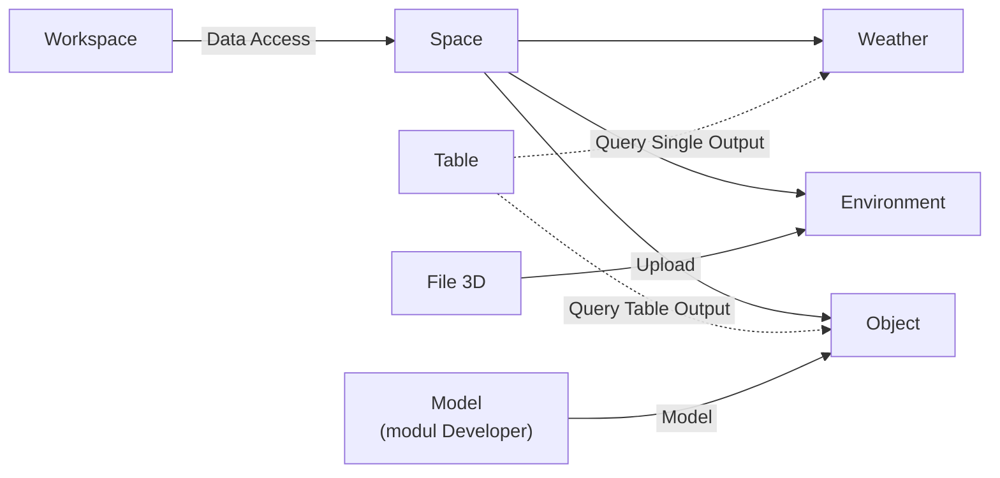

# Cara Kerja Space

Space menaungi data Weather, Environment, dan Object lalu menampilkannya bersama dalam satu ruang 3D, dengan Weather dan Object mengambil nilainya dari [[Docs/Tipe Data/Query]] sedangkan Environment memakai file 3D.

