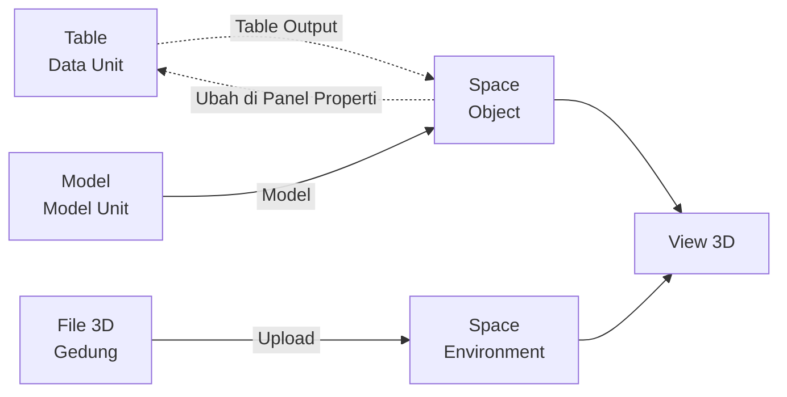

# Contoh Penggunaan Space

## Studi Kasus : Memantau Kondisi Unit Operasional di Area Gudang secara 3D

Tim operasional ingin melihat posisi dan kondisi seluruh unit di sebuah area gudang sekaligus, tanpa membaca baris demi baris di tabel. Dengan Space, data unit tampil sebagai objek 3D di dalam denah gudang, sehingga unit yang menumpuk atau bermasalah langsung terlihat dari sudut pandang mana pun.

## Komponen yang terlibat

| Komponen | Peran |
| --- | --- |
| [[^field/table|Data Unit]] | Menyimpan data setiap unit: identitas, posisi, dan status. |
| [[^field/model|Model Unit]] | Menyiapkan wujud dan logika unit, termasuk daftar Key. |
| [[^field/space|Denah Gudang]] | Menampilkan gedung, suasana, dan unit dalam satu ruang 3D. |
| [[^field/tableview|Daftar Unit]] | Menampilkan data yang sama dalam bentuk tabel untuk dicek bersama. |

## Alur penggunaan

| Langkah | Komponen | Peran dalam alur | Hasil |
| --- | --- | --- | --- |
| 1 | [[^field/table|Data Unit]] | Menyiapkan data unit sebagai sumber. | Data riil siap dipakai. |
| 2 | [[Docs/Modul Developer/Model/Apa itu Model|Model]] | Menyiapkan wujud unit dan daftar Key. | Object memiliki wujud 3D. |
| 3 | [[#Mengelola Environment|Environment]] | Meng-upload file 3D gedung. | Denah gudang tampil sebagai latar. |
| 4 | [[#Mengelola Object|Object]] | Mengisi [[^field|Query]] dan memilih [[^value/radio|bind]] pada [[^field|Model Attribute]]. | Satu objek 3D tampil untuk setiap unit dengan kondisi masing-masing. |
| 5 | [[#Mengelola Weather|Weather]] | Menambahkan Weather dengan [[^field|Type]] [[^value/radio|Earth Sky]] dan [[^field|Time]] dari [[Docs/Tipe Data/Query#Single Output|Single Output]]. | Suasana langit mengikuti waktu dari data sumber. |
| 6 | [[#Panel Properti]] | Fokus pada satu unit lalu ubah nilainya. | Row unit pada sumber ikut diperbarui. |

## Hasil yang dirasakan

- Tim melihat sebaran dan kondisi seluruh unit dalam satu pandangan, lalu memutar dan memperbesar tampilan untuk memeriksa area tertentu.
- Perubahan status unit dari [[#Panel Properti]] langsung tersimpan ke data sumber, sehingga [[Docs/Modul Interface/Table View/Apa itu Table View|Table View]] yang menampilkan data yang sama ikut menyesuaikan.
- Data yang sama bisa dibaca sebagai tabel maupun sebagai ruang, tergantung kebutuhan.

## Ide skenario lain

| Jenis nilai | Contoh integrasi |
| --- | --- |
| Lokasi aset | Object menampilkan setiap aset pada denah, dengan posisi dari kolom [[Docs/Tipe Data/Table|Table]] yang di-*bind*. |
| Status mesin | Object menampilkan status tiap mesin pada Model, dengan atribut status di-*bind* ke kolom Query. |
| Kondisi lingkungan | Weather [[^value/radio|Sea]] memakai [[^field|Level]] dan [[^field|Wave Rate]] dari Query Single Output untuk memantau kondisi perairan. |
| Tata ruang | Environment menampilkan bangunan atau perabot statis sebagai latar data yang dipantau. |

Dengan menggabungkan Environment, Object, dan Weather, Space mengubah data tabel menjadi ruang yang dapat dijelajahi dan langsung terhubung dengan sumber datanya.