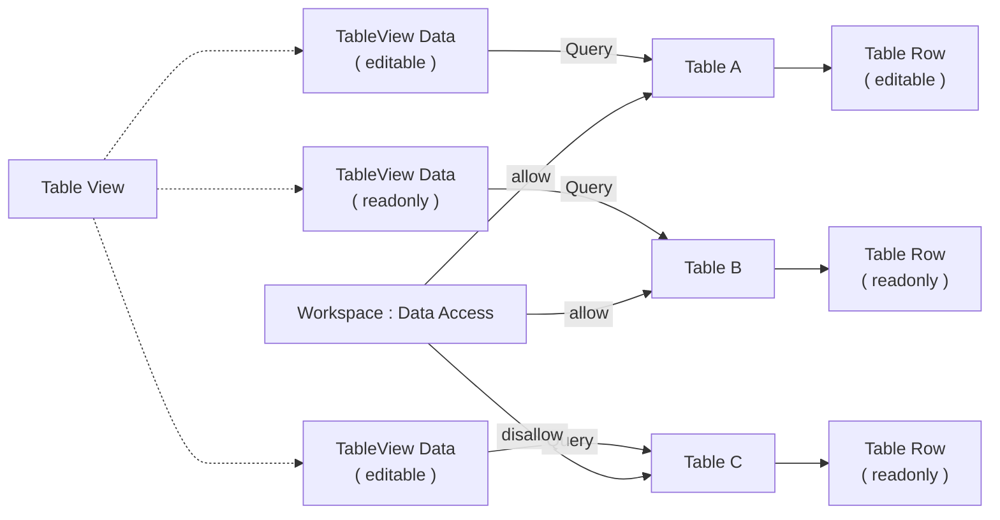

# Apa itu Table View?

>**note** Table View merupakan salah satu komponen dalam modul [[Docs/Modul Interface/Pengenalan|Interface]] di Phoenix.

Table View (atau TableView) adalah komponen antarmuka yang dapat digunakan untuk menampilkan data [[Docs/Modul Data/Table/Apa itu Table|Table]] menggunakan [[Docs/Tipe Data/Query|Query]].

Satu Table View dapat memiliki lebih dari satu Data. Setiap Data menampung satu Query, sebuah nama, dan konfigurasi tampilannya sendiri, sehingga Anda dapat menyajikan beberapa tampilan Table dalam satu halaman dengan kolom dan filter yang berbeda-beda. [[Docs/Tipe Data/Row]] tetap dapat ditambah, diubah, dan dihapus langsung dari tampilan, seperti pada Table.

## Mengapa Menggunakan Table View?
- **Banyak tampilan dalam satu halaman.** Tampilkan beberapa Data sekaligus, baik dari Table yang sama maupun dari Table yang berbeda.
- **Kolom yang dapat dikontrol.** Tampilkan hanya kolom yang dibutuhkan dengan [[Docs/Tipe Data/Query#Show dan Hide|Show/Hide]] di Query.
- **Data yang dapat difilter.** Tambahkan kondisi [[Docs/Tipe Data/Query#Where|Where]] di Query agar Data hanya memuat Row yang relevan.
- **Dapat langsung dikelola.** Tambah, ubah, dan hapus Row tanpa berpindah ke halaman Table.
- **Row baru tidak hilang.** Kolom yang menjadi syarat filter akan terisi otomatis saat Row ditambahkan, sehingga Row tetap relevan dengan kondisi Query-nya.

## Konsep Utama

| Istilah | Penjelasan |
| ------- | ---------- |
| Data | Satu unit tampilan pada Table View yang menampung nama, konfigurasi tampilan dan [[Docs/Tipe Data/Query]]. Satu Table View dapat memiliki lebih dari satu Data. |
| [[Docs/Tipe Data/Query]] | Tipe data yang merumuskan [[Docs/Tipe Data/Row]] yang tampil pada setiap Data. |
| [[Docs/Tipe Data/Query#Show dan Hide\|Show/Hide]] | Pengaturan di [[Docs/Tipe Data/Query]] untuk menampilkan atau menyembunyikan kolom tertentu. |
| [[Docs/Tipe Data/Query#Where\|Where]] | Kondisi di [[Docs/Tipe Data/Query]] untuk memfilter [[Docs/Tipe Data/Row]] yang tampil. |

## Cara Kerja Table View

Table View menjalankan [[Docs/Tipe Data/Query|Query]] pada setiap Data, lalu menampilkan hasilnya sebagai tabel [[Docs/Tipe Data/Row]] yang dapat dikelola langsung (_editable_) atau hanya dapat dibaca (_readonly_).

## Membuat Table View

![[Docs/Modul Interface/Table View/add-tableview.png]]
1. Buka folder tempat Table View akan ditempatkan di [[Docs/Antarmuka#Area Manajemen Folder]]
2. Periksa [[^field|Directory]] yang terisi otomatis sesuai folder yang Anda klik kanan, atau pilih folder lain. Biarkan kosong untuk letak _root_.
3. Klik kanan ➜ [[^field/add|Add]] ➜ [[^field|Interface]] ➜ [[^field/tableview|Table View]]
4. Isi [[^field|Name]] dan [[^field|Description]]
5. Klik [[^button|Create]]

>**success** Table View berhasil dibuat
> Table View yang baru dibuat belum memiliki Data. Tambahkan Data di [[#Mengelola Data Table View]].

## Mengubah Table View

1. Buka halaman kerja Table View
2. Klik [[^button/edit|Edit]]
3. Ubah [[^field|Name]] atau [[^field|Description]]
4. Klik [[^button|Update]]

## Menyegarkan Table View

Klik [[^button/refresh|Refresh]] untuk memuat ulang tampilan. [[Docs/Tipe Data/Query]] pada setiap Data disegarkan kembali, sehingga [[Docs/Tipe Data/Row]] yang tidak lagi memenuhi syarat Query tidak ditampilkan lagi.

## Menghapus Table View

1. Buka folder yang berisi Enum di [[Docs/Antarmuka#Area Manajemen Folder]]
2. Klik kanan Enum ➜ [[^button/delete|Delete]]
3. Konfirmasi dengan klik [[^button|Delete]]

Buka folder yang berisi Table View, klik kanan Table View, pilih [[^button/delete|Delete]], lalu konfirmasi dengan [[^button|Delete]].

>**warning** Seluruh Data ikut terhapus
> Menghapus Table View secara otomatis akan menghapus seluruh Data di dalamnya beserta [[Docs/Tipe Data/Query]] dan konfigurasi tampilannya. [[Docs/Modul Data/Table/Apa itu Table|Table]] yang menjadi sumber [[Docs/Tipe Data/Query]] dan [[Docs/Tipe Data/Row]] di dalamnya tidak ikut terhapus.

## Antarmuka Table View

![[Docs/Modul Interface/Table View/interface-tableview.png]]
Halaman kerja Table View terdiri dari bilah navigasi di bagian atas dan area Data di bagian bawah. Setiap Data tampil sebagai tabel yang dapat dilipat, dan Data baru ditambahkan lewat tombol [[^button/add|Add Data]] di bagian paling bawah.

Contoh gambar diatas merupakan halaman kerja Table View dengan dua Data bernama [[^field|On Progress...]] dan [[^field|Done belum diambil]].

### Bilah navigasi Table View terdiri dari:

| Elemen | Fungsi |
| ------ | ------ |
| Judul | Menampilkan ikon Table View dan [[^field\|Header Name]]. |
| [[^button/edit\|Edit]] | Mengubah atribut Table View. |
| [[^button/refresh\|Refresh]] | Memuat ulang tampilan dan menjalankan kembali Query pada setiap Data. |
| [[^field\|Search TableView Data...]] | Mencari kata kunci di semua kolom pada Data. |

### Bagian Data terdiri dari:

| Elemen | Fungsi |
| ------ | ------ |
| Judul Data | Menampilkan ikon panah, nama Data, dan angka jumlah [[Docs/Tipe Data/Row]] dalam tanda kurung. |
| [[^value/radio|full]], [[^value/radio/|half]], [[^value/radio|quarter]] | Menentukan porsi layar yang ditempati Data. Selengkapnya lihat [[#Mengatur Tampilan Data]]. |
| Tombol [[^button|Q]] | Membuka pengaturan [[Docs/Tipe Data/Query]] untuk Data tersebut. |
| Kolom Data | Menampilkan kolom hasil [[Docs/Tipe Data/Query]], ditambah [[^field\|Action]] di akhir |
| Baris Data | Menampilkan baris hasil [[Docs/Tipe Data/Query]], ditambah tombol [[^button/save|Save]] dan [[^button/delete|Delete]] |
| [[^button/add|Add Row]] | Menambahkan baris pada sumber Data. |
| [[^field|Show _ of _ items, on page]], [[^button/empty|Go]], [[^button/left|Prev]], [[^button/right|Next]] | Informasi jumlah Row dan perpindahan halaman, sama seperti pada [[Docs/Modul Data/Table/Apa itu Table|Table]]. |
| [[^field|Empty]] | Muncul pada Data yang [[Docs/Tipe Data/Query]]-nya belum diisi. |
| Error | Muncul ketika ada kesalahan dalam Query. Selengkapnya lihat [[Docs/Tipe Data/Query#Error]]

### Interaksi Antarmuka Table View

| Fungsi | Aksi |
| ------ | ---- |
| Melipat atau membuka Data | Klik judul Data. |
| Membuka menu konteks Data | Klik kanan pada judul Data, lalu pilih [[^field/edit\|Rename]], [[^field/add\|Add Row]], [[^field/add\|Add Data]], atau [[^field/delete\|Delete Data]]. |

## Mengelola Data Table View

Data adalah isi dari Table View. Setiap Data menampung satu Query, nama, dan konfigurasi tampilan.

### Menambahkan Data

1. Buka halaman kerja Table View
2. Klik [[^button/add|Add Data]] di bagian bawah halaman, atau klik kanan Data lain ➜ [[^field/add|Add Data]]
3. Data baru tampil dengan Query kosong, ditandai [[^field|Empty]]
4. Isi Query di [[#Mengatur Query]]
   
### Mengatur Tampilan Data

Klik salah satu pilihan tampilan pada bagian atas Data:

| Pilihan | Porsi layar |
| ------- | ----------- |
| [[^button\|full]] | Seluruh layar. |
| [[^button\|half]] | Setengah layar. |
| [[^button\|quarter]] | Seperempat layar. |

### Mengatur Query

1. Klik  [[^button/q]] pada Data yang ingin diatur
2. Isi Query sesuai dengan kaidah [[Docs/Tipe Data/Query#Table Output]]
3. Klik bagian luar konfigurasi Query agar menutup popup
4. Perubahan akan tersimpan secara otomatis dan hasil Query dapat dilihat pada Data

>**note** Query wajib memakai header Table
> Query pada Table View harus diisi dengan kaidah yang tepat. Jika Query belum diisi atau outputnya tidak valid, Data menampilkan pesan error seperti[[^field|Query table output is not valid!]].

### Mengubah Nama Data

Klik kanan Data ➜ [[^field/edit|Rename]], ubah nama, lalu simpan dengan klik [[^button/ok|Ok]].

### Menghapus Data

Klik kanan Data ➜ [[^field/delete|Delete Data]], lalu konfirmasi dengan [[^button|Delete]].

>**warning** Query dan konfigurasi Data ikut terhapus
> Menghapus Data hanya menghapus Query dan konfigurasi tampilannya dari Table View. Table sumber beserta Row di dalamnya tidak terhapus.

## Mengelola Row pada Data

Row ditambahkan dan diisi seperti pada komponen Table. Cara mengisi setiap Format Column dijelaskan di [[Docs/Modul Data/Table/Apa itu Table#Mengelola Data Table]].

>**note** Kolom yang Terisi Otomatis
> Data hanya menampilkan baris yang memenuhi [[Docs/Tipe Data/Query]]. Jika [[Docs/Tipe Data/Query]] memiliki filter pada kolom yang tidak ditampilkan (artinya tidak bisa diisi melalui Data Table View), kolom tersebut tetap terisi otomatis saat baris ditambahkan. Dengan begitu, baris baru tetap memenuhi syarat Query dan tidak hilang bahkan setelah [[^button/refresh|Refresh]].
>Misalnya, Data berjudul [[^field|Menunggu Diproses]] memiliki kondisi Query pada kolom [[^field|Status]] (berformat [[Docs/Tipe Data/EnumData|EnumData]]) bernilai [[^field|Menunggu]], sementara kolom [[^field|Status]] tidak ditampilkan. Saat Anda menambahkan baris dari Data tersebut, kolom [[^field|Status]] langsung terisi [[^field|Menunggu]].

>**danger** Row pada Table ikut terhapus
> Baris yang ditampilkan Table View adalah data ril milik sumber. Menghapus baris dari Table View secara otomatis menghapusnya dari sumber dan tidak dapat dikembalikan.

## Hak Akses Table View

Hak akses pada Table View diatur berlapis. Pengelolaan Data diatur di Workspace, sedangkan perubahan Row dan cell diatur di konfigurasi Data dan di hak akses Table.

| Yang dikelola | Diatur melalui | Penjelasan |
| ------------- | -------------- | ---------- |
| Data: ubah nama, ubah Query, dan ubah konfigurasi | [[Docs/Modul Developer/Workspace/Data Access|Data Access]] di Workspace | Menentukan apakah anggota [[^value/boolean/allow]] atau [[^value/boolean/disallow]] mengubah Data. |
| Baris dan isi sel pada Table View | Konfigurasi Data editable/readonly +  [[Docs/Modul Developer/Workspace/Data Access|Data Access]] sumber di Workspace | Jika salah satu kondisi tidak memenuhi, maka baris dan isi sel tidak dapat dikelola |

>**note** Akses data sumber tetap berlaku
> Jika Workspace tidak mengizinkan pengelolaan pada data sumber, baris dan isi sel tetap tidak dapat diubah dari Table View, meskipun konfigurasi Data mengizinkannya. Aturan ini juga berlaku pada komponen Interface lain yang dapat mengubah data di komponen [[Docs/Modul Data/Pengenalan|Modul Data]].

## Contoh Penggunaan

**Memantau Pesanan per Status dalam Satu Halaman**

Tim operasional sebuah toko daring perlu melihat seluruh pesanan sekaligus memisahkan pesanan yang menunggu diproses dari yang sudah selesai. Dengan Table View, satu Table pesanan ditampilkan dalam beberapa Data dengan Query berbeda. Tim menambahkan pesanan baru langsung dari Data yang relevan, dan sistem pengiriman menerima pesanan baru secara otomatis lewat Flow.

**Komponen yang terlibat**

| Komponen | Peran |
| -------- | ----- |
| Tabel [[^field/table|Pesanan]] | Menyimpan seluruh pesanan dengan kolom [[^field/column|Pelanggan]], [[^field/column|Total]], dan [[^field/column|Status]]. |
| Enum [[^field/enum|Status Pesanan]] | Menyediakan pilihan status untuk kolom [[^field/column|Status]] di [[^field/table|Pesanan]]: [[^value/enumdata|Menunggu]] dan [[^value/enumdata|Selesai]]. |
| Table View [[^field/tableview|Pemantauan Pesanan]] | Menampilkan Table [[^field/table|Pesanan]] dalam tiga Data: [[^field|Semua Pesanan]], [[^field|Menunggu Diproses]] dan [[^field|Selesai]] |
| Flow [[^field/flow|Notifikasi Pesanan Baru]] | Mengirim pesanan baru ke sistem pengiriman. |

**Pengaturan Table View**

| Data | Query | Tampilan |
| ---- | ----- | -------- |
| Semua Pesanan | Menampilkan seluruh kolom tanpa filter. | [[^button\|full]] |
| Menunggu Diproses | Filter Status sama dengan Menunggu, kolom Status disembunyikan dengan Hide. | [[^button\|half]] |
| Selesai | Where Status sama dengan Selesai. | [[^button\|half]] |

**Alur di Flow**

| Langkah | Flow Block | Peran dalam alur | Hasil |
| ------- | ---------- | ---------------- | ----- |
| 1 | [[Docs/Modul Logic/Flow/Flow Block/Event/Table Row Event\|Table Row Event]] | Memicu alur saat Row baru ditambahkan pada Table Pesanan, termasuk dari Table View. | Row pesanan baru. |
| 2 | [[Docs/Modul Logic/Flow/Flow Block/Modular/HTTP Request\|HTTP Request]] | Mengirim data pesanan ke sistem pengiriman. | Sistem pengiriman menerima pesanan. |

**Hasil yang dirasakan**

- Tim melihat pesanan menurut status tanpa membuat Table terpisah, dan data tetap berasal dari satu sumber.
- Pesanan yang ditambahkan dari Data [[^field|Menunggu Diproses]] otomatis berstatus `Menunggu` dan langsung tampil setelah [[^button/refresh|Refresh]].
- Sistem pengiriman menerima pesanan baru tanpa input ulang.

**Ide skenario lain**

| Jenis nilai | Contoh integrasi |
| ----------- | ---------------- |
| Keuangan | Satu halaman berisi Data tagihan belum lunas dan Data tagihan lunas, dengan filter pada status pembayaran. |
| Inventaris | Data stok rendah dengan filter pada jumlah stok, dan sembunyikan kolom harga untuk tim gudang. |
| Layanan pelanggan | Data tiket menurut prioritas, dengan Flow yang memberi tahu tim saat tiket baru ditambahkan. |

Dengan satu Table sebagai sumber, Table View memberi setiap tim sudut pandang yang sesuai tanpa menggandakan data, sementara Flow menjaga sistem lain tetap sinkron.

## Praktik Terbaik

- **Beri nama Data sesuai filternya**, misalnya nama yang menjelaskan kondisi [[Docs/Tipe Data/Query#Filter|Filter]], agar pembaca langsung paham isi Data.
- **Tampilkan hanya kolom yang dibutuhkan** dengan [[Docs/Tipe Data/Query#Show or Hide|Show/Hide]] agar tabel mudah dibaca.
- **Selalu gunakan kaidah [[Docs/Tipe Data/Query#Table Output]]** pada [[Docs/Tipe Data/Query|Query]] agar Data tidak menampilkan [[^field|Query table output is not valid!]].
- **Pilih porsi layar sesuai kepentingan Data**: [[^value/radio|full]] untuk Data utama, [[^value/radio|half]] atau [[^value/radio|quarter]] untuk Data pendukung.
- **Atur hak akses di dua tempat.** Pastikan [[Docs/Modul Developer/Workspace/Data Access]] Table dan konfigurasi [[Docs/Modul Interface/Table View/TableViewData|Data]] sesuai dengan siapa yang boleh mengubah baris data.

## Batasan dan Catatan

- Setiap Data hanya menampung satu [[Docs/Tipe Data/Query|Query]], dan Query wajib memakai kaidah [[Docs/Tipe Data/Query#Output Table]].
- Table View hanya menampilkan data [[Docs/Modul Data/Table/Apa itu Table|Table]] dan tidak menyimpan data baris sendiri. Baris yang Anda tambah, ubah, atau hapus adalah data ril pada sumber.
- Menghapus baris dari Table View tidak dapat dikembalikan, sedangkan menghapus Data atau Table View tidak menghapus baris pada data sumber.
- Kolom yang menjadi syarat [[Docs/Tipe Data/Query#Filter|Filter]] akan terisi otomatis saat baris ditambahkan, walaupun kolom tersebut tidak ditampilkan oleh [[Docs/Tipe Data/Query#Show or Hide|Show/Hide]].
- Hak akses Table di Workspace selalu berlaku. Jika Workspace tidak mengizinkan pengelolaan data sumber maka tetap data tersebut tidak dapat diubah dari Table View meskipun konfigurasi Data mengizinkannya.
- Hak akses pengelolaan Data (ubah nama, Query, dan konfigurasi) diatur di [[Docs/Modul Developer/Workspace/Data Access|Data Access]] di komponen Table View, bukan di konfigurasi Data.
- Mengubah nilai kolom yang menjadi syarat [[Docs/Tipe Data/Query#Filter|Filter]] dapat membuat baris data tidak tampil lagi walaupun setelah [[^button/refresh|Refresh]].

## TL:DR

- [[Docs/Modul Interface/Table View/Apa itu Table View|Table View]] menampilkan data sumber seperti [[Docs/Modul Data/Table/Apa itu Table|Table]] menggunakan [[Docs/Tipe Data/Query|Query]], dan dapat memiliki lebih dari satu [[Docs/Modul Interface/Table View/TableViewData|Data]].
- Setiap Data menampung satu [[Docs/Tipe Data/Query]], nama, dan tampilan ([[^value/radio|full]], [[^value/radio|half]], atau [[^value/radio|quarter]]), dan dapat dilipat dengan klik.
- Atur kolom dengan [[Docs/Tipe Data/Query#Show dan Hide|Show/Hide]] dan kondisi dengan [[Docs/Tipe Data/Query#Filter|Filter]]; Query wajib memakai kaidah [[Docs/Tipe Data/Query#Table Output]].
- Baris dikelola seperti pada Table, dan kolom syarat [[Docs/Tipe Data/Query#Filter|Filter]] yang tidak tampil terisi otomatis agar baris tidak hilang setelah [[^button/refresh|Refresh]].
- Pengelolaan Data diatur di [[Docs/Modul Developer/Workspace/Apa itu Workspace|Workspace]], sedangkan baris dan sel mengikuti konfigurasi Data serta hak akses sumber.
- Menghapus baris di Table View menghapusnya dari sumber, tetapi menghapus Data tidak.

## FAQ : Pertanyaan yang Sering Diajukan

> **faq**
> **Mengapa Row yang baru saya tambahkan tidak hilang walaupun kolom filternya tidak tampil?**
> Kolom yang menjadi syarat [[Docs/Tipe Data/Query#Filter|Filter]] terisi otomatis saat baris ditambahkan, sehingga baris tetap memenuhi kondisi [[Docs/Tipe Data/Query|Query]]. Selengkapnya lihat [[#Mengelola Row pada Data]].
> **Mengapa muncul pesan [[^field|Query column output is not valid!]]?**
> Query pada Data belum diisi atau outputnya tidak valid. Pastikan Query memakai [[Docs/Tipe Data/Query#Table Output]], lalu atur di [[#Mengatur Query]].
> **Apakah menghapus Data juga menghapus data sumber?**
> Tidak. Menghapus Data hanya menghapus [[Docs/Tipe Data/Query]] dan konfigurasinya. Namun menghapus Row lewat [[^button/delete|Delete]] pada kolom [[^field|Action]] menghapus baris dari sumber.
> **Mengapa saya tidak dapat mengubah cell padahal konfigurasi Data mengizinkan?**
> Perubahan data tetap mengikuti [[Docs/Modul Developer/Workspace/Data Access|Data Access]] Table di [[Docs/Modul Developer/Workspace/Apa itu Workspace| Workspace]]. Jika [[Docs/Modul Developer/Workspace/Apa itu Workspace|Workspace]] tidak mengizinkan, baris tidak dapat diubah dari Table View.
> **Apa bedanya Table View dengan komponen data lain seperti Table?**
> Table View menampilkan data sumber seperti [[Docs/Modul Data/Table/Apa itu Table|Table]] dalam beberapa tampilan sekaligus dengan [[Docs/Tipe Data/Query]] berbeda.

<!--
  * [TODO] Halaman dan anchor yang ditautkan dari halaman ini dan perlu dibuat atau disesuaikan:
    * `Docs/Modul Interface/Pengenalan`: pintu masuk modul Interface.
    * `Docs/Modul Interface/Table View/TableViewData`: atribut Data (nama, Query, tampilan), konfigurasi Data termasuk opsi izin Row, dan perilaku isi otomatis.
    * `Docs/Tipe Data/Query` dengan anchor `#Header`, `#Show dan Hide`, dan `#Where`.
    * `Docs/Modul Data/Table/Mengisi TableData`: cara mengisi Row per Format Column.
    * `Docs/Modul Developer/Workspace/Data Access` dan `Docs/Modul Developer/Workspace/Apa itu Workspace`.
    * `Docs/Tipe Data/EnumData`.
-->

