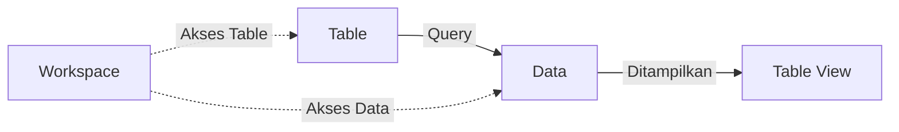
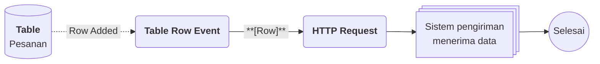

# Apa itu Table View?

>**note** Table View merupakan salah satu komponen dalam modul [[Docs/Modul Interface/Pengenalan|Interface]] di Phoenix.

Table View adalah komponen antarmuka yang dapat digunakan untuk menampilkan data [[Docs/Modul Data/Table/Apa itu Table|Table]] menggunakan [[Docs/Tipe Data/Query|Query]].

Satu Table View dapat memiliki lebih dari satu [[Docs/Modul Interface/Table View/TableViewData|Data]]. Setiap Data menampung satu Query, sebuah nama, dan konfigurasi tampilannya sendiri, sehingga Anda dapat menyajikan beberapa tampilan Table dalam satu halaman dengan kolom dan filter yang berbeda-beda. Row tetap dapat ditambah, diubah, dan dihapus langsung dari tampilan, seperti pada Table.

## Mengapa Menggunakan Table View?

- **Banyak tampilan dalam satu halaman.** Tampilkan beberapa Data sekaligus, baik dari Table yang sama maupun dari Table yang berbeda.
- **Kolom yang dapat dikontrol.** Tampilkan hanya kolom yang dibutuhkan dengan [[Docs/Tipe Data/Query#Show dan Hide|Show/Hide]] di Query.
- **Data yang dapat difilter.** Tambahkan kondisi [[Docs/Tipe Data/Query#Where|Where]] di Query agar Data hanya memuat Row yang relevan.
- **Dapat langsung dikelola.** Tambah, ubah, dan hapus Row tanpa berpindah ke halaman Table.
- **Row baru tidak hilang.** Kolom yang menjadi syarat filter akan terisi otomatis saat Row ditambahkan, sehingga Row tetap relevan dengan kondisi Query-nya.

## Konsep Utama

| Istilah | Penjelasan |
| ------- | ---------- |
| [[Docs/Tipe Data/Query]] | Perintah yang menentukan data apa yang tampil pada sebuah Data. Selengkapnya lihat halaman Query. |
| [[Docs/Tipe Data/Query#Header\|Header Table]] | Header yang wajib digunakan Query pada Table View. |
| [[Docs/Modul Interface/Table View/TableViewData]] | Satu unit tampilan pada Table View yang menampung satu Query, nama, dan konfigurasi tampilan. Satu Table View dapat memiliki lebih dari satu Data. |
| [[#Mengatur Tampilan Data\|Tampilan Data]] | Porsi layar yang ditempati sebuah Data: [[^button\|full]], [[^button\|half]], atau [[^button\|quarter]]. |
| [[Docs/Tipe Data/Query#Show dan Hide\|Show/Hide]] | Pengaturan di Query untuk menampilkan atau menyembunyikan kolom tertentu. |
| [[Docs/Tipe Data/Query#Where\|Where]] | Kondisi di Query untuk memfilter Row yang tampil. |
| [[#Kolom yang Terisi Otomatis]] | Kolom syarat filter yang tidak tampil tetap terisi saat Row ditambahkan. |
| [[#Hak Akses Table View\|Hak Akses]] | Akses pengelolaan Data diatur di Workspace, sedangkan akses Row dan cell diatur di konfigurasi Data dan Table. |

## Cara Kerja Table View

Table View menjalankan Query pada setiap Data, lalu menampilkan hasilnya sebagai tabel Row yang dapat dikelola langsung.

## Membuat Table View

![[Docs/Modul Interface/Table View/add-table-view.png]]

1. Buka folder tempat Table View akan ditempatkan di [[Docs/Antarmuka#Area Manajemen Folder]]
2. Klik kanan > [[^field/add|Add]] > [[^field|Interface]] > [[^field/tableview|Table View]]
3. Isi [[^field|Name]] dan [[^field|Description]]
4. Klik [[^button|Create]]

>**success** Table View berhasil dibuat
> Table View yang baru dibuat belum memiliki Data. Tambahkan [[Docs/Modul Interface/Table View/TableViewData|Data]] di [[#Mengelola Data Table View]].

<!--
  * [TODO] Penempatan gambar: `add-table-view.png` (screenshot dialog Create Table View) diletakkan di awal bagian Membuat.
  * [TODO] Pada dialog, baris Name tampil dengan dua isian yang dipisahkan tanda `/` (isian kiri tampak berisi nama folder). Diasumsikan isian kiri terisi otomatis sesuai folder yang diklik kanan, seperti Directory pada Table. Mohon konfirmasi label field-nya dan apakah boleh dikosongkan (letak root). Setelah itu langkah 3 perlu diperbarui.
  * [TODO] Konfirmasi: apakah Table View yang baru dibuat memang belum memiliki Data sama sekali, atau sudah ada Data awal?
-->

## Mengubah Table View

Buka halaman kerja Table View, klik [[^button/edit|Edit]], perbarui isian, lalu klik [[^button|Update]].

<!--
  * [DONE] Konfirmasi cakupan tombol Edit: diasumsikan hanya mengubah atribut Table View (Name dan Description). Pengelolaan Data (nama, Query, tampilan) dilakukan di halaman kerja, bukan lewat Edit.
-->

## Menyegarkan Table View

Klik [[^button/refresh|Refresh]] untuk memuat ulang tampilan. Query pada setiap Data dijalankan kembali, sehingga Row yang tidak lagi memenuhi syarat Query tidak ditampilkan lagi.

## Menghapus Table View

Buka folder yang berisi Table View, klik kanan Table View, pilih [[^button/delete|Delete]], lalu konfirmasi dengan [[^button|Delete]].

>**warning** Seluruh Data ikut terhapus
> Menghapus Table View menghapus seluruh Data di dalamnya beserta Query dan konfigurasi tampilannya. Table yang menjadi sumber Query dan Row di dalamnya tidak ikut terhapus.

<!--
  * [TODO] Konfirmasi dampak lain penghapusan Table View, misalnya apakah ada komponen yang menautkan Table View ini dan menjadi terputus.
-->

## Antarmuka Table View

![[Docs/Modul Interface/Table View/halaman-kerja-table-view.png]]

Halaman kerja Table View terdiri dari bilah navigasi di bagian atas dan area Data di bagian bawah. Setiap Data tampil sebagai tabel yang dapat dilipat, dan Data baru ditambahkan lewat tombol [[^button/add|Add Data]] di bagian paling bawah.

<!--
  * [TODO] Penempatan gambar: `halaman-kerja-table-view.png` di bagian Antarmuka. Anotasi yang disarankan (nomor penanda): 1 judul Table View, 2 Edit, 3 Refresh, 4 Search, 5 judul Data, 6 pilihan tampilan, 7 tombol Q, 8 tabel Row, 9 Add Row, 10 informasi halaman dan pagination, 11 Add Data.
  * [TODO] Nama Table View, nama Data, dan isi Row pada screenshot adalah kasus pribadi dan tidak disebut di halaman ini. Mohon sesuaikan gambar atau gunakan penamaan generik.
  * [TODO] Konfirmasi perbedaan tampilan desktop dan mobile. Jika ada, tambahkan callout catatan di bagian ini.
-->

### Bilah navigasi Table View terdiri dari:

| Elemen | Fungsi |
| ------ | ------ |
| Judul | Menampilkan ikon Table View dan [[^field\|Header Name]]. |
| [[^button/edit\|Edit]] | Mengubah atribut Table View. |
| [[^button/refresh\|Refresh]] | Memuat ulang tampilan dan menjalankan kembali Query pada setiap Data. |
| [[^field\|Search TableView Data...]] | Mencari kata kunci di semua kolom pada Data. |

<!--
  * [TODO] Konfirmasi cakupan Search: apakah mencari di seluruh Data sekaligus atau hanya Data yang terbuka, dan apakah Row yang tidak cocok disembunyikan.
-->

### Bagian Data terdiri dari:

| Elemen | Fungsi |
| ------ | ------ |
| Judul Data | Menampilkan ikon panah, nama Data, dan angka dalam tanda kurung. Klik untuk melipat atau membuka Data. |
| [[^button\|full]], [[^button\|half]], [[^button\|quarter]] | Menentukan porsi layar yang ditempati Data. Selengkapnya lihat [[#Mengatur Tampilan Data]]. |
| [[^button\|Q]] | Membuka pengaturan Query untuk Data tersebut. |
| Tabel Row | Menampilkan kolom hasil Query, ditambah kolom [[^field\|ID]] di awal dan [[^field\|Action]] di akhir yang berisi tombol [[^button/save\|Save]] dan [[^button/delete\|Delete]] per Row. |
| [[^button/add\|Add Row]] | Menambahkan Row pada Table sumber Data. |
| [[^field\|Show 50 of 4 items, on page]], [[^button/empty\|Go]], [[^button/left\|Prev]], [[^button/right\|Next]] | Informasi jumlah Row dan perpindahan halaman, sama seperti pada Table. |
| [[^field\|Empty]] | Muncul pada Data yang Query-nya belum diisi. |
| [[^field\|Query column output is not valid!]] | Muncul pada Data yang Query-nya belum diisi atau tidak valid. Lihat [[Docs/Tipe Data/Query]]. |

<!--
  * [TODO] Angka dalam kurung pada judul Data diasumsikan jumlah Row hasil Query (contoh: `(4)`, `(2)`). Pada Data dengan Query kosong tampil `(3) ()`. Mohon jelaskan arti `(3)` dan `()` tersebut.
  * [TODO] Tombol Q diasumsikan membuka editor Query untuk Data. Mohon konfirmasi fungsinya dan namanya (apakah ada label atau tooltip).
  * [TODO] Konfirmasi kapan pesan error muncul: Query kosong, Query tidak valid, atau Query tidak memakai header Table.
  * [TODO] Informasi jumlah halaman pada screenshot ("Show 50 of 4 items, on page") diasumsikan sama seperti Table, yaitu batas 50 Row per halaman.
-->

### Interaksi Antarmuka Table View

| Fungsi | Aksi |
| ------ | ---- |
| Melipat atau membuka Data | Klik judul Data. |
| Membuka menu konteks Data | Klik kanan pada Data, lalu pilih [[^field/edit\|Rename]], [[^field/add\|Add Row]], [[^field/add\|Add Data]], atau [[^field/delete\|Delete Data]]. |
| Mencari kata kunci | Ketik di [[^field\|Search TableView Data...]]. |
| Berpindah halaman Row | Klik [[^button/left\|Prev]] atau [[^button/right\|Next]], atau isi nomor halaman lalu klik [[^button/empty\|Go]]. |

<!--
  * [TODO] Konfirmasi tempat menu konteks dibuka (klik kanan di judul Data atau di seluruh area Data) dan ikon masing-masing menu. Ikon pada tabel di atas masih tebakan.
-->

## Mengelola Data Table View

Data adalah isi dari Table View. Setiap Data menampung satu Query, nama, dan konfigurasi tampilan. Selengkapnya lihat [[Docs/Modul Interface/Table View/TableViewData]].

### Menambahkan Data

1. Buka halaman kerja Table View
2. Klik [[^button/add|Add Data]] di bagian bawah halaman, atau klik kanan Data lain > [[^field/add|Add Data]]
3. Data baru tampil dengan Query kosong, ditandai [[^field|Empty]]
4. Isi Query di [[#Mengatur Query]]

<!--
  * [TODO] Konfirmasi apakah Data baru langsung ditambahkan dengan nama awal "New Data", atau ada dialog isian terlebih dahulu.
-->

### Mengatur Query

1. Klik [[^button|Q]] pada Data yang ingin diatur
2. Isi Query dengan [[Docs/Tipe Data/Query#Header|header Table]]
3. Simpan perubahan Query

Gunakan [[Docs/Tipe Data/Query#Show dan Hide|Show/Hide]] untuk memilih kolom yang tampil, dan [[Docs/Tipe Data/Query#Where|Where]] untuk memfilter Row. Cara menulis Query dijelaskan di [[Docs/Tipe Data/Query]].

>**note** Query wajib memakai header Table
> Query pada Table View harus menggunakan header Table. Jika Query belum diisi atau outputnya tidak valid, Data menampilkan pesan [[^field|Query column output is not valid!]].

<!--
  * [TODO] Langkah 1 dan 3 bergantung pada fungsi tombol Q. Perbarui setelah fungsi dan tombol simpan pada editor Query dikonfirmasi.
-->

### Mengatur Tampilan Data

Klik salah satu pilihan tampilan pada bagian atas Data:

| Pilihan | Porsi layar |
| ------- | ----------- |
| [[^button\|full]] | Seluruh layar. |
| [[^button\|half]] | Setengah layar. |
| [[^button\|quarter]] | Seperempat layar. |

### Mengubah Nama Data

Klik kanan Data > [[^field/edit|Rename]], ubah nama, lalu simpan.

### Menghapus Data

Klik kanan Data > [[^field/delete|Delete Data]], lalu konfirmasi dengan [[^button|Delete]].

>**warning** Query dan konfigurasi Data ikut terhapus
> Menghapus Data hanya menghapus Query dan konfigurasi tampilannya dari Table View. Table sumber beserta Row di dalamnya tidak terhapus.

## Mengelola Row pada Data

Row ditambahkan dan diisi seperti pada komponen Table. Cara mengisi setiap Format Column dijelaskan di [[Docs/Modul Data/Table/Mengisi TableData]].

### Menambahkan Row

1. Klik [[^button/add|Add Row]] di bawah tabel Data, atau klik kanan Data > [[^field/add|Add Row]]
2. Isi kolom yang tampil pada Row baru
3. Klik [[^button/save|Save]]

Anda dapat klik [[^button/x|Cancel]] untuk membatalkan penambahan Row.

### Kolom yang Terisi Otomatis

Data hanya menampilkan Row yang memenuhi Query. Jika Query memiliki kondisi [[Docs/Tipe Data/Query#Where|Where]] pada kolom yang tidak ditampilkan, kolom tersebut tetap terisi otomatis saat Row ditambahkan. Dengan begitu, Row baru tetap memenuhi syarat Query dan tidak hilang setelah [[^button/refresh|Refresh]].

Misalnya, Data [[^field|Menunggu Diproses]] memiliki kondisi Where pada kolom [[^field|Status]] (berformat [[Docs/Tipe Data/EnumData|EnumData]]) bernilai `Menunggu`, sementara kolom [[^field|Status]] disembunyikan dengan Hide. Saat Anda menambahkan Row dari Data tersebut, kolom [[^field|Status]] langsung terisi `Menunggu`.

<!--
  * [TODO] Contoh Data, kolom, dan nilai di atas adalah penamaan generik. Mohon sesuaikan atau ganti dengan contoh yang Anda inginkan.
  * [TODO] Konfirmasi batas perilaku isi otomatis: apakah berlaku untuk semua jenis kondisi Where (misalnya rentang nilai) atau hanya kondisi kesamaan (sama dengan).
-->

### Mengubah Row

Ubah isian pada Row, lalu klik [[^button/save|Save]] pada kolom [[^field|Action]]. Anda dapat klik [[^button/x|Cancel]] untuk membatalkan perubahan Row.

### Menghapus Row

Klik [[^button/delete|Delete]] pada kolom [[^field|Action]], lalu konfirmasi dengan [[^button|Delete]].

>**danger** Row pada Table ikut terhapus
> Row yang ditampilkan Table View adalah Row milik Table sumber. Menghapus Row dari Table View menghapusnya dari Table dan tidak dapat dikembalikan.

## Hak Akses Table View

Hak akses pada Table View diatur berlapis. Pengelolaan Data diatur di Workspace, sedangkan perubahan Row dan cell diatur di konfigurasi Data dan di hak akses Table.

| Yang dikelola | Diatur melalui | Penjelasan |
| ------------- | -------------- | ---------- |
| Data: ubah nama, ubah Query, dan ubah konfigurasi | [[Docs/Modul Developer/Workspace/Data Access\|Data Access]] Table View di Workspace | Menentukan apakah anggota [[^value/boolean/allow]] atau [[^value/boolean/disallow]] mengubah Data. |
| Row dan isi cell pada Table View | Konfigurasi [[Docs/Modul Interface/Table View/TableViewData\|Data]] | Diatur pada konfigurasi Data, bukan melalui Workspace. |
| Row dan isi cell pada Table sumber | [[Docs/Modul Developer/Workspace/Data Access\|Data Access]] Table di Workspace | Tetap berlaku, apa pun pengaturan konfigurasi Data. |

>**note** Akses Table tetap berlaku
> Jika Workspace tidak mengizinkan pengubahan data pada Table sumber, Row dan cell tetap tidak dapat diubah dari Table View, meskipun konfigurasi Data mengizinkannya. Aturan ini juga berlaku pada komponen Interface lain yang dapat mengubah data di komponen Modul Data.

<!--
  * [TODO] Konfirmasi pemetaan Data Access Table View di Workspace (Add, Update, Delete) ke aksi di halaman ini. Diasumsikan Add untuk menambah Data, Update untuk ubah nama, Query, dan konfigurasi, serta Delete untuk menghapus Data.
  * [TODO] Konfirmasi opsi yang tersedia pada konfigurasi Data selain porsi layar (misalnya izin menambah, mengubah, dan menghapus Row). Detailnya diusulkan ditulis di halaman TableViewData.
-->

## Contoh Penggunaan

**Memantau Pesanan per Status dalam Satu Halaman**

Tim operasional sebuah toko daring perlu melihat seluruh pesanan sekaligus memisahkan pesanan yang menunggu diproses dari yang sudah selesai. Dengan Table View, satu Table pesanan ditampilkan dalam beberapa Data dengan Query berbeda. Tim menambahkan pesanan baru langsung dari Data yang relevan, dan sistem pengiriman menerima pesanan baru secara otomatis lewat Flow.

**Komponen yang terlibat**

| Komponen | Peran |
| -------- | ----- |
| [[^field/table\|Pesanan]] | Menyimpan seluruh pesanan dengan kolom Pelanggan, Total, dan Status. |
| [[^field/enum\|Status Pesanan]] | Menyediakan pilihan Status untuk kolom Status (EnumData): Menunggu dan Selesai. |
| [[^field/tableview\|Pemantauan Pesanan]] | Menampilkan Table Pesanan dalam tiga Data. |
| [[^field/flow\|Notifikasi Pesanan Baru]] | Mengirim pesanan baru ke sistem pengiriman. |

**Pengaturan Table View**

| Data | Query | Tampilan |
| ---- | ----- | -------- |
| Semua Pesanan | Menampilkan seluruh kolom tanpa filter. | [[^button\|full]] |
| Menunggu Diproses | Where Status sama dengan Menunggu, kolom Status disembunyikan dengan Hide. | [[^button\|half]] |
| Selesai | Where Status sama dengan Selesai. | [[^button\|half]] |

**Alur di Flow**

| Langkah | Flow Block | Peran dalam alur | Hasil |
| ------- | ---------- | ---------------- | ----- |
| 1 | [[Docs/Modul Logic/Flow/Flow Block/Event/Table Row Event\|Table Row Event]] | Memicu alur saat Row baru ditambahkan pada Table Pesanan, termasuk dari Table View. | Row pesanan baru. |
| 2 | [[Docs/Modul Logic/Flow/Flow Block/Modular/HTTP Request\|HTTP Request]] | Mengirim data pesanan ke sistem pengiriman. | Sistem pengiriman menerima pesanan. |

**Hasil yang dirasakan**

- Tim melihat pesanan menurut status tanpa membuat Table terpisah, dan data tetap berasal dari satu sumber.
- Pesanan yang ditambahkan dari Data [[^field|Menunggu Diproses]] otomatis berstatus `Menunggu` dan langsung tampil setelah [[^button/refresh|Refresh]].
- Sistem pengiriman menerima pesanan baru tanpa input ulang.

**Ide skenario lain**

| Jenis nilai | Contoh integrasi |
| ----------- | ---------------- |
| Keuangan | Satu halaman berisi Data tagihan belum lunas dan Data tagihan lunas, dengan Where pada status pembayaran. |
| Inventaris | Data stok rendah dengan Where pada jumlah stok, dan Hide pada kolom harga untuk tim gudang. |
| Layanan pelanggan | Data tiket menurut prioritas, dengan Flow yang memberi tahu tim saat tiket baru ditambahkan. |

Dengan satu Table sebagai sumber, Table View memberi setiap tim sudut pandang yang sesuai tanpa menggandakan data, sementara Flow menjaga sistem lain tetap sinkron.

<!--
  * [TODO] Nama Table, Enum, Table View, Flow, Data, dan kolom pada contoh ini adalah penamaan generik. Mohon sesuaikan.
  * [TODO] Konfirmasi nama event Table pada diagram (`Row Added`) dan bahwa Row yang ditambahkan lewat Table View memicu [[Docs/Modul Logic/Flow/Flow Block/Event/Table Row Event|Table Row Event]] seperti Row yang ditambahkan dari Table.
-->

## Praktik Terbaik

- **Beri nama Data sesuai filternya**, misalnya nama yang menjelaskan kondisi [[Docs/Tipe Data/Query#Where|Where]], agar pembaca langsung paham isi Data.
- **Tampilkan hanya kolom yang dibutuhkan** dengan [[Docs/Tipe Data/Query#Show dan Hide|Show/Hide]] agar tabel mudah dibaca.
- **Selalu gunakan [[Docs/Tipe Data/Query#Header|header Table]]** pada [[Docs/Tipe Data/Query|Query]] agar Data tidak menampilkan [[^field|Query column output is not valid!]].
- **Pilih porsi layar sesuai kepentingan Data**: [[^button|full]] untuk Data utama, [[^button|half]] atau [[^button|quarter]] untuk Data pendukung.
- **Atur hak akses di dua tempat.** Pastikan [[Docs/Modul Developer/Workspace/Data Access|Data Access]] Table dan konfigurasi [[Docs/Modul Interface/Table View/TableViewData|Data]] sesuai dengan siapa yang boleh mengubah Row.
- **Klik [[^button/refresh|Refresh]]** setelah mengubah kolom yang menjadi syarat [[Docs/Tipe Data/Query#Where|Where]], karena Row yang tidak lagi memenuhi syarat akan hilang dari Data.

## Batasan dan Catatan

- Setiap [[Docs/Modul Interface/Table View/TableViewData|Data]] hanya menampung satu [[Docs/Tipe Data/Query|Query]], dan Query wajib memakai [[Docs/Tipe Data/Query#Header|header Table]].
- Table View hanya menampilkan data [[Docs/Modul Data/Table/Apa itu Table|Table]] dan tidak menyimpan Row sendiri. Row yang Anda tambah, ubah, atau hapus adalah Row pada Table sumber.
- Menghapus Row dari Table View tidak dapat dikembalikan, sedangkan menghapus Data atau Table View tidak menghapus Row pada Table sumber.
- Kolom yang menjadi syarat [[Docs/Tipe Data/Query#Where|Where]] akan terisi otomatis saat Row ditambahkan, walaupun kolom tersebut tidak ditampilkan oleh [[Docs/Tipe Data/Query#Show dan Hide|Show/Hide]].
- Hak akses Table di Workspace selalu berlaku. Jika Workspace tidak mengizinkan pengubahan data Table, Row tetap tidak dapat diubah dari Table View meskipun konfigurasi Data mengizinkannya.
- Hak akses pengelolaan Data (ubah nama, Query, dan konfigurasi) diatur di [[Docs/Modul Developer/Workspace/Data Access|Data Access]] Table View, bukan di konfigurasi Data.
- Mengubah nilai kolom yang menjadi syarat Where dapat membuat Row tidak tampil lagi setelah [[^button/refresh|Refresh]].

## TL:DR

- [[Docs/Modul Interface/Table View/Apa itu Table View|Table View]] menampilkan data [[Docs/Modul Data/Table/Apa itu Table|Table]] menggunakan [[Docs/Tipe Data/Query|Query]], dan dapat memiliki lebih dari satu [[Docs/Modul Interface/Table View/TableViewData|Data]].
- Setiap Data menampung satu Query, nama, dan tampilan ([[^button|full]], [[^button|half]], atau [[^button|quarter]]), dan dapat dilipat dengan klik.
- Atur kolom dengan [[Docs/Tipe Data/Query#Show dan Hide|Show/Hide]] dan filter dengan [[Docs/Tipe Data/Query#Where|Where]]; Query wajib memakai [[Docs/Tipe Data/Query#Header|header Table]].
- Row dikelola seperti pada Table, dan kolom syarat filter yang tidak tampil terisi otomatis agar Row tidak hilang setelah [[^button/refresh|Refresh]].
- Pengelolaan Data diatur di Workspace, sedangkan Row dan cell mengikuti konfigurasi Data serta hak akses Table.
- Menghapus Row di Table View menghapusnya dari Table, tetapi menghapus Data tidak.

## FAQ : Pertanyaan yang Sering Diajukan

> **faq**
> **Mengapa Row yang baru saya tambahkan tidak hilang walaupun kolom filternya tidak tampil?**
> Kolom yang menjadi syarat [[Docs/Tipe Data/Query#Where|Where]] terisi otomatis saat Row ditambahkan, sehingga Row tetap memenuhi [[Docs/Tipe Data/Query|Query]]. Selengkapnya lihat [[#Kolom yang Terisi Otomatis]].
> **Mengapa muncul pesan [[^field|Query column output is not valid!]]?**
> Query pada Data belum diisi atau outputnya tidak valid. Pastikan Query memakai [[Docs/Tipe Data/Query#Header|header Table]], lalu atur di [[#Mengatur Query]].
> **Apakah menghapus Data juga menghapus Row di Table?**
> Tidak. Menghapus [[Docs/Modul Interface/Table View/TableViewData|Data]] hanya menghapus Query dan konfigurasinya. Namun menghapus Row lewat [[^button/delete|Delete]] pada kolom [[^field|Action]] menghapus Row dari Table.
> **Mengapa saya tidak dapat mengubah cell padahal konfigurasi Data mengizinkan?**
> Perubahan data tetap mengikuti [[Docs/Modul Developer/Workspace/Data Access|Data Access]] Table di Workspace. Jika Workspace tidak mengizinkan, Row tidak dapat diubah dari Table View.
> **Apa bedanya Table View dengan Table?**
> [[Docs/Modul Data/Table/Apa itu Table|Table]] menyimpan data, sedangkan Table View menampilkan data Table dalam beberapa tampilan sekaligus dengan Query berbeda.

<!--
  * [TODO] Halaman dan anchor yang ditautkan dari halaman ini dan perlu dibuat atau disesuaikan:
    * `Docs/Modul Interface/Pengenalan`: pintu masuk modul Interface.
    * `Docs/Modul Interface/Table View/TableViewData`: atribut Data (nama, Query, tampilan), konfigurasi Data termasuk opsi izin Row, dan perilaku isi otomatis.
    * `Docs/Tipe Data/Query` dengan anchor `#Header`, `#Show dan Hide`, dan `#Where`.
    * `Docs/Modul Data/Table/Mengisi TableData`: cara mengisi Row per Format Column.
    * `Docs/Modul Developer/Workspace/Data Access` dan `Docs/Modul Developer/Workspace/Apa itu Workspace`.
    * `Docs/Tipe Data/EnumData`.
-->

