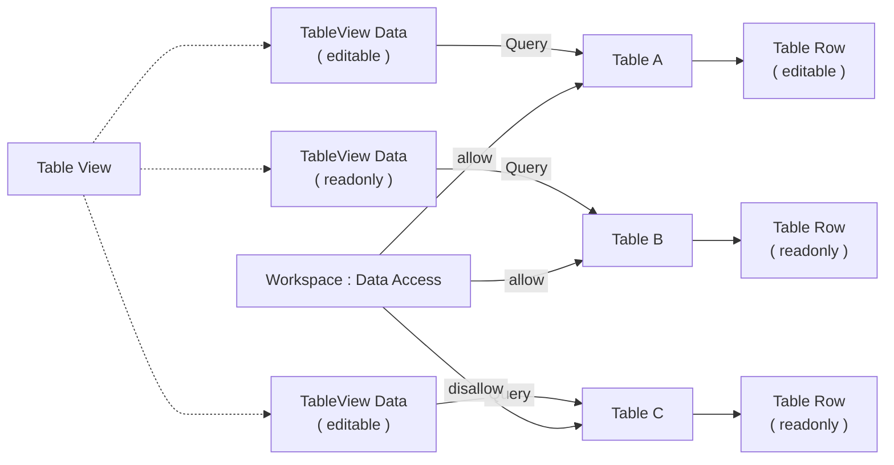

# Cara Kerja Table View

Table View menjalankan [[Docs/Tipe Data/Query|Query]] pada setiap Data, lalu menampilkan hasilnya sebagai tabel [[Docs/Tipe Data/Row]] yang dapat dikelola langsung (_editable_) atau hanya dapat dibaca (_readonly_).

