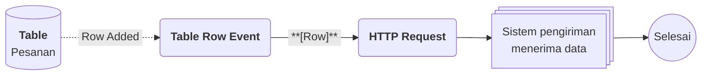

# Contoh Penggunaan Kanban

## Studi Kasus : Memantau Pesanan per Status dalam Satu Halaman**

Tim operasional sebuah toko daring perlu melihat seluruh pesanan sekaligus memisahkan pesanan yang menunggu diproses dari yang sudah selesai. Dengan Table View, satu Table pesanan ditampilkan dalam beberapa Data dengan Query berbeda. Tim menambahkan pesanan baru langsung dari Data yang relevan, dan sistem pengiriman menerima pesanan baru secara otomatis lewat Flow.

## Komponen yang terlibat

| Komponen | Peran |
| -------- | ----- |
| Tabel [[^field/table|Pesanan]] | Menyimpan seluruh pesanan dengan kolom [[^field/column|Pelanggan]], [[^field/column|Total]], dan [[^field/column|Status]]. |
| Enum [[^field/enum|Status Pesanan]] | Menyediakan pilihan status untuk kolom [[^field/column|Status]] di [[^field/table|Pesanan]]: [[^value/enumdata|Menunggu]] dan [[^value/enumdata|Selesai]]. |
| Table View [[^field/tableview|Pemantauan Pesanan]] | Menampilkan Table [[^field/table|Pesanan]] dalam tiga Data: [[^field|Semua Pesanan]], [[^field|Menunggu Diproses]] dan [[^field|Selesai]] |
| Flow [[^field/flow|Notifikasi Pesanan Baru]] | Mengirim pesanan baru ke sistem pengiriman. |

## Pengaturan Table View

| Data | Query | Tampilan |
| ---- | ----- | -------- |
| Semua Pesanan | Menampilkan seluruh kolom tanpa filter. | [[^value/radio|full]] |
| Menunggu Diproses | Filter Status sama dengan Menunggu, kolom Status disembunyikan dengan Hide. | [[^value/radio|half]] |
| Selesai | Where Status sama dengan Selesai. | [[^value/radio|half]] |

## Alur di Flow [[^field/flow|Notifikasi Pesanan Baru]]

| Langkah | Flow Block | Peran dalam alur | Hasil |
| ------- | ---------- | ---------------- | ----- |
| 1 | [[Docs/Modul Logic/Flow/Flow Block/Event/Table Row Event|Table Row Event]] | Memicu alur saat Row baru ditambahkan pada Table Pesanan, termasuk dari Table View. | Row pesanan baru. |
| 2 | [[Docs/Modul Logic/Flow/Flow Block/Modular/HTTP Request|HTTP Request]] | Mengirim data pesanan ke sistem pengiriman. | Sistem pengiriman menerima pesanan. |

## Hasil yang dirasakan

- Tim melihat pesanan menurut status tanpa membuat Table terpisah, dan data tetap berasal dari satu sumber.
- Pesanan yang ditambahkan dari Data [[^field|Menunggu Diproses]] otomatis berstatus `Menunggu` dan langsung tampil setelah [[^button/refresh|Refresh]].
- Sistem pengiriman menerima pesanan baru tanpa input ulang.

## Ide skenario lain

| Jenis nilai | Contoh integrasi |
| ----------- | ---------------- |
| Keuangan | Satu halaman berisi Data tagihan belum lunas dan Data tagihan lunas, dengan filter pada status pembayaran. |
| Inventaris | Data stok rendah dengan filter pada jumlah stok, dan sembunyikan kolom harga untuk tim gudang. |
| Layanan pelanggan | Data tiket menurut prioritas, dengan Flow yang memberi tahu tim saat tiket baru ditambahkan. |

Dengan satu Table sebagai sumber, Table View memberi setiap tim sudut pandang yang sesuai tanpa menggandakan data, sementara Flow menjaga sistem lain tetap sinkron.