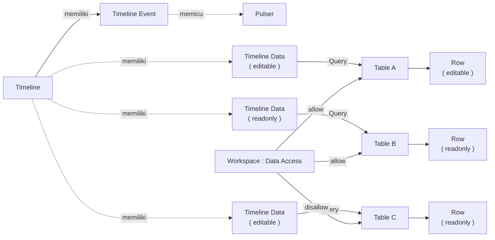
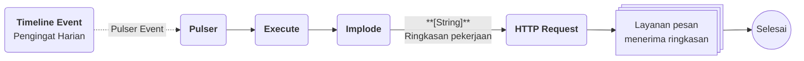

# Apa itu Timeline?

>**note** Timeline merupakan salah satu komponen dalam modul [[Docs/Modul Interface/Pengenalan|Interface]] di Phoenix.

Timeline adalah komponen yang menampilkan data dalam urutan waktu sehingga Anda dapat memantau jadwal, riwayat aktivitas, dan perkembangan suatu proses dengan lebih mudah.

Komponen ini cocok untuk perencanaan, pelacakan progres, serta melihat hubungan antar peristiwa dalam satu rentang waktu.

Timeline memiliki dua jenis isi, yaitu [[Docs/Modul Interface/Timeline/Timeline Event|Timeline Event]] untuk memicu otomasi terjadwal dan [[Docs/Modul Interface/Timeline/Timeline Data|Timeline Data]] untuk menampilkan data sumber di sumbu waktu. Keduanya tampil dalam satu halaman kerja yang dapat digeser, diperbesar, dan diperkecil.

## Mengapa Menggunakan Timeline?

- **Jadwal dan progres dalam satu pandangan.** Setiap data tampil sebagai blok di sumbu waktu sehingga rentang, urutan, dan tumpang tindih peristiwa langsung terlihat.
- **Jadwal dapat diubah langsung.** Geser blok untuk memindahkan waktu [[^field|Start]] atau [[^field|End]] tanpa membuka data sumber satu per satu.
- **Otomasi terjadwal.** [[Docs/Modul Interface/Timeline/Timeline Event|Timeline Event]] memicu Flow Block [[Docs/Modul Logic/Flow/Flow Block/Event/Pulser|Pulser]] satu kali atau berulang.
- **Beberapa data dalam satu halaman.** Satu Timeline dapat memiliki lebih dari satu [[Docs/Modul Interface/Timeline/Timeline Data|Timeline Data]] dengan [[Docs/Tipe Data/Query|Query]] yang berbeda.
- **Skala waktu fleksibel.** Ubah tampilan dari kuartal sampai detik dengan menu [[#Menu Konteks Timeline|Zoom]] atau *wheel* mouse.

## Konsep Utama

| Istilah | Penjelasan |
| ------- | ---------- |
| [[Docs/Modul Interface/Timeline/Timeline Event|Timeline Event]] | Pemicu [[Docs/Event/Apa itu Event|Event]] ke Flow Block Pulser pada waktu tertentu, dengan atau tanpa pengulangan. |
| [[Docs/Modul Interface/Timeline/Timeline Data|Timeline Data]] | Pembuka data sumber di sumbu waktu dengan bantuan Query. |
| [[Docs/Tipe Data/Query|Query]] | Aturan pengambilan data sumber. Bagian Show menandai kolom yang dipakai sebagai Name, Start, dan End. |
| [[Docs/Modul Logic/Flow/Flow Block/Event/Pulser|Pulser]] | Flow Block Event yang menerima pemicu dari Timeline Event. |
| [[Docs/Tipe Data/Row|Row]] | Satu data sumber. Setiap Row pada Timeline Data tampil sebagai satu blok. |
| [[#Menu Konteks Timeline|Zoom]] | Pengatur tingkat satuan waktu pada header, dari kuartal sampai detik. |
| [[#Preview dan Edit Row|Preview]] | Popup ringkasan Row yang terbuka saat Row diklik kiri. |

## Cara Kerja Timeline

Timeline mempertemukan dua hal dalam satu sumbu waktu: Timeline Event yang memicu Pulser sesuai jadwal, dan Timeline Data yang menampilkan Row dari data sumber berdasarkan Query.

## Membuat Timeline

![[Docs/Modul Interface/Timeline/add-timeline.png]]
1. Buka folder tempat Timeline akan ditempatkan di [[Docs/Antarmuka#Area Manajemen Folder]]
2. Klik kanan ➜ [[^field/add|Add]] ➜ [[^field|Interface]] ➜ [[^field/timeline|Timeline]]
3. Isi [[^field|Name]] dan [[^field|Description]]
4. Klik [[^button|Create]]

>**success** Timeline berhasil dibuat
> Timeline yang baru dibuat belum memiliki isi dan menampilkan [[^field|Event is empty]] serta [[^field|Data is empty]]. Tambahkan isinya di [[#Menambahkan Timeline Event]] dan [[#Menambahkan Timeline Data]].

## Mengubah Timeline

1. Buka halaman kerja Timeline
2. Klik [[^button/edit|Edit]]
3. Ubah [[^field|Name]] atau [[^field|Description]]
4. Klik [[^button|Update]]

Untuk mengubah Timeline Event, klik kanan blok Timeline Event ➜ [[^field|Edit]]. Untuk mengubah nama Timeline Data, klik kanan Timeline Data ➜ [[^field|Rename Data]].

## Menyegarkan Timeline

Klik [[^button/refresh|Refresh]] untuk memuat ulang tampilan.

## Menghapus Timeline

1. Buka folder yang berisi Timeline di [[Docs/Antarmuka#Area Manajemen Folder]]
2. Klik kanan Timeline ➜ [[^button/delete|Delete]]
3. Konfirmasi dengan klik [[^button|Delete]]

>**warning** Timeline Event dan Timeline Data ikut terhapus
> Seluruh Timeline Event dan Timeline Data beserta konfigurasi Query di dalam Timeline hilang. Flow Block Pulser yang sebelumnya dipicu Timeline Event tidak lagi menerima pemicu dari Timeline ini. Row pada data sumber tidak terhapus.

## Antarmuka Timeline
 ![[Docs/Modul Interface/Timeline/interface-timeline.png]]
Halaman kerja Timeline terdiri dari bilah navigasi di bagian atas dan area kerja di bagian bawah.

### Bilah navigasi Timeline terdiri dari:

| Tombol | Fungsi |
| ------ | ------ |
| Judul Timeline | Menampilkan ikon Timeline dan nama Timeline. |
| [[^button/edit|Edit]] | Mengubah atribut Timeline. Lihat [[#Mengubah Timeline]]. |
| [[^button/refresh|Refresh]] | Memuat ulang tampilan. |
| [[^field|Search Timeline Data...]] | Mencari kata kunci pada Timeline Data dan Timeline Event. |

### Area Kerja Timeline

| Area | Penjelasan |
| ---- | ---------- |
| [[^field|Item List]] | Kolom kiri berisi nama Timeline Event dan nama Row pada Timeline Data. |
| Header waktu | Baris di atas area kerja, misalnya [[^field|MonthYear]], [[^field|Week]], [[^field|Date]], [[^field|DateDayweek]], dan [[^field|Hour]]. Barisnya berubah mengikuti tingkat [[#Menu Konteks Timeline|Zoom]]. |
| [[^field|now]] | Garis dan penanda yang menunjukkan waktu saat ini. |
| Grup Event | Judul `Event (n)` memuat Timeline Event, dengan n jumlah Timeline Event. Jika kosong, tampil [[^field|Event is empty]] dan tombol [[^button/add|Add Event]]. |
| Grup Timeline Data | Judul berisi nama Timeline Data, jumlah Row hasil Query, dan tombol [[^button/q]] untuk mengatur Query. Jika belum ada, tampil [[^field|Data is empty]] dan tombol [[^button/add|Add Data]]. |
| Blok | Timeline Event dan Row tampil sebagai blok di sumbu waktu, dengan nama di sampingnya. |

<!--
  * [TODO] Mohon konfirmasi: (1) pasangan label Zoom (misalnya Week - Date, Date - Hour) memang menentukan baris header waktu, (2) angka di judul Timeline Data adalah jumlah Row hasil Query, (3) panah di judul Event dan Data dipakai untuk melipat atau membuka grup, (4) arti ikon jam di samping nama Timeline Event.
    Jawaban : 1. Iya betul header akan disesuaikan, 2. Iya betul. 3. iya betul. 4. Hanya ikon untuk menandakan itu grup event.
-->

### Menu Konteks Timeline

Klik kanan pada area berikut untuk membuka menu konteks.

| Area | Menu |
| ---- | ---- |
| Blok Timeline Event | [[^field|Edit]], [[^field|Add Data]], [[^field|Add Event]], [[^field|Zoom]], [[^field|Delete Event]] |
| Judul Timeline Data | [[^field|Rename Data]], [[^field|Add Data]], [[^field|Add Event]], [[^field|Zoom]], [[^field|Delete Data]] |
| Row pada Timeline Data | [[^field|Edit]], [[^field|View]], [[^field|Add Row]], [[^field|Add Data]], [[^field|Add Event]], [[^field|Zoom]], [[^field|Delete Row]] |
| Bagian yang kosong | [[^field|Add Data]], [[^field|Add Event]], [[^field|Zoom]] |

Menu [[^field|Zoom]] memiliki cabang berikut.

| Cabang | Fungsi |
| ------ | ------ |
| [[^field|Zoom In]], [[^field|Zoom Out]] | Memperbesar atau memperkecil skala rentang waktu. |
| [[^field|Quarter - Month]], [[^field|Month - Week]], [[^field|Week - Date]], [[^field|Week - Dayweek]], [[^field|Date - Hour]], [[^field|Time - 30 Minute]], [[^field|Time - 10 Minute]], [[^field|Time - 1 Minute]], [[^field|Minute - Second]] | Memilih tingkat satuan waktu pada header, dari kuartal sampai detik. |

<!--
  * [TODO] Daftar menu untuk "Timeline Data" saya ambil dari butir kedua yang pada catatan Anda tertulis "block Timeline Event" dua kali. Mohon konfirmasi bahwa itu menu untuk Timeline Data.
    Jawaban : itu bukan menu tapi balok yang ada di baris row.
  * [TODO] Ikon pada item menu konteks belum diketahui, jadi semua memakai `[[^field|...]]`. Mohon tambahkan ikon bila ada.
    Jawaban : Abaikan
  * [TODO] Mohon jelaskan perbedaan [[^field|Edit]] dan [[^field|View]] pada Row (apakah View membuka popup preview atau form baca saja), serta fungsi persis cabang Time - 30 Minute, Time - 10 Minute, dan Time - 1 Minute.
    Jawaban : iya view hanya popup view bukan form, kalau edit itu buka form editnya.
  * [TODO] Mohon konfirmasi dampak [[^field|Delete Event]], [[^field|Delete Data]], dan [[^field|Delete Row]] (asumsi: Delete Row menghapus Row dari data sumber dan tidak dapat dikembalikan).
    Jawaban : Delete Event hanya menghapus Timeline Event (bukan pulsernya), Delete Data hanya menghapus konfigurasi dan query. Delete Row berdampak akan menghapus sumbernya (tidak dapat dikembalikan).
-->

### Preview dan Edit Row

![[Docs/Modul Interface/Timeline/preview-example.png]]
Klik kiri pada Row untuk membuka popup preview. Popup berisi bagian berikut.

| Bagian | Penjelasan |
| ------ | ---------- |
| Judul | Nama Row. |
| [[^field|Start]] dan [[^field|End]] | Waktu mulai dan waktu selesai Row. |
| [[^field|Duration]] | Lama waktu dari Start sampai End. |
| [[^field|Status]] | Kondisi Row terhadap waktu saat ini. |
| [[^field|Calendar]] | Rentang tanggal dari Start sampai End. |
| [[^field|Relative]] | Selisih waktu Row terhadap waktu saat ini. |
| [[^field|Progress]] | Kemajuan Row. |
| [[^field|change time]] | Kontrol untuk menggeser waktu. Tombol panah di bawah label [[^field|start]] menggeser waktu Start, tombol panah di bawah label [[^field|end]] menggeser waktu End, dan pilihan satuan di tengah (misalnya 1 Day) menentukan besar pergeseran. |
| [[^button/edit|Edit Row]] | Membuka modal form untuk mengubah Row. |

Hak akses untuk mengubah Row mengikuti [[Docs/Modul Developer/Workspace/Data Access]] pada data sumber.

<!--
  * [TODO] Mohon konfirmasi: (1) kapan [[^field|Progress]] tampil (pada gambar Row berstatus selesai dan Progress tidak tampil), (2) daftar nilai [[^field|Status]], (3) fungsi tombol panah ganda dan tunggal pada Change time, (4) fungsi ikon di kiri bawah popup.
    Jawaban : 1. ketika saat  statusnya On Going. 2. Upcoming, On Going, Finished. 3. membuka dan menutup kontrol change time. 4. iya 2 ikon itu kesatuan, jika kontrol dibuka maka panahnya menjadi keatas.
  * [TODO] Teks Relative pada gambar berbunyi "Ended in 180 days ago" yang tampaknya salah susunan kata di aplikasi. Dokumentasi hanya menyebut Relative tanpa mengutip teks itu.
    Jawaban : Iya itu isi dari relative. yaitu sebagai contoh di gambar sudah berakhir 180 hari lalu.
-->

### Interaksi Antarmuka Timeline

| Fungsi | Aksi |
| ------ | ---- |
| Berpindah posisi waktu | Geser area kerja ke kiri atau kanan (horizontal). |
| Menggulir Event dan Data | Geser area kerja ke atas atau bawah (vertikal). Ini berlaku jika jumlah Timeline Event dan Timeline Data melebihi tinggi layar. |
| Mengubah skala rentang waktu | Putar *wheel* mouse untuk mengubah *scale factor* rentang waktu Timeline. |
| Memindahkan waktu blok | Klik dan geser blok Timeline Data atau Timeline Event. Bagian kiri blok memindahkan waktu Start, bagian kanan memindahkan waktu selesai (End), dan bagian tengah memindahkan keduanya secara bersamaan. |
| Select dengan geser | Klik dan geser pada celah di antara header waktu dan blok data. |
| Select satu blok | Tekan Ctrl + Shift lalu klik blok untuk memilih rentang waktu blok tersebut secara otomatis. |
| Select pada area kerja | Tekan Shift lalu klik dan geser pada area kerja. |
| Membuka preview Row | Klik kiri pada Row. Lihat [[#Preview dan Edit Row]]. |
| Membuka menu konteks | Klik kanan pada Timeline Event, Timeline Data, Row, atau bagian yang kosong. Lihat [[#Menu Konteks Timeline]]. |

<!--
  * [TODO] Mohon jelaskan hasil dari Select (apa yang terjadi setelah rentang terpilih, misalnya menu atau Zoom ke rentang tersebut), karena tabel di atas baru menjelaskan caranya.
    Jawaban : Menu tetap dan zoom tetap sama, akan tetapi ketika Add Row, isi start dan end akan otomatis terisi sesuai select.
  * [TODO] Mohon konfirmasi cara berpindah posisi waktu: geser dengan *drag* pada area kerja atau gulir horizontal.
    Jawaban: Gulir horizontal, akan tetap pada tampilan mobile bisa geser pada halaman kerja.
  * [TODO] Mohon konfirmasi hak akses saat memindahkan blok. Asumsi saya: memindahkan blok Row mengubah data sumber sehingga memerlukan Data Access, sedangkan Timeline Event mengikuti hak akses Timeline Event.
    Jawaban : Betul cara kerjanya sama seperti TableView.
-->

## Mengatur Isi Timeline

### Menambahkan Timeline Event

![[Docs/Modul Interface/Timeline/add-timeline-event.png]]
1. Klik [[^button/add|Add Event]], atau klik kanan ➜ [[^field|Add Event]]
2. Isi [[^field|Name]]
3. Pilih Flow Block Pulser yang akan dipicu di [[^field|Pulser Event]]
4. Isi waktu mulai di [[^field|Start]]
5. Aktifkan [[^field|Repeat]] bila pemicu perlu berulang, lalu isi [[^field|End]] dan [[^field|Interval]]
6. Pastikan [[^field|Active]] aktif agar jadwal berjalan
7. Klik [[^button|Create]]

>**note** Repeat dan field turunannya
> Field [[^field|End]] dan [[^field|Interval]] hanya tampil ketika [[^field|Repeat]] aktif. Jika [[^field|Repeat]] [[^value/boolean/false]], Timeline Event hanya memicu Pulser satu kali pada waktu [[^field|Start]].

>**success** Timeline berhasil dibuat
> Pemicu akan berjalan pada jadwal yang ditentukan, pasti bila [[^field|Status]] bernilai [[^value/boolean/Active]] pada Timeline Event agar jadwal dijalankan.

Selengkapnya lihat [[Docs/Modul Interface/Timeline/Timeline Event]].

<!--
  * [TODO] Mohon konfirmasi: (1) pilihan pada dropdown [[^field|Interval]] (pada gambar tampil Custom dengan isian angka dan satuan Minute), (2) fungsi toggle [[^field|Active]] (asumsi: mematikan jadwal tanpa menghapus Timeline Event), (3) hak akses Timeline Event (Data Access atau Function Access Modify Event).\
    Jawaban : 1. Custom, Minutely, Hourly, Daily, Weekly, Monthly, Quarterly, Yearly. 2. Iya betul fungsi toggle Active mematikan jadwal tanpa hapus Timeline Event. 3. Masuknya ke Modify Event.
  * [TODO] Nilai toggle Active/Non-Active saya tulis dengan `[[^value/boolean/true]]` dan `[[^value/boolean/false]]`. Mohon sesuaikan bila konvensinya berbeda.
    Jawaban : Oke sudah betul.
-->

### Menambahkan Timeline Data

1. Klik [[^button/add|Add Data]], atau klik kanan ➜ [[^field|Add Data]]
2. Timeline Data baru tampil dengan Query kosong ([[^field|Empty]]) dan nama awal `New Data (n)`
3. Klik [[^button/q]] pada Timeline Data untuk mengatur [[Docs/Tipe Data/Query|Query]]
4. Pada bagian [[Docs/Tipe Data/Query#Show or Hide|Show]], tandai [[Docs/Tipe Data/Column|Column]] yang dipakai dengan label [[^field|Name]], [[^field|Start]], dan [[^field|End]]

>**warning** Query belum valid
> Selama Query belum menampilkan paling sedikit dua Column, Timeline Data menampilkan pesan [[^field|Error]] "Query must at least have 2 showed columns!" dan tidak ada Row yang tampil.

Selengkapnya lihat [[Docs/Modul Interface/Timeline/Timeline Data]].

<!--
  * [TODO] Pesan error pada gambar tertulis "Query must atleast have 2 showed column!" (ada salah ketik di aplikasi). Dokumentasi memakai bentuk yang benar.
    Jawaban: Query menggunakan kaidah Timeline output. jadi ada error khusus seperti contoh.
  * [TODO] Mohon konfirmasi kolom wajib pada Show: apakah Name dan Start wajib sedangkan End opsional, dan apakah kolom Start/End harus berformat tanggal-waktu ([[Docs/Tipe Data/DateTime]]).
    Jawaban: kolom pada Show yang wajib hanya Name dan End. Start dan End harus berformat waktu : DateTime, Date, DateTimeZone.
  * [TODO] Mohon konfirmasi apakah perubahan Query tersimpan otomatis saat popup ditutup (seperti Table View) atau ada tombol simpan, serta apakah nama awal `New Data (n)` mengikuti pola Table View.
    Jawaban: Query tersimpan otomatis ketika popup ditutup dan isi Row akan disesuaikan otomatis.
-->

## Contoh Penggunaan

**Pengingat harian untuk pekerjaan yang jatuh tempo**

Tim operasional mencatat setiap pekerjaan beserta tanggal mulai dan tenggatnya. Mereka ingin melihat sebaran pekerjaan di satu sumbu waktu, sekaligus menerima ringkasan setiap pagi tanpa perlu membuka Phoenix. Timeline menampilkan datanya, dan Timeline Event menjadwalkan pengirimannya.

**Komponen yang terlibat**

| Komponen | Peran |
| -------- | ----- |
| [[^field/table|Data Pekerjaan]] | Menyimpan pekerjaan beserta tanggal mulai dan tenggatnya. |
| [[^field/timeline|Jadwal Pekerjaan]] | Menampilkan pekerjaan sebagai blok di sumbu waktu lewat Timeline Data, dan menjadwalkan pengingat lewat Timeline Event. |
| [[^field/flow|Pengingat Pekerjaan]] | Menyusun ringkasan pekerjaan jatuh tempo dan mengirimkannya. |

**Alur di Flow**

| Langkah | Flow Block | Peran dalam alur | Hasil |
| ------- | ---------- | ---------------- | ----- |
| 1 | Timeline Event | Memicu Pulser setiap hari pada jam yang ditentukan ([[^field|Repeat]] aktif dengan [[^field|Interval]] satu hari). | Pemicu terkirim ke Pulser. |
| 2 | [[Docs/Modul Logic/Flow/Flow Block/Event/Pulser|Pulser]] | Menerima pemicu dari Timeline Event. | Alur dimulai. |
| 3 | [[Docs/Modul Logic/Flow/Flow Block/Query/Execute|Execute]] | Menjalankan Query untuk mengambil pekerjaan yang jatuh tempo hari ini. | Daftar pekerjaan jatuh tempo. |
| 4 | [[Docs/Modul Logic/Flow/Flow Block/Operator/Implode|Implode]] | Menggabungkan nama pekerjaan menjadi satu teks. | Ringkasan dalam bentuk teks. |
| 5 | [[Docs/Modul Logic/Flow/Flow Block/Modular/HTTP Request|HTTP Request]] | Mengirim ringkasan ke layanan pesan. | Ringkasan diterima tim. |

**Hasil yang dirasakan**

- Tim melihat seluruh pekerjaan beserta rentangnya dalam satu halaman, tanpa membuka data sumber.
- Ringkasan pekerjaan jatuh tempo tiba setiap pagi secara otomatis.
- Jika tenggat bergeser, tim cukup menggeser blok pada Timeline dan data sumber ikut berubah.

**Ide skenario lain**

| Jenis nilai | Contoh integrasi |
| ----------- | ---------------- |
| Jadwal perawatan | Timeline Data menampilkan jadwal perawatan peralatan, Timeline Event memicu Pulser untuk membuat tugas perawatan baru setiap bulan. |
| Pelacakan progres proyek | Timeline Data menampilkan tahapan proyek, Flow menghitung keterlambatan dari Status Row. |
| Riwayat aktivitas | Timeline Data menampilkan riwayat aktivitas dari Table log untuk memantau urutan kejadian. |
| Pembersihan berkala | Timeline Event memicu Pulser yang menjalankan Flow pembersihan data pada interval tertentu. |

Dengan Timeline, data yang tersebar menjadi satu gambaran waktu yang dapat diubah langsung, dan jadwal yang sama dapat menjalankan otomasi tanpa langkah manual.

## Praktik Terbaik

- **Atur Query secermat mungkin** dan tandai Column Name, Start, dan End dengan benar agar blok tampil sesuai.
- **Pisahkan Timeline Data berdasarkan jenis data** atau tahapan agar halaman mudah dibaca.
- **Beri nama Timeline Event yang menjelaskan tujuannya**, misalnya pengingat atau pembersihan, agar mudah dikenali di [[^field|Item List]].
- **Uji Pulser lebih dulu** dengan tombol Trigger pada Flow sebelum menjadwalkannya di Timeline Event.
- **Gunakan [[#Menu Konteks Timeline|Zoom]] yang sesuai** dengan rentang data, misalnya Month - Week untuk jadwal bulanan dan Date - Hour untuk jadwal harian.

## Batasan dan Catatan

- Timeline Event hanya memicu [[Docs/Modul Logic/Flow/Flow Block/Event/Pulser|Pulser]]. Proses setelahnya diatur di [[Docs/Modul Logic/Flow/Apa itu Flow|Flow]].
- Field [[^field|End]] dan [[^field|Interval]] hilang bila [[^field|Repeat]] [[^value/boolean/false]], sehingga Timeline Event hanya terpicu satu kali.
- Timeline Data valid bila Query menampilkan paling sedikit dua Column. Selain itu, Timeline Data menampilkan [[^field|Error]].
- Mengubah Row dari popup preview mengikuti [[Docs/Modul Developer/Workspace/Data Access]] pada data sumber.
- [[^field|Delete Row]] menghapus Row dari data sumber dan tidak dapat dikembalikan, sedangkan [[^field|Delete Data]] hanya menghapus Query dan konfigurasi Timeline Data.
- Zoom dan *wheel* hanya mengubah tampilan, bukan data.
- Menghapus Timeline menghapus seluruh Timeline Event dan Timeline Data di dalamnya, dan Pulser yang terhubung tidak lagi dipicu dari Timeline tersebut.

## TL:DR

- **Definisi:** Timeline menampilkan data dalam urutan waktu untuk memantau jadwal, riwayat aktivitas, dan progres.
- **Isi:** Timeline Event memicu Pulser dengan atau tanpa pengulangan, Timeline Data menampilkan Row dari data sumber lewat Query.
- **Antarmuka:** bilah navigasi di atas dan area kerja di bawah, dengan menu konteks dan menu [[^field|Zoom]] dari klik kanan.
- **Membangun:** tambahkan isi dengan [[^button/add|Add Event]] dan [[^button/add|Add Data]], lalu atur Query lewat [[^button/q]].
- **Interaksi:** geser, *wheel*, pindahkan blok, dan Select. Klik kiri Row membuka preview, dan [[^button/edit|Edit Row]] mengikuti Data Access.
- **Hati-hati:** Query minimal dua Column, dan menghapus Row atau Timeline berdampak pada data dan Pulser.

## FAQ : Pertanyaan yang Sering Diajukan

> **faq**
> **Apa bedanya Timeline Event dan Timeline Data?**
> [[Docs/Modul Interface/Timeline/Timeline Event|Timeline Event]] memicu Flow Block [[Docs/Modul Logic/Flow/Flow Block/Event/Pulser|Pulser]] pada waktu tertentu, sedangkan [[Docs/Modul Interface/Timeline/Timeline Data|Timeline Data]] menampilkan Row dari data sumber di sumbu waktu.
> **Mengapa field End dan Interval tidak muncul?**
> Keduanya hanya tampil ketika [[^field|Repeat]] aktif. Aktifkan [[^field|Repeat]] pada Timeline Event untuk mengisinya.
> **Mengapa Timeline Data menampilkan Error?**
> Query belum menampilkan paling sedikit dua Column. Klik [[^button/q]], lalu tandai [[^field|Name]], [[^field|Start]], dan [[^field|End]] pada bagian [[Docs/Tipe Data/Query#Show or Hide|Show]].
> **Apakah menggeser blok mengubah data sumber?**
> Ya. Blok mewakili Row pada data sumber, sehingga perubahan waktunya mengikuti [[Docs/Modul Developer/Workspace/Data Access]].
> **Bagaimana melihat rentang waktu yang lebih detail?**
> Putar *wheel* mouse, atau klik kanan ➜ [[^field|Zoom]] lalu pilih tingkat satuan waktu, misalnya [[^field|Date - Hour]].