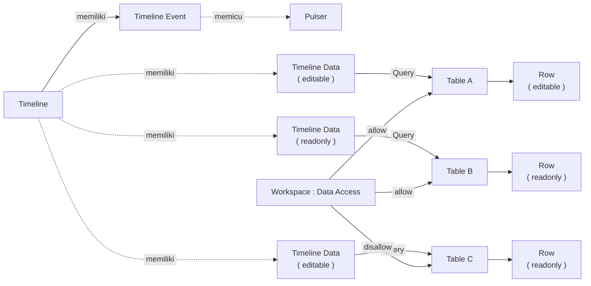

# Apa itu Timeline?

>**note** Timeline merupakan salah satu komponen dalam modul [[Docs/Modul Interface/Pengenalan|Interface]] di Phoenix.

Timeline adalah komponen yang menampilkan data dalam urutan waktu sehingga Anda dapat memantau jadwal, riwayat aktivitas, dan perkembangan suatu proses dengan lebih mudah.

Komponen ini cocok untuk perencanaan, pelacakan progres, serta melihat hubungan antar peristiwa dalam satu rentang waktu.

Timeline memiliki dua jenis isi, yaitu [[#Mengelola Timeline Event|Timeline Event]] untuk memicu otomasi terjadwal dan [[#Mengelola Timeline Data|Timeline Data]] untuk menampilkan data sumber di sumbu waktu. Keduanya tampil dalam satu halaman kerja yang dapat digeser, diperbesar, dan diperkecil.

## Mengapa Menggunakan Timeline?

- **Jadwal dan progres dalam satu pandangan.** Setiap data tampil sebagai blok di sumbu waktu sehingga rentang, urutan, dan tumpang tindih peristiwa langsung terlihat.
- **Jadwal dapat diubah langsung.** Geser blok untuk memindahkan waktu [[^field|Start]] atau [[^field|End]] tanpa membuka data sumber satu per satu.
- **Otomasi terjadwal.** [[#Mengelola Timeline Event|Timeline Event]] memicu Flow Block [[Docs/Modul Logic/Flow/Flow Block/Event/Pulser|Pulser]] satu kali atau berulang.
- **Beberapa data dalam satu halaman.** Satu Timeline dapat memiliki lebih dari satu [[#Mengelola Timeline Data|Timeline Data]] dengan [[Docs/Tipe Data/Query|Query]] yang berbeda.
- **Skala waktu fleksibel.** Ubah tampilan dari kuartal sampai detik dengan menu [[#Menu Konteks Timeline|Zoom]] atau *wheel* mouse.

## Konsep Utama

| Istilah | Penjelasan |
| ------- | ---------- |
| [[#Mengelola Timeline Event|Timeline Event]] | Pemicu [[Docs/Event/Apa itu Event|Event]] ke Flow Block Pulser pada waktu tertentu, dengan atau tanpa pengulangan. |
| [[#Mengelola Timeline Data|Timeline Data]] | Pembuka data sumber di sumbu waktu dengan bantuan Query. |
| [[#Query Timeline Data|Query]] | Aturan pengambilan data sumber. Bagian Show menandai kolom yang dipakai sebagai Name, Start, dan End. |
| [[Docs/Modul Logic/Flow/Flow Block/Event/Pulser|Pulser]] | Flow Block Event yang menerima pemicu dari Timeline Event. |
| [[Docs/Tipe Data/Row|Row]] | Satu data sumber. Setiap Row pada Timeline Data tampil sebagai satu blok. |
| [[#Hak Akses Timeline Data|Mode Timeline Data]] | Pengaturan `editable` atau `readonly` yang menentukan apakah Row dapat diubah dari Timeline. |
| [[#Menu Konteks Timeline|Zoom]] | Pengatur tingkat satuan waktu pada header, dari kuartal sampai detik. |
| [[#Preview dan Edit Row|Preview]] | Popup ringkasan Row yang terbuka saat Row diklik kiri. |

## Cara Kerja Timeline

Timeline mempertemukan dua hal dalam satu sumbu waktu: Timeline Event yang memicu Pulser sesuai jadwal, dan Timeline Data yang menampilkan Row dari data sumber berdasarkan Query.

Row hanya dapat diubah dari Timeline bila dua syarat terpenuhi: Timeline Data berada pada mode `editable` dan Data Access data sumber di Workspace mengizinkan. Lihat [[#Hak Akses Timeline Data]].

## Membuat Timeline

![[Docs/Modul Interface/Timeline/add-timeline.png]]
1. Buka folder tempat Timeline akan ditempatkan di [[Docs/Antarmuka#Area Manajemen Folder]]
2. Klik kanan ➜ [[^field/add|Add]] ➜ [[^field|Interface]] ➜ [[^field/timeline|Timeline]]
3. Isi [[^field|Name]] dan [[^field|Description]]
4. Klik [[^button|Create]]

>**success** Timeline berhasil dibuat
> Timeline yang baru dibuat belum memiliki isi dan menampilkan [[^field|Event is empty]] serta [[^field|Data is empty]]. Tambahkan isinya di [[#Menambahkan Timeline Event]] dan [[#Menambahkan Timeline Data]].

## Mengubah Timeline

1. Buka halaman kerja Timeline
2. Klik [[^button/edit|Edit]]
3. Ubah [[^field|Name]] atau [[^field|Description]]
4. Klik [[^button|Update]]

Untuk mengubah Timeline Event, lihat [[#Mengubah Timeline Event]]. Untuk mengubah nama Timeline Data, lihat [[#Mengubah Nama Timeline Data]].

## Menyegarkan Timeline

Klik [[^button/refresh|Refresh]] untuk memuat ulang tampilan.

## Menghapus Timeline

1. Buka folder yang berisi Timeline di [[Docs/Antarmuka#Area Manajemen Folder]]
2. Klik kanan Timeline ➜ [[^button/delete|Delete]]
3. Konfirmasi dengan klik [[^button|Delete]]

>**warning** Timeline Event dan Timeline Data ikut terhapus
> Seluruh Timeline Event dan Timeline Data beserta konfigurasi Query di dalam Timeline hilang. Flow Block Pulser yang sebelumnya dipicu Timeline Event tidak lagi menerima pemicu dari Timeline ini. Row pada data sumber tidak terhapus.

## Antarmuka Timeline

 ![[Docs/Modul Interface/Timeline/interface-timeline.png]]
Halaman kerja Timeline terdiri dari bilah navigasi di bagian atas dan area kerja di bagian bawah.

### Bilah navigasi Timeline terdiri dari:

| Tombol | Fungsi |
| ------ | ------ |
| Judul Timeline | Menampilkan ikon Timeline dan nama Timeline. |
| [[^button/edit|Edit]] | Mengubah atribut Timeline. Lihat [[#Mengubah Timeline]]. |
| [[^button/refresh|Refresh]] | Memuat ulang tampilan. |
| [[^field|Search Timeline Data...]] | Mencari kata kunci pada Timeline Data dan Timeline Event. |

### Area Kerja Timeline

| Area | Penjelasan |
| ---- | ---------- |
| [[^field|Item List]] | Kolom kiri berisi nama Timeline Event dan nama Row pada Timeline Data. |
| Header waktu | Baris di atas area kerja, misalnya [[^field|MonthYear]], [[^field|Week]], [[^field|Date]], [[^field|DateDayweek]], dan [[^field|Hour]]. Barisnya menyesuaikan tingkat [[#Menu Konteks Timeline|Zoom]]. |
| [[^field|now]] | Garis dan penanda yang menunjukkan waktu saat ini. |
| Grup Event | Judul `Event (n)` memuat Timeline Event, dengan n jumlah Timeline Event. Ikon jam di samping nama menandakan item tersebut Timeline Event. Jika kosong, tampil [[^field|Event is empty]] dan tombol [[^button/add|Add Event]]. |
| Grup Timeline Data | Judul berisi nama Timeline Data, jumlah Row hasil Query, dan tombol [[^button/q]] untuk mengatur Query. Jika belum ada, tampil [[^field|Data is empty]] dan tombol [[^button/add|Add Data]]. |
| Blok | Timeline Event dan Row tampil sebagai blok di sumbu waktu, dengan nama di sampingnya. |
| Panah pada judul grup | Klik panah di judul grup Event atau Timeline Data untuk melipat atau membuka grup tersebut. |

### Menu Konteks Timeline

Klik kanan pada area berikut untuk membuka menu konteks.

| Area | Menu |
| ---- | ---- |
| Blok Timeline Event | [[^field|Edit]], [[^field|Add Data]], [[^field|Add Event]], [[^field|Zoom]], [[^field|Delete Event]] |
| Judul Timeline Data | [[^field|Rename Data]], [[^field|Add Data]], [[^field|Add Event]], [[^field|Zoom]], [[^field|Delete Data]] |
| Row pada Timeline Data | [[^field|Edit]], [[^field|View]], [[^field|Add Row]], [[^field|Add Data]], [[^field|Add Event]], [[^field|Zoom]], [[^field|Delete Row]] |
| Bagian yang kosong | [[^field|Add Data]], [[^field|Add Event]], [[^field|Zoom]] |

[[^field|View]] membuka popup preview Row, sedangkan [[^field|Edit]] membuka form edit Row. Dampak penghapusan dijelaskan di [[#Menghapus Timeline Event]], [[#Menghapus Timeline Data]], dan [[#Menghapus Row]].

Menu [[^field|Zoom]] memiliki cabang berikut.

| Cabang | Fungsi |
| ------ | ------ |
| [[^field|Zoom In]], [[^field|Zoom Out]] | Memperbesar atau memperkecil skala rentang waktu. |
| [[^field|Quarter - Month]], [[^field|Month - Week]], [[^field|Week - Date]], [[^field|Week - Dayweek]], [[^field|Date - Hour]], [[^field|Time - 30 Minute]], [[^field|Time - 10 Minute]], [[^field|Time - 1 Minute]], [[^field|Minute - Second]] | Memilih tingkat satuan waktu pada header, dari kuartal sampai detik. |

### Preview dan Edit Row

![[Docs/Modul Interface/Timeline/preview-example.png]]
Klik kiri pada Row, atau pilih [[^field|View]] pada menu konteks Row, untuk membuka popup preview. Popup berisi bagian berikut.

| Bagian | Penjelasan |
| ------ | ---------- |
| Judul | Nama Row. |
| [[^field|Start]] dan [[^field|End]] | Waktu mulai dan waktu selesai Row. |
| [[^field|Duration]] | Lama waktu dari Start sampai End. |
| [[^field|Status]] | Kondisi Row terhadap waktu saat ini, yaitu [[^field|Upcoming]], [[^field|On Going]], atau [[^field|Finished]]. |
| [[^field|Calendar]] | Rentang tanggal dari Start sampai End. |
| [[^field|Relative]] | Keterangan waktu Row relatif terhadap waktu saat ini, misalnya sudah berakhir 180 hari lalu. |
| [[^field|Progress]] | Kemajuan Row. Hanya tampil ketika [[^field|Status]] bernilai [[^field|On Going]]. |
| [[^field|change time]] | Kontrol untuk menggeser waktu. Tombol panah di bawah label [[^field|start]] menggeser waktu Start, tombol panah di bawah label [[^field|end]] menggeser waktu End, dan pilihan satuan di tengah (misalnya 1 Day) menentukan besar pergeseran. Kontrol dibuka atau ditutup dengan ikon di kiri bawah popup, dan panahnya mengarah ke atas ketika kontrol terbuka. |
| [[^button/edit|Edit Row]] | Membuka modal form untuk mengubah Row. |

Hak akses untuk mengubah Row mengikuti [[#Hak Akses Timeline Data]].

### Interaksi Antarmuka Timeline

| Fungsi | Aksi |
| ------ | ---- |
| Berpindah posisi waktu | Gulir horizontal pada area kerja. Pada tampilan mobile, geser area kerja ke kiri atau kanan. |
| Menggulir Event dan Data | Geser area kerja ke atas atau bawah (vertikal). Ini berlaku jika jumlah Timeline Event dan Timeline Data melebihi tinggi layar. |
| Mengubah skala rentang waktu | Putar *wheel* mouse untuk mengubah *scale factor* rentang waktu Timeline. |
| Memindahkan waktu blok | Klik dan geser blok Timeline Data atau Timeline Event. Bagian kiri blok memindahkan waktu Start, bagian kanan memindahkan waktu selesai (End), dan bagian tengah memindahkan keduanya secara bersamaan. Hak aksesnya mengikuti [[#Hak Akses Timeline Event]] dan [[#Hak Akses Timeline Data]]. |
| Select dengan geser | Klik dan geser pada celah di antara header waktu dan blok data. |
| Select satu blok | Tekan Ctrl + Shift lalu klik blok untuk memilih rentang waktu blok tersebut secara otomatis. |
| Select pada area kerja | Tekan Shift lalu klik dan geser pada area kerja. |
| Memakai hasil Select | Menu konteks dan Zoom tetap sama. Saat [[^field|Add Row]], isian Start dan End terisi otomatis sesuai rentang Select. |
| Membuka preview Row | Klik kiri pada Row. Lihat [[#Preview dan Edit Row]]. |
| Membuka menu konteks | Klik kanan pada Timeline Event, Timeline Data, Row, atau bagian yang kosong. Lihat [[#Menu Konteks Timeline]]. |

## Mengelola Timeline Event

Timeline Event berfungsi untuk membuat *trigger* [[Docs/Event/Apa itu Event|Event]] ke Flow Block [[Docs/Modul Logic/Flow/Flow Block/Event/Pulser|Pulser]], dengan atau tanpa pengulangan. Timeline Event hanya memicu Pulser, sedangkan proses setelahnya diatur di [[Docs/Modul Logic/Flow/Apa itu Flow|Flow]].

### Atribut Timeline Event

| Atribut | Penjelasan |
| ------- | ---------- |
| [[^field|Name]] | Nama Timeline Event yang tampil di [[^field|Item List]]. |
| [[^field|Pulser Event]] | Flow Block Pulser yang akan dipicu. |
| [[^field|Start]] | Tanggal dan waktu pemicu pertama. |
| [[^field|Repeat]] | Menentukan apakah pemicu berulang. Bawaannya aktif. |
| [[^field|End]] | Tanggal dan waktu berakhirnya pengulangan. Hanya tampil ketika [[^field|Repeat]] aktif. |
| [[^field|Interval]] | Jarak waktu antar pemicu. Hanya tampil ketika [[^field|Repeat]] aktif. |
| [[^field|Active]] | Menentukan apakah jadwal berjalan. Bawaannya aktif. |

Pilihan [[^field|Interval]] adalah [[^field|Custom]], [[^field|Minutely]], [[^field|Hourly]], [[^field|Daily]], [[^field|Weekly]], [[^field|Monthly]], [[^field|Quarterly]], dan [[^field|Yearly]]. Pilihan [[^field|Custom]] memungkinkan jarak antar pemicu diisi dalam satuan menit.

>**note** Repeat dan field turunannya
> Field [[^field|End]] dan [[^field|Interval]] hanya tampil ketika [[^field|Repeat]] aktif. Jika [[^field|Repeat]] [[^value/boolean/false]], Timeline Event hanya memicu Pulser satu kali pada waktu [[^field|Start]].

>**note** Menonaktifkan jadwal
> Matikan [[^field|Active]] untuk menghentikan jadwal tanpa menghapus Timeline Event. Aktifkan kembali saat jadwal perlu berjalan.

### Menambahkan Timeline Event

![[Docs/Modul Interface/Timeline/add-timeline-event.png]]
1. Klik [[^button/add|Add Event]], atau klik kanan ➜ [[^field|Add Event]]
2. Isi [[^field|Name]]
3. Pilih Flow Block Pulser yang akan dipicu di [[^field|Pulser Event]]
4. Isi waktu mulai di [[^field|Start]]
5. Aktifkan [[^field|Repeat]] bila pemicu perlu berulang, lalu isi [[^field|End]] dan [[^field|Interval]]
6. Pastikan [[^field|Active]] aktif agar jadwal berjalan
7. Klik [[^button|Create]]

>**success** Timeline Event berhasil dibuat
> Pemicu berjalan pada jadwal yang ditentukan selama [[^field|Active]] aktif.

### Mengubah Timeline Event

1. Klik kanan blok Timeline Event ➜ [[^field|Edit]]
2. Ubah atribut yang diperlukan
3. Klik [[^button|Update]]

Waktu [[^field|Start]] dan [[^field|End]] juga dapat dipindahkan dengan menggeser blok, lihat [[#Interaksi Antarmuka Timeline]].

### Menghapus Timeline Event

1. Klik kanan blok Timeline Event ➜ [[^field|Delete Event]]
2. Konfirmasi dengan klik [[^button|Delete]]

>**warning** Hanya Timeline Event yang terhapus
> [[^field|Delete Event]] hanya menghapus Timeline Event. Flow Block Pulser tidak ikut terhapus, tetapi tidak lagi dipicu oleh Timeline Event tersebut. Bila jadwal hanya perlu dihentikan sementara, matikan [[^field|Active]].

### Hak Akses Timeline Event

Menambah, mengubah, menggeser, dan menghapus Timeline Event dibatasi Function Access [[^field|Modify Event]] di [[Docs/Modul Developer/Workspace/Apa itu Workspace|Workspace]].

## Mengelola Timeline Data

Timeline Data berfungsi untuk membuka data sumber di sumbu waktu dengan bantuan [[Docs/Tipe Data/Query|Query]]. Setiap Row hasil Query tampil sebagai satu blok. Satu Timeline dapat memiliki beberapa Timeline Data.

### Query Timeline Data

Query pada Timeline Data mengikuti kaidah Timeline Output ([[Docs/Tipe Data/Query#Timeline Output]]). Cara menyusun sumber data dan [[Docs/Tipe Data/Query#Filter|Filter]] sama seperti Query lainnya. Pada bagian [[Docs/Tipe Data/Query#Show or Hide|Show]], label [[^field|Name]], [[^field|Start]], dan [[^field|End]] menunjukkan [[Docs/Tipe Data/Column|Column]] yang dipakai Timeline.

| Label | Fungsi | Format Column |
| ----- | ------ | ------------- |
| [[^field|Name]] | Nama Row yang tampil di [[^field|Item List]] dan di samping blok. | - |
| [[^field|Start]] | Waktu mulai Row. | [[Docs/Tipe Data/DateTime]], [[Docs/Tipe Data/Date]], atau [[Docs/Tipe Data/DateTimeZone]] |
| [[^field|End]] | Waktu selesai Row. | [[Docs/Tipe Data/DateTime]], [[Docs/Tipe Data/Date]], atau [[Docs/Tipe Data/DateTimeZone]] |

Label yang wajib hanya [[^field|Name]] dan [[^field|Start]].

>**warning** Query belum valid
> Selama Query tidak memenuhi kaidah Timeline Output, misalnya belum menampilkan paling sedikit dua Column, Timeline Data menampilkan baris [[^field|Error]] dengan pesan "Query must at least have 2 showed columns!" dan tidak ada Row yang tampil. Penjelasan kesalahan lain ada di [[Docs/Tipe Data/Query#Error]].

### Menambahkan Timeline Data

1. Klik [[^button/add|Add Data]], atau klik kanan ➜ [[^field|Add Data]]
2. Timeline Data baru tampil dengan Query kosong ([[^field|Empty]]) dan nama awal `New Data (n)`
3. Klik [[^button/q]] pada Timeline Data untuk mengatur [[Docs/Tipe Data/Query|Query]]
4. Pada bagian [[Docs/Tipe Data/Query#Show or Hide|Show]], pastikan Column untuk label [[^field|Name]], [[^field|Start]], dan [[^field|End]] sudah sesuai
5. Tutup popup Query dengan klik di luar popup

>**success** Timeline Data berhasil diatur
> Query tersimpan otomatis ketika popup ditutup, dan Row hasil Query langsung tampil sebagai blok di sumbu waktu.

### Mengubah Query Timeline Data

1. Klik [[^button/q]] pada Timeline Data
2. Ubah Query
3. Tutup popup Query dengan klik di luar popup

Perubahan Query tersimpan otomatis dan Row menyesuaikan hasil Query yang baru. Tidak ada tombol simpan.

### Mengubah Nama Timeline Data

1. Klik kanan judul Timeline Data ➜ [[^field|Rename Data]]
2. Isi nama baru
3. Klik [[^button/ok|Ok]]

### Menghapus Timeline Data

1. Klik kanan judul Timeline Data ➜ [[^field|Delete Data]]
2. Konfirmasi dengan klik [[^button|Delete]]

>**warning** Hanya konfigurasi yang terhapus
> [[^field|Delete Data]] hanya menghapus konfigurasi dan Query Timeline Data. Row pada data sumber tidak terhapus.

### Hak Akses Timeline Data

Hak akses Timeline Data berlapis, sama seperti Table View.

- Menambah, mengubah (nama, Query, dan konfigurasi), serta menghapus Timeline Data mengikuti Data Access Timeline di [[Docs/Modul Developer/Workspace/Data Access]].
- Row dan isinya hanya dapat dikelola bila dua syarat terpenuhi, yaitu Timeline Data berada pada mode `editable` dan Data Access data sumber di Workspace mengizinkan.

| Mode Timeline Data | Data Access data sumber | Hasil pada Row |
| ------------------ | ----------------------- | -------------- |
| `editable` | [[^value/boolean/allow]] | Row dapat ditambah, diubah, dan dihapus, dan blok dapat digeser. |
| `editable` | [[^value/boolean/disallow]] | Row hanya dapat dilihat. |
| `readonly` | [[^value/boolean/allow]] | Row hanya dapat dilihat. |
| `readonly` | [[^value/boolean/disallow]] | Row hanya dapat dilihat. |

### Menambahkan Row

1. Klik kanan Row pada Timeline Data ➜ [[^field|Add Row]]
2. Isi form Row
3. Simpan Row

Jika Anda sudah melakukan [[#Interaksi Antarmuka Timeline|Select]], isian Start dan End terisi otomatis sesuai rentang yang dipilih.

### Melihat dan Mengubah Row

1. Klik kiri Row, atau klik kanan Row ➜ [[^field|View]], untuk membuka popup preview
2. Klik [[^button/edit|Edit Row]] di popup, atau klik kanan Row ➜ [[^field|Edit]], untuk membuka form edit
3. Ubah isian Row
4. Simpan perubahan

Isi popup preview dijelaskan di [[#Preview dan Edit Row]]. Waktu Start dan End juga dapat dipindahkan dengan menggeser blok atau dengan kontrol [[^field|change time]].

### Menghapus Row

1. Klik kanan Row ➜ [[^field|Delete Row]]
2. Konfirmasi dengan klik [[^button|Delete]]

>**danger** Row pada data sumber ikut terhapus
> [[^field|Delete Row]] menghapus Row dari data sumber, bukan hanya dari Timeline, dan tidak dapat dikembalikan.

## Contoh Penggunaan

**Pengingat harian untuk pekerjaan yang jatuh tempo**

Tim operasional mencatat setiap pekerjaan beserta tanggal mulai dan tenggatnya. Mereka ingin melihat sebaran pekerjaan di satu sumbu waktu, sekaligus menerima ringkasan setiap pagi tanpa perlu membuka Phoenix. Timeline menampilkan datanya, dan Timeline Event menjadwalkan pengirimannya.

**Komponen yang terlibat**

| Komponen | Peran |
| -------- | ----- |
| [[^field/table|Data Pekerjaan]] | Menyimpan pekerjaan beserta tanggal mulai dan tenggatnya. |
| [[^field/timeline|Jadwal Pekerjaan]] | Menampilkan pekerjaan sebagai blok di sumbu waktu lewat Timeline Data, dan menjadwalkan pengingat lewat Timeline Event. |
| [[^field/flow|Pengingat Pekerjaan]] | Menyusun ringkasan pekerjaan jatuh tempo dan mengirimkannya. |

**Alur di Flow**

| Langkah | Flow Block | Peran dalam alur | Hasil |
| ------- | ---------- | ---------------- | ----- |
| 1 | Timeline Event | Memicu Pulser setiap hari pada jam yang ditentukan ([[^field|Repeat]] aktif dengan [[^field|Interval]] [[^field|Daily]]). | Pemicu terkirim ke Pulser. |
| 2 | [[Docs/Modul Logic/Flow/Flow Block/Event/Pulser|Pulser]] | Menerima pemicu dari Timeline Event. | Alur dimulai. |
| 3 | [[Docs/Modul Logic/Flow/Flow Block/Query/Execute|Execute]] | Menjalankan Query untuk mengambil pekerjaan yang jatuh tempo hari ini. | Daftar pekerjaan jatuh tempo. |
| 4 | [[Docs/Modul Logic/Flow/Flow Block/Operator/Implode|Implode]] | Menggabungkan nama pekerjaan menjadi satu teks. | Ringkasan dalam bentuk teks. |
| 5 | [[Docs/Modul Logic/Flow/Flow Block/Modular/HTTP Request|HTTP Request]] | Mengirim ringkasan ke layanan pesan. | Ringkasan diterima tim. |

**Hasil yang dirasakan**

- Tim melihat seluruh pekerjaan beserta rentangnya dalam satu halaman, tanpa membuka data sumber.
- Ringkasan pekerjaan jatuh tempo tiba setiap pagi secara otomatis.
- Jika tenggat bergeser, tim cukup menggeser blok pada Timeline dan data sumber ikut berubah.

**Ide skenario lain**

| Jenis nilai | Contoh integrasi |
| ----------- | ---------------- |
| Jadwal perawatan | Timeline Data menampilkan jadwal perawatan peralatan, Timeline Event memicu Pulser untuk membuat tugas perawatan baru setiap bulan. |
| Pelacakan progres proyek | Timeline Data menampilkan tahapan proyek, Flow menghitung keterlambatan dari Status Row. |
| Riwayat aktivitas | Timeline Data menampilkan riwayat aktivitas dari Table log untuk memantau urutan kejadian. |
| Pembersihan berkala | Timeline Event memicu Pulser yang menjalankan Flow pembersihan data pada interval tertentu. |

Dengan Timeline, data yang tersebar menjadi satu gambaran waktu yang dapat diubah langsung, dan jadwal yang sama dapat menjalankan otomasi tanpa langkah manual.

## Praktik Terbaik

- **Atur Query secermat mungkin** dan pastikan Column Name, Start, dan End sesuai agar blok tampil benar.
- **Pisahkan Timeline Data berdasarkan jenis data** atau tahapan agar halaman mudah dibaca.
- **Beri nama Timeline Event yang menjelaskan tujuannya**, misalnya pengingat atau pembersihan, agar mudah dikenali di [[^field|Item List]].
- **Uji Pulser lebih dulu** dengan tombol Trigger pada Flow sebelum menjadwalkannya di Timeline Event.
- **Matikan [[^field|Active]]** bila jadwal hanya perlu dihentikan sementara, daripada menghapus Timeline Event.
- **Gunakan Select sebelum [[^field|Add Row]]** agar Start dan End langsung terisi sesuai rentang yang Anda pilih.
- **Gunakan [[#Menu Konteks Timeline|Zoom]] yang sesuai** dengan rentang data, misalnya Month - Week untuk jadwal bulanan dan Date - Hour untuk jadwal harian.

>**success** Pastikan Timeline Event aktif
> Jadwal hanya berjalan bila [[^field|Active]] aktif pada Timeline Event.

## Batasan dan Catatan

- Timeline Event hanya memicu [[Docs/Modul Logic/Flow/Flow Block/Event/Pulser|Pulser]]. Proses setelahnya diatur di [[Docs/Modul Logic/Flow/Apa itu Flow|Flow]].
- Field [[^field|End]] dan [[^field|Interval]] hilang bila [[^field|Repeat]] [[^value/boolean/false]], sehingga Timeline Event hanya terpicu satu kali.
- Pengelolaan Timeline Event dibatasi Function Access [[^field|Modify Event]] di [[Docs/Modul Developer/Workspace/Apa itu Workspace|Workspace]].
- Query Timeline Data mengikuti kaidah Timeline Output. Label [[^field|Name]] dan [[^field|End]] wajib, dan Column untuk [[^field|Start]] serta [[^field|End]] harus berformat DateTime, Date, atau DateTimeZone. Bila tidak terpenuhi, Timeline Data menampilkan [[^field|Error]].
- Row hanya dapat diubah, ditambah, dihapus, dan digeser bila Timeline Data `editable` dan [[Docs/Modul Developer/Workspace/Data Access]] data sumber mengizinkan.
- [[^field|Delete Event]] hanya menghapus Timeline Event dan [[^field|Delete Data]] hanya menghapus konfigurasi dan Query. [[^field|Delete Row]] menghapus Row pada data sumber dan tidak dapat dikembalikan.
- [[^field|Progress]] pada popup preview hanya tampil ketika [[^field|Status]] bernilai [[^field|On Going]].
- Zoom dan *wheel* hanya mengubah tampilan, bukan data.
- Menghapus Timeline menghapus seluruh Timeline Event dan Timeline Data di dalamnya, dan Pulser yang terhubung tidak lagi dipicu dari Timeline tersebut.

## TL:DR

- **Definisi:** Timeline menampilkan data dalam urutan waktu untuk memantau jadwal, riwayat aktivitas, dan progres.
- **Isi:** Timeline Event memicu Pulser dengan atau tanpa pengulangan, Timeline Data menampilkan Row dari data sumber lewat Query.
- **Antarmuka:** bilah navigasi di atas dan area kerja di bawah, dengan menu konteks dan menu [[^field|Zoom]] dari klik kanan.
- **Membangun:** tambahkan isi dengan [[^button/add|Add Event]] dan [[^button/add|Add Data]], lalu atur Query lewat [[^button/q]] yang tersimpan otomatis.
- **Interaksi:** gulir, *wheel*, pindahkan blok, dan Select. Klik kiri Row membuka preview, dan Select mengisi Start dan End saat [[^field|Add Row]].
- **Hati-hati:** Row hanya dapat diubah bila `editable` dan Data Access mengizinkan, Query harus valid, dan [[^field|Delete Row]] menghapus data sumber.

## FAQ : Pertanyaan yang Sering Diajukan

> **faq**
> **Apa bedanya Timeline Event dan Timeline Data?**
> [[#Mengelola Timeline Event|Timeline Event]] memicu Flow Block [[Docs/Modul Logic/Flow/Flow Block/Event/Pulser|Pulser]] pada waktu tertentu, sedangkan [[#Mengelola Timeline Data|Timeline Data]] menampilkan Row dari data sumber di sumbu waktu.
> **Mengapa field End dan Interval tidak muncul?**
> Keduanya hanya tampil ketika [[^field|Repeat]] aktif. Aktifkan [[^field|Repeat]] pada Timeline Event untuk mengisinya.
> **Bagaimana menghentikan jadwal Timeline Event tanpa menghapusnya?**
> Matikan [[^field|Active]] pada Timeline Event. Jadwal berhenti dan Timeline Event tetap ada.
> **Apakah menghapus Timeline Event ikut menghapus Pulser?**
> Tidak. [[^field|Delete Event]] hanya menghapus Timeline Event, sedangkan Pulser tetap ada di Flow.
> **Mengapa Timeline Data menampilkan Error?**
> Query belum memenuhi kaidah Timeline Output, misalnya belum menampilkan paling sedikit dua Column. Klik [[^button/q]], lalu periksa bagian [[Docs/Tipe Data/Query#Show or Hide|Show]].
> **Apakah menggeser blok mengubah data sumber?**
> Ya, bila Timeline Data `editable` dan [[Docs/Modul Developer/Workspace/Data Access]] data sumber mengizinkan. Jika salah satu tidak terpenuhi, blok tidak dapat digeser.
> **Bagaimana menambah Row dengan rentang waktu tertentu?**
> Lakukan Select pada rentang waktu yang diinginkan, lalu pilih [[^field|Add Row]]. Isian Start dan End terisi otomatis.
> **Bagaimana melihat rentang waktu yang lebih detail?**
> Putar *wheel* mouse, atau klik kanan ➜ [[^field|Zoom]] lalu pilih tingkat satuan waktu, misalnya [[^field|Date - Hour]].