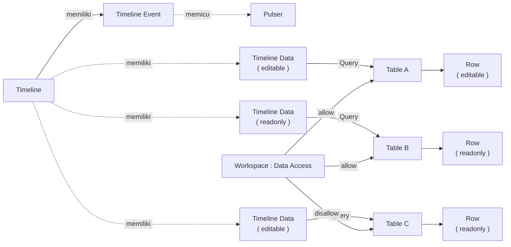

# Cara Kerja Timeline

Timeline mempertemukan dua hal dalam satu sumbu waktu: Timeline Event yang memicu Pulser sesuai jadwal, dan Timeline Data yang menampilkan Row dari data sumber berdasarkan Query.

Row hanya dapat diubah dari Timeline bila dua syarat terpenuhi: Timeline Data berada pada mode `editable` dan Data Access data sumber di Workspace mengizinkan. Lihat [[#Hak Akses Timeline Data]].
