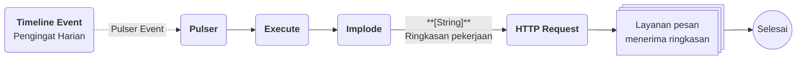

# Contoh Penggunaan Timeline

## Studi Kasus : Pengingat harian untuk pekerjaan yang jatuh tempo

Tim operasional mencatat setiap pekerjaan beserta tanggal mulai dan tenggatnya. Mereka ingin melihat sebaran pekerjaan di satu sumbu waktu, sekaligus menerima ringkasan setiap pagi tanpa perlu membuka Phoenix. Timeline menampilkan datanya, dan Timeline Event menjadwalkan pengirimannya.

## Komponen yang terlibat

| Komponen | Peran |
| -------- | ----- |
| [[^field/table|Data Pekerjaan]] | Menyimpan pekerjaan beserta tanggal mulai dan tenggatnya. |
| [[^field/timeline|Jadwal Pekerjaan]] | Menampilkan pekerjaan sebagai blok di sumbu waktu lewat Timeline Data, dan menjadwalkan pengingat lewat Timeline Event. |
| [[^field/flow|Pengingat Pekerjaan]] | Menyusun ringkasan pekerjaan jatuh tempo dan mengirimkannya. |

## Alur di Flow

| Langkah | Flow Block | Peran dalam alur | Hasil |
| ------- | ---------- | ---------------- | ----- |
| 1 | Timeline Event | Memicu Pulser setiap hari pada jam yang ditentukan ([[^field|Repeat]] aktif dengan [[^field|Interval]] [[^field|Daily]]). | Pemicu terkirim ke Pulser. |
| 2 | [[Docs/Modul Logic/Flow/Flow Block/Event/Pulser|Pulser]] | Menerima pemicu dari Timeline Event. | Alur dimulai. |
| 3 | [[Docs/Modul Logic/Flow/Flow Block/Query/Execute|Execute]] | Menjalankan Query untuk mengambil pekerjaan yang jatuh tempo hari ini. | Daftar pekerjaan jatuh tempo. |
| 4 | [[Docs/Modul Logic/Flow/Flow Block/Operator/Implode|Implode]] | Menggabungkan nama pekerjaan menjadi satu teks. | Ringkasan dalam bentuk teks. |
| 5 | [[Docs/Modul Logic/Flow/Flow Block/Modular/HTTP Request|HTTP Request]] | Mengirim ringkasan ke layanan pesan. | Ringkasan diterima tim. |

## Hasil yang dirasakan

- Tim melihat seluruh pekerjaan beserta rentangnya dalam satu halaman, tanpa membuka data sumber.
- Ringkasan pekerjaan jatuh tempo tiba setiap pagi secara otomatis.
- Jika tenggat bergeser, tim cukup menggeser blok pada Timeline dan data sumber ikut berubah.

## Ide skenario lain

| Jenis nilai | Contoh integrasi |
| ----------- | ---------------- |
| Jadwal perawatan | Timeline Data menampilkan jadwal perawatan peralatan, Timeline Event memicu Pulser untuk membuat tugas perawatan baru setiap bulan. |
| Pelacakan progres proyek | Timeline Data menampilkan tahapan proyek, Flow menghitung keterlambatan dari Status Row. |
| Riwayat aktivitas | Timeline Data menampilkan riwayat aktivitas dari Table log untuk memantau urutan kejadian. |
| Pembersihan berkala | Timeline Event memicu Pulser yang menjalankan Flow pembersihan data pada interval tertentu. |

Dengan Timeline, data yang tersebar menjadi satu gambaran waktu yang dapat diubah langsung, dan jadwal yang sama dapat menjalankan otomasi tanpa langkah manual.jaga sistem lain tetap sinkron.