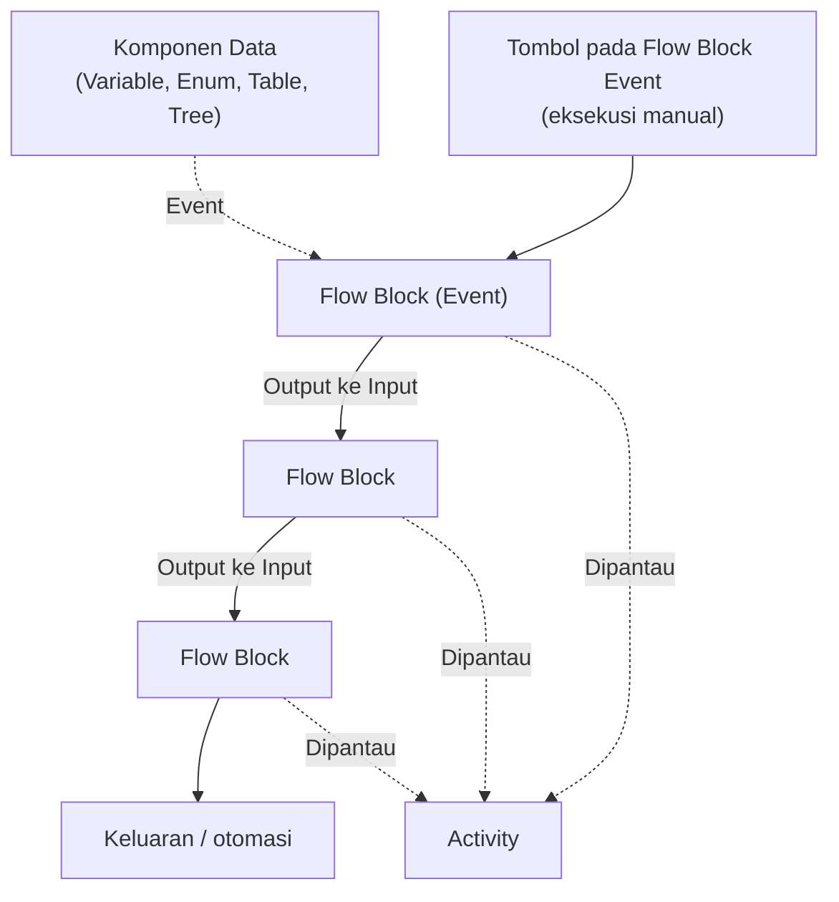

# Cara Kerja Flow
Flow Block Event memicu proses, lalu hasilnya mengalir lewat koneksi dari satu Flow Block ke Flow Block berikutnya hingga menghasilkan keluaran.

Flow Block hanya terhubung dari output ke input. Garis putus-putus menandakan relasi yang tidak selalu dipakai, misalnya Flow Block Event yang dipicu dari komponen data atau dijalankan manual.