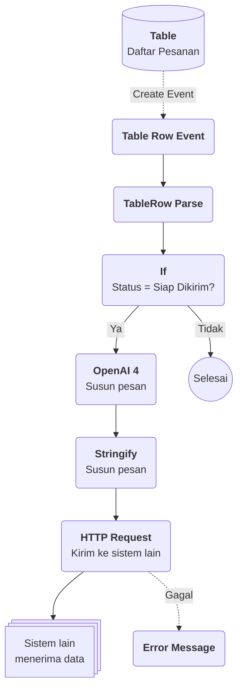

# Contoh Penggunaan Flow

## Studi Kasus : Mengirim informasi ke sistem lain ketika ada perubahan data

Bayangkan tim operasional Anda mencatat pesanan pelanggan pada sebuah Table. Selama ini, setiap pesanan yang siap dikirim harus disalin manual ke aplikasi logistik, lalu pelanggan dikabari satu per satu. Dengan Flow, perubahan data pada Table tersebut dapat langsung diteruskan ke sistem lain secara otomatis, lengkap dengan pesan pemberitahuan yang disusun oleh AI.

## Komponen yang terlibat

| Komponen | Peran |
| --- | --- |
| [[^field/table|Daftar Pesanan]] | Sumber data. Setiap baris adalah satu pesanan beserta nomor pesanan, pelanggan, status, dan total. |
| [[^field/enum|Status Pesanan]] | Pilihan status yang dipakai pada kolom status, misalnya Baru, Diproses, Siap Dikirim, dan Terkirim. |
| [[^field/flow|Notifikasi Pesanan]] | Flow yang berisi rangkaian Flow Block untuk meneruskan data pesanan. |
| Sistem lain | Aplikasi logistik atau aplikasi pesan yang menerima data melalui API. |

## Alur di Flow

| Langkah | Flow Block | Peran dalam alur | Hasil |
| --- | --- | --- | --- |
| 1 | [[Docs/Modul Logic/Flow/Flow Block/Event/Table Row Event|Table Row Event]] | Dihubungkan ke Daftar Pesanan melalui tombol pada Table, lalu terpicu ketika baris pesanan berubah. | Data baris pesanan masuk ke Flow. |
| 2 | [[Docs/Modul Logic/Flow/Flow Block/Operator/Table/TableRow Parse|TableRow Parse]] | Mengurai baris menjadi nilai per kolom: nomor pesanan, pelanggan, status, dan total. | Setiap nilai kolom siap dipakai block berikutnya. |
| 3 | [[Docs/Modul Logic/Flow/Flow Block/Operator/Boolean/If|If]] | Memeriksa apakah status pesanan adalah Siap Dikirim. | Hanya perubahan yang relevan yang dilanjutkan. |
| 4 | [[Docs/Modul Logic/Flow/Flow Block/Modula/AI/OpenAI]] | Menyusun pesan pemberitahuan yang ramah dari data pesanan. | Teks pesan siap kirim. |
| 5 | [[Docs/Modul Logic/Flow/Flow Block/Operator/Object/Stringify|Stringify]] | Mengubah data pesanan dan pesan menjadi teks yang siap dikirim. | Muatan data (*payload*) siap dikirim. |
| 6 | [[Docs/Modul Logic/Flow/Flow Block/Modular/API/HTTP Request|HTTP Request]] | Mengirim muatan data ke aplikasi logistik atau aplikasi pesan. | Sistem lain menerima pesanan. |
| 7 | [[Docs/Modul Logic/Flow/Flow Block/Error/Error Message|Error Message]] | Menampilkan pesan kesalahan bila pengiriman gagal. | Kegagalan terlihat dan dapat ditelusuri di [[Docs/Modul Logic/Flow/Flow Activity|Flow Activity]]. |

## Hasil yang dirasakan

* **Tanpa input ulang.** Tim cukup memperbarui status pesanan di Phoenix, sedangkan pengiriman data ke sistem lain berjalan otomatis.
* **Pelanggan lebih cepat terinformasi.** Pesan pemberitahuan terkirim begitu status berubah, tanpa menunggu tim mengabari satu per satu.
* **Mudah ditelusuri.** Setiap proses tercatat sehingga Anda dapat memeriksa pesanan mana yang berhasil dan gagal terkirim.
* **Data tetap satu sumber.** Pesanan tetap dikelola di Phoenix, sistem lain hanya menerima salinan yang dibutuhkan.

## Ide skenario lain

| Pemicu | Contoh integrasi |
| --- | --- |
| [[Docs/Modul Logic/Flow/Flow Block/Event/Variable Event|Variable Event]] | **Peringatan stok menipis.** Saat nilai Variable stok turun di bawah batas, kirim peringatan ke tim pengadaan melalui aplikasi pesan. |
| [[Docs/Modul Logic/Flow/Flow Block/Event/Enum Data Event|Enum Data Event]] | **Kabar status layanan.** Saat status tiket berubah, kabari pelanggan melalui sistem komunikasi yang sudah mereka pakai. |
| [[Docs/Modul Logic/Flow/Flow Block/Event/Tree Node Event|Tree Node Event]] | **Sinkronisasi struktur.** Saat node pada struktur organisasi atau kategori produk berubah, perbarui sistem kepegawaian atau katalog. |
| [[Docs/Modul Logic/Flow/Flow Block/Event/Pulser|Pulser]] | **Ringkasan berkala.** Ambil data Table, minta [[Docs/Modul Logic/Flow/Flow Block/Modular/AI/OpenAI 4|OpenAI 4]] meringkasnya menjadi laporan singkat, lalu kirim ke manajemen. |

Dengan satu Flow, data yang Anda kelola di Phoenix tidak berhenti sebagai catatan, tetapi langsung menjadi tindakan di sistem lain tanpa perlu disalin ulang.