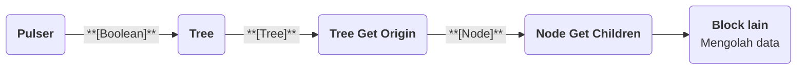

# Flow Block Data Tree

>**note** Flow Block Data Tree merupakan salah satu kelompok [[Docs/Modul Logic/Flow/Flow Block/Pengenalan|Flow Block]] pada kategori Data dalam komponen [[Docs/Modul Logic/Flow/Apa itu Flow|Flow]] di Phoenix.

Flow Block Data Tree adalah kelompok [[Docs/Modul Logic/Flow/Flow Block/Pengenalan|Flow Block]] yang dipakai untuk mengakses komponen [[Docs/Modul Data/Tree/Apa itu Tree|Tree]] melalui logika [[Docs/Modul Logic/Flow/Apa itu Flow|Flow]]. Dengan kelompok ini, alur Anda dapat menunjuk [[Docs/Tipe Data/Tree]] dan [[Docs/Tipe Data/Node]], menelusuri hubungan antar Node (induk, anak, dan leluhur), serta menambah, menetapkan, mengubah, dan menghapus Node secara otomatis, tanpa membuka halaman kerja Tree.

Berbeda dengan [[Docs/Modul Logic/Flow/Flow Block/Event/Pengenalan|Flow Block Event]] yang menjadi titik awal alur dan memiliki Control serta output yang mirip, block Data bekerja setelah menerima data dari block sebelumnya sehingga tunduk pada [[Docs/Modul Logic/Flow/Flow Block/Syarat Eksekusi|Syarat Flow Block Diproses]]. Setiap block pada kelompok ini juga unik sesuai fungsinya: ada yang menunjuk Tree atau Node, ada yang menelusuri hubungan Node, dan ada yang mengelola Node. Karena itu Anda memilih block berdasarkan peran yang dibutuhkan di alur, bukan berdasarkan pola input dan output yang seragam.

![[Docs/Modul Logic/Flow/Flow Block/Data Tree/data-tree-block-flow.png|Sepuluh Flow Block Data Tree pada Blueprint: Add Node, Assign Node, Delete Node, Node, Node Get Ancestor, Node Get Children, Node Get Parent, Node Setter, Tree, dan Tree Get Origin]]

<!--

  * [TODO] Letakkan screenshot sepuluh block Data Tree pada Blueprint dengan nama file `data-tree-block-flow.png` di folder `Docs/Modul Logic/Flow/Flow Block/Data Tree/`. Saran anotasi: nomor penanda 1 sampai 10 mengikuti urutan baris pada tabel [[#Jenis Flow Block Data Tree]]. Sesuaikan keterangan gambar bila jumlah atau urutan block pada screenshot berbeda.

-->

## Peran Data Tree dalam Flow

Block Data Tree umumnya berada di tengah atau di ujung alur. Misalnya, alur menunjuk sebuah Tree, mengambil [[Docs/Tipe Data/Node]] Origin, menelusuri anak-anaknya, lalu meneruskan hasilnya ke block lain:

<!--

  * [TODO] Konfirmasi diagram: apakah Tree Block dapat langsung dihubungkan dari Pulser, bagaimana tipe data output Node Get Children (dikosongkan pada diagram, kemungkinan kumpulan Node), dan apakah Tree Get Origin menerima output Tree Block seperti pada diagram.

-->

>**note** Tree yang baru dibuat memiliki Node Origin
> Setiap Tree yang baru dibuat otomatis memiliki satu [[Docs/Tipe Data/Node]] bernama Origin. Block Tree Get Origin mengambil Node ini sebagai titik awal penelusuran.

>**note** Perubahan data oleh Flow tidak memicu Flow kembali
> Aksi menambahkan, mengubah, atau menghapus [[Docs/Tipe Data/Node]] yang dilakukan oleh block Data Tree tidak memicu [[Docs/Modul Logic/Flow/Flow Block/Event/Tree Node Event|Tree Node Event Block]]. Perubahan dari sumber lain, seperti pengisian manual di halaman kerja Tree, Import, atau Upload, tetap memicu Event.

## Jenis Flow Block Data Tree

Phoenix menyediakan sepuluh Flow Block Data Tree. Selengkapnya tentang komponennya lihat [[Docs/Modul Data/Tree/Apa itu Tree|Tree]].

| Block | Fungsi |
| --- | --- |
| [[Docs/Modul Logic/Flow/Flow Block/Data Tree/Add Node|Add Node Block]] | Menambahkan [[Docs/Tipe Data/Node]] baru ke sebuah [[Docs/Modul Data/Tree/Apa itu Tree|Tree]]. |
| [[Docs/Modul Logic/Flow/Flow Block/Data Tree/Assign Node|Assign Node Block]] | Menetapkan [[Docs/Tipe Data/Node]] ke posisi tertentu pada Tree, misalnya di bawah Node induk yang dipilih. |
| [[Docs/Modul Logic/Flow/Flow Block/Data Tree/Delete Node|Delete Node Block]] | Menghapus [[Docs/Tipe Data/Node]] dari sebuah [[Docs/Modul Data/Tree/Apa itu Tree|Tree]]. |
| [[Docs/Modul Logic/Flow/Flow Block/Data Tree/Node|Node Block]] | Menunjuk satu [[Docs/Tipe Data/Node]] agar dapat diteruskan ke block lain. |
| [[Docs/Modul Logic/Flow/Flow Block/Data Tree/Node Get Ancestor|Node Get Ancestor Block]] | Mengambil [[Docs/Tipe Data/Node]] leluhur dari sebuah Node. |
| [[Docs/Modul Logic/Flow/Flow Block/Data Tree/Node Get Children|Node Get Children Block]] | Mengambil [[Docs/Tipe Data/Node]] anak dari sebuah Node. |
| [[Docs/Modul Logic/Flow/Flow Block/Data Tree/Node Get Parent|Node Get Parent Block]] | Mengambil [[Docs/Tipe Data/Node]] induk dari sebuah Node. |
| [[Docs/Modul Logic/Flow/Flow Block/Data Tree/Node Setter|Node Setter Block]] | Mengubah atribut [[Docs/Tipe Data/Node]], yaitu [[^field|Name]], [[^field|Order]], [[^field|Parent]], dan [[^field|Children]]. |
| [[Docs/Modul Logic/Flow/Flow Block/Data Tree/Tree|Tree Block]] | Menunjuk satu [[Docs/Modul Data/Tree/Apa itu Tree|Tree]] agar dapat diteruskan ke block lain. |
| [[Docs/Modul Logic/Flow/Flow Block/Data Tree/Tree Get Origin|Tree Get Origin Block]] | Mengambil [[Docs/Tipe Data/Node]] Origin dari sebuah [[Docs/Modul Data/Tree/Apa itu Tree|Tree]]. |

<!--

  * [TODO] Konfirmasi fungsi Assign Node Block. Draf ini menebak dari nama (menetapkan Node ke posisi atau induk tertentu). Mohon jelaskan fungsinya dan perbedaannya dengan Add Node Block dan Node Setter Block (yang dapat mengubah Parent), apakah terkait dengan clone Node pada Tree Merger, serta input dan output-nya.
  * [TODO] Konfirmasi fungsi Node Get Ancestor Block: apakah mengambil seluruh leluhur sampai Origin atau hanya leluhur pada tingkat tertentu, dan apakah Node Get Children Block hanya mengambil anak langsung atau seluruh keturunan.
  * [TODO] Konfirmasi fungsi Node Block dan Tree Block. Draf ini menebak dari nama: keduanya menunjuk Node atau Tree. Mohon jelaskan bagaimana Node ditentukan (misalnya lewat Name atau ID) dan input serta output masing-masing.
  * [TODO] Konfirmasi perilaku block Data Tree pada Tree yang memakai Merger Mode atau External Read Only aktif (misalnya apakah Node clone atau Node terlindungi dapat diubah atau dihapus lewat Flow), agar dapat ditulis sebagai callout `>**warning**` di halaman ini atau di halaman block.
  * [TODO] Konfirmasi apakah Delete Node Block perlu callout `>**warning**` terkait Node yang memiliki anak (pada Tree Node Event, menghapus Node yang punya anak menghasilkan satu delete pada Node itu saja).

-->

## Memilih Flow Block Data Tree

| Kebutuhan Anda | Block yang dipilih |
| --- | --- |
| Menunjuk [[Docs/Modul Data/Tree/Apa itu Tree|Tree]] atau [[Docs/Tipe Data/Node]] tertentu untuk dipakai block lain. | [[Docs/Modul Logic/Flow/Flow Block/Data Tree/Tree|Tree Block]], [[Docs/Modul Logic/Flow/Flow Block/Data Tree/Node|Node Block]] |
| Memulai penelusuran dari Node Origin. | [[Docs/Modul Logic/Flow/Flow Block/Data Tree/Tree Get Origin|Tree Get Origin Block]] |
| Menelusuri hubungan antar Node. | [[Docs/Modul Logic/Flow/Flow Block/Data Tree/Node Get Parent|Node Get Parent Block]], [[Docs/Modul Logic/Flow/Flow Block/Data Tree/Node Get Children|Node Get Children Block]], [[Docs/Modul Logic/Flow/Flow Block/Data Tree/Node Get Ancestor|Node Get Ancestor Block]] |
| Menambahkan [[Docs/Tipe Data/Node]] baru. | [[Docs/Modul Logic/Flow/Flow Block/Data Tree/Add Node|Add Node Block]] |
| Menempatkan [[Docs/Tipe Data/Node]] pada posisi tertentu di Tree. | [[Docs/Modul Logic/Flow/Flow Block/Data Tree/Assign Node|Assign Node Block]] |
| Mengubah atribut [[Docs/Tipe Data/Node]]. | [[Docs/Modul Logic/Flow/Flow Block/Data Tree/Node Setter|Node Setter Block]] |
| Menghapus [[Docs/Tipe Data/Node]] yang tidak dipakai lagi. | [[Docs/Modul Logic/Flow/Flow Block/Data Tree/Delete Node|Delete Node Block]] |

## Lihat Juga

- [[Docs/Modul Logic/Flow/Flow Block/Data/Pengenalan|Flow Block Data]]
- [[Docs/Modul Logic/Flow/Flow Block/Pengenalan|Flow Block]]
- [[Docs/Modul Data/Tree/Apa itu Tree|Tree]]
- [[Docs/Modul Data/Tree/Mengotomasi|Mengotomasi Tree]]
- [[Docs/Modul Logic/Flow/Flow Activity|Flow Activity]]

<!--

  * [TODO] Halaman baru yang diasumsikan pada draf ini: (1) `Docs/Modul Logic/Flow/Flow Block/Data/Pengenalan` sebagai pengantar kategori Data yang memuat keempat kelompok; (2) halaman per block di `Docs/Modul Logic/Flow/Flow Block/Data Tree/<Nama Block>` (Add Node, Assign Node, Delete Node, Node, Node Get Ancestor, Node Get Children, Node Get Parent, Node Setter, Tree, Tree Get Origin), mengikuti pola folder `Data Tree/Pengenalan` yang Anda berikan. Skill sebelumnya memakai pola `Data/<Grup>/<Nama>`, mohon konfirmasi pola yang dipakai. Halaman `Docs/Modul Data/Tree/Mengotomasi` mengikuti pola yang sudah ada.

-->